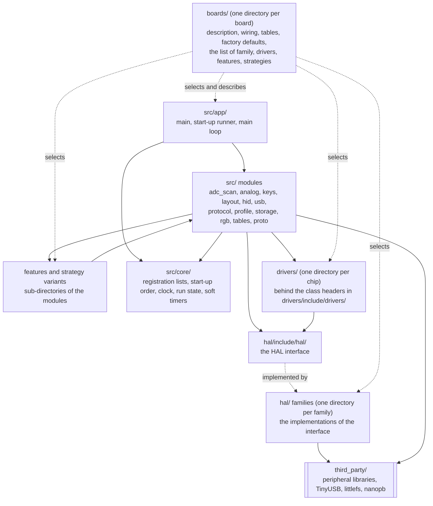
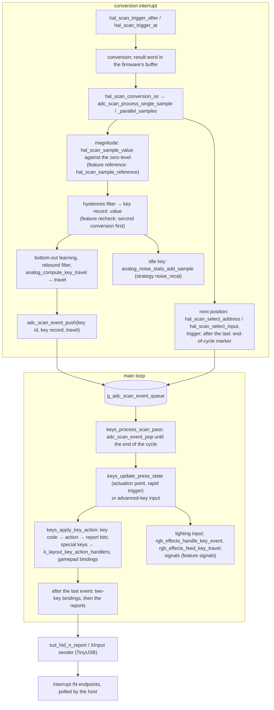
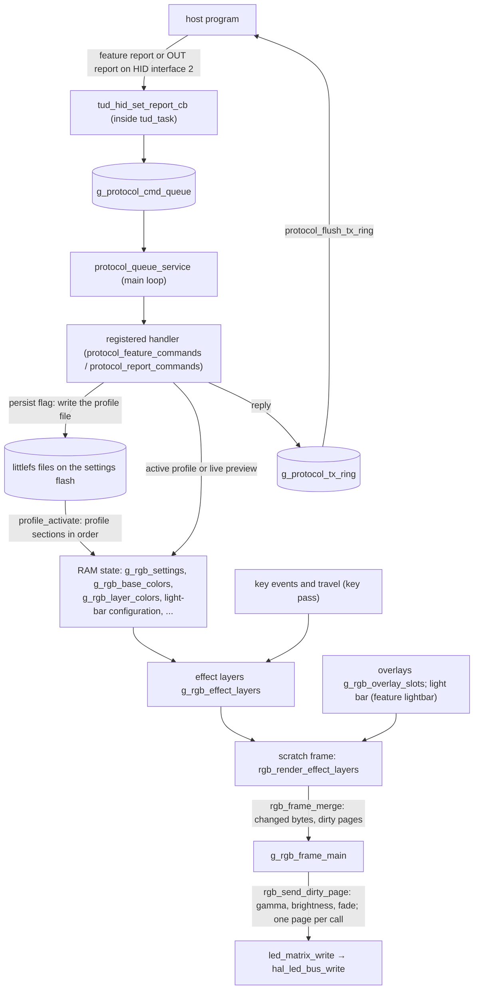

# Firmware architecture

This document is the entry point for a reader of the source tree. It explains how the tree is divided into layers, what each layer and module is responsible for, what the firmware asks of a microcontroller, how optional parts and board-specific algorithms are selected, how modules register their start-up steps, profile sections and host commands, and how data moves from a hall sensor to a USB report and from a stored setting to an LED.

Related documents: [building](building.md) (toolchain, `make`, how the source list is formed), [porting](porting.md) (adding a board, a microcontroller family, a driver, a feature, a strategy), [hardware](hardware.md) (the electronics as the firmware uses them), [protocol](protocol.md) (USB interfaces and the host protocol), [storage](storage.md) (files and formats), [layout](layout.md) (key and LED positions), [extending-keys](extending-keys.md) and [extending-rgb](extending-rgb.md) (the analog and lighting pipelines in detail), [flashing](flashing.md), [bootloader](bootloader.md).

## Overview

The firmware is a bare-metal C program without an operating system:

- One endless main loop does all work that is not time-critical: USB stack, key logic, lighting, host protocol, file access.
- Interrupts serve a 1 ms tick, the end of every sensor conversion (the whole sensor scan runs in this interrupt) and the USB device controller.
- Four libraries are linked: the peripheral library of the microcontroller family (GigaDevice GD32F4xx or GD32F30x), TinyUSB (USB device stack), littlefs (file system on the settings flash chip) and the nanopb runtime (Protocol Buffers).

The firmware of each board behaves like that board's stock firmware 2.14.1: the same USB interfaces, the same host protocol and the same stored settings, so the vendor's configuration program and the settings already on a keyboard keep working. Where a defect is kept for that reason, the code says so in a comment that starts with `KNOWN ISSUE`.

The same source tree builds the firmware of every board in [`boards/`](../boards/). Nothing in `src/`, `drivers/` or `hal/include/` names a board or a microcontroller family; a board is described by its directory, and the build learns everything else from it ([building](building.md)).

## Layers

The tree has five layers, each a top-level directory. Dependencies point downwards only.



| Layer | Directory | Responsibility | Sees (include paths) |
| --- | --- | --- | --- |
| Board | `boards/<board>/` | Everything that is specific to one keyboard: its numbers (`board.h`), its pins (`wiring.h`), its data (`tables/`), its factory profiles (`defaults/`), its memory regions (`linker.ld`), what the host tool needs to know (`board.json`) and what its firmware consists of (`board.mk`). Description and data only, no logic. | `tables/` sees the board directory and `src/` (for element types); `defaults/` is compiled like `src/` |
| Firmware | `src/` | The firmware itself, the same for every board. `src/app/` sits on top; `src/core/` is used by everything. | the board's `board.h`, `src/`, `src/proto/`, the selected strategy variants, `drivers/include/`, `hal/include/` and the family's `inline/` headers, littlefs, nanopb, TinyUSB |
| Drivers | `drivers/<chip>/` | One directory per chip on the board (LED matrix driver, settings flash), written against the HAL only | the board's `board.h`, `drivers/include/`, `hal/include/` and the family's `inline/` headers, TinyUSB |
| HAL interface | `hal/include/hal/` | What the firmware and the drivers need from a microcontroller, described by need (start a conversion, write bytes to the LED bus, read the microsecond count), not by peripheral | nothing but the family's `inline/` headers |
| Family | `hal/<family>/` | The implementation of the interface for one microcontroller family, its vector table, reset code, clock tree and section layout; the only code that uses a peripheral library or touches a register | the board's `board.h` and `wiring.h`, the HAL interface, its own directory, its peripheral library, TinyUSB |
| Libraries | `third_party/` | Upstream code, see [`third_party/README.md`](../third_party/README.md) | |

The include paths are set per layer in the [`Makefile`](../Makefile), so most violations do not compile: `src/` and `drivers/` have no path to a peripheral library or into a family directory (apart from its `inline/` headers), and a family has no path into `src/`. `make check` enforces the rest; `python3 tools/check_tree.py --list-rules` prints the rules:

| Rule | What it enforces |
| --- | --- |
| `layers` | the top level holds the layer directories and nothing else |
| `layer-include` | `src/`, `drivers/` and `hal/include/` include no header of a peripheral library, of a family directory (apart from its inline headers), the board's `wiring.h`, or a directory outside the layers |
| `app-include` | no file outside `src/app/` includes a header of `src/app/` |
| `register` | `src/`, `drivers/` and `hal/include/` contain no address of a peripheral register |
| `identity-conditional` | no preprocessor conditional in `src/`, `drivers/`, `hal/include/` on a board, family or device name |
| `names`, `display-names` | no board or family directory name, and no name a board is sold under, in the shared code (and no directory name in the `Makefile` and the host tool) |
| `feature-define` | `FEATURE_<NAME>` occurs only in the public header of that feature |
| `hal-files`, `hal-area`, `hal-functions`, `hal-inline`, `hal-registry` | every family has the same file names, implements every header and every function of the interface, keeps its inline headers free of library includes and keeps the registration lists in its section layout |
| `board-files`, `board-constants`, `board-wiring`, `board-json`, `board-layout` | every board has the same file set, the same `board.h` constants in the same order, the `wiring.h` constants its family asks for, a `board.json` that agrees with `board.h`, `linker.ld` and the vector table, and one key position file per layout variant |
| `driver-class`, `strategy-variants` | every driver names a class that has a header; every variant of a strategy slot has the same file names |

With `--elf`, the same script checks the registration lists of built images ([Registration](#registration)).

## Source tree

```
Makefile                       the build; names no board, family, driver, feature or strategy
boards/<board>/                board.mk, board.h, wiring.h, board.json, linker.ld, README.md,
                               tables/, defaults/, layout/
src/app/                       main, the start-up runner, the main loop, the start-up settings
src/core/                      registration lists, start-up order, clock, run state, soft timers
src/<module>/                  adc_scan, analog, keys, layout, hid, usb, protocol, profile,
                               storage, rgb; tables/ (constant tables shared by all boards);
                               proto/ (the settings schema and its generated code)
src/<module>/<feature>/        a feature: feature.mk, its public header, its sources
src/<module>/<slot>/           a strategy slot: strategy.mk, its interface header,
src/<module>/<slot>/<variant>/   one directory per variant
drivers/include/drivers/       one header per driver class (led_matrix.h, nor_flash.h)
drivers/<chip>/                driver.mk and the driver
hal/include/hal/               the HAL interface, one header per area
hal/<family>/                  hal.mk, one hal_<area>.c per area, inline/, startup.c, vectors.c,
                               system_clock.c, sections.ld, wiring_template.h
third_party/                   gd32f4xx, gd32f30x, tinyusb, littlefs, nanopb, patches
tools/                         openwoot.py (host tool), check_tree.py (tree check)
docs/                          documentation
```

## The firmware: `src/`

### Conventions

Every module has the same file pattern:

| File | Content |
| --- | --- |
| `<module>.h` | Public functions (some modules have more than one such header) |
| `<module>_types.h` | Structures, enumerations and constants. Layouts that stored data or the host depend on are guarded by `_Static_assert` on size and offsets. |
| `<module>_data.h`, `<module>_data.c` | Declarations and definitions of the module's RAM variables (`g_<module>_...`) |
| `<module>_init.c` | The module's start-up steps, each registered next to its function |
| other `.c` files | The code |

Constant tables are named `k_<module>_...`: those that are the same on every board live in [`src/tables/`](../src/tables/), those of one board in `boards/<board>/tables/`. A dimension of the board enters a module as a constant of its own, derived from `board.h` in the module's types header (`LAYOUT_ROWS` from `BOARD_KEY_ROWS`, `ADC_SCAN_MUX_COUNT` from `BOARD_MUX_COUNT`). Every header states in its first comment what the unit is for and what it depends on.

Headers are included with their directory below `src/` (`#include "rgb/rgb_frame.h"`) or below the board directory (`#include "tables/layout_tables.h"`); the file names of the two never collide.

### `app/` and `core/`

| Directory | Responsibility | Main files |
| --- | --- | --- |
| [`app/`](../src/app/) | The top of the firmware: `main` runs the registered start-up steps and then the main loop; the task bodies of one loop pass; the device settings applied at start-up. Nothing else includes its headers. | [`app/main.c`](../src/app/main.c) (`main`), [`app/tasks.c`](../src/app/tasks.c) (`hal_time_tick_isr`, `startup_run_active_task`, `startup_run_suspended_task`, `protocol_queue_service`), [`app/settings.c`](../src/app/settings.c) (`settings_load_and_apply`, `settings_apply_usb_mode`, `rebound_filter_option_init`) |
| [`core/`](../src/core/) | What every module uses and no module owns: the registration lists, the order of the start-up steps, the millisecond clock, the run-state flags and the software timers | [`core/registry.h`](../src/core/registry.h), [`core/startup.h`](../src/core/startup.h), [`core/clock.h`](../src/core/clock.h) (`g_clock_uptime_ms`, `clock_delay_ms`), [`core/run_state.h`](../src/core/run_state.h) (`g_run_state_flags`, `g_run_state_options`), [`core/soft_timer.h`](../src/core/soft_timer.h) (`soft_timers_service`) |

### Modules

| Module | Responsibility | Main files |
| --- | --- | --- |
| [`adc_scan/`](../src/adc_scan/) | The hall-sensor scan: the scan state machine in the conversion interrupt (start-up sweep, single-input and parallel scanning), the start of a scan cycle from the main loop, and the key event ring between the two | [`adc_scan_irq.c`](../src/adc_scan/adc_scan_irq.c) (`hal_scan_conversion_isr`), [`adc_scan_sample.c`](../src/adc_scan/adc_scan_sample.c) (`adc_scan_process_single_sample`, `adc_scan_process_parallel_samples`), [`adc_scan_control.c`](../src/adc_scan/adc_scan_control.c) (`adc_scan_start_cycle`), [`adc_scan_events.c`](../src/adc_scan/adc_scan_events.c), [`adc_scan_init.c`](../src/adc_scan/adc_scan_init.c) |
| [`analog/`](../src/analog/) | The per-key analog model: switch profiles, sensor value to key travel, bottom-out learning, release-rebound filter, scheduling of the idle noise recalibration | [`analog_types.h`](../src/analog/analog_types.h) (`analog_key_state_t`), [`analog_switch.c`](../src/analog/analog_switch.c) (`analog_compute_key_travel`), [`analog_bottom_out.c`](../src/analog/analog_bottom_out.c), [`analog_rebound.c`](../src/analog/analog_rebound.c), [`analog_recal.c`](../src/analog/analog_recal.c) |
| [`keys/`](../src/keys/) | The key logic: press decision (actuation point, rapid trigger), advanced keys, key actions, and the key pass that turns one scan cycle into HID reports | [`keys_scan_pass.c`](../src/keys/keys_scan_pass.c) (`keys_process_scan_pass`), [`keys_actuation.c`](../src/keys/keys_actuation.c) (`keys_update_press_state`), [`keys_actions.c`](../src/keys/keys_actions.c) (`keys_apply_key_action`), [`keys_advanced.c`](../src/keys/keys_advanced.c), [`keys_scan_pass_reports.c`](../src/keys/keys_scan_pass_reports.c) |
| [`layout/`](../src/layout/) | The physical layout variant of the unit, the keymap layers and the special-key (Fn) actions | [`layout_variant.c`](../src/layout/layout_variant.c) (`layout_select_variant`), [`layout_keymap.c`](../src/layout/layout_keymap.c) (`layout_load_keymap_layers`), [`layout_key_actions.c`](../src/layout/layout_key_actions.c) (`k_layout_key_action_handlers`) |
| [`hid/`](../src/hid/) | HID and XInput reports: report structures, gamepad stick math, the senders | [`hid_types.h`](../src/hid/hid_types.h), [`hid_gamepad.c`](../src/hid/hid_gamepad.c), [`hid_reports.c`](../src/hid/hid_reports.c) |
| [`usb/`](../src/usb/) | The glue around TinyUSB: its configuration, the descriptors, the mount and suspend call-backs, the XInput class driver | [`tusb_config.h`](../src/usb/tusb_config.h), [`usb_descriptors.c`](../src/usb/usb_descriptors.c), [`usb_callbacks.c`](../src/usb/usb_callbacks.c), [`usb_xinput.c`](../src/usb/usb_xinput.c), [`usb_init.c`](../src/usb/usb_init.c) |
| [`protocol/`](../src/protocol/) | The host configuration protocol: transport, command queue, dispatch through the registered command lists, and the command handlers grouped by subject | [`protocol.h`](../src/protocol/protocol.h), [`protocol_core.c`](../src/protocol/protocol_core.c), `protocol_device*.c`, [`protocol_profile.c`](../src/protocol/protocol_profile.c), `protocol_keys_*.c`, `protocol_rgb_*.c` |
| [`profile/`](../src/profile/) | Profiles: activation through the registered profile sections, the general profile settings, the factory defaults shared by all boards, the first boot | [`profile.h`](../src/profile/profile.h), [`profile_activate.c`](../src/profile/profile_activate.c) (`profile_activate`), [`profile_sections.c`](../src/profile/profile_sections.c), [`profile_cfg.c`](../src/profile/profile_cfg.c), [`profile_defaults.h`](../src/profile/profile_defaults.h), [`profile_default_files.c`](../src/profile/profile_default_files.c) |
| [`storage/`](../src/storage/) | The littlefs volume on the settings flash chip, whole files and profile files, the device settings, the serial number, and through two strategy slots the factory device information and the stored layout variant | [`storage.h`](../src/storage/storage.h), [`storage_bd.c`](../src/storage/storage_bd.c), [`storage_file.c`](../src/storage/storage_file.c), [`storage_profile_files.c`](../src/storage/storage_profile_files.c), [`storage_device_settings.c`](../src/storage/storage_device_settings.c), [`storage_serial.c`](../src/storage/storage_serial.c) |
| [`rgb/`](../src/rgb/) | The lighting: LED frame and its pages, effect layers and effect kinds, overlays, brightness, idle dimming, output to the LED matrix driver | [`rgb_frame_update.c`](../src/rgb/rgb_frame_update.c) (`rgb_update_frame`), [`rgb_frame.c`](../src/rgb/rgb_frame.c), [`rgb_effect_layers.c`](../src/rgb/rgb_effect_layers.c), `rgb_effect_kind_*.c`, [`rgb_overlay.c`](../src/rgb/rgb_overlay.c), [`rgb_brightness.c`](../src/rgb/rgb_brightness.c), [`rgb_init.c`](../src/rgb/rgb_init.c) |
| [`tables/`](../src/tables/) | Constant tables that are the same on every board: travel curves and switch data, key-code actions, USB descriptors, gamma curve and effect palette, host reply tables | `<module>_tables.c` and `.h`; [`analog_travel_curves.c`](../src/tables/analog_travel_curves.c) |
| [`proto/`](../src/proto/) | The schema of the stored settings and host messages, and the nanopb code generated from it; see [`src/proto/README.md`](../src/proto/README.md) | [`settings.proto`](../src/proto/settings.proto), [`settings.options`](../src/proto/settings.options), `settings.pb.c`, `settings.pb.h` |

## The HAL interface: `hal/include/hal/`

The interface is what the firmware asks of a microcontroller. Every header names an area; every family implements every header, either in `hal/<family>/hal_<area>.c` or, for functions on a hot path, as `static inline` functions in `hal/<family>/inline/hal_<area>_inline.h`, which the interface header includes at its end. Where the HAL needs something from the firmware, the interface declares a call-back that the firmware defines.

| Header | What the firmware asks for | Functions | Used by |
| --- | --- | --- | --- |
| [`hal_irq.h`](../hal/include/hal/hal_irq.h) | Mask interrupts around a short section and restore the previous state | `hal_irq_save`, `hal_irq_restore` (inline) | every module that shares data with an interrupt |
| [`hal_time.h`](../hal/include/hal/hal_time.h) | A 1 ms tick interrupt and a free-running microsecond count | `hal_time_start_tick`, `hal_time_start_micros`, `hal_time_micros` (inline); call-back `hal_time_tick_isr` | `app/tasks.c` (tick), `adc_scan`, `analog` (durations) |
| [`hal_system.h`](../hal/include/hal/hal_system.h) | Shared set-up, reset, and the messages exchanged with the bootloader across a reset: restart with an option, stay in update mode, the request to format the settings volume | `hal_system_init`, `hal_system_reset`, `hal_system_restart`, `hal_system_enter_update_mode`, `hal_system_take_format_request` | `app/main.c`, `protocol`, `storage` |
| [`hal_scan.h`](../hal/include/hal/hal_scan.h) | The converter side of the sensor scan: multiplexer inputs and address lines, a conversion triggered a given number of microseconds later, results delivered into a buffer of the firmware, single-input and parallel scanning | `hal_scan_init`, `hal_scan_select_input`, `hal_scan_enter_single`, `hal_scan_enter_parallel`, `hal_scan_sweep_enter_parallel`, `hal_scan_trigger_at`, `hal_scan_end_cycle`; inline `hal_scan_ack_conversion`, `hal_scan_sample_value`, `hal_scan_sample_reference`, `hal_scan_select_address`, `hal_scan_trigger_after`; call-backs `hal_scan_conversion_isr`, `hal_scan_wait_ms` | `adc_scan` |
| [`hal_led_bus.h`](../hal/include/hal/hal_led_bus.h) | The two-wire bus to the LED driver chip at 400 kHz, and the chip's enable line | `hal_led_bus_init`, `hal_led_bus_write`, `hal_led_bus_set_enable` | the LED matrix driver, `rgb/rgb_init.c` |
| [`hal_nor_bus.h`](../hal/include/hal/hal_nor_bus.h) | One command at a time to the settings flash chip: opcode, optional 24-bit address, dummy cycles, a data phase in one direction | `hal_nor_bus_init`, `hal_nor_bus_transfer_in`, `hal_nor_bus_transfer_out` | the NOR flash driver |
| [`hal_mcu.h`](../hal/include/hal/hal_mcu.h) | Facts and services of the chip itself: unique id, read protection, reading and (where allowed) programming its own flash, the user option byte | `hal_mcu_read_unique_id`, `hal_mcu_is_read_protected`, `hal_mcu_flash_read`, `hal_mcu_flash_write_page`, `hal_mcu_read_user_option` | `protocol`, `storage` and its strategy variants |
| [`hal_usb.h`](../hal/include/hal/hal_usb.h) | What happens around the USB controller outside TinyUSB: preparing it before the stack starts, limiting it to full speed, the root port | `hal_usb_prepare`, `hal_usb_limit_to_full_speed`, `hal_usb_root_port` | `usb/usb_init.c` |

The rest of a family directory:

| File | Content |
| --- | --- |
| `hal.mk` | What the build needs: processor options (`ARCH`), the TinyUSB binding (`HAL_DEFS`), the peripheral library files the family calls (`VENDOR_INCS`, `VENDOR_SRC`), the TinyUSB port driver (`TUSB_PORT_SRC`) |
| `startup.c` | `Reset_Handler` (copy `.data`, zero `.bss`, `SystemInit`, C library initialisation, `main`) and `Default_Handler` |
| `system_clock.c` | `SystemInit`: the clock tree, set up before `main` |
| `vectors.c` | The vector table `g_vector_table`; the entries that lead into the firmware are the HAL call-backs and the family's USB handlers |
| `sections.ld` | The section layout of an image, included by the board's `linker.ld`; contains the line that keeps the registration lists |
| `wiring_template.h` | Not compiled: the list of constants a board's `wiring.h` must define for this family |

Two families exist:

| Family | Microcontroller | USB | Boards |
| --- | --- | --- | --- |
| [`gd32f4xx`](../hal/gd32f4xx/) | GigaDevice GD32F425 (Cortex-M4F), 200 MHz from a 25 MHz crystal | high-speed controller with an external ULPI transceiver; TinyUSB driver `dcd_dwc2.c` | `wooting_80he` |
| [`gd32f30x`](../hal/gd32f30x/) | GigaDevice GD32F303 (Cortex-M4F), 120 MHz from the internal 8 MHz oscillator | full-speed controller; TinyUSB driver `dcd_stm32_fsdev.c` | `wooting_60he_plus` |

## Drivers and driver classes

A driver class is a header in [`drivers/include/drivers/`](../drivers/include/drivers/) that says what the firmware needs from one kind of chip. A driver is a directory `drivers/<chip>/` whose `driver.mk` names its class (`DRIVER_CLASS`) and whose code implements the class header using only the HAL interface. A board lists its drivers in `DRIVERS` of `board.mk`; the build requires exactly one driver of every class that exists.

| Class | Header | What the firmware needs | Drivers |
| --- | --- | --- | --- |
| `led_matrix` | [`led_matrix.h`](../drivers/include/drivers/led_matrix.h) | Bring the chip up, switch it between running and shut down, write a run of brightness values into a register bank: `led_matrix_init`, `led_matrix_set_running`, `led_matrix_write` | [`is31fl3741`](../drivers/is31fl3741/) (IS31FL3741, over `hal_led_bus.h`) |
| `nor_flash` | [`nor_flash.h`](../drivers/include/drivers/nor_flash.h) | Read, page program, sector erase, busy wait, manufacturer/device id, unique id: `nor_flash_init`, `nor_flash_read`, `nor_flash_program`, `nor_flash_erase_sector`, `nor_flash_wait_ready`, `nor_flash_read_id`, `nor_flash_read_unique_id` | [`spi_nor`](../drivers/spi_nor/) (serial NOR flash with the common command set, over `hal_nor_bus.h`) |

The chip's board-specific settings (bus address, operating configuration) are `board.h` constants (`BOARD_LED_DRIVER_ADDRESS`, `BOARD_LED_DRIVER_CONFIG_RUN`).

## Features

A feature is an optional part of the firmware that a board either has or does not have. It lives in its own directory inside the module it extends, `src/<module>/<feature>/`, which holds:

- `feature.mk`: a comment that says what the feature is, and `FEATURE_REQUIRES` if it needs another feature;
- one public header, `<feature>.h`: the only place where `FEATURE_<NAME>` appears. Under `#if FEATURE_<NAME>` it declares the feature's functions; under `#else` it defines the same functions as `static inline` functions that do nothing or return the neutral value. Callers are therefore the same on every board and contain no conditional;
- its sources, compiled only for a board that lists the feature. They hold everything that belongs to the feature: its state, its host commands, its profile sections and start-up steps (registered like those of a module), its settings files.

A board lists its features in `FEATURES` of `board.mk`; the build defines `FEATURE_<NAME>=1` for those and `=0` for every other feature. Constants a feature needs from the board are in a block `---- Feature: <name>` at the end of `board.h`, present only on boards that list the feature.

| Feature | Directory | What it contains | Boards |
| --- | --- | --- | --- |
| `signals` | [`src/rgb/signals/`](../src/rgb/signals/) | Named live values (lock states, active layer and profile, key rate, brightness, values set by the host) that lighting elements subscribe to; the key-rate window; host commands 65 (feature) and 31 (report); three profile sections and one start-up step | `wooting_80he` |
| `lightbar` | [`src/rgb/lightbar/`](../src/rgb/lightbar/) | A row of LEDs that are not under keys, with its own configuration files (`lb`, `lbm`, `glb`, `glbm`), effects, conditions, brightness and overlay; host commands 66 to 68, 70, 71 (feature) and 30, 32 to 35 (report); one profile section and two start-up steps. Requires `signals`. Board constants `BOARD_LIGHTBAR_LED_COUNT`, `BOARD_LIGHTBAR_LEDS`. | `wooting_80he` |
| `edition` | [`src/profile/edition/`](../src/profile/edition/) | Special-edition units: a unit whose serial number carries one of the board's edition codes gets another USB product string, another number and content of factory profiles and another default switch type. Board constants `BOARD_EDITION_*`; the edition's factory profiles are `k_profile_edition_default_set` in the board's `defaults/profile_defaults.c`. | `wooting_80he` |
| `recheck` | [`src/adc_scan/recheck/`](../src/adc_scan/recheck/) | A changed reading of a converter input from `BOARD_SCAN_RECHECK_FIRST_INPUT` on is confirmed by a second conversion of the same position before it is used. Inline only. | `wooting_80he` |
| `reference` | [`src/adc_scan/reference/`](../src/adc_scan/reference/) | The zero-field level of the sensors is measured together with every reading (`hal_scan_sample_reference`) instead of assumed to be `BOARD_ADC_ZERO_LEVEL`; the kept level is reported to the host. Inline only. | `wooting_60he_plus` |

The two scan features are called for every sensor sample, so their whole interface is inline: a board without the feature pays nothing.

## Strategies

A strategy is a place where boards need different algorithms for the same job. A strategy slot is a directory `src/<module>/<slot>/` with a `strategy.mk` (a comment that describes the slot) and an interface header `<slot>.h`; every sub-directory is one variant, and every variant has the same file names. A board selects exactly one variant per slot with `STRATEGY_<slot> := <variant>` in `board.mk`. The build compiles the selected variant and puts its directory on the include path, so a header that every variant provides under the same name (such as `noise_stats.h`) resolves to the selected one. Variants are named for what they do, not for the board that uses them.

| Slot | Interface | Variants | Selected by |
| --- | --- | --- | --- |
| `noise_recal` ([`src/analog/noise_recal/`](../src/analog/noise_recal/)) | [`noise_recal.h`](../src/analog/noise_recal/noise_recal.h): how the noise of a key at rest is measured and turned into its rest level and noise band (`analog_noise_stats_restart`, `analog_noise_stats_add_sample`, `analog_apply_noise_recalibration`; the record type `analog_noise_stats_t` in the variant's `noise_stats.h`) | `minmax`: band from the spread between smallest and largest reading; `stddev`: band from the standard deviation, movement detected by a moving average | `wooting_80he`: `minmax`; `wooting_60he_plus`: `stddev` |
| `device_info` ([`src/storage/device_info/`](../src/storage/device_info/)) | [`device_info.h`](../src/storage/device_info/device_info.h): where the factory device information record is kept and whether it can be rewritten (`storage_read_device_info`, `storage_write_device_info`); the record format shared by all variants is [`storage_device_info.c`](../src/storage/storage_device_info.c) | `nor_flash_sector`: a sector of the settings flash, rewritable; `mcu_flash_page_readonly`: a flash page of the microcontroller, read in place, never written | `wooting_80he`: `nor_flash_sector`; `wooting_60he_plus`: `mcu_flash_page_readonly` |
| `layout_variant` ([`src/storage/layout_variant/`](../src/storage/layout_variant/)) | [`layout_variant.h`](../src/storage/layout_variant/layout_variant.h): where the physical layout of the unit is kept (`storage_layout_variant_load`, `storage_layout_variant_store`) | `device_info`: in the device information record; `mcu_option`: a bit of the user option byte (`hal_mcu_read_user_option`), cannot be stored | `wooting_80he`: `device_info`; `wooting_60he_plus`: `mcu_option` |

## The board directory

A board directory describes; it contains no logic. [Porting](porting.md#a-board) lists every file and constant; each board's `README.md` gives its facts ([Wooting 80HE](../boards/wooting_80he/README.md), [Wooting 60HE+](../boards/wooting_60he_plus/README.md)). In short:

- `board.mk` names the family, the device define, the drivers, the features and one variant per strategy slot.
- `board.h` gives the board in numbers as `BOARD_` constants: USB identity, image limits, key matrix, sensor scan, converter, layout, lighting, LED driver, storage, then one block per listed feature that needs constants. Every board defines the same constants in the same order.
- `wiring.h` gives the pins in the vocabulary of the family; only the family code reads it.
- `tables/` holds the board's data: multiplexer order of the parallel scan (`adc_scan_tables.c`); layout variants, factory key maps and the maps between scan positions and key ids (`layout_tables.c`, with `k_layout_variants`); key-to-LED maps and the LED frame layout (`rgb_tables.c`, with `k_rgb_led_channels` and `k_rgb_frame_pages`); factory colour maps (`profile_tables.c`).
- `defaults/profile_defaults.c` describes the factory profiles as data (`profile_default_set_t`, [`profile/profile_defaults.h`](../src/profile/profile_defaults.h)) and the order in which the first boot writes the default files.
- `linker.ld` gives the memory regions; the section layout is the family's `sections.ld`.
- `board.json` tells the host tool the USB ids, the image limits and whether the board's update procedure is known.
- `layout/` holds key and LED positions as CSV files (reference data, not compiled).

## Registration

Four lists are assembled from entries that the modules and features contribute; there is no central list and no code that runs to register. [`core/registry.h`](../src/core/registry.h) provides the mechanism:

- The owner of a list declares it once in its header: `REGISTRY_DECLARE(profile_sections, profile_section_t);` and provides a macro built on `REGISTRY_ENTRY` for contributors.
- A contributor adds an entry in any `.c` file, next to the function it names, with that macro. The entry is a constant placed in the linker section `.registry.<list>.1`.
- The line `KEEP(*(SORT(.registry.*)))` in every family's `sections.ld` sorts the sections by name, so each list is contiguous between two empty markers (`.registry.<list>.0` and `.registry.<list>.2`). A new list needs no change of a linker script.
- The owner walks the list with `REGISTRY_FOREACH` (link order) or `REGISTRY_FOREACH_ORDERED` (ascending field `order`).

| List | Declared in | Entry macro | Key | Walked by |
| --- | --- | --- | --- | --- |
| `startup_steps` | [`core/startup.h`](../src/core/startup.h) | `STARTUP_STEP(order, function)` | order, ascending | `startup_run_steps` in [`app/main.c`](../src/app/main.c), once before the main loop |
| `profile_sections` | [`profile/profile.h`](../src/profile/profile.h) | `PROFILE_SECTION(order, function)` | order, ascending | `profile_activate` in [`profile/profile_activate.c`](../src/profile/profile_activate.c), at every profile activation |
| `protocol_feature_commands` | [`protocol/protocol.h`](../src/protocol/protocol.h) | `PROTOCOL_FEATURE_COMMAND(number, handler)` | command number | `protocol_feature_handler` in [`protocol/protocol_core.c`](../src/protocol/protocol_core.c), for every feature command |
| `protocol_report_commands` | [`protocol/protocol.h`](../src/protocol/protocol.h) | `PROTOCOL_REPORT_COMMAND(number, handler)` | command number | `protocol_report_handler` in `protocol/protocol_core.c`, for every OUT-report command |

The order numbers of the core entries are enumerations in the owner's header (`enum startup_order`, `enum profile_section_order`), spaced by 10. They are the readable start-up and activation sequences, and they follow stock firmware 2.14.1, because the sequence is visible to the hardware and to the stored files. A feature places its entries relative to a core slot in its own files, for example `STARTUP_LIGHTBAR_LEDS = STARTUP_LED_BUS + 1` in [`rgb/lightbar/lightbar_leds.c`](../src/rgb/lightbar/lightbar_leds.c). A command number without a registered handler is answered by rule (`protocol_handle_feature_command`, `protocol_handle_report_command`): a feature command from `PROTOCOL_FEATURE_CMD_FIRST_CURRENT` on gets status `0xAA` (unsupported), a lower one is not accepted, and an OUT-report command is ignored ([protocol](protocol.md)).

`make check` builds every board twice (`LTO=0` and `LTO=1`), prints the four lists of each image and fails if a list is missing or empty, if two entries of one list have the same order or command number, or if the two images of a board differ in their lists. To see the lists of one build:

```sh
python3 tools/check_tree.py --elf build/wooting_80he/openwoot-wooting_80he.elf
```

## Start-up

1. After a reset the factory bootloader runs first. It starts the application when the image looks valid and no update was requested ([bootloader](bootloader.md)). The application's vector table at the board's `BOARD_APP_BASE` supplies the initial stack pointer (`BOARD_RAM_END`) and the address of `Reset_Handler`.
2. `Reset_Handler` (`hal/<family>/startup.c`) copies the initial values of `.data` to RAM, clears `.bss`, and calls `SystemInit` (`hal/<family>/system_clock.c`: floating-point unit, clock tree, vector table address), the C library's constructors and `main`.
3. `main` ([`app/main.c`](../src/app/main.c)) runs the registered start-up steps in ascending order and enters the main loop.

The steps as registered (the order numbers are the constants of [`core/startup.h`](../src/core/startup.h); `make check` prints this list for every image):

| Order | Function | File | What it does |
| --- | --- | --- | --- |
| 10 | `hal_time_start_tick` | `app/tasks.c` | 1 ms tick. **The tick interrupt runs from here on.** |
| 20 | `hal_system_init` | `app/main.c` | What the HAL areas share (port and DMA clocks) |
| 30 | `hal_usb_prepare` | `usb/usb_init.c` | USB controller clocks and pins prepared, device invisible to the host |
| 40 | `soft_timers_init` | `core/soft_timer.c` | Clears the software timers |
| 50 | `nor_flash_init` | `storage/storage_init.c` | Bus to the settings flash chip |
| 60 | `storage_init` | `storage/storage_init.c` | Mounts the littlefs volume; formats it first if the bootloader asked for it (`hal_system_take_format_request`), or if mounting fails |
| 70 | `storage_create_first_boot_profiles` | `profile/profile_first_boot.c` | If no profile exists: writes the factory profiles of the board's `defaults/profile_defaults.c` |
| 80 | `device_info_load_lock_mode` | `storage/storage_init.c` | Reads the factory device information (strategy `device_info`), keeps the lock mode |
| 90 | `device_serial_mirror_init` | `storage/storage_serial.c` | Mirrors the serial number into the microcontroller flash page the bootloader reads, where the family can write it |
| 100 | `settings_load_and_apply` | `app/settings.c` | Device settings (file `ds` and the stored layout variant): report format, forced full speed, layout variant |
| 110 | `layout_select_variant` | `layout/layout_variant.c` | Points the matrix lookups at the tables of the unit's layout variant (`k_layout_variants`) |
| 120 | `settings_apply_usb_mode` | `app/settings.c` | USB mode (which gamepad interface exists) and gamepad polling rate |
| 130 | `profile_counts_init` | `profile/profile_init.c` | Counts the stored profiles |
| 140 | `analog_key_actuation_reset` | `analog/analog_init.c` | Clears value and actuation point of every key record |
| 150 | `analog_switch_profiles_init` | `analog/analog_init.c` | Loads the switch profiles (file `sw`) and applies them to the key records |
| 160 | `adc_scan_hardware_init` | `adc_scan/adc_scan_init.c` | `hal_scan_init`: multiplexer pins, trigger, converter, result transfer; conversion interrupt enabled, nothing triggered |
| 170 | `hal_time_start_micros` | `adc_scan/adc_scan_init.c` | The microsecond count |
| 180 | `analog_key_records_init` | `analog/analog_init.c` | Start values of the calibration fields of every key record |
| 190 | `adc_scan_column_table_init` | `adc_scan/adc_scan_init.c` | Builds the scan column table from the layout tables |
| 200 | `adc_scan_start_sweep` | `adc_scan/adc_scan_init.c` | Triggers the first conversion. **The conversion interrupt runs from here on** and performs the start-up sweep (rest level and noise of every sensor) while `main` continues. |
| 210 | `global_settings_load` | `profile/profile_init.c` | Keyboard-wide settings (file `global`) |
| 220 | `keys_task_init` | `keys/keys_init.c` | Time state of the key pass |
| 221 | `signals_key_rate_reset` | `rgb/signals/signals_key_rate.c` | Feature `signals`: empty key-rate window |
| 230 | `hal_led_bus_init` | `rgb/rgb_init.c` | Bus to the LED driver chip |
| 231 | `lightbar_leds_init` | `rgb/lightbar/lightbar_leds.c` | Feature `lightbar`: which frame bytes belong to the light-bar LEDs |
| 240 | `led_matrix_init` | `rgb/rgb_init.c` | LED driver chip reset and configured; it stays shut down |
| 250 | `rgb_frame_pages_init` | `rgb/rgb_frame.c` | Page headers of the main LED frame from `k_rgb_frame_pages` |
| 251 | `rgb_load_global_lightbar_config` | `rgb/lightbar/lightbar.c` | Feature `lightbar`: file `glb` |
| 260 | `rgb_start_and_activate_profile` | `rgb/rgb_init.c` | Time base of the lighting; `profile_activate` loads the active profile completely |
| 270 | `usb_speed_option_init` | `usb/usb_init.c` | `hal_usb_limit_to_full_speed` if the device settings ask for it |
| 280 | `usb_serial_string_init` | `usb/usb_init.c` | Serial number string descriptor |
| 290 | `usb_descriptors_init` | `usb/usb_init.c` | Product id (`BOARD_USB_PID_BASE` + USB mode), product string, keyboard report descriptor |
| 300 | `usb_stack_init` | `usb/usb_init.c` | `tud_init`: TinyUSB starts and connects. **The USB interrupt runs from here on.** |
| 310 | `rebound_filter_option_init` | `app/settings.c` | Latches the release-rebound filter option of the global settings |
| 320 | `adc_scan_start_cycle` | `adc_scan/adc_scan_init.c` | Waits for the end of the start-up sweep, then starts the first scan cycle |

Steps 221, 231 and 251 exist only on a board that lists the feature named. Things to know about the order:

- The file system is mounted before anything else is configured, because almost every later step reads a file.
- The start-up sweep measures every sensor at rest. A key held down during power-up has its pressed position recorded as its rest level until the idle recalibration corrects it.
- The LED driver is woken later, by the main loop, once the host has configured the USB device (`rgb_update_output_enable`, `rgb_wake_led_driver`).

## Main loop

The loop at the end of `main` has no timing of its own; one pass takes as long as its work, and the work is paced by the sensor scan, because the key pass waits for the end of the running scan cycle.

```c
for (;;) {
    tud_task();                                   /* USB events and call-backs */

    if (g_usb_link_flags & USB_LINK_SUSPENDED)
        startup_run_suspended_task();             /* a scan and key pass about every 100 ms */
    else
        startup_run_active_task();                /* key pass, lighting, next scan cycle */

    soft_timers_service();                        /* 25 ms software timers */
    protocol_notify_service();                    /* pending "profiles changed" event */
    protocol_queue_service();                     /* one queued host command */
    protocol_flush_tx_ring();                     /* one queued reply to the host */

    /* restart request: device disconnected for 3000 ms, then hal_system_reset */
}
```

`startup_run_active_task` ([`app/tasks.c`](../src/app/tasks.c)), in this order:

1. Starts a scan cycle if none is running (`adc_scan_start_cycle`).
2. Runs the key pass `keys_process_scan_pass`; while the scan settles after a scan mode change it only waits for the end of the cycle.
3. Steps the key-rate window (`signals_key_rate_step`; does nothing without feature `signals`).
4. Executes a deferred profile switch (`g_profile_switch_pending` → `profile_activate`).
5. Follows the on/off state of the LED driver (`rgb_wake_led_driver` or `led_matrix_set_running(false)`).
6. Calls `rgb_update_frame` while the LED driver is enabled.
7. Starts the next scan cycle; the conversion interrupt scans while the rest of the loop runs.

There is no sleep mode: the loop spins continuously.

## Interrupts

| Source | Entry | Rate | Work |
| --- | --- | --- | --- |
| 1 ms tick (SysTick, lowest priority) | `hal_time_tick_isr` ([`app/tasks.c`](../src/app/tasks.c)) | 1 kHz | Increments `g_clock_wait_ms` (busy waits) and `g_clock_uptime_ms` (every timestamp and period) |
| End of a sensor conversion (priority 0) | `hal_scan_conversion_isr` ([`adc_scan/adc_scan_irq.c`](../src/adc_scan/adc_scan_irq.c)) | once per conversion | The whole sensor scan: start-up sweep (`adc_scan_sweep_step`), or the sample(s) of one conversion (`adc_scan_process_single_sample`, `adc_scan_process_parallel_samples`), selection of the next position and its trigger |
| USB controller | `USBHS_IRQHandler` (gd32f4xx) or `USBD_HP_CAN0_TX_IRQHandler`, `USBD_LP_CAN0_RX0_IRQHandler` (gd32f30x), in `hal/<family>/hal_usb.c` | on USB events | `tud_int_handler`: TinyUSB moves data and queues events for `tud_task` |
| Microsecond timer overflow (gd32f30x only, priority 0) | `TIMER4_IRQHandler` in `hal/gd32f30x/hal_time.c` | every 65.535 ms | Counts the upper half of the microsecond count, whose timer has 16 bits on this family |
| every other vector | `Default_Handler` (`hal/<family>/startup.c`) | | Endless loop; this includes the fault handlers |

The application's USB call-backs do **not** run in the interrupt: TinyUSB calls them from `tud_task`, which is main-loop context.

## Data flow: from sensor to USB report



1. **Conversion.** The scan is a chain: each conversion interrupt selects the next sensor (multiplexer address and, in single-input scanning, the next multiplexer) and triggers the next conversion a fixed number of microseconds later. The family code moves the result word into `g_adc_scan_dma_samples` before the interrupt runs.
2. **Sample to sensor value** ([`adc_scan/adc_scan_sample.c`](../src/adc_scan/adc_scan_sample.c), [`adc_scan/adc_scan_magnitude.h`](../src/adc_scan/adc_scan_magnitude.h)). The distance of the reading from the zero-field level, a dead band and a hysteresis filter whose width is the key's measured noise band give `analog_key_state_t.value`.
3. **Sensor value to travel.** For a moved key the interrupt updates the bottom-out estimate (`analog_update_bottom_out_estimate`), runs the release-rebound filter (`analog_detect_release_rebound`) if it is enabled and converts the value to travel through the travel curve of the key's switch type (`analog_compute_key_travel`). A key at rest feeds the idle noise statistics of the selected `noise_recal` variant instead.
4. **Event.** `adc_scan_event_push` appends `{key id, key record, travel}` to the event ring. After the last sensor of a cycle the interrupt stores an end-of-cycle marker and stops triggering.
5. **Key pass** ([`keys/keys_scan_pass.c`](../src/keys/keys_scan_pass.c)). The main loop clears the report buffers and pops events until the end-of-cycle marker; while the ring is empty and the cycle still runs, it calls `tud_task`. All outputs are rebuilt in every pass.
6. **Press decision and action.** `keys_update_press_state` ([`keys/keys_actuation.c`](../src/keys/keys_actuation.c)) applies the actuation point or rapid trigger; a key with an advanced-key binding goes through `keys_pass_advanced_key_input` instead. `keys_apply_key_action` ([`keys/keys_actions.c`](../src/keys/keys_actions.c)) turns the key code of the active layer (through `k_layout_keycode_actions`) into report bits in `g_hid_nkro_report`, `g_hid_boot_kbd_report` or `g_hid_extra_report`, a special-key request, or a gamepad input (`hid_gamepad_apply_binding`).
7. **Reports** ([`keys/keys_scan_pass_reports.c`](../src/keys/keys_scan_pass_reports.c)). After the last event the pass resolves the two-key bindings and sends the gamepad or XInput report, the keyboard report, the extra report and the key-state report, each only if it differs from the copy sent last.
8. **USB.** TinyUSB starts the transfer on the interrupt IN endpoint; the host fetches it at its next poll.

[Extending-keys](extending-keys.md) describes the analog pipeline and the decision logic in detail.

## Data flow: from settings to LEDs



1. **Transport.** The host talks to HID interface 2. Short commands arrive as feature reports and are answered; long "set" commands arrive as OUT reports and are not answered. `tud_hid_set_report_cb` ([`protocol/protocol_core.c`](../src/protocol/protocol_core.c)) only queues them; an OUT report stays in TinyUSB's buffer (`g_protocol_rx_report`) until its handler has run.
2. **Dispatch.** `protocol_queue_service` ([`app/tasks.c`](../src/app/tasks.c)) executes one queued command per pass through the registered lists. Payloads are Protocol Buffers messages of [`src/proto/settings.proto`](../src/proto/settings.proto), decoded with nanopb.
3. **RAM and files.** A "set" command carries a profile id and a persist flag (`PROTOCOL_REPORT_FLAG_PERSIST`): without it the handler changes RAM only (live preview); with it the handler writes the profile's file and changes RAM only if that profile is active. Files are the encoded messages ([storage](storage.md)).
4. **Activation.** `profile_activate` ([`profile/profile_activate.c`](../src/profile/profile_activate.c)) runs the registered profile sections in order (file `cfg`, `rgb`, `clr`, the effect layers, `r1`..`r3`, ..., then the features' sections), each loading one part of the profile into the RAM state of the module that owns it, with a factory fallback when a file is missing. It runs at start-up and for every profile switch; switches requested by keys, the host or the USB resume path are deferred through `g_profile_switch_pending`.
5. **Render.** At most every 16 ms, and only when an effect layer, an overlay or the light bar needs it, `rgb_update_frame` ([`rgb/rgb_frame_update.c`](../src/rgb/rgb_frame_update.c)) paints the base colours and the effect layers into a scratch frame (`rgb_render_effect_layers`), draws the overlays and the light bar on top, and merges the changed bytes into `g_rgb_frame_main`, queueing the changed pages.
6. **Output.** Every call that does not render sends one queued page: each value goes through the gamma table `k_rgb_gamma_table`, is scaled by the brightness and the fade level (the light bar by its own brightness), and goes to the chip with `led_matrix_write`, which blocks until the bus transfer is done. Which channel of which register bank an LED number occupies is the board's `k_rgb_led_channels`.

[Extending-rgb](extending-rgb.md) describes the effect mechanism; [hardware](hardware.md) the frame layout and the LED numbering.

## Concurrency

The firmware has no locks other than masking interrupts (`hal_irq_save`, `hal_irq_restore`). Points to know before changing code:

- **Key records are written from both sides.** The conversion interrupt writes the sensor-side fields of `analog_key_state_t` (value, filter, bottom-out and rebound state, noise statistics, and the calibration during the sweep and recalibration); the main loop writes the configuration and decision fields. Multi-field updates that must be consistent need interrupts masked, as `adc_scan_set_mode` does.
- **The interrupt owns the scan hardware during a cycle.** Change the scan configuration only between cycles (`g_adc_scan_cycle_busy` clear) or with interrupts masked.
- **Time in the conversion interrupt is scan time.** Code added there slows the scan, and it delays the USB interrupt, which runs at the same priority.
- **`tud_task` is re-entered from blocking waits:** the waits of `hal_led_bus_write` and of the NOR bus transfers in `hal/<family>/`, `nor_flash_wait_ready` in [`drivers/spi_nor/spi_nor.c`](../drivers/spi_nor/spi_nor.c), the empty-ring wait of `keys_process_scan_pass` and the settling wait of `startup_run_active_task`. Any TinyUSB call-back can therefore run in the middle of a flash transaction, an LED write or the key pass. This is why host commands are only queued in the call-back and executed in the main loop; do not add file or LED access to a TinyUSB call-back. One stock behaviour breaks this rule and is kept: `tud_suspend_cb` can read a profile file through `usb_set_suspended`.
- **Blocking calls have no timeout:** the LED bus and NOR bus waits, `nor_flash_wait_ready`, the wait for the end of the start-up sweep. `clock_delay_ms` never returns while interrupts are masked.
- **Faults are final.** Every fault vector ends in `Default_Handler` and no watchdog runs: a fault looks like a frozen keyboard.
- **Division by zero.** Some code relies on an integer division by zero giving 0, as the Cortex-M4 does while its divide-by-zero trap is off. All firmware code is compiled with `-fno-isolate-erroneous-paths-dereference` ([building](building.md)) so that GCC does not replace such a path by a trap.

## What has run on hardware

The firmware of the Wooting 80HE ran on one keyboard (ANSI layout) in an earlier form of this tree, before the layers, the HAL interface, the drivers, the features and the strategies existed: typing, lighting, profiles, rapid trigger. The restructured tree described here has not yet been run on hardware. The `gd32f30x` family, the Wooting 60HE+ board, feature `reference` and the variants `stddev`, `mcu_flash_page_readonly` and `mcu_option` have never run on a device. [Porting](porting.md#what-has-run-where) lists what this means for a new port.
