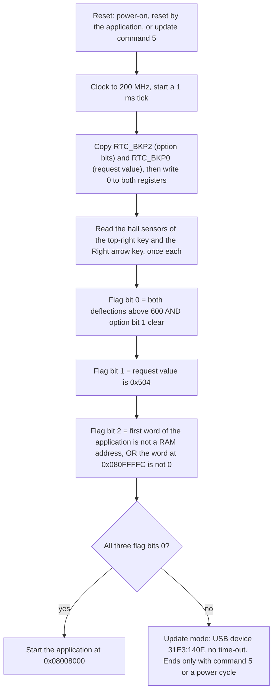
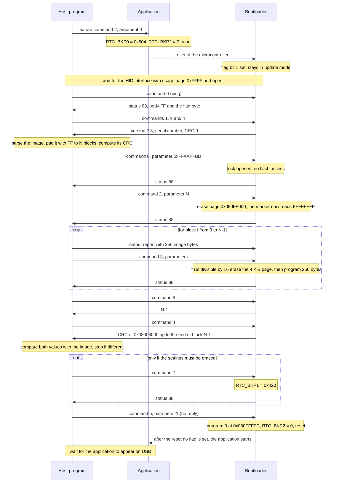

# The factory bootloader

**This document is about the factory bootloader of the Wooting 80HE.** For the Wooting 60HE+ none of it is established: that board has its own factory bootloader (in `0x08000000`-`0x08006FFF`, see [hardware](hardware.md#wooting-60he)), and its start-up decision, its update mode and its recovery paths are not known. `tools/openwoot.py` refuses `enter` and `flash` for the 60HE+ before it sends anything. The restructured build of openwoot in this tree has not yet been run on hardware; the statements marked "confirmed" below were made with an earlier build of openwoot for the 80HE and with the stock firmware, and concern the bootloader, which does not change with the application.

The Wooting 80HE has a bootloader in the first 32 KiB of the microcontroller's flash. It runs first after every reset, decides whether the keyboard firmware is started, and receives new firmware over USB. openwoot does not contain it and does not replace it: the bootloader is installed at the factory, no update file contains it, and no update can write it. This document is the reference for its behaviour, for someone who builds firmware for this keyboard or writes a host program that installs it.

This description applies to bootloader version 2.3 as found on a Wooting 80HE; the normal update (three complete updates in total), the key combination and commands 0, 1, 2, 3, 4, 5, 6, 8 and 9 were exercised on hardware, while the invalid-application indication, an interrupted update, command 7, the error statuses and the option bits were not. The tables below mark single statements as "confirmed" (confirmed on a Wooting 80HE) or "not yet tested" (not yet tested on hardware) where the difference matters.

Related documents: [flashing](flashing.md) (the practical procedure with the host tool, risks), [hardware](hardware.md) (microcontroller, memory map, backup registers, sensors and LED driver), [protocol](protocol.md) (the host protocol of the running firmware, including the command that requests update mode), [building](building.md) (how the image is linked), [`tools/README.md`](../tools/README.md) (the host tool `tools/openwoot.py`, which implements the protocol described here).

Terms: the *application* is the keyboard firmware, stock or openwoot, that starts at `0x08008000`. *Update mode* is the state in which the bootloader, not the application, answers on USB. A *block* is 256 bytes of an image. A *page* is 4096 bytes of flash, the unit that is erased, or 16 blocks. The *completion marker* is the last 32-bit word of the flash, at `0x080FFFFC`. Multi-byte numbers are little endian; bytes are written in hexadecimal.

## Flash ranges and what an update can reach

| Range | Size | Content | What the bootloader does with it |
| --- | --- | --- | --- |
| `0x08000000`-`0x08007FFF` | 32 KiB | The bootloader | Nothing. No command can address it: the lowest address a write command can form is `0x08008000`. |
| `0x08008000`-`0x080FDFFF` | 984 KiB = 1,007,616 bytes = 3936 blocks = 246 pages | The application, vector table first | Command 3 erases it page by page and programs it block by block. |
| `0x080FE000`-`0x080FEFFF` | 4 KiB | Serial page: one length byte, then the serial number as text. The application writes it (`storage_mirror_serial_to_mcu_flash` in `src/storage/storage_serial.c`). | Read once at start, for the USB serial string and for command 9. Never written: the highest block of command 3 ends at `0x080FDFFF`. |
| `0x080FF000`-`0x080FFFFF` | 4 KiB | Marker page. Only the last word, the completion marker at `0x080FFFFC`, has a meaning: 0 says that the last update was completed. | Command 2 erases the page. Command 5 with parameter bit 0 programs the marker to 0. |
| Option bytes (`0x1FFFC000` and up) | | Read and write protection settings of the microcontroller | Never accessed, neither read nor written. |

These limits are constants of the bootloader. No command and no parameter moves them. The application's linker script uses exactly the second range ([building](building.md)).

The bootloader never accesses the external SPI flash that holds profiles and settings ([storage](storage.md)). An update leaves it alone unless command 7 is sent.

Peripherals the bootloader uses: the 25 MHz crystal and the PLL (200 MHz system clock, the same setting as the application), the RTC backup registers, ADC0 with the pins of two hall sensors, I2C0 with DMA for the LED driver, the high-speed USB core, the flash controller and the SysTick timer. USB, I2C and the LED driver are set up only when the bootloader stays in update mode.

## The start-up decision

The decision is made once, a few milliseconds after every reset. Power-on, a reset requested by the application and the reset of update command 5 all take the same path. The result is one byte with three flag bits. If it is 0, the application is started. If any bit is set, the keyboard is in update mode and stays there.



All three tests are always carried out; none skips another. The flag byte is computed once and never updated: command 0 returns the value from start-up for the whole session, even after command 2 has made the application invalid.

| Flag bit | Meaning | Set when | On hardware |
| --- | --- | --- | --- |
| 0 (value `01`) | key combination | both sensors show a deflection above 600 and option bit 1 is clear | confirmed, with a working application installed |
| 1 (value `02`) | update requested by the application | the low 16 bits of `RTC_BKP0` were `0x504` | confirmed |
| 2 (value `04`) | application invalid | the first word of the application fails the test below, or the completion marker is not 0 | not yet tested |

### The key combination

The two keys are the **top-right key** (key matrix row 0, column 16) and the **Right arrow key** (row 5, column 16, the bottom-right key). They are the same positions on the ANSI, ISO and JIS boards ([layout](layout.md)).

The bootloader reads exactly these two hall sensors ([hardware](hardware.md) describes the multiplexers):

| Key | Multiplexer (enable pin, active low) | Multiplexer input | ADC channel (pin) |
| --- | --- | --- | --- |
| row 0, column 16 | 4 (PC8) | 5 | 15 (PC5) |
| row 5, column 16 | 5 (PC9) | 4 | 14 (PC4) |

How a key is judged:

- One 12-bit conversion per key, started after the next 1 ms tick so that the multiplexer output can settle. There is no averaging and no second look.
- The deflection is the distance of the sample from 2048, the value without magnetic field. Samples from 1969 to 2127 count as 0.
- The key counts as held if the deflection is greater than 600, that is a sample below 1448 or above 2648. Both keys must be held.
- The bootloader has no calibration data. How far a key must travel for a deflection of 600 has not been measured; press both keys fully.

Because the sensors are sampled within the first milliseconds after reset, the keys must already be fully down when the keyboard is plugged in. Confirmed on a Wooting 80HE: with both keys pressed completely before the plug went in, the combination was detected; with the keys not yet fully down at that moment, it was not, and the application started.

The test runs before the bootloader looks at the application, so it does not depend on the application in any way. It has been exercised with a working application installed; with an application that does not start it is not yet tested on hardware.

### The request from the application

The application's "reset into update mode" command (feature command 2 of the configuration channel, see [protocol](protocol.md); handler `protocol_cmd_enter_update_mode` in `src/protocol/protocol_device.c`, which calls `hal_system_enter_update_mode` in `hal/gd32f4xx/hal_system.c`) writes `0x504` to the backup register `RTC_BKP0` (`0x40002850`) and resets the microcontroller. The bootloader copies the register and then writes 0 to it, at every start and before it decides anything. The request therefore holds for exactly one start. `tools/openwoot.py enter` uses this path.

### The validity test

Two words of flash are examined, nothing else:

| Word | Must be | Notes |
| --- | --- | --- |
| The first word of the application at `0x08008000`: its initial stack pointer | a value `v` with `(v & 0x2FFC0000) == 0x20000000`, in practice `0x20000000` to `0x2003FFFF` | An erased first page (`FFFFFFFF`) fails. The `0x20030000` of an openwoot image passes. |
| The completion marker at `0x080FFFFC` | 0 | Command 2 erases it (it then reads `FFFFFFFF`); command 5 with parameter bit 0 programs it to 0. |

The bootloader does not check the reset vector, the length of the image, a checksum, a version, a model or a signature, neither at start-up nor during an update, and it stores none of these. It starts any image that passes the two tests; this is how firmware that Wooting did not build can be installed at all (confirmed on a Wooting 80HE).

### The option bits in `RTC_BKP2`

The low byte of `RTC_BKP2` (`0x40002858`) is read at every start and the register is then set to 0. The bits apply to that one start, whether or not an update was requested.

| Bit | Effect when set | On hardware |
| --- | --- | --- |
| 0 | Update mode runs at USB high speed. Clear: full speed. | clear: confirmed (full speed). Set: not yet tested |
| 1 | The key combination is ignored for this start. The bit does not override a request from the application or an invalid application. | not yet tested |
| 2 | The LED driver is not initialised; update mode shows no LEDs at all. | not yet tested |

Two writers exist: the application's two reset commands, which store the low byte of their argument there (feature commands 2 and 25, see [protocol](protocol.md)), and update command 5, which stores bits 8 to 15 of its parameter before it resets. `tools/openwoot.py` always sends 0 in both places.

Bit 1 deserves care in firmware development: an application that resets with this bit set switches the key combination off for the next start.

### No time-out, no watchdog

Once in update mode, the bootloader serves USB and the LEDs in an endless loop. Nothing limits the time and no watchdog is used. Update mode ends in two ways only: update command 5, or removal of power. A keyboard left in update mode stays there.

The other side of this: if the bootloader itself hangs, nothing resets it. It waits without time-out for the crystal oscillator, for the ADC and for the I2C transfers to the LED driver. In each case the remedy is to unplug the keyboard.

## How the application is started

When the flag byte is 0, the bootloader:

1. stops the SysTick timer;
2. sets the vector table register `SCB->VTOR` to `0x08008000`;
3. loads the main stack pointer from the first word of the application;
4. calls the address in the second word, the application's `Reset_Handler`. If the application ever returned, the bootloader would loop forever.

At that moment USB, I2C and the LED driver have not been touched. What the application finds:

| Item | State |
| --- | --- |
| Clock | 200 MHz from the PLL. The application's own `SystemInit` sets it again. |
| `RTC_BKP0`, `RTC_BKP2` | 0, always |
| `RTC_BKP1` | Untouched by the start-up path. It holds `0x420` if update command 7 was sent before the reset; the application then clears it and formats its settings storage (`hal_system_take_format_request`, called by `storage_init` in `src/storage/storage_init.c`). |
| Pins | The six multiplexer enable pins are outputs and high (off), PA8 to PA11 are outputs and low, PC4 and PC5 are analog. The clocks of GPIOA, GPIOB and GPIOC are switched off again. |
| ADC | Switched off and reset |
| Interrupts | None enabled in the interrupt controller; interrupts not masked |

An application for this bootloader therefore needs nothing special: it is linked for `0x08008000`, its vector table comes first, and its initial stack pointer lies in `0x20000000`-`0x2003FFFF`.

## Update mode on USB

### Identity

| Property | Value | On hardware |
| --- | --- | --- |
| Vendor id, product id | `0x31E3`, `0x140F`. The application uses the product ids `0x1400` to `0x1402` ([protocol](protocol.md)). | confirmed |
| `bcdDevice` | `0x0102`. This is not the bootloader version; command 1 reports that. | confirmed |
| Manufacturer, product string | "Wooting", "Wooting Restore (80HE)" | confirmed |
| Serial string | The serial number text of the serial page; USB shows at most 31 characters of it. If the page is erased or its length byte is 0: twelve letters A to Y derived from the unique id of the microcontroller. | first case confirmed; second case not yet tested |
| Interfaces | One HID interface, no boot protocol | |
| Endpoints | `0x01` interrupt OUT and `0x81` interrupt IN, 64-byte packets, interval 1 | |
| HID reports | Usage page `0xFFFF`, no report ids: input 256 bytes, output 256 bytes, feature 7 bytes. The application's configuration channel has usage page `0xFF55`, so a host can tell the two modes apart. | confirmed |
| Bus speed | Full speed (12 Mbit/s) unless option bit 0 was set for this start. The descriptors are the same at both speeds. | full speed confirmed |
| Power | Bus powered, 200 mA | |

### Transport

| Purpose | Transfer | Size |
| --- | --- | --- |
| Request | Feature report: `SET_REPORT` with report type 3 on the control endpoint | 7 bytes. At most 64 bytes are accepted; the length is not checked. |
| Reply | Input report on endpoint `0x81` | Always 256 bytes, of which the first `5 + length` matter |
| Block data | Output report on endpoint `0x01` (or `SET_REPORT` with report type 2) | 256 bytes per block |

`GET_REPORT` does not return replies; they arrive on the interrupt endpoint only. Because the interface has no report ids, a HID library that expects a report-id byte at the start of every buffer, such as hidapi, needs a leading `00` in front of the bytes shown in this document.

## The update protocol

### Request

| Offset | Size | Field | Content |
| --- | --- | --- | --- |
| 0 | 2 | magic | `DF DB` (the value `0xDBDF`) |
| 2 | 1 | command | 0 to 9 |
| 3 | 4 | parameter | 32 bits; 0 if the command has none |

This is the layout of the application's feature commands ([protocol](protocol.md)) with another magic and without report id. There is no checksum.

A command is executed immediately and completely when its feature report arrives, before the reply is queued. There is no command queue and no sequence the bootloader enforces: every command is accepted at any time, subject only to the lock described below.

### Reply

| Offset | Size | Field | Content |
| --- | --- | --- | --- |
| 0 | 2 | magic | `DF DB` |
| 2 | 1 | command | copy of the request's command byte |
| 3 | 1 | status | see below |
| 4 | 1 | length | number of body bytes |
| 5 | length | body | depends on the command |

Unlike in the application's replies, the length field is one byte and the body starts at offset 5. The rest of the 256 bytes is zero. Example, the reply to command 1: `DF DB 01 88 02 02 03 00 ...`.

| Status | Meaning | Produced when | On hardware |
| --- | --- | --- | --- |
| `88` | executed | | confirmed |
| `FF` | refused | command 2, 3 or 8 while locked; command 2 with a block count outside 1 to 65,535; command 3 with a block index of `0xF60` or more; command 6 with a wrong parameter while locked; command 9 when no serial number is stored | not yet tested |
| `66` | unknown command | command number above 9 | not yet tested |
| `33` | wrong magic | the first two bytes of the request are not `DF DB`. The reply still starts with `DF DB` and repeats the command byte. | not yet tested |

Two properties a host program must know:

- **A reply can be lost.** If the previous reply has not been fetched by the host when the next command finishes, the new reply is dropped without notice, and a request that arrives while another is being executed is ignored. Read the reply to each request before sending the next one. On a Wooting 80HE every reply arrived within about 40 ms.
- **Status `88` from commands 2 and 3 means "request accepted", not "flash written".** The bootloader does not look at the result of erasing or programming. Only the CRC of command 4 shows whether the image arrived.

### Commands

*The lock*: after every reset the bootloader is locked. Commands 2, 3 and 8 are refused with status `FF` until command 6 has been sent with the right parameter. The lock then stays open until the next reset. The other commands work in either state.

| Cmd | Name | Parameter | Needs unlock | Reply body | Effect | On hardware |
| --- | --- | --- | --- | --- | --- | --- |
| 0 | ping | any | no | 2 bytes: the inverted low byte of the parameter (`FF` for 0), then the flag byte of the start-up decision | none | confirmed: `FF 02` after a request from the application, `FF 01` after the key combination |
| 1 | version | none | no | 2 bytes `02 03`: version 2.3 | none | confirmed |
| 2 | start upload | block count, 1 to 65,535 | yes | none | **Erases the marker page** `0x080FF000`-`0x080FFFFF`. From this moment the application counts as invalid, whatever the rest of the flash contains. The count is used only for the progress display on the LEDs; it does not limit what command 3 accepts. | confirmed |
| 3 | write block | block index, 0 to `0xF5F` (3935) | yes | none | Writes the block received last to `0x08008000 + 256 * index`, after erasing the page if the block is the first of a page (see [flash handling](#flash-handling)) | confirmed for ascending order from index 0 |
| 4 | CRC | none | no | 4 bytes: the [CRC](#the-crc), low byte first, then `00` | Computes the CRC over flash from `0x08008000` up to the end of the block that was written last **in this session**. Reads only. | confirmed: `00 00 00 00` before an upload, the CRC of the image after it |
| 5 | reboot | bit 0: write the completion marker. Bits 8 to 15: option bits for the next start. | no | no reply: the keyboard resets | If bit 0 is set, **programs the completion marker to 0**, without any condition. Then writes bits 8 to 15 to `RTC_BKP2` and resets the microcontroller. | confirmed with parameter 1 after an upload and with parameter 0 while a valid application was installed (it started again). Option bits: not yet tested |
| 6 | unlock | `0xFFAAFFBB`, the request `DF DB 06 BB FF AA FF` | | none | Opens the lock. **It erases nothing** and touches no flash. With any other parameter: status `FF` while locked, `88` and no effect once unlocked. | confirmed with the right parameter |
| 7 | settings reset | none | no | none | Writes `0x420` to the backup register `RTC_BKP1`. The application formats its settings storage when it finds this value at its next start: all profiles and settings are lost ([storage](storage.md)). | not yet tested |
| 8 | last block | none | yes | 4 bytes: index of the block written last; 0 after a reset | none | confirmed after the last block of an upload. The value after a reset and the refusal while locked: not yet tested |
| 9 | serial | ignored | no | the serial number as ASCII text, at most 50 characters, copied at start from the serial page. Status `FF` if the page holds none. | none | confirmed: the same text for the parameters 0 and 1 |
| 10 to 255 | | | | status `66` | none | not yet tested |

There is no command that reads flash content, none that erases the whole application, and none that writes outside the ranges of the first section.

Details that matter for a host program:

- **Command 4 covers only this session.** The end of the CRC range is set by every command 3 to the end of that block and is 0 after a reset. The command therefore cannot report the CRC of an application that is already installed, and after out-of-order writes it covers less than the image.
- **Command 5 with bit 0 is unconditional.** It needs no unlock and no preceding upload, and the bootloader compares no CRC. Whoever sends it declares the content of the application area valid.
- **Command 5 with parameter 0** only resets. A valid application starts again; after command 2 the keyboard comes back in update mode with flag bit 2.
- **Command 3 without preceding data** programs whatever is in the block buffer: zeros directly after a reset, `FF` after an earlier command 3.
- **The settings reset of command 7 is a request to the application**, carried by a backup register. Whether the register keeps its value while the keyboard is unplugged is not determined ([hardware](hardware.md)).

### Block transfer

A block travels as an output report with the 256 bytes of the block and nothing else: no magic, no block number, no checksum. The bootloader appends output-report data to a staging buffer; when 256 bytes are complete they become the *current block*. Command 3 then writes the current block to flash and names its position. There is one current block: a second block sent before command 3 replaces the first.

**Send exactly 256 bytes per block.** The fill level of the staging buffer is reset in one place only, when it reaches 256. No command resets it, not command 2, not command 6, not a refused command. The append is not bounds-checked. A report shorter than 256 bytes therefore leaves a partial block behind; every later block is shifted by that amount, and the next full report is written up to 255 bytes past the end of the buffer, over the bootloader's own variables. After that the bootloader may ignore every command until power is removed. Sending a block as four 64-byte pieces is equivalent to one 256-byte report as long as the pieces add up to exactly 256 bytes.

If a transfer was aborted in the middle of a block, or commands stop being answered, do not continue: unplug the keyboard, plug it in again and start the update from command 6.

The pattern "one 256-byte output report, then command 3", repeated for every block in ascending order, is confirmed on a Wooting 80HE. What happens with partial blocks is not yet tested on hardware.

### The CRC

A 24-bit CRC over 16-bit little-endian words, starting at 0. For each word: remember bit 23 of the CRC, shift the CRC left by one bit and keep 24 bits, exclusive-or the word into the low 16 bits, and if the remembered bit was set, exclusive-or the constant `0x80001B` as well.

```c
uint32_t update_crc24(const uint8_t *p, size_t len)   /* len is even; for an image a multiple of 256 */
{
    uint32_t crc = 0;
    for (size_t i = 0; i < len; i += 2) {
        uint32_t word = p[i] | ((uint32_t)p[i + 1] << 8);
        uint32_t fb   = (crc & 0x800000u) ? 0x80001Bu : 0;
        crc = (((crc << 1) & 0xFFFFFEu) ^ word ^ fb) & 0xFFFFFFu;
    }
    return crc;
}
```

Test values: the four bytes `01 02 03 04` give `0x000001`; the 256 bytes `00` to `FF` give `0xEF3F62`.

The host computes the CRC over the image after padding it with `FF` to a multiple of 256 bytes. The bootloader computes it over flash from `0x08008000` to the end of the block written last. The two ranges are the same only if the blocks were written in ascending order up to the last block of the image. Command 4 returns the value low byte first in a 4-byte body: `0xA00C30` arrives as `30 0C A0 00`. The rule is confirmed on a Wooting 80HE with three different images.

### A complete update



This is the sequence of `tools/openwoot.py enter` followed by `tools/openwoot.py flash`, without the optional command 7, which the tool never sends. It is confirmed on a Wooting 80HE: every request was answered with status `88`, the CRC was the one computed on the host, and the application was back on USB about one second after the final command. An image of 1931 blocks took 24.4 s.

How an image file becomes blocks is the host's business, because the bootloader is given block numbers and never addresses: block 0 always goes to `0x08008000`. `tools/openwoot.py` takes the address of the first data record of an Intel HEX file as offset 0, fills gaps between records with `FF` and pads the end with `FF` to a multiple of 256 bytes ([`tools/README.md`](../tools/README.md)).

### Rules for a host program

1. **Send command 2 before the first block.** Only command 2 erases the completion marker. A host that unlocks and writes blocks without it leaves the marker at 0, and after an interruption the bootloader would start a partly written image.
2. **Send blocks in ascending order from index 0, each exactly once**, and exactly 256 bytes per block.
3. **Read the reply to every request before sending the next request.**
4. **Send command 5 with bit 0 only after the CRC of command 4 matched** the CRC of the image. After a mismatch send nothing, or start again with command 6. Command 5 with bit 0 marks whatever is in flash as a complete application.

## Flash handling

How command 3 writes a block:

1. The address is `0x08008000 + 256 * index`.
2. If the address is a multiple of `0x1000`, that is the block is the first of a page (index divisible by 16), that page is erased.
3. The 256 bytes of the current block are programmed as 64 words of 32 bits.
4. The current block is filled with `FF`; the index is remembered for command 8 and the end address for command 4.

Measured on a Wooting 80HE: a block that starts a page takes 32 to 39 ms from request to reply, any other block 5 to 13 ms (median 6 ms), command 2 takes 26 ms.

What follows from this design:

- **There is no "erase the application" step.** A page is erased only when its first block arrives. An image shorter than the previous one leaves the old content behind it in flash. This is harmless: that content is never executed, and the start-up test looks at two words only.
- **Blocks must arrive in ascending order from index 0, each once.** The bootloader does not enforce it. A block sent out of order, or twice, is programmed onto flash that was not erased.
- **The largest image has 3936 blocks** and ends at `0x080FDFFF`.
- **Nothing is verified on the device.** The results of the erase and program operations are discarded, nothing is read back, and commands 2 and 3 answer `88` regardless. The only check is the CRC of command 4, and only the host compares it.
- **Errors of the flash controller are ignored and can silence later writes.** The erase and program routines do nothing while the flash controller shows an error flag, and the bootloader clears only two of the flags between operations (end of operation, write-protection error). If another error flag is ever raised, every later erase and program of that session is skipped while the replies stay `88`. Whether this can occur in practice, for example when a block is written twice, is not yet tested on hardware. The CRC would show it; the remedy is to unplug the keyboard and repeat the update.

## LED indications

The LED driver is initialised only in update mode and only if option bit 2 is clear. The colours are set once at the start of update mode from the flag byte and do not change afterwards. Several reasons can be shown at once. All other key LEDs are off.

| Reason for update mode | Keys lit (row, column) | Key in the default ANSI key map | LED id | Colour | On hardware |
| --- | --- | --- | --- | --- | --- |
| flag bit 0: key combination | (0, 16) and (5, 16), the two keys that were held | Pause (the top-right key), Right arrow | 98, 39 | blue | confirmed |
| flag bit 1: update requested by the application | (5, 6) | Space bar | 71 | yellow | not yet tested |
| flag bit 2: application invalid | (2, 3) and (2, 4) | E, R | 42, 55 | red | not yet tested |

Key positions and LED ids are the same on the ANSI, ISO and JIS boards; [layout](layout.md) has the tables.

Progress of an upload is shown on the light bar, the row of ten LEDs to the right of the Enter key (not yet tested on hardware):

- Command 2 sets all ten LEDs to dim red.
- Each command 3 redraws the bar from `index / block count`, with the count that was given to command 2: LED number *i* (1 to 10) turns green when the quotient, scaled to 0 to 255, reaches `25 * i`; the others stay dim red. For an image of more than 50 blocks all ten are green after the last block.
- The bar is driven by the host's numbers alone. It shows which block index was sent last, not that the flash content is correct.

## Recovery scenarios

Of the paths in this table, two are confirmed on a Wooting 80HE: entering update mode with the key combination while a working application is installed, and leaving update mode with command 5, parameter 0. Everything else in the table is not yet tested on hardware. [Flashing](flashing.md) gives the steps with the host tool.

| Situation | What the bootloader does | Way out |
| --- | --- | --- |
| The update was interrupted before command 2 (only reads, or command 6). | Nothing was changed. The installed application starts at the next reset. | Command 5 with parameter 0, or unplug and plug in. |
| The update was interrupted at any point after command 2: cable pulled, host program stopped, CRC mismatch, power loss. | The marker is not 0, so flag bit 2 is set at every start, whatever the application area contains. The keyboard comes up in update mode after every power cycle, with the E and R keys red. | Repeat the complete update, from command 6. No key needs to be held. |
| Power failed while the marker page was being erased or the marker programmed. | The word is partly erased or partly programmed. Any value other than 0 keeps the keyboard in update mode; at worst a complete image is not started. | Repeat the update. |
| The application is complete and marked, but it does not appear on USB, crashes, hangs, or resets again and again. | The bootloader cannot notice this. Both test words are fine, so it starts the application at every reset. Every reset passes through the key test, also in a reset loop. | The key combination: unplug, press both keys fully, plug in. Then a normal update. |
| A wrong image was written and marked complete, and its first word is not a RAM address. | The validity test fails: update mode at every start, flag bit 2. | Repeat the update with the right image. |
| A wrong image was written and marked complete, and its first word happens to pass the test. | The bootloader calls whatever address the second word holds. The result is a crash. | The key combination, then the right image. |
| Update mode was entered by mistake and command 2 was not sent. | Nothing was changed. | Command 5 with parameter 0 (`tools/openwoot.py reboot 0`), or unplug and plug in without holding keys. |

What every way out depends on:

- The bootloader region `0x08000000`-`0x08007FFF` is intact. Nothing the bootloader does can change it.
- For the key combination: the two hall sensors, their multiplexers and the ADC work, and both keys are pressed far enough for a deflection above 600 before power is applied.
- `RTC_BKP2` does not have bit 1 set at that start. The bootloader clears the register at every start, so a second attempt is not affected.
- The host program follows the [rules](#rules-for-a-host-program).

If the bootloader itself is damaged, none of this applies and USB offers no way back. The only remaining route is a hardware debug probe on the SWD pins of the microcontroller.

## What the bootloader does not protect against

- **An application that programs flash itself.** Once started, the application has full access to the flash controller. openwoot uses it in one place, for the serial page, as the stock firmware does. A wrong address in such code, or stray code after a crash, can erase or overwrite any page, including the bootloader region. The bootloader sets up no protection and checks none: it never touches the option bytes. Whether the bootloader's pages are write-protected by the option bytes of a given keyboard is not known; treat them as unprotected.
- **A host that validates a bad image.** The completion marker is written whenever command 5 arrives with bit 0. The bootloader does not know whether an upload happened, was complete or matched a CRC.
- **A wrong but well-formed image.** Only an implausible first word is caught.
- **An application that starts and then fails.** There is no watchdog, no boot counter and no fallback image. The key combination is the only way back, and it is a manual one.
- **Host protocol errors.** Blocks out of order or repeated, partial blocks, replies not read. The bootloader accepts all of it and answers `88`.
- **Its own failures.** Flash controller errors are ignored, and a hang in the bootloader is not ended by a reset.
- **Loss of settings.** Command 7 makes the application format its settings storage at the next start. The bootloader itself never touches that storage, and an update without command 7 leaves it alone (confirmed on a Wooting 80HE: the firmware reported the same profiles and settings before and after each update).
- **Changes to the serial page and the marker page by the application.** If an application erases the serial page, the bootloader falls back to the letter string for USB and command 9 answers `FF`; the firmware writes the page again at its next start. If an application erases or overwrites the marker, the keyboard comes up in update mode at the next reset, and a complete update brings it back.
