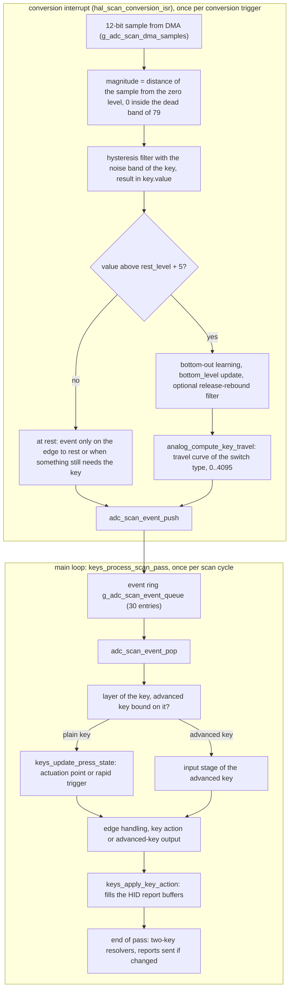

# Extending the key features: the analog pipeline and how to change it

This guide follows a key press through openwoot, the open firmware for Wooting hall-effect keyboards, from the hall sensor to the USB report, with the numbers the code uses. It then shows, with two complete examples, how to add a behaviour of your own: a change to the press decision, and a new advanced-key type. The pipeline is one code base for every board. Where the boards differ (scan geometry, zero level of the sensors, oversampling, noise recalibration), the values of the Wooting 80HE and of the Wooting 60HE+ are given side by side.

Related documents: [architecture](architecture.md) (layers, registration lists, main loop, interrupts, concurrency), [hardware](hardware.md) (multiplexers, pins, converter set-up of both boards), [layout](layout.md) (key matrix and physical positions), [protocol](protocol.md) (host commands), [storage](storage.md) (profile files), [extending-rgb](extending-rgb.md) (lighting, which receives key events from this pipeline), [building](building.md) (toolchain, build options), [porting](porting.md) (boards, features, strategies), [flashing](flashing.md) (writing the image to the keyboard).

## Status

- Typing with key repeat, Fn combinations, profile switching and rapid trigger of the unmodified firmware, built without link-time optimisation, were confirmed on a Wooting 80HE with ANSI layout in an earlier form of this tree; the current tree has not yet been run on hardware. Not yet tested on hardware: the link-time-optimised build, the gamepad and XInput modes, ISO and JIS boards.
- The firmware of the Wooting 60HE+ has never run on a keyboard. What this guide says about that board (scan geometry, zero level from the measured reference, oversampling, the noise recalibration variant `stddev`) is taken from that board's stock firmware, not confirmed on hardware.
- Times given below are calculated from the constants in the code. They are lower bounds where the run time of code is involved.
- Feature names ("rapid trigger", "dynamic keystroke", "mod-tap", "toggle", "SOCD", "release-rebound filter", "bottom-out learning") and all message and field names are names chosen by this project. They describe behaviour and may differ from the names in Wootility.
- The examples of section 3 compile and link when they are applied to this repository as written, for both boards and in both build configurations (`make BOARD=<board>` and `make BOARD=<board> LTO=1`), and add no compiler warning: every step of sections 3.2 (all three stages, including the dedicated host command) and 3.3 (including the hard-wired entry), and the recipes of sections 3.4 (with the table entry of step 4) and 3.5. `make check` passes with all of them applied. A firmware that contains them is not yet tested on hardware.

File names in this guide are given as the code includes them: relative to `src/` (`keys/keys_actuation.c` is `src/keys/keys_actuation.c`). Paths into the HAL and the board directories are written out (`hal/include/hal/hal_scan.h`, `boards/<board>/board.h`). A new key feature is code shared by all boards and goes into `src/`; it works on every board, because the scan geometry and the other board numbers reach the shared code only through the constants of `boards/<board>/board.h` (`ANALOG_KEY_COUNT`, `ADC_SCAN_MUX_COUNT` and others are derived from them). A change to a keymap or another board table is made in `boards/<board>/tables/` of every board it concerns; the table of key-code actions is shared by all boards ([`tables/layout_keycode_tables.c`](../src/tables/layout_keycode_tables.c)). [Building](building.md#how-the-source-list-follows-from-boardmk) explains how the build combines the directories.

## 1. The analog pipeline

### 1.1 Overview



Two contexts are involved and the boundary between them is the event ring:

- **Interrupt context** does everything that needs every sample: filtering, calibration, bottom-out tracking, the conversion to travel. Code: [`src/adc_scan/`](../src/adc_scan/) and [`src/analog/`](../src/analog/), with the per-sample hardware access of the HAL ([`hal/include/hal/hal_scan.h`](../hal/include/hal/hal_scan.h)).
- **Main-loop context** does everything that is a decision: actuation, rapid trigger, advanced keys, layers, key codes, reports. Code: [`src/keys/`](../src/keys/) and [`src/layout/`](../src/layout/). In particular `keys_update_press_state` and `keys_get_actuation_threshold` run in the main loop, not in the interrupt.

The central data structure is the per-key record `analog_key_state_t` (172 bytes) in the array `g_analog_key_states[ANALOG_KEY_COUNT]`, one record per scan position (96 on the 80HE, 64 on the 60HE+), defined in [`analog/analog_types.h`](../src/analog/analog_types.h). Both contexts work on it. Types of the key logic are in [`keys/keys_types.h`](../src/keys/keys_types.h), those of the scan in [`adc_scan/adc_scan_types.h`](../src/adc_scan/adc_scan_types.h).

### 1.2 How a key is addressed

| Name | Value | Used by |
| --- | --- | --- |
| Scan position | `multiplexer address + 16 x multiplexer index`. 80HE: address 0..14, multiplexer 0..5, positions 0..95. 60HE+: address 0..15, multiplexer 0..3, positions 0..63 | Index of `g_analog_key_states`; the scan |
| Key id | `row << 5 \| column` of the key matrix (`KEYS_KEY_ID(row, col)`): 6 x 17 on the 80HE, 6 x 14 on the 60HE+, whose row 0 carries no key (`BOARD_KEY_ROWS`, `BOARD_KEY_COLS`); `0xFF` = none | Key logic, keymaps, profile data, host protocol |

The tables `g_layout_scanpos_to_keyid` and `g_layout_keyid_to_scanpos` translate between the two; `layout_select_variant` points them at the table set of the physical layout (80HE: ANSI 84 keys, ISO 85, JIS 88; 60HE+: ANSI 61, ISO 62). At boot `adc_scan_column_table_init` builds `g_adc_scan_column_table[ADC_SCAN_MUX_CHANNELS][ADC_SCAN_MUX_COUNT]` (15 x 6 on the 80HE, 16 x 4 on the 60HE+) from them: one `adc_scan_column_entry_t` per multiplexer address and multiplexer with the key id, a pointer to the key record (NULL if the position has no key) and the scan position. The interrupt handler works with this table only. Wiring and table contents are described in [hardware](hardware.md) and [layout](layout.md).

Most key code passes a key around as a `keys_key_ref_t`: a pointer to the record plus the key id.

### 1.3 Scan order and timing

One converter converts all sensors; on the 60HE+ a second converter converts the zero-field reference at the same instant (section 1.4). `TIMER1` runs in one-pulse mode at 1 MHz and triggers one conversion (or one group with one conversion per multiplexer) per arming; the result words are moved to `g_adc_scan_dma_samples` by DMA, and the end-of-conversion interrupt calls `hal_scan_conversion_isr` ([`adc_scan_irq.c`](../src/adc_scan/adc_scan_irq.c)), the call-back of the HAL interface [`hal_scan.h`](../hal/include/hal/hal_scan.h). The handler processes the result, selects the next sensor and arms the trigger for it (`hal_scan_trigger_after`, inline in `hal/<family>/inline/hal_scan_inline.h`). The scan is therefore a chain of interrupts that paces itself: no conversion starts before the handler has armed it.

There are two scan modes (`enum adc_scan_mode`), selected by the profile setting `ProfileConfig.scan_mode_enabled` / `scan_mode` and applied by `adc_scan_set_mode` ([`adc_scan_control.c`](../src/adc_scan/adc_scan_control.c)):

| | Single-input mode (`ADC_SCAN_MODE_SINGLE`) | Parallel mode (`ADC_SCAN_MODE_PARALLEL`) |
| --- | --- | --- |
| Handler path | `adc_scan_process_single_sample` | `adc_scan_process_parallel_samples` |
| Per trigger | One conversion: the sensor at the current address of the one enabled multiplexer | One conversion per multiplexer (six on the 80HE, four on the 60HE+): the sensors at the current address of all multiplexers |
| Order within a cycle | Multiplexer 0, all addresses in use (0..14 on the 80HE, 0..15 on the 60HE+); then multiplexer 1; and so on to the last multiplexer. Positions without a key are skipped (`adc_scan_next_position`). | Addresses 0..14 (80HE) or 0..15 (60HE+) |
| Triggers per cycle | One per key: 84, 85 or 88 on the 80HE, 61 or 62 on the 60HE+ | 15 (80HE), 16 (60HE+) |
| Delay before the next conversion | 2 µs on the same multiplexer (`ADC_SCAN_DELAY_SAME_MUX_US`), 54 µs after switching to another multiplexer (`ADC_SCAN_DELAY_MUX_US`) | 2 µs |
| First conversion of a cycle | 54 µs after the end of the previous cycle, or at once if that time has passed (`hal_scan_trigger_at(55)`) | 2 µs after the end of the previous cycle, or at once (`hal_scan_trigger_at(3)`) |
| Calculated minimum cycle time, 80HE (ANSI) | 6 x 54 µs + 78 x 2 µs + 84 conversions = about 0.51 ms | 15 x (2 µs + 6 conversions) = about 0.06 ms |
| Calculated minimum cycle time, 60HE+ (ANSI) | 4 x 54 µs + 57 x 2 µs + 61 results = about 0.56 ms | 16 x (2 µs + 4 results) = about 0.27 ms |

On the 80HE one conversion takes 0.375 µs (12 bit, sample time 3 cycles, ADC clock 40 MHz). On the 60HE+ the converter averages eight conversions of 14 cycles into one result (`BOARD_SCAN_OVERSAMPLE` = 8; 12 bit, sample time 1.5 cycles, ADC clock 30 MHz): about 3.7 µs per result. The "calculated minimum" counts only trigger delays and conversion time. The handler's own run time per sample comes on top wherever it is longer than the trigger delay plus the conversion (about 2.4 µs on the 80HE, about 5.7 µs on the 60HE+), which on the 80HE is likely for every pressed key. Treat the figures as lower bounds, not as the scan rate.

On the 80HE both paths convert some readings twice (feature `recheck`, [`adc_scan/recheck/recheck.h`](../src/adc_scan/recheck/recheck.h)): a reading on multiplexer 3, 4 or 5 (from `BOARD_SCAN_RECHECK_FIRST_INPUT` = 3 on) that would change the filtered value is not used; the same sensor is converted again 2 µs later and the second result is taken. The 60HE+ does not list the feature; there every reading is used as it is.

**The cycle and the main loop.** A scan cycle is started by `adc_scan_start_cycle` from the main loop and ends when the handler has processed the last position; the handler then stops triggering and reserves one slot of the event ring as end-of-cycle marker (`adc_scan_finish_cycle`). The main loop starts one cycle per pass (`startup_run_active_task` in [`app/tasks.c`](../src/app/tasks.c)): it starts a cycle at the end of a pass, after the lighting step, does its other work, and at the beginning of the next pass `keys_process_scan_pass` consumes the events of that cycle, waiting for the end-of-cycle marker if the cycle is still running. The time between two key passes is therefore the run time of the key pass and of one lighting step (up to about 1 ms) plus the scan cycle time or the duration of the other main-loop work (USB, one host command), whichever is longer.

While USB is suspended only one cycle and key pass run about every 100 ms (`startup_run_suspended_task`).

### 1.4 What the interrupt does with one sample

Both scan paths first compute, for the key whose conversion finished:

1. **Magnitude** (`adc_scan_magnitude` in [`adc_scan_magnitude.h`](../src/adc_scan/adc_scan_magnitude.h)): `|sample - level|`, forced to 0 when the sample is within ±79 of the level (`ANALOG_ADC_DEADBAND`). The sign is discarded. A larger magnitude means a deeper press. The level is the sensor output without magnetic field, as `adc_scan_reference_level` ([`adc_scan/reference/reference.h`](../src/adc_scan/reference/reference.h)) gives it:

   | Board | Feature `reference` | Level |
   | --- | --- | --- |
   | 80HE | not listed | `BOARD_ADC_ZERO_LEVEL` = 2048, the middle of the 12-bit range. Matches stock firmware 2.14.1. |
   | 60HE+ | listed | The reference input that the second converter converted together with this sample (`hal_scan_sample_reference`, the high half of the result word); `BOARD_ADC_ZERO_LEVEL` = 2482 while the reference reads 0. Taken from that board's stock firmware, not confirmed on hardware. |

   With the feature the reference converted with the sample of scan position 0 is also kept in `g_adc_scan_ref_level`, which host feature command 20 reports.
2. **Hysteresis filter** (`adc_scan_filter_hysteresis`): the filter output follows the magnitude at a distance of the key's `noise_band` and stays where it is while the magnitude is closer than that:

   ```c
   diff = magnitude - filtered;
   if (diff > band)        filtered = magnitude - band;
   else if (diff < -band)  filtered = magnitude + band;
   ```

   The result is stored in `key->filtered`. This is the only filter in the firmware; on the 60HE+ the converter itself averages eight conversions per sample (section 1.3).

Then they select the next sensor and arm its conversion, and only after that run the per-key processing, so that the multiplexer settles while the handler computes. The per-key processing is `adc_scan_process_key_sample` ([`adc_scan_sample.c`](../src/adc_scan/adc_scan_sample.c)), identical for both modes:

| Step | Condition | Action |
| --- | --- | --- |
| Raw scanning | `g_run_state_options & RUN_STATE_OPTION_RAW_SCANNING` (host feature command 44) | `key->value` = unfiltered magnitude; nothing else. No key events are produced in this mode. |
| Store | always | `key->value` = filtered value |
| Noise statistics | `key->recal_active` | `analog_noise_stats_add_sample` with the unfiltered magnitude; when the window is complete, `analog_apply_noise_recalibration` (section 1.6) |
| Settling | `g_adc_scan_settling` (three cycles after a scan mode switch, `ADC_SCAN_SETTLE_CYCLES`) | stop here |
| Activity | `value > rest_level + 5 + 20` | `adc_scan_note_key_activity`: hold the idle recalibration for 5 s and cancel a running batch |
| Pressed | `value > rest_level + 5` (`ANALOG_REST_MARGIN`) | `analog_update_bottom_out_estimate` (section 1.7), `adc_scan_update_bottom_level`, and `analog_detect_release_rebound` if the filter is enabled (section 2.4) |
| At rest | otherwise | rebound filter if it is enabled and not idle; then return without an event, unless the previous value was above the rest threshold (the edge to rest) or `adc_scan_key_needs_rest_events` says the key is still needed |
| Event | pressed, or at rest with one of the two reasons above | `travel = analog_compute_key_travel(key)` (section 1.8), or 0 if the rebound filter reported a rebound; `adc_scan_event_push(key_id, key, travel)` |

The rule in the last two rows shapes everything downstream: **a key produces one event per scan cycle while it is above its rest threshold, one final event with travel 0 when it returns to rest, and then nothing.** A key at rest keeps producing events only while `adc_scan_key_needs_rest_events` is true: one of its advanced keys is marked active (`ak_slot[layer].active`), or the flag `ANALOG_KEY_FLAG2_IGNORE_UNTIL_RELEASE` is set. Section 2.7 explains how a feature uses this.

### 1.5 Start-up sweep and calibration

After reset, before the first regular cycle, the interrupt runs a baseline sweep (`adc_scan_sweep_step` in [`adc_scan_irq.c`](../src/adc_scan/adc_scan_irq.c), while `g_adc_scan_calibrating` is set). It is started by the start-up step `adc_scan_start_sweep` (slot `STARTUP_SCAN_SWEEP` of [`core/startup.h`](../src/core/startup.h)); the start-up goes on with the LED driver and USB meanwhile, and `adc_scan_start_cycle` (slot `STARTUP_SCAN_CYCLE`, the last step) waits for the end of the sweep in an empty loop.

| Phase | What is converted | Trigger delays |
| --- | --- | --- |
| 1 | Single-input: every multiplexer (0..5 on the 80HE, 0..3 on the 60HE+), every address in use, 100 conversions per position (`ADC_SCAN_SWEEP_SAMPLES`) | 254 µs before the very first conversion, 149 µs after an address change (2 µs when the new position has no key), 54 µs after a multiplexer change, 1 µs between the 100 conversions |
| 2 | Parallel: every address in use, 100 triggers of one conversion per multiplexer each | 149 µs after an address change, 1 µs between triggers |

For every keyed position the sweep tracks the maximum and the minimum magnitude of the 100 conversions (in `rest_level` and `noise_band`, which serve as running maximum and minimum during the sweep). At the 100th conversion `adc_scan_sweep_finish_key` derives the calibration of the phase's scan mode:

| Result | Formula | Stored in |
| --- | --- | --- |
| Noise band | `(uint16_t)(ceilf((max - min) * 0.5f) * 1.2f)` | `noise_band_single` (phase 1), `noise_band_parallel` (phase 2) |
| Rest level | `max`; in phase 2 `max + 5` when the noise band is 4 or less | `rest_level_single`, `rest_level_parallel` |
| First bottom-out level | `rest + max(50, round(curve_end_q8 * (nominal_bottom - rest) / 0xFFF00))` with the single-mode rest level and the values of the key's switch type (section 1.8) | `bottom_level`; `bottom_is_learned` = 0; the bottom-out tracker is reset |

The first regular cycle then calls `adc_scan_set_mode`, which copies the pair of the active mode into the working fields `rest_level` and `noise_band` (for scan mode levels above 1 with margins of +10 and +2; `profile_apply_cfg` only ever requests levels 0 and 1).

By calculation the sweep takes a few tens of milliseconds. A key that is held down during the sweep gets its pressed value as rest level; the idle recalibration corrects this later, once the key has been at rest and quiet for a full statistics window.

### 1.6 Idle noise recalibration

While keys are idle the firmware re-measures rest level and noise band in the background. Which keys are measured when is shared code. How the samples of one key are collected and turned into a calibration is the strategy slot `noise_recal` ([`analog/noise_recal/noise_recal.h`](../src/analog/noise_recal/noise_recal.h)); every board selects one variant with `STRATEGY_noise_recal` in its `board.mk`: `minmax` on the 80HE, `stddev` on the 60HE+.

- **Scheduling** (main loop, `adc_scan_start_cycle` with the static helpers `analog_recal_should_run`, `analog_recal_poll_batch`, `analog_recal_advance`; the batch iterator is in [`analog_recal.c`](../src/analog/analog_recal.c)): keys are processed in batches. The batch pattern (`enum analog_recal_pattern`) depends on the scan mode and on whether a full pass has been completed. The number of batches per pattern is `k_analog_recal_batch_counts`: one per scan position, one per multiplexer address in use (two patterns), one per pair of multiplexers; {96, 15, 15, 3} on the 80HE, {64, 16, 16, 2} on the 60HE+. Recalibration is blocked for 5000 ms after any key activity (`ANALOG_RECAL_HOLD_MS`) and pauses 20,000 ms after a complete pass over all keys (`ANALOG_RECAL_PASS_PAUSE_MS`). Starting a batch sets `recal_active` and resets `noise_stats` of its keys.
- **Sampling** (interrupt, `analog_noise_stats_add_sample` in `analog/noise_recal/<variant>/noise_recal.c`): per key a window of 1000 samples (`ANALOG_NOISE_SAMPLES_DONE`) of the unfiltered magnitude with running mean and variance. From sample 500 on, every 100 samples, the standard deviation is compared with the previous check; if the accumulated change exceeds 0.5 the window is discarded as unstable (the key moved) and counts as key activity. `minmax` also keeps the minimum and the maximum of the window. `stddev` also keeps a moving average of the samples (weight 0.05 per sample) and discards the window as unstable as soon as that average is more than 4 away from the running mean, from sample 26 on.
- **Applying** (interrupt, `analog_apply_noise_recalibration`). Variant `minmax` (80HE, matches stock firmware 2.14.1):

  ```c
  noise      = 0.9 * (0.52 * (max - min)) + 0.1 * old noise_band;
  noise_band = ceilf(noise);
  rest_level = ceilf(min + noise) + 5;
  ```

  Variant `stddev` (60HE+, taken from that board's stock firmware, not confirmed on hardware):

  ```c
  noise      = 0.9 * (2.8 * standard deviation) + 0.1 * old noise_band;
  noise_band = ceilf(noise);
  rest_level = ceilf(mean) + 2;
  ```

  The new pair is also stored in `rest_level_single` and `noise_band_single` or in `rest_level_parallel` and `noise_band_parallel`, whichever belongs to the current scan mode.

### 1.7 Bottom-out learning

The sensor value of a fully pressed key differs from key to key (magnet, switch, tolerances). `bottom_level` is the firmware's estimate of it and defines, together with `rest_level`, the range that is mapped to travel. Two mechanisms maintain it while a key is pressed, both in the interrupt:

- `analog_update_bottom_out_estimate` ([`analog_bottom_out.c`](../src/analog/analog_bottom_out.c)) watches the key's velocity (sensor counts per millisecond, from the microsecond clock `hal_time_micros`, [`hal/include/hal/hal_time.h`](../hal/include/hal/hal_time.h)). A fast press ("stroke") that ends in a quiet stretch of 15 ms ("plateau") counts as one bottom-out observation. Observations move a reference (lowest accepted plateau), an optional upper estimate and finally the published estimate `bo_estimate`, with scores for confidence and stability. The state is `analog_bottom_out_tracker_t` (60 bytes) in the key record. The strength of the learning comes from the switch type (`analog_switch_params_t.learn_strength`, table `k_analog_switch_bottom_out_strength`).
- `adc_scan_update_bottom_level` (static, `adc_scan_sample.c`) decides what `bottom_level` is: while nothing is learned, it follows the deepest value seen at a distance of 240 (`ANALOG_BOTTOM_HEADROOM`), limited to 229/255 of the largest accepted plateau and not below `rest_level`; once the tracker's confidence exceeds 149 (`ANALOG_BO_CONFIDENCE_ADOPT`) or its estimate is lower than the current level, `bottom_level` becomes `bo_estimate` and `bottom_is_learned` is set.

For changing key behaviour you rarely need to touch this. What matters is its effect: full travel (4095) is reached at `bottom_level`, which adapts during use and is reset at every boot and whenever the switch profiles are applied.

### 1.8 From sensor value to travel

`analog_compute_key_travel` ([`analog_switch.c`](../src/analog/analog_switch.c)) converts the key's `value` into travel:

```c
if (value <= rest_level + 5) return 0;
range    = bottom_level - rest_level;
index_q8 = (range != 0) ? (curve_end_q8 * (value - rest_level) + range / 2) / range : 0;   /* position in the curve, 8 fraction bits */
if (index_q8 > curve_end_q8) index_q8 = curve_end_q8;
y = analog_lut_interpolate(curve, index_q8);                            /* 0..0x3FFF */
if (the switch has a travel offset)
    y = min(0x3FFF, 0x3FFF * y / analog_lut_interpolate(curve, curve_end_q8));   /* 0 if the divisor is 0 */
return 4095 * y / 0x3FFF;
```

- **Travel curves.** `k_analog_travel_curves[40][4096]` ([`tables/analog_tables.h`](../src/tables/analog_tables.h)) holds 40 curves. A curve maps the normalised sensor position (index 0..4095 between rest and bottom-out) to travel (value 0..`0x3FFF`). The curves correct the non-linear relation between magnet distance and sensor output. Each of the 49 switch types (`ANALOG_SWITCH_TYPE_COUNT`) selects a curve through `k_analog_switch_curve_index`. The tables are the same on both boards.
- **Switch parameters.** A key uses `key->switch_params` if `key->has_switch_params` is set, otherwise `g_analog_default_switch_params`. The struct `analog_switch_params_t` is built by `analog_build_switch_params` from the switch description of the profile file `sw` (switch type id, optional travel offset): `curve_end_q8` is the curve position that counts as end of travel (`0xFFF00` without a travel offset), `nominal_bottom` the nominal bottom-out sensor level of the type (700..1450, `k_analog_switch_bottom_adc`).
- **Units.** Run-time travel is always 0..4095 (`ANALOG_TRAVEL_MAX`), 0 = released, 4095 = end of travel. It is a fraction of the switch's travel, not a length. The total travel of a switch type is `k_analog_switch_travel[type]` in units of **0.05 mm** (80 = 4.0 mm; the table holds values from 64 to 80), minus the optional travel offset in the same unit. A length converts as:

  ```
  travel units = 4095 * length / total travel
  ```

  `analog_get_key_travel_per_0p1mm(row, col)` returns the travel units of 0.1 mm for a key: `0x1FFE / (total travel in 0.05 mm units)`, for example 102 for a 4.0 mm switch (and 112 for a position without key). On a 4.0 mm switch one travel unit is about 0.001 mm.

### 1.9 How distances are stored (actuation points, sensitivities)

Settings that are distances (actuation point, rapid-trigger sensitivities, the bottom-out point of a dynamic keystroke) are stored as a `uint16_t` in one of two encodings, both fractions of the full travel:

| Stored value | Meaning | Travel units |
| --- | --- | --- |
| 0 (`KEYS_DISTANCE_UNSET`) | Not set; for a per-key actuation point: use the profile-wide value | |
| 1..255 (`KEYS_DISTANCE_LEGACY_MAX`) | 8-bit fraction | `4095 * v / 255` |
| `0x4000 \| n` (`KEYS_DISTANCE_Q14_FLAG`, bits 15:14 = 01), `n` = 0..`0x3FFF` | 14-bit fraction | `4095 * n / 0x3FFF` |
| anything else | invalid | 0 in `keys_distance_to_travel` |

To store a length: `n = round(0x3FFF * length / total travel)`, value = `0x4000 | n`. Decoding is done by the static `keys_distance_to_travel` and by `keys_get_actuation_threshold` ([`keys_actuation.c`](../src/keys/keys_actuation.c)). `keys_sanitize_distance(&value, min, default)` rewrites an unusable stored value to a default and raises values below a minimum; the profile code calls it with a minimum of 0.1 mm of the installed switch.

### 1.10 The per-key record, stage by stage

All fields are in `analog_key_state_t` ([`analog_types.h`](../src/analog/analog_types.h)); the header gives the offset of every field.

| Stage | Fields | Written by |
| --- | --- | --- |
| Calibration, stored per scan mode | `rest_level_single`, `rest_level_parallel`, `noise_band_single`, `noise_band_parallel` | Sweep and recalibration (interrupt) |
| Calibration, active | `rest_level`, `noise_band` | `adc_scan_set_mode` (main loop, interrupts masked), recalibration (interrupt) |
| Filter | `filtered`, `value` | Interrupt; cleared by `adc_scan_set_mode` |
| Idle recalibration | `noise_stats` (`analog_noise_stats_t`, 28 bytes, defined by the `noise_recal` variant of the board), `recal_active` | Main loop arms, interrupt samples |
| Bottom-out | `bo_tracker`, `bo_reference`, `bo_estimate`, `bottom_level`, `bottom_is_learned` | Interrupt; reset by `analog_apply_switch_profiles` |
| Rebound filter | `rebound` (`analog_rebound_filter_t`) | Interrupt |
| Switch model | `has_switch_params`, `switch_params` | `analog_apply_switch_profiles` (main loop) |
| Press decision | `actuation_point`, `press_ref_travel`, `rt_params`, `flags` (bits `ANALOG_KEY_FLAG_RT_OVERRIDE`, `ANALOG_KEY_FLAG_RT_ON`, `ANALOG_KEY_FLAG_RT_ENGAGED`, `ANALOG_KEY_FLAG_PRESSED`, `ANALOG_KEY_FLAG_CHANGED`) | Main loop |
| Output control | `flags` (`ANALOG_KEY_FLAG_DISABLED`, `ANALOG_KEY_FLAG_DEFER_OUTPUT`), `flags2` (`ANALOG_KEY_FLAG2_IGNORE_UNTIL_RELEASE`, latched layer) | Main loop |
| Bindings | `keycode[4]` (one key code per keymap layer), `ak_slot[4]` (advanced key per layer: `index`, `active`), `gamepad_binding` | Main loop (profile and protocol code) |
| Unused | `unk_0e`, `unk_7a` (two `uint16_t` that no code accesses), padding bytes | |

The two unused 16-bit fields matter for extensions: a new per-key value can take one of them without changing the size of the record (172 bytes, checked by `_Static_assert`).

### 1.11 The event ring

`g_adc_scan_event_queue` holds 30 entries (`ADC_SCAN_EVENT_QUEUE_LEN`) of `adc_scan_event_t`: key id, pointer to the key record, travel. Code: [`adc_scan_events.c`](../src/adc_scan/adc_scan_events.c).

- The interrupt writes with `adc_scan_event_push`. If the ring is full the event is dropped without notice.
- At the end of a cycle the interrupt reserves one more slot and stores its index in `g_adc_scan_event_scan_end`.
- The main loop reads with `adc_scan_event_pop`, which masks interrupts and returns `ADC_SCAN_POP_EVENT`, `ADC_SCAN_POP_EMPTY` (ring empty, cycle still running) or `ADC_SCAN_POP_CYCLE_END` (the read index reached the marker).
- `adc_scan_start_cycle` empties the ring before every cycle.

In normal operation the key pass pops events while the cycle is running, so the ring does not fill. If the main loop is busy elsewhere while a cycle runs (a host command that writes a file, for example), at most 29 moving keys can be reported for that cycle.

## 2. The decision logic

### 2.1 The actuation threshold

`keys_get_actuation_threshold(key_ref)` returns the travel at which a key actuates:

1. Take the per-key `actuation_point`; if it is 0, take the profile-wide `g_keys_actuation_point` (`ProfileConfig.actuation_point`).
2. Decode it (section 1.9).
3. Never return less than 0.1 mm of the key's switch (`analog_get_key_travel_per_0p1mm`). A value in neither encoding gives exactly this minimum.

Per-key actuation points come from the profile file `act` (message `ActuationPoints`, four formats) and are applied by `keys_apply_actuation_map`.

### 2.2 Fixed actuation with hysteresis

`keys_update_press_state(key_ref, travel)` is the press decision for one scan event. It sets or clears `ANALOG_KEY_FLAG_PRESSED` and sets `ANALOG_KEY_FLAG_CHANGED` on every edge. It first decides whether the key uses rapid trigger: the per-key override (`ANALOG_KEY_FLAG_RT_OVERRIDE` with `ANALOG_KEY_FLAG_RT_ON`) wins over the profile-wide `g_keys_rapid_trigger_enabled`.

Without rapid trigger the static `keys_update_press_state_fixed` applies. With `A` = actuation threshold and `H` = 96 (`KEYS_PRESS_HYSTERESIS`, about 0.09 mm on a 4.0 mm switch):

| State | `press_ref_travel` holds | Edge when |
| --- | --- | --- |
| Released | the highest point (smallest travel) reached since the release | Press when `travel >= A + max(0, H - (A - ref))`. After a full release (`ref` = 0) the threshold is exactly `A`. If the key was released only slightly above `A`, it must go that much deeper again. The threshold is capped at 4095. |
| Pressed | the deepest point reached since the press | Release when `travel < max(16, A - max(0, H - (ref - A)))`. Right after actuation the key releases only 96 units before `A` (at a travel of `A - 96`); the further it went past `A`, the smaller this margin becomes, and from 96 units past `A` on it releases exactly at `A`. The floor is 16 (`KEYS_RELEASE_FLOOR`). |

The hysteresis is thus a chatter guard around the actuation point that disappears once the key has clearly passed it.

### 2.3 Rapid trigger

With rapid trigger (static `keys_update_press_state_rapid_trigger`) the key actuates at the actuation point once and from then on follows changes of direction.

**Parameters.** `RapidTriggerParams` (8 bytes): `sensitivity` (press sensitivity; also the release sensitivity when none is given), optional `release_sensitivity`, optional `continuous`. A key uses `key->rt_params` if it is not NULL, otherwise the profile-wide `g_keys_rapid_trigger_params`. Sensitivities use the distance encoding of section 1.9.

**The rapid-trigger zone.** The key is "engaged" (`ANALOG_KEY_FLAG_RT_ENGAGED`) from the first actuation until it leaves the zone:

- with `continuous` set: until the travel is 0;
- otherwise: until the travel falls below `max(16, A - 96)`.

**Decision per event**, with `moved_up = press_ref_travel - travel`:

| Situation | Action |
| --- | --- |
| Key left the zone | Clear the engaged flag (lighting event `RGB_KEY_EVENT_RESET`), release if pressed. |
| Not engaged, not pressed, `travel >= A` | Press; set engaged; `press_ref_travel = travel` (lighting event `RGB_KEY_EVENT_ACTUATED`). |
| Engaged, not pressed | Press when the key moved down from the reference by more than the press sensitivity (`moved_up < -sensitivity`) or reached full travel (4095). Otherwise, if it moved further up by more than 32 (`KEYS_RT_FOLLOW_STEP`), the reference follows. |
| Engaged, pressed | Release when the key moved up from the reference by more than the release sensitivity. Otherwise, if it moved further down by more than 32, the reference follows. |

**Per-key settings: groups.** The profile file `prt2` (message `RapidTriggerGroups`, RAM copy `g_keys_rt_groups`) holds up to 30 groups (`KEYS_RT_GROUP_MAX`) of up to 10 key ids. A group either carries its own `RapidTriggerParams` (rapid trigger on for these keys, with these parameters) or a boolean (rapid trigger on or off with the profile-wide parameters). `keys_apply_rapid_trigger_groups` ([`keys_rapid_trigger.c`](../src/keys/keys_rapid_trigger.c)) turns the list into the override flags and the `rt_params` pointer of every key record. The pointers point into `g_keys_rt_groups`, so this function must run again after every change of the list. `keys_sanitize_rapid_trigger_groups` clamps the sensitivities of a group against the shortest switch among its keys: minimum 0.1 mm; defaults 0.4 mm without a separate release sensitivity, 0.2 mm press and 0.55 mm release with one. An older per-key format (file `prt`, one mode byte per key) is applied by `keys_apply_legacy_rapid_trigger_keys`.

**Profile-wide settings.** `profile_apply_cfg` ([`profile/profile_cfg.c`](../src/profile/profile_cfg.c)) copies `ProfileConfig.rapid_trigger_enabled`, `rapid_trigger_sensitivity`, `rapid_trigger_release_sensitivity` and the inverted `rapid_trigger_non_continuous` into `g_keys_rapid_trigger_enabled` and `g_keys_rapid_trigger_params`.

### 2.4 The release-rebound filter

When a key is released quickly, the stem can bounce and the sensor value rises briefly again. With rapid trigger this would be a new press. The filter `analog_detect_release_rebound` ([`analog_rebound.c`](../src/analog/analog_rebound.c)) detects this pattern in the interrupt; while it reports a rebound the scan path queues the key's events with travel 0.

It is enabled by the keyboard-wide setting `GlobalSettings.release_rebound_filter_enabled`, latched in `g_profile_global_option3_active`. Its state per key is `analog_rebound_filter_t`. It works on travel in percent of the range between rest threshold and `bottom_level`:

| State (`enum analog_rebound_state`) | Leaves when |
| --- | --- |
| `ANALOG_REBOUND_IDLE` | Travel above 30 %: to `PRESSED` |
| `ANALOG_REBOUND_PRESSED` | The reading falls: to `RELEASING` |
| `ANALOG_REBOUND_RELEASING` | Travel 0 %: to `RELEASED`. Reading rises before that: back to `IDLE` (a real re-press) |
| `ANALOG_REBOUND_RELEASED` | Reading rises: to `REBOUND`, events suppressed. 3.5 ms at rest (`ANALOG_REBOUND_REST_US`): to `IDLE` |
| `ANALOG_REBOUND_REBOUND` | Travel above 10 %: to `IDLE` (a real press, no longer suppressed). 3.5 ms at rest: to `IDLE` |

A change of the reading by at most one count is "stable", neither rising nor falling.

### 2.5 The key processing pass, step by step

`keys_process_scan_pass` ([`keys_scan_pass.c`](../src/keys/keys_scan_pass.c)) runs once per scan cycle. It is one long pass, split into static functions, one per step. The step numbers S0..S14 used below are those of the source comments.

A principle to keep in mind: **every output is rebuilt from nothing in every pass.** The report buffers and the pass context are cleared at the start; what is not added during this pass is not pressed. This is why a held key must produce an event in every cycle.

| Step | Function | File | What it does |
| --- | --- | --- | --- |
| S0 | `keys_reset_pass_outputs` | `keys_scan_pass.c` | Clears the keyboard, extra and key-state report buffers and the pass context `keys_pass_ctx_t` |
| S1 | `keys_take_pass_time` | `keys_scan_pass.c` | `ctx.elapsed_ms` = milliseconds since the previous pass; `ctx.tap_ms` = tap length 1, 20 or 40 ms from `g_keys_tap_duration_preset` |
| S2 | loop in `keys_process_scan_pass` | `keys_scan_pass.c` | Pops events until the end-of-cycle marker; runs `tud_task()` while the ring is empty |
| S3 | `keys_process_event` | `keys_scan_pass.c` | Per event: finds the key's layer (`keys_get_binding_layer`) and the advanced key bound on it; plain key: `keys_update_press_state`; advanced key: S4. Then S5 (if the key has an edge), S6, S7 |
| S4 | `keys_pass_advanced_key_input` | [`keys_scan_pass_advanced.c`](../src/keys/keys_scan_pass_advanced.c) | Input stage of the advanced key: `keys_dks_input` (dynamic keystroke), `keys_modtap_input` (mod-tap), `keys_toggle_input` (toggle), `keys_pair_capture` (two-key bindings). Stores the entry's "active" flag in the key record |
| S5 | `keys_handle_key_edge` | `keys_scan_pass.c` | Press or release edge: resolves pending mod-tap keys (`keys_pass_modtap_resolve_pending`), latches the layer into `flags2`, sends lighting key events, counts the press for the key-rate signal (feature `signals`, which the 80HE lists) |
| S6 | `keys_update_key_common` | `keys_scan_pass.c` | For every event: clears "ignore until release" at travel 0, feeds the travel to the lighting (`rgb_effects_feed_key_travel`), records the last pressed key, handles deferred output |
| S7 | `keys_emit_key_output` | `keys_scan_pass.c` | Output of the event: advanced key: `keys_process_advanced_keys` (output stage, [`keys_advanced.c`](../src/keys/keys_advanced.c)); plain key: key code of the layer, action word, `keys_apply_key_action` ([`keys_actions.c`](../src/keys/keys_actions.c)), plus the key's direct gamepad binding |
| S8 | `keys_pass_resolve_two_key_pairs` | [`keys_scan_pass_pairs.c`](../src/keys/keys_scan_pass_pairs.c) | After all events: decides for each two-key binding which key is reported: `keys_resolve_depth_pair` (the deeper key wins), `keys_resolve_socd_pair` (fixed rule); output through `keys_pair_emit` |
| S9 | `keys_pass_send_gamepad_report` | [`keys_scan_pass_reports.c`](../src/keys/keys_scan_pass_reports.c) | Builds and sends the XInput or HID gamepad report from `ctx.gamepad` |
| S10 | `keys_pass_send_keyboard_report` | `keys_scan_pass_reports.c` | Sends the 6-key or n-key rollover keyboard report if it changed |
| S11 | `keys_pass_send_extra_report` | `keys_scan_pass_reports.c` | Sends the system control / consumer / mouse-button report if it changed |
| S12 | `keys_dispatch_fn_actions` | `keys_scan_pass.c` | Calls the handler of every special-key action whose pressed state changed (mostly releases; presses are handled at once in `keys_apply_key_action`) |
| S13 | `keys_pass_send_key_state_report` | `keys_scan_pass_reports.c` | Sends the 64-byte key-state report (up to 16 keys with kind, code and 10-bit travel) if it changed |
| S14 | `keys_publish_key_activity` | `keys_scan_pass.c` | Resets the lighting idle timer on activity; publishes the lighting signals "key pressed" and "analog level" (feature `signals`; without it nothing is published) |

Shared state of the steps is `keys_scan_pass_t` ([`keys_scan_pass_internal.h`](../src/keys/keys_scan_pass_internal.h)): the pass context, the deepest travel of the pass and one value of the dynamic keystroke stage.

### 2.6 Layers, key codes and key actions

**Layers.** A key has one key code per keymap layer (`key->keycode[0..3]`) and may have one advanced key per layer (`key->ak_slot[0..3]`). `g_layout_layer_state` holds the highest layer of the profile (bits 1:0), the active layer (bits 3:2) and the locked layer (bits 5:4). `keys_get_binding_layer` returns the layer that applies to a key: the layer of a latched toggle entry if there is one, else the layer latched at the key's press (`flags2`, so that a held key stays on its layer when the layer changes), else the active layer.

**Key codes and action words.** A key code is a byte; it is not a HID usage. `k_layout_keycode_actions[256]` ([`tables/layout_keycode_tables.c`](../src/tables/layout_keycode_tables.c), the same table on every board) maps it to a 16-bit action word: kind in bits 2:0 (`enum layout_action_kind`), an "analog" flag in bit 3 (`LAYOUT_ACTION_ANALOG`: the action is applied in every pass with the travel, pressed or not), and a code in the high byte. Constants are in [`layout/layout_types.h`](../src/layout/layout_types.h).

| Kind | Code is | `keys_apply_key_action` does |
| --- | --- | --- |
| `LAYOUT_ACTION_KEYBOARD` | HID keyboard usage | Adds it to the keyboard report (`g_hid_boot_kbd_report` or `g_hid_nkro_report`) |
| `LAYOUT_ACTION_MODIFIER` | Modifier bit mask | ORs it into the modifier byte |
| `LAYOUT_ACTION_EXTRA` | System control 1..3, button bits 4..11, else consumer usage | Fills the extra report |
| `LAYOUT_ACTION_SPECIAL` | `enum layout_key_action` 1..14 | Records the request in `ctx->fn[code]` and calls the handler from `k_layout_key_action_handlers` on the press edge |
| `LAYOUT_ACTION_GAMEPAD` | Gamepad control 120..155 | `hid_gamepad_apply_binding` into `ctx->gamepad` |

`keys_apply_key_action(ctx, action, key_id, layer, analog, force_keyboard, pressed)` is the single sink for all outputs. It also logs every call in the key-state report. With `pressed` = 0 it does nothing else, unless the action has the analog flag.

**Special-key actions** (brightness, profile selection, momentary layers, layer lock, key disable) are the handlers in [`layout/layout_key_actions.c`](../src/layout/layout_key_actions.c), all of type `layout_key_action_handler_t`: `int handler(uint32_t row, uint32_t col, uint32_t layer, uint32_t pressed)`. The key codes `0xE0`..`0xEC` map to them.

### 2.7 Advanced keys

An advanced key is one entry of the list `g_keys_advanced_keys` (message `AdvancedKeys`, profile file `ak2`, up to 40 entries, `KEYS_ADVANCED_KEY_MAX`).

- **Entry** (`AdvancedKey`, 16 bytes): a oneof `which_kind` / `kind` with the parameters of the type (at most 12 bytes), the `key_id` of the key that carries it and the `layer` it is bound on. Kinds: `enum keys_advanced_key_kind`.
- **State** (`keys_advanced_key_state_t`, 12 bytes, a union with one struct per kind): `g_keys_advanced_key_states[index]`, zeroed whenever the entry is written.
- **Binding.** `keys_apply_advanced_key_entry` calls `keys_bind_advanced_key`, which stores the entry's index in `key->ak_slot[layer].index` (two-key kinds are bound to both keys). `profile_load_advanced_keys` ([`profile/profile_sections.c`](../src/profile/profile_sections.c), the profile section `PROFILE_SECTION_ADVANCED_KEYS`) and `protocol_cmd_set_advanced_keys` ([`protocol/protocol_keys_advanced.c`](../src/protocol/protocol_keys_advanced.c)) clear all slots and bind the whole list again.

Each kind has two stages:

| Kind | Input stage (S4, per event of the key) | Output stage (in `keys_process_advanced_keys`) |
| --- | --- | --- |
| 1 dynamic keystroke (`KEYS_AK_DKS`) | `keys_dks_input`: four points of the travel (actuation, bottom-out, leaving the bottom, release) queue press / release / tap events for up to four key codes. Drives the pressed flag itself, without `keys_update_press_state`. | `keys_run_dynamic_keystroke`: plays the event queues with the tap length as timing |
| 2 mod-tap (`KEYS_AK_MODTAP`) | `keys_modtap_input`: press decision, state machine idle / undecided / hold / tap on the edges; puts the key on the pending list `g_keys_modtap_slots` so that another key press can decide it | `keys_run_mod_tap`: hold timer, output of the hold or the tap key code |
| 3 toggle (`KEYS_AK_TOGGLE`) | `keys_toggle_input`: a press of up to 199 ms flips a latch and starts or stops a lighting overlay on the key | `keys_run_toggle_key`: outputs the key code while held or latched |
| 4 deeper key wins (`KEYS_AK_PAIR_DEEP`), 5 SOCD (`KEYS_AK_PAIR_SOCD`) | `keys_pair_capture`: records pressed state and travel of this key in the shared state | `keys_update_key_pair_state`; the decision and output happen in S8 |

**The "active" flag.** The input stage returns non-zero while the entry still has work to do, and `keys_pass_advanced_key_input` stores that in `key->ak_slot[layer].active`. This flag has two effects:

- The interrupt keeps queueing events for the key while it is at rest (section 1.4). An entry that must act after the key was released (finish a tap, play queued events, keep a latched key pressed) gets its processing time this way: it is called once per scan cycle with travel 0.
- `keys_process_advanced_keys` runs entries of other layers of the same key only while they are active, and `keys_get_binding_layer` looks at active entries.

Timing inside the stages uses `ctx->elapsed_ms` (milliseconds since the previous pass, usually 0 or 1) accumulated in the entry's state, and `ctx->tap_ms`.

### 2.8 Reports

The reports are HID reports on different interfaces: keyboard (interface 1; 6-key report while `RUN_STATE_FLAG_6KRO_ACTIVE` is set in `g_run_state_flags`, otherwise a bitmap), extra (interface 3), key state (interface 4), gamepad (interface 0, XInput or HID depending on the USB mode). Each is sent only when it differs from the copy sent last. Formats and USB details are in [protocol](protocol.md) and [architecture](architecture.md). Key output is suppressed altogether while `USB_LINK_KEY_REPORTS` is clear in `g_usb_link_flags` (host commands "keys off" / "keys on").

## 3. Adding a feature

### 3.1 Where a feature belongs

| The feature needs | Put it | Runs in | Example |
| --- | --- | --- | --- |
| A different press / release rule from the travel of one key | `keys_update_press_state` and its static helpers, or `keys_get_actuation_threshold` ([`keys_actuation.c`](../src/keys/keys_actuation.c)) | Main loop | Section 3.2 |
| Its own state machine, timing, or output of other key codes | A new advanced-key kind: input stage in `keys_scan_pass_advanced.c`, output stage in `keys_advanced.c` | Main loop | Section 3.3 |
| A command of the host | A handler in the `src/protocol/` file of its topic, registered next to it with `PROTOCOL_FEATURE_COMMAND` or `PROTOCOL_REPORT_COMMAND` | Main loop | Section 3.2, stage B |
| An action triggered by a key (switch something in the firmware) | A new special-key action in `layout_key_actions.c` | Main loop | Section 3.4 |
| A decision across several keys after all events are in | A resolver like S8, called from `keys_process_scan_pass` after the event loop | Main loop | The two-key resolvers |
| Every sample of a key (velocity, peaks, filtering) | `adc_scan_process_key_sample`, as little as possible, with the result stored in the key record | Interrupt | Section 3.5 |

Prefer the main loop. The press decision sees one travel value per key and scan cycle, which is the full time resolution of the sensor data in single-input mode. Only features that need what the interrupt discards (the unfiltered magnitude, samples of keys at rest, exact sample times) belong in the interrupt.

Host commands, start-up steps and profile sections have no central table: each is registered next to its function with the macro of its list ([architecture](architecture.md#registration)), so a feature adds its entries in its own files. Code in `src/` names no board: it reads the board numbers through the constants derived from `board.h`, and it never includes a header of a microcontroller family; interrupt masking and the scan hardware are reached through `hal/include/hal/` (`make check` enforces both).

### 3.2 Example 1: a separate release point (custom hysteresis)

**Goal.** With fixed actuation (no rapid trigger), a pressed key shall stay pressed until it rises above a release point that is configured independently of the actuation point. Example: actuate at 1.5 mm, release only at 0.5 mm. This replaces the built-in shrinking hysteresis of section 2.2 on the release side. The press side is unchanged.

**Files.**

| Stage | File | Change |
| --- | --- | --- |
| A | [`keys/keys_data.h`](../src/keys/keys_data.h), [`keys/keys_data.c`](../src/keys/keys_data.c) | New global `g_keys_release_point` |
| A | [`keys/keys_actuation.c`](../src/keys/keys_actuation.c) | New helper `keys_get_release_threshold`, changed pressed branch of `keys_update_press_state_fixed` |
| B | `src/proto/settings.proto`, `.options`, regenerated `proto/settings.pb.h` and `.pb.c` | New field `ProfileConfig.release_point` |
| B | [`profile/profile_cfg.c`](../src/profile/profile_cfg.c) | `profile_apply_cfg`, `profile_export_cfg` |
| B | [`protocol/protocol_profile.c`](../src/protocol/protocol_profile.c), [`profile/profile_default_files.c`](../src/profile/profile_default_files.c) | Encode buffer sizes |
| B | [`profile/profile_types.h`](../src/profile/profile_types.h) | Two size assertions of the changed message |
| B (optional) | [`protocol/protocol_types.h`](../src/protocol/protocol_types.h), [`protocol/protocol_keys_actuation.c`](../src/protocol/protocol_keys_actuation.c) | A dedicated host command, registered next to its handler |
| C (optional) | [`analog/analog_types.h`](../src/analog/analog_types.h), `keys_actuation.c`, [`keys/keys.h`](../src/keys/keys.h) | Per-key value in the key record |

Nothing changes in interrupt context: the feature only reads the travel that the interrupt already delivers. Nothing in it depends on the board.

#### Stage A: the decision, with a hard-wired value

Add the setting as a global. In `keys_data.h`, in front of the closing `#endif`:

```c
/* Custom: profile-wide release point of keys with fixed actuation, in the distance encoding
 * (keys_types.h). 0 = default behaviour (hysteresis around the actuation point). */
extern uint16_t g_keys_release_point;
```

In `keys_data.c`, in a section of its own at the end of the file:

```c
/* ---- custom ------------------------------------------------------------------------------------ */

uint16_t g_keys_release_point = 32; /* 32/255 of the travel: 0.5 mm on a 4.0 mm switch */
```

The initial value is the "hard-wired constant" of this stage. Set it to 0 to switch the feature off.

In `keys_actuation.c`, add a helper after `keys_get_actuation_threshold` (it uses the existing static `keys_distance_to_travel`):

```c
/* Custom: travel below which a pressed key with fixed actuation is released; 0 = use the default
 * hysteresis. Never above the actuation threshold, never below KEYS_RELEASE_FLOOR. */
static uint32_t keys_get_release_threshold(const keys_key_ref_t *key_ctx, uint32_t actuation)
{
    uint32_t release_point = g_keys_release_point;
    uint32_t release;

    (void)key_ctx; /* stage C reads the per-key value from key_ctx->key_state */

    if (release_point == KEYS_DISTANCE_UNSET) {
        return 0;
    }
    release = keys_distance_to_travel(release_point);
    if (release > actuation) {
        release = actuation;
    }
    if (release < KEYS_RELEASE_FLOOR) {
        release = KEYS_RELEASE_FLOOR;
    }
    return release;
}
```

In `keys_update_press_state_fixed`, insert the new rule at the top of the pressed branch. The branch currently starts like this:

```c
    if ((flags & ANALOG_KEY_FLAG_PRESSED) != 0) {
        /* Pressed: press_ref_travel tracks the deepest point. */
        bool deeper = travel > ref_travel;
```

Change it to:

```c
    if ((flags & ANALOG_KEY_FLAG_PRESSED) != 0) {
        uint32_t release = keys_get_release_threshold(key_ctx, (uint32_t)threshold);

        if (release != 0) {
            /* Custom: fixed release point instead of the hysteresis around the actuation point. */
            if (travel < release) {
                key->press_ref_travel = (uint16_t)travel;
                key->flags = (key->flags & ~(ANALOG_KEY_FLAG_PRESSED | ANALOG_KEY_FLAG_CHANGED))
                             | ANALOG_KEY_FLAG_CHANGED;
            } else if (travel > ref_travel) {
                key->press_ref_travel = (uint16_t)travel; /* keep tracking the deepest point */
            }
            return;
        }

        /* Pressed: press_ref_travel tracks the deepest point. */
        bool deeper = travel > ref_travel;
```

The rest of the function stays as it is. Notes on the details:

- The release edge is signalled exactly as the existing code does it: clear `ANALOG_KEY_FLAG_PRESSED`, set `ANALOG_KEY_FLAG_CHANGED`. `keys_handle_key_edge` (S5) consumes the changed flag in the same pass. Never set the pressed bit without the changed bit, or the edge work (layer latch, lighting event, mod-tap resolution) is skipped.
- `press_ref_travel` is set to the travel at the release, as the existing code does. The released branch then starts tracking the highest point from there. Because the key was released at least `A - release` above the actuation point, the press threshold of the released branch is the plain actuation point whenever that distance is 96 units or more.
- The helper clamps instead of trusting the stored value, so a wrong setting cannot make a key stick: the release point is never above the actuation point.
- Keys with rapid trigger are not affected; they take the other branch of `keys_update_press_state`. Advanced keys that call `keys_update_press_state` (mod-tap, toggle, the two-key bindings) get the new rule too. The dynamic keystroke has its own thresholds in `keys_dks_input`.

A variant on the press side ("hair trigger": actuate on the first movement regardless of the configured point) would go into `keys_get_actuation_threshold` in the same way: return a smaller threshold under your condition. Keep the minimum of `analog_get_key_travel_per_0p1mm`; below it, sensor noise and the rest margin of the scan start to produce presses. Every caller of the function is affected: the fixed and rapid-trigger decisions and `keys_dks_input`.

#### Stage B: a profile setting

To make the value part of a profile, add a field to the general profile settings. They are the message `ProfileConfig`, stored in the profile file `cfg` and carried by three existing host commands.

1. Schema. In [`src/proto/settings.proto`](../src/proto/settings.proto), add to `message ProfileConfig` after field 9:

   ```proto
     optional uint32 release_point = 10 [default = 0];  // custom: g_keys_release_point, distance encoding; absent or 0 = default hysteresis
   ```

   In [`src/proto/settings.options`](../src/proto/settings.options), after the other `ProfileConfig` lines:

   ```
   ProfileConfig.release_point              int_size:IS_16
   ```

   Regenerate the C files with the nanopb generator 0.4.9.1, from the repository root. [Storage](storage.md#regenerating-the-c-code) describes how to install the generator, the schema files and the rules for changing them.

   ```sh
   nanopb_generator -I src/proto -f src/proto/settings.options -D src/proto src/proto/settings.proto
   ```

   The generated struct `ProfileConfig` gains `bool has_release_point` and `uint16_t release_point`. The two schema files are the source; [`proto/settings.pb.h`](../src/proto/settings.pb.h) and `proto/settings.pb.c` are generated from them and are not edited by hand. The schema is shared by all boards.

   Compatibility note: the schema describes the stored settings and the messages of the host protocol, and both are shared with stock firmware 2.14.1 and with the vendor's configuration program. A new optional field with an unused number is a compatible change in the protobuf sense: a program that does not know field 10 skips it, and a message without the field reads as "not set". Never change the number or the type of an existing field.

   The size of this message is checked at compile time. With the new field the struct grows from 18 to 22 bytes (a `bool` at offset `0x12`, one padding byte, the `uint16_t` at `0x14`), and the build stops with a failed static assertion until you adjust the two assertions on `sizeof(ProfileConfig)` and `sizeof(ProfileConfigFile)` in [`profile/profile_types.h`](../src/profile/profile_types.h): replace `== 18` by `== 22` in both lines.

   These assertions pin the C layout of the generated structs, so that an unintended change of the schema or of the options file is caught at compile time. Changing them is correct here because the message itself was changed on purpose. The same kind of assertion exists for other messages that a custom firmware might extend (`GlobalSettings`, `ProfileInfo`, `SwitchParams`, `GamepadSettings`, `RgbSettings`, `RgbEffectLayer`, the device messages in `storage/storage_types.h`); the compiler names the one to adjust.

2. Apply and export. `ProfileConfig` has no RAM copy; `profile_apply_cfg` scatters it into globals and `profile_export_cfg` collects it again ([`profile/profile_cfg.c`](../src/profile/profile_cfg.c)). Add to `profile_apply_cfg`, after the line that sets `g_keys_actuation_point`:

   ```c
       g_keys_release_point = cfg->has_release_point ? cfg->release_point : KEYS_DISTANCE_UNSET;
   ```

   and at the end of `profile_export_cfg`:

   ```c
       cfg->has_release_point = g_keys_release_point != KEYS_DISTANCE_UNSET;
       cfg->release_point = g_keys_release_point;
   ```

   The export lines are required, not optional: `protocol_cmd_save_live_cfg` passes an uninitialised `ProfileConfigFile` to `profile_export_cfg` and writes the result to flash, so a field that the export does not set is saved with stack garbage.

   With this in place the initial value of stage A no longer matters after boot: the first profile activation runs the profile section `PROFILE_SECTION_CONFIG`, which calls `profile_load_and_apply_cfg`, and a `cfg` file without the field gives 0, the default behaviour. Existing profiles therefore behave as before.

3. Buffer sizes. The encode buffer for file `cfg` is fixed at 26 bytes in two places: `PROTOCOL_CFG_FILE_MAX` in [`protocol/protocol_profile.c`](../src/protocol/protocol_profile.c) and `PROFILE_CFG_ENCODED_MAX` in [`profile/profile_default_files.c`](../src/profile/profile_default_files.c). The new field adds up to 4 encoded bytes (the generated `ProfileConfigFile_size` becomes 30). Define both macros as the generated `ProfileConfigFile_size` instead of `26u`. `storage_write_profile_pb_file` does not check the encode result; with a buffer that is too small it stores a truncated file.

4. Transport. No new command is needed. The existing commands handle the whole message and therefore the new field:

   | Command | Handler | Effect |
   | --- | --- | --- |
   | OUT report 17 (`PROTOCOL_REPORT_CMD_SET_PROFILE_CFG`) | `protocol_cmd_set_profile_cfg` | Decodes a `ProfileConfigFile`, sanitises the distances, optionally writes file `cfg`, applies it |
   | Feature 39 (`PROTOCOL_FEATURE_CMD_GET_PROFILE_CFG`) | `protocol_cmd_get_profile_cfg` | Returns the live settings or a stored file |
   | Feature 42 (`PROTOCOL_FEATURE_CMD_SAVE_LIVE_CFG`) | `protocol_cmd_save_live_cfg` | Writes the live settings to a profile |

   Compatibility note: the vendor's configuration program does not know field 10. It will not send it, and when it writes the settings the field is absent and the feature is off. To set it you need a host tool of your own that sends the message with the field; framing and transport are in [protocol](protocol.md).

   If you prefer a dedicated command for experiments, a feature command is a few lines. There is no dispatch table to edit: a handler is registered next to its definition with `PROTOCOL_FEATURE_COMMAND(number, handler)` (or `PROTOCOL_REPORT_COMMAND` for an OUT-report command, [`protocol/protocol.h`](../src/protocol/protocol.h)), and the dispatcher looks the command number up in that list. Feature command number 4 has no handler. Two additions:

   - in `enum protocol_feature_cmd_id` ([`protocol/protocol_types.h`](../src/protocol/protocol_types.h)), after `PROTOCOL_FEATURE_CMD_GET_SERIAL`:

     ```c
         PROTOCOL_FEATURE_CMD_SET_RELEASE_POINT             =  4,  /* custom: g_keys_release_point, RAM only */
     ```

   - the handler and its registration, at the end of [`protocol/protocol_keys_actuation.c`](../src/protocol/protocol_keys_actuation.c) (this file already includes `keys/keys.h`, which declares the global):

     ```c
     /* Custom feature command 4: arg bits 15:0 = release point in the distance encoding. RAM only. */
     static void protocol_cmd_set_release_point(uint32_t arg, protocol_response_t *response)
     {
         g_keys_release_point = (uint16_t)arg;
         response->status = PROTOCOL_STATUS_OK;
     }
     PROTOCOL_FEATURE_COMMAND(PROTOCOL_FEATURE_CMD_SET_RELEASE_POINT, protocol_cmd_set_release_point);
     ```

   Handlers run from `protocol_queue_service` in the main loop, between two key passes, so a plain store is enough. A feature command number below 38 (`PROTOCOL_FEATURE_CMD_FIRST_CURRENT`) is accepted only while a handler is registered for it; without one it is answered with status `0x66`. `make check` prints the registration lists of every image and fails if two handlers are registered for the same number. Compatibility note: command number 4 is not assigned in the host protocol of stock firmware 2.14.1; another version of the stock firmware or of the vendor's configuration program may use it.

5. Optional: `profile_sanitize_cfg_distances` clamps the other distance fields of the message with `keys_sanitize_distance`. The run-time clamp in `keys_get_release_threshold` makes this unnecessary for safety; add it if you want stored values to be normalised to the 14-bit encoding.

#### Stage C: a per-key value

The key record has two unused 16-bit fields (section 1.10). Change the declaration of `unk_0e` in `analog_key_state_t` ([`analog_types.h`](../src/analog/analog_types.h)) to:

```c
    uint16_t release_point;        /* +0x0E custom: per-key release point, distance encoding, 0 = use g_keys_release_point */
```

The record keeps its size and all its offsets; the `_Static_assert`s still hold. The array is in `.bss`, so the field is 0 after boot. Then let `keys_get_release_threshold` look at the per-key value first. The start of the function changes: the `(void)key_ctx;` line goes away and a second test is added. The whole function is then:

```c
static uint32_t keys_get_release_threshold(const keys_key_ref_t *key_ctx, uint32_t actuation)
{
    uint32_t release_point = key_ctx->key_state->release_point;
    uint32_t release;

    if (release_point == KEYS_DISTANCE_UNSET) {
        release_point = g_keys_release_point;
    }
    if (release_point == KEYS_DISTANCE_UNSET) {
        return 0;
    }
    release = keys_distance_to_travel(release_point);
    if (release > actuation) {
        release = actuation;
    }
    if (release < KEYS_RELEASE_FLOOR) {
        release = KEYS_RELEASE_FLOOR;
    }
    return release;
}
```

The field belongs to the main-loop side: the interrupt never reads or writes it, so no masking is needed.

What remains is a way to fill it. The model is the per-key actuation point: message `ActuationPoints`, file `act`, `keys_apply_actuation_map`. The sparse 16-bit list type `KeyValueListU16` (up to 50 items of `key id | value << 16`) can be reused as it is. An apply function in `keys_actuation.c`, after `keys_apply_actuation_map`:

```c
/* Custom: per-key release points from a sparse list; keys that are not listed use the profile value. */
void keys_apply_release_points(const KeyValueListU16 *list)
{
    for (uint32_t pos = 0; pos != ANALOG_KEY_COUNT; pos++) {
        g_analog_key_states[pos].release_point = KEYS_DISTANCE_UNSET;
    }
    for (uint32_t i = 0; i < list->items_count; i++) {
        uint32_t item = list->items[i];
        uint8_t pos = keys_key_id_to_scan_pos((uint8_t)item);

        if (pos != ANALOG_NO_SCAN_POS) {
            g_analog_key_states[pos].release_point = (uint16_t)(item >> 16);
        }
    }
}
```

and its prototype in [`keys/keys.h`](../src/keys/keys.h), after that of `keys_apply_actuation_map`:

```c
void keys_apply_release_points(const KeyValueListU16 *list);
```

`keys_key_id_to_scan_pos` is the existing static helper of that file. The loop runs over `ANALOG_KEY_COUNT`, the number of scan positions of the board being built, so the same code serves both boards. To complete the feature you would call this function from a new OUT-report handler that decodes a `KeyValueListU16` (descriptor `KeyValueListU16_msg`) and is registered with `PROTOCOL_REPORT_COMMAND` under an unused number, following `protocol_cmd_set_actuation_points` in [`protocol/protocol_keys_actuation.c`](../src/protocol/protocol_keys_actuation.c); store the message in a new profile file; and load it in a profile section of your own, registered with `PROFILE_SECTION` ([`profile/profile.h`](../src/profile/profile.h)) in a free slot next to `PROFILE_SECTION_ACTUATION_POINTS`. Like `profile_load_actuation_points` in [`profile/profile_sections.c`](../src/profile/profile_sections.c) does for `actuation_point`, your loader also has to clear the field when the file is missing. Those parts follow existing code one to one and are not spelled out here; see [storage](storage.md) and [protocol](protocol.md).

### 3.3 Example 2: a new advanced-key type ("turbo key")

**Goal.** While the key is held, a key code is pressed and released periodically. The entry has two parameters: the key code and the cycle time.

This is a good template because it needs everything an advanced key can need: parameters in the entry, run-time state, the press decision, timing, and output through `keys_apply_key_action`.

**Files.**

| Step | File | Change |
| --- | --- | --- |
| 1 | `src/proto/settings.proto`, `.options`, regenerated `proto/settings.pb.h` and `.pb.c` | Message `TurboKey`, oneof member 6 of `AdvancedKey` |
| 2 | [`keys/keys_types.h`](../src/keys/keys_types.h) | Kind constant, state struct |
| 3 | [`keys/keys_scan_pass_advanced.c`](../src/keys/keys_scan_pass_advanced.c) | Input stage |
| 4 | [`keys/keys_advanced.c`](../src/keys/keys_advanced.c) | Output stage |
| 5 | [`keys/keys_scan_pass.c`](../src/keys/keys_scan_pass.c) | One constant in `keys_release_needs_reset_event` |
| 6 | [`profile/profile_sections.c`](../src/profile/profile_sections.c), or a host tool | A way to create an entry |

Nothing changes in interrupt context, and nothing depends on the board.

#### Step 1: the entry type

The kind is the tag of a new member in the oneof of `AdvancedKey`. Tags 1..5 are kinds, 8 and 9 are `key_id` and `layer`; 6 is free. The parameters must fit into the 12 bytes of the union so that the entry stays 16 bytes.

In [`src/proto/settings.proto`](../src/proto/settings.proto), in front of the two comment lines of `message AdvancedKey`:

```proto
// Custom. AdvancedKey type 6: the key code is pressed and released periodically while the key is held.
message TurboKey {
  required uint32 keycode = 1;      // key code that is repeated (index into k_layout_keycode_actions)
  required uint32 period_10ms = 2;  // length of one press + release cycle in units of 10 ms
}
```

and in the oneof of `message AdvancedKey`, after the member `socd = 5`:

```proto
    TurboKey turbo = 6;             // custom: type 6
```

In [`src/proto/settings.options`](../src/proto/settings.options), after the line of `ModTap.hold_time_10ms`:

```
TurboKey.keycode                         int_size:IS_8
TurboKey.period_10ms                     int_size:IS_8
```

Regenerate with the `nanopb_generator` command of section 3.2. This gives the type `TurboKey`, the member `kind.turbo` and the macro `AdvancedKey_turbo_tag` (6). The compatibility note of section 3.2 applies to the new oneof member as well. The entry keeps its size of 16 bytes, so no size assertion changes. The encoded entry is shorter than the largest existing entry, so the buffer for file `ak2` (`STORAGE_AK2_ENCODED_MAX` = 1040 = `AdvancedKeys_size`) is still large enough.

#### Step 2: kind constant and state

In [`keys_types.h`](../src/keys/keys_types.h), add to `enum keys_advanced_key_kind`, after `KEYS_AK_PAIR_SOCD`:

```c
    KEYS_AK_TURBO     = 6,  /* custom: key code repeated while the key is held */
```

and a member to the union `keys_advanced_key_state_t` (12 bytes, checked by `_Static_assert`), after the member `pair`:

```c
    struct {                                /* KEYS_AK_TURBO (custom) */
        uint8_t  pressed;                   /* +0x00 key held */
        uint16_t phase_ms;                  /* +0x02 position inside the current press + release cycle */
    } turbo;
```

The state is zero when the entry is created or the profile is activated.

#### Step 3: the input stage

In [`keys_scan_pass_advanced.c`](../src/keys/keys_scan_pass_advanced.c), add the stage next to the others, after `keys_pair_capture`:

```c
/* Custom: turbo key. The press decision is the normal one (actuation point or rapid trigger);
 * the stage only tracks the held state and restarts the cycle on a new press. */
static uint8_t keys_turbo_input(keys_key_ref_t *ref, uint32_t travel, keys_advanced_key_state_t *state)
{
    keys_update_press_state(ref, travel);

    if (ref->key_state->flags & ANALOG_KEY_FLAG_PRESSED) {
        if (state->turbo.pressed == 0)
            state->turbo.phase_ms = 0;   /* the first pulse starts with the press */
        state->turbo.pressed = 1;
    } else {
        state->turbo.pressed = 0;
    }

    /* Active only while held: nothing is left to do after the release. */
    return state->turbo.pressed;
}
```

and a `case` to the `switch` in `keys_pass_advanced_key_input`, in front of `default`:

```c
    case KEYS_AK_TURBO:
        active = keys_turbo_input(ref, travel, state);
        break;
```

The stage calls `keys_update_press_state`, so the key honours its actuation point and rapid-trigger settings, and the pressed and changed flags are maintained for S5. An entry that had to finish something after the release (a last pulse of full length, say) would return 1 until that is done; the key would then keep receiving events at rest (section 2.7).

#### Step 4: the output stage

In [`keys_advanced.c`](../src/keys/keys_advanced.c), add after `keys_run_toggle_key`, next to the other `keys_run_*` functions (it uses the existing static `keys_keycode_action`):

```c
#define KEYS_TURBO_PERIOD_UNIT_MS  10u   /* unit of TurboKey.period_10ms */
#define KEYS_TURBO_PERIOD_MIN_MS   20u   /* shortest cycle: 10 ms pressed, 10 ms released */

/* Custom: turbo key. First half of every cycle pressed, second half released. Returns 1 while
 * the key is held. */
static uint8_t keys_run_turbo_key(keys_pass_ctx_t *ctx, const keys_key_ref_t *key_ref, uint32_t analog,
                                  const AdvancedKey *entry, keys_advanced_key_state_t *state)
{
    uint32_t period_ms = KEYS_TURBO_PERIOD_UNIT_MS * entry->kind.turbo.period_10ms;
    uint8_t pulse_on;

    if (state->turbo.pressed == 0) {
        return 0;   /* released: no output, the key code drops out of the report */
    }
    if (period_ms < KEYS_TURBO_PERIOD_MIN_MS) {
        period_ms = KEYS_TURBO_PERIOD_MIN_MS;
    }

    pulse_on = state->turbo.phase_ms < period_ms / 2u;
    keys_apply_key_action(ctx, keys_keycode_action(entry->kind.turbo.keycode), key_ref->key_id, entry->layer,
                          (uint16_t)analog, 1, pulse_on);

    /* Advance by the time since the previous pass. */
    state->turbo.phase_ms = (uint16_t)((state->turbo.phase_ms + ctx->elapsed_ms) % period_ms);
    return 1;
}
```

and a `case` to the `switch` in `keys_process_advanced_keys`, after the case of `KEYS_AK_TOGGLE`:

```c
        case KEYS_AK_TURBO:
            active = keys_run_turbo_key(ctx, key_ref, analog, &entry, state);
            break;
```

How this works:

- The output stage runs once per event of the key, that is once per scan cycle while the key is held. In each pass it either adds the key code to the report (`pulse_on` = 1) or does not. Because reports are rebuilt from nothing every pass, "not adding" is the release. The keyboard report is sent when it differs from the last one, so the host sees one press and one release per cycle.
- `keys_apply_key_action` is called with `force_keyboard` = 1, like the other advanced keys, so that the key code is sent even when the profile mutes plain keys in gamepad mode. With `pulse_on` = 0 the call only logs the key in the key-state report.
- Time comes from `ctx->elapsed_ms`. It is the difference of two millisecond time stamps, so it is 0 in most passes and 1 in some; the sum over passes is exact. Do not count passes: the pass rate differs between the boards and the scan modes (section 1.3).
- The 20 ms minimum is a choice of this example, not a limit of the firmware (the built-in tap lengths are 1, 20 and 40 ms). What the shortest pulse is that a host and an application register reliably is not yet tested.
- The code after the `switch` in `keys_process_advanced_keys` logs the entry in the key-state report and stores `active` in the key's slot. It needs no change. It passes the value your stage returns to `hid_keystate_report_add_key` as the "pressed" argument, and that function ORs the argument into the report word without masking, so bits 6 and up of a value other than 0 or 1 end up in the travel field of the report (marked `KNOWN ISSUE:` in [`hid/hid_reports.c`](../src/hid/hid_reports.c)). Return exactly 0 or 1 from an output stage, as the example does.

#### Step 5: one consistency fix

`keys_release_needs_reset_event` ([`keys_scan_pass.c`](../src/keys/keys_scan_pass.c)) decides whether S5 must send the lighting event `RGB_KEY_EVENT_RESET` for a released advanced key. It returns false for the kinds that use `keys_update_press_state` (which sends the event itself when rapid trigger is on), identified by the range `KEYS_AK_MODTAP`..`KEYS_AK_PAIR_SOCD`. The turbo key uses `keys_update_press_state` too, so extend the range: replace `KEYS_AK_PAIR_SOCD - KEYS_AK_MODTAP` by `KEYS_AK_TURBO - KEYS_AK_MODTAP` in the `return` statement. Without this change the only effect is a duplicate reset event for the lighting.

The other places that test the kind need no change: `keys_apply_advanced_key_entry` binds an unknown kind to its key through the common tail, `keys_validate_advanced_keys` and `keys_stop_toggle_overlays` only look at kinds 1 and 3, the two-key resolver only at kinds 4 and 5.

#### Step 6: creating an entry

**Hard-wired, for experiments.** Append an entry when a profile is activated. In `profile_load_advanced_keys` ([`profile/profile_sections.c`](../src/profile/profile_sections.c), the loader of the profile section `PROFILE_SECTION_ADVANCED_KEYS`), after the call of `keys_validate_advanced_keys` and before the two loops that unbind and bind:

```c
    /* Experiment: the key at row 3, column 0 repeats key code 1 on layer 0, five times per second. */
    if (g_keys_advanced_keys.entries_count < KEYS_ADVANCED_KEY_MAX) {
        AdvancedKey *entry = &g_keys_advanced_keys.entries[g_keys_advanced_keys.entries_count++];

        memset(entry, 0, sizeof(*entry));
        entry->which_kind = AdvancedKey_turbo_tag;
        entry->kind.turbo.keycode = 1;        /* action word 0x0400: HID usage 0x04, the letter A */
        entry->kind.turbo.period_10ms = 20;   /* 200 ms per cycle */
        entry->key_id = KEYS_KEY_ID(3, 0);
        entry->layer = 0;
    }
```

Row 3, column 0 is the leftmost key of the Caps Lock row on both boards; it is Caps Lock on the default keymap. The files `key_positions_ansi.csv` of [`boards/wooting_80he/layout/`](../boards/wooting_80he/layout/) and [`boards/wooting_60he_plus/layout/`](../boards/wooting_60he_plus/layout/) list the cell with the default key code `0x36` and a 1.75u key (see [layout](layout.md)). On another board, pick the key id from its layout files. The run-time states were zeroed at the top of the function. The entry lives in `g_keys_advanced_keys`, so the host reads it back, and it is written to file `ak2` if the host saves the list; after that a second copy is appended at every activation (harmless: the later binding of the same key and layer wins). When the host sends a new list (`protocol_cmd_set_advanced_keys`), the entry is gone until the next activation.

**Through the host protocol.** After step 1 the firmware accepts the new kind without further changes: `protocol_cmd_set_advanced_keys` (OUT report 24) decodes an `AdvancedKeysPage` (up to 10 entries, `first_index`), zeroes the states of the written entries, validates and rebinds the list and optionally stores it; `protocol_cmd_get_advanced_keys` (feature 52) reads pages back; `protocol_cmd_save_advanced_keys` (feature 53) stores the RAM list. The vendor's configuration program does not know kind 6, so a host tool of your own has to send the page.

Compatibility note: a stored `ak2` file then contains an entry with oneof member 6, which only this modified firmware knows. A firmware without the change, stock firmware 2.14.1 included, decodes such an entry with kind 0 and binds it to its key, but no stage handles it: the key produces no output on that layer. How the vendor's configuration program treats a list that contains an unknown kind is not known.

### 3.4 A new special-key action

A special-key action is a handler that the firmware calls when a key with the corresponding key code is pressed or released. Use it for functions that change firmware state rather than send a key code. Example: a key that toggles rapid trigger for the whole keyboard.

Special-key actions have no registration list: the action number is the index of the handler table `k_layout_key_action_handlers` and of the request slots of the pass context, so steps 2 and 3 change both together.

1. Handler, at the end of [`layout/layout_key_actions.c`](../src/layout/layout_key_actions.c) (add `#include "keys/keys_data.h"` to its includes):

   ```c
   /* Custom: special-key action 15: toggles the profile-wide rapid trigger. Not stored. */
   int layout_key_action_toggle_rapid_trigger(uint32_t row, uint32_t col, uint32_t layer, uint32_t pressed)
   {
       if (pressed != 0u) {
           g_keys_rapid_trigger_enabled ^= 1u;
       }
       return 1;
   }
   ```

   and its prototype at the end of the prototypes in [`layout/layout.h`](../src/layout/layout.h):

   ```c
   int layout_key_action_toggle_rapid_trigger(uint32_t row, uint32_t col, uint32_t layer, uint32_t pressed);
   ```

   On the press edge the handler gets the key's position and layer. On the release it is called with all four arguments 0 (the request of an action that nobody holds is all zero, see `keys_dispatch_fn_actions`).

2. Action number, in [`layout/layout_types.h`](../src/layout/layout_types.h): add the action to `enum layout_key_action` and raise `LAYOUT_KEY_ACTION_COUNT` to 16. The last two members of the enum become:

   ```c
       LAYOUT_KEY_ACTION_TOGGLE_RAPID_TRIGGER = 15, /* custom: profile-wide rapid trigger on / off */
       LAYOUT_KEY_ACTION_COUNT            = 16,
   ```

   Add the handler to the initialiser of `k_layout_key_action_handlers` in `layout_key_actions.c`, after the entry of `LAYOUT_KEY_ACTION_NEXT_PROFILE`:

   ```c
       [LAYOUT_KEY_ACTION_TOGGLE_RAPID_TRIGGER] = layout_key_action_toggle_rapid_trigger,
   ```

3. Request slots, in [`keys/keys_types.h`](../src/keys/keys_types.h): raise `KEYS_FN_ACTION_COUNT` to 16. The pass context `keys_pass_ctx_t` holds one 2-byte request per action, so its layout grows by 2 bytes; adjust the three `_Static_assert`s that this changes (new values: size `0x4C`, `elapsed_ms` at `0x48`, `tap_ms` at `0x4A`) and the size assert of `g_keys_fn_action_states` in [`keys/keys_data.c`](../src/keys/keys_data.c) (new value 32). These asserts pin the layout of the pass context; the struct only lives on the stack of the key pass, so the change has no outside effect. The two counts must stay equal, because `keys_dispatch_fn_actions` indexes the handler table with the request index.

4. A key code. The action word is `(15 << LAYOUT_ACTION_CODE_SHIFT) | LAYOUT_ACTION_SPECIAL` = `0x0F03`. `k_layout_keycode_actions` ([`tables/layout_keycode_tables.c`](../src/tables/layout_keycode_tables.c), one table for all boards) has unused key codes with action word 0, among them `0xDD`..`0xDF`. Either set entry `0xDD` of the table to `0x0F03`; it is the fourteenth value of the fourteenth row of the initialiser, which then reads:

   ```c
       0x2A02, 0x0102, 0x0202, 0x0302, 0x9F02, 0xA202, 0x7002, 0x6F02, 0x0402, 0x0502, 0x0602, 0x0702, 0x0802, 0x0F03, 0x0000, 0x0000,
   ```

   or intercept the key code in the two lookup helpers, `keys_pass_keycode_action` ([`keys_scan_pass_internal.h`](../src/keys/keys_scan_pass_internal.h)) and `keys_keycode_action` ([`keys_advanced.c`](../src/keys/keys_advanced.c)). Compatibility note: key codes are stored in the keymap files and sent by the host; `0xDD` is not assigned in stock firmware 2.14.1, and another version of the stock firmware may assign it differently.

5. A keymap that contains key code `0xDD`: through the host (OUT report 20, `protocol_cmd_set_keymap_layer`) with a tool of your own, or by assigning it at activation for experiments (`key->keycode[layer]` of the key record, after `layout_load_keymap_layers`). The vendor's configuration program does not offer an unknown key code.

Handlers run inside the key pass. They must not block; the existing handlers that need time (profile switch, brightness repeat) only set a request flag or start a software timer.

### 3.5 When a feature needs every sample: keeping the interrupt part short

Some features cannot be built from one travel value per pass: anything about speed or peaks between passes, or about keys at rest. For those, split the feature:

- **Interrupt part:** a few integer operations in `adc_scan_process_key_sample` ([`adc_scan_sample.c`](../src/adc_scan/adc_scan_sample.c)) that condense the samples into one or two values in the key record.
- **Main-loop part:** everything else, in the press decision or an advanced key, reading those values.

Example of the pattern: remember the deepest sensor value a key reached since the main loop last looked. Change the declaration of the second unused field, `unk_7a`, of `analog_key_state_t` to:

```c
    uint16_t peak_value;           /* +0x7A custom: deepest value since the main loop cleared it */
```

and add, in `adc_scan_process_key_sample`, directly after `key->value = value;`:

```c
    if (value > key->peak_value) {
        key->peak_value = value;   /* custom: deepest value since the main loop cleared it */
    }
```

The main loop takes and clears the value. Two separate accesses could lose an update that arrives between them, so mask interrupts for the pair with `hal_irq_save` and `hal_irq_restore` ([`hal/include/hal/hal_irq.h`](../hal/include/hal/hal_irq.h)), in the way `adc_scan_event_pop` does. Put the helper into the file of its caller, for example [`keys_scan_pass.c`](../src/keys/keys_scan_pass.c), which includes `hal/hal_irq.h`, in front of the S0 section:

```c
/* Custom: returns the deepest sensor value since the previous call and restarts the tracking. */
static inline uint16_t keys_take_peak_value(analog_key_state_t *key)
{
    uint32_t irq_state = hal_irq_save();
    uint16_t peak = key->peak_value;

    key->peak_value = 0;
    hal_irq_restore(irq_state);
    return peak;
}
```

It is `static inline`, so it costs nothing until the main-loop part of your feature calls it, and it causes no unused-function warning before that.

Rules for the interrupt part:

- Add it after the next conversion has been armed. `adc_scan_process_key_sample` already runs after the arming in both paths, so the multiplexer settling time is used for computing.
- No loops over keys, no division where a comparison does, no `double`. Float arithmetic is possible (the handler already uses it) but costs FPU context saving that the existing code already pays.
- Do not call anything from the key, layout, lighting, protocol or storage modules. None of that code is written to run in the interrupt.
- Remember the early returns of `adc_scan_process_key_sample`: raw scanning, settling, and the at-rest return. Code placed after them does not see every sample.
- If the main-loop part needs events for a key at rest, do not push extra events from your code; set the mechanism that exists (an active advanced-key slot, section 2.7).
- Keep it board-independent: a sample is one conversion on the 80HE and the average of eight conversions on the 60HE+ (section 1.3), and with feature `recheck` the 80HE drops some readings before this function sees them.

## 4. Constraints

### 4.1 Interrupt context and its time budget

The conversion interrupt (`hal_scan_conversion_isr`) and everything it calls run in interrupt context at the highest priority (0, the same as the USB interrupt and, on the 60HE+, the overflow interrupt of the microsecond clock, so none of them interrupts another): `adc_scan_sweep_step`, `adc_scan_process_single_sample`, `adc_scan_process_parallel_samples`, `adc_scan_event_push`, `adc_scan_event_reserve`, the scan functions of the HAL (`hal_scan_select_address`, `hal_scan_select_input`, `hal_scan_trigger_after`), `analog_noise_stats_add_sample`, `analog_apply_noise_recalibration`, `analog_update_bottom_out_estimate`, `analog_detect_release_rebound`, `analog_compute_key_travel`, `analog_lut_interpolate`.

There is no hard deadline per sample: the next conversion is started by a one-pulse timer that the handler itself arms, and a finished conversion simply waits until the handler returns. Nothing overruns. The budget is a different one: **handler time is scan time.**

- In single-input mode the handler runs once per key and cycle. Once the per-key path is longer than the trigger delay plus the conversion, every microsecond added to it lengthens the scan cycle by about 85 µs on the 80HE (84 to 88 keys) and about 60 µs on the 60HE+ (61 or 62 keys), and with it the time between two key passes.
- In parallel mode the per-key path runs once per multiplexer per interrupt (six times on the 80HE, four times on the 60HE+), one interrupt per address (15 or 16 per cycle); the cost per cycle is the same number of keys.
- For orientation: on the 80HE the trigger delay on the same multiplexer is 2 µs, which is 400 CPU cycles at 200 MHz, and the conversion adds 0.375 µs. The existing per-key path of a pressed key (bottom-out tracker with float arithmetic, travel computation with two divisions) is probably longer than that already. On the 60HE+ the core runs at 120 MHz, and trigger delay plus averaged conversion are about 5.7 µs, about 690 CPU cycles. A resting key takes the short path.
- The handler delays the USB interrupt for its duration, and every main-loop section with interrupts masked delays the handler.
- The handler uses the FPU (both boards have a Cortex-M4 with single-precision FPU). The automatic saving of the floating-point registers on interrupt entry must stay enabled.

### 4.2 Rules for shared state

The key records are shared between the interrupt and the main loop without locks. The code relies on a division of fields and on single 8-bit or 16-bit accesses.

| Rule | Reason |
| --- | --- |
| Decide for every new field which side writes it. A field written by one side and only read by the other needs no protection if it is a single 8-bit, 16-bit or 32-bit value. | Single loads and stores are atomic on this core. |
| Never do a read-modify-write on a field that the other side writes. `flags` and `flags2` are written by the main loop only; keep it that way. The interrupt reads `ak_slot[].active` and `flags2`. | The handler can run between the read and the write. |
| Mask interrupts for updates of several fields that must be consistent for the handler (`hal_irq_save()`, then `hal_irq_restore()` with the saved state, [`hal/include/hal/hal_irq.h`](../hal/include/hal/hal_irq.h)), as `adc_scan_set_mode` does. Keep such sections short. | The handler uses `rest_level`, `bottom_level`, `switch_params` together in one computation. |
| The fields the handler owns (`value`, `filtered`, `bottom_level`, `bo_*`, `rebound`, `noise_stats`, and the calibration fields during sweep and recalibration) are read-only for the main loop, except in the reset functions that exist. | |
| Do not hold pointers into `g_keys_rt_groups` or `g_keys_advanced_keys` across a list change. Re-run `keys_apply_rapid_trigger_groups` after changing the groups; advanced keys are found by index, and the whole list is rebound on every change. | `key->rt_params` points into the group list. |
| Touch the scan hardware (the functions of [`hal/include/hal/hal_scan.h`](../hal/include/hal/hal_scan.h): converter, trigger timer `TIMER1`, multiplexer lines, DMA) only between cycles or with interrupts masked. | The handler owns it during a cycle. |
| Keep the two properties of the layout tables of every board: a key at multiplexer 0, address 0, and no multiplexer without keys. | `adc_scan_next_position` loops forever otherwise, inside the interrupt. |
| Main-loop key code is not re-entered: the key pass, the profile code and the host command handlers all run from the main loop, one after the other. But the key pass calls `tud_task()` while it waits for events, and USB callbacks run there. They change `g_usb_link_flags`; the pass re-tests `USB_LINK_KEY_REPORTS` after a send attempt for this reason. | See [architecture](architecture.md#concurrency). |
| A host command that changes key settings takes effect between two passes. If it changes an entry that a key is using, the existing code zeroes the entry's state and `keys_bind_advanced_key` turns a held key's pressed flag into a pending release. Follow this pattern for new settings that can change under a held key. | |

Other limits to respect:

- The event ring holds 30 entries; events beyond that are dropped (section 1.11).
- The key-state report holds 16 entries per pass (`HID_KEY_STATE_ENTRIES`), the 6-key report six keys.
- There are five pending mod-tap slots (`KEYS_MODTAP_SLOT_COUNT`) and 40 advanced keys.
- Divisions by zero return 0 on this core because the trap is disabled; several existing code paths rely on it. In new code, test the divisor.

### 4.3 Known issues in this area

Some profile data that a correct host program never sends makes the key code misbehave. This firmware keeps that behaviour where it matches stock firmware 2.14.1, and marks every such place with a `KNOWN ISSUE:` comment. These are all such comments under `src/keys/`, `src/analog/` and `src/adc_scan/`, and in the scan code of the microcontroller families (`hal/<family>/hal_scan.c`):

| File | Function | Issue |
| --- | --- | --- |
| [`keys_rapid_trigger.c`](../src/keys/keys_rapid_trigger.c) | `keys_sanitize_rapid_trigger_groups` | A switch travel offset that is not smaller than the switch travel gives a travel of 0; the divisions by it return 0, so such a key contributes no minimum and no default to its group. |
| [`keys_rapid_trigger.c`](../src/keys/keys_rapid_trigger.c) | `keys_apply_legacy_rapid_trigger_keys` | After the dense (matrix) format was applied, the code runs on into the list format and reads the first bytes of the matrix again as a list. A non-zero mode at row 0, column 1 becomes the high byte of the list count, which the 8-bit loop index never reaches: the loop does not end. |
| [`keys_scan_pass.c`](../src/keys/keys_scan_pass.c) | `keys_dispatch_fn_actions` | Handler 0 of the special-key table is NULL and would be called. Not reachable with the shipped key code table, in which no key code maps to action 0. |
| [`keys_scan_pass_advanced.c`](../src/keys/keys_scan_pass_advanced.c) | `keys_dks_travel_limit` | A travel offset as large as the switch travel gives a range of 0 and a division by zero. The function returns 0 for it, which is what the Cortex-M4 division yields. |
| [`keys_scan_pass_advanced.c`](../src/keys/keys_scan_pass_advanced.c) | `keys_dks_input` | A stored bottom-out point that is in neither distance encoding leaves the value of the previous dynamic keystroke event of the same pass in place, or 0. |
| [`keys_scan_pass_pairs.c`](../src/keys/keys_scan_pass_pairs.c) | `keys_pair_emit` | The record pointer of the entry's own key is NULL when its key id maps to no scan position, and is used unchecked. |
| [`analog_switch.c`](../src/analog/analog_switch.c) | `analog_apply_switch_profiles` | A key id in a switch group that is outside the matrix or has no sensor leaves the destination pointer NULL; the 16 bytes of switch parameters are then written to address 0. |
| [`hal/gd32f4xx/hal_scan.c`](../hal/gd32f4xx/hal_scan.c) | `hal_scan_sweep_enter_parallel` | At the switch to the parallel phase of the start-up sweep it disables channel 0 of the wrong DMA controller (`DMA0` instead of `DMA1`). No effect: the right channel is re-initialised directly afterwards. Only the GD32F4xx family (80HE); the GD32F30x code disables the channel it uses. |

Related behaviour that the source comments describe without the `KNOWN ISSUE:` mark, or that lies outside these directories:

- `adc_scan_next_position` computes the successor multiplexer once; a multiplexer without any key would make it spin in the interrupt. Not reachable with the shipped layouts of either board.
- `adc_scan_sweep_finish_key` and `analog_apply_switch_profiles` compute `nominal_bottom - rest` unsigned; a rest level above the nominal bottom-out level of the switch type gives a huge bottom-out level.
- The travel computation and the rebound filter divide by `bottom_level - rest_level`, which can be 0. On this core the division returns 0, but in C it is undefined, and the compiler is free to turn it into a trap. The code therefore writes the result out: `analog_compute_key_travel` and `analog_detect_release_rebound` test the divisor and yield 0, and the divisions of `keys_sanitize_rapid_trigger_groups` and `keys_dks_travel_limit` do the same.
- `hid_keystate_report_add_key` ([`hid/hid_reports.c`](../src/hid/hid_reports.c), marked `KNOWN ISSUE:` there) ORs its `pressed` argument into the report word without masking. `keys_process_advanced_keys` can pass a raw state byte, so a value other than 0 or 1 leaks into the travel field of the key-state report.
- `analog_build_switch_params` does not check the switch type id against the 49 table entries.
- `keys_get_binding_layer` and `keys_modtap_resolve_slot` use an advanced-key index without checking it against the list length in one place each.
- `adc_scan_apply_mode_calibration` contains a loop that can never run.
- `profile_sanitize_cfg_distances` ([`profile/profile_cfg.c`](../src/profile/profile_cfg.c)) lets the last switch group alone decide the rapid-trigger limits (marked `KNOWN ISSUE:` there).

Most of these are reachable only through profile data that the vendor's configuration program presumably never sends. A host tool of your own can send it. Either validate on the host or add the missing checks in your firmware; the two endless loops and the NULL accesses stop the keyboard, and with every fault vector pointing at an endless loop there is no recovery other than a power cycle.

## 5. Checklists

**Changing the press decision**

1. Change `keys_update_press_state_fixed`, `keys_update_press_state_rapid_trigger` or `keys_get_actuation_threshold`; signal edges with `ANALOG_KEY_FLAG_PRESSED` together with `ANALOG_KEY_FLAG_CHANGED`.
2. Work in travel units 0..4095; convert settings with `keys_distance_to_travel`; clamp at run time.
3. Settings: a global in `keys_data.h` / `keys_data.c`; then a field in `ProfileConfig` with `profile_apply_cfg` and `profile_export_cfg`; per key: one of the unused fields of the key record.
4. Raise the `cfg` buffer constants to `ProfileConfigFile_size`.
5. Adjust the two size assertions of `ProfileConfig` and `ProfileConfigFile` in `profile/profile_types.h`.

**Adding an advanced-key kind**

1. Parameter message of at most 12 bytes and a oneof member in `AdvancedKey`; regenerate.
2. Kind constant and state struct (at most 12 bytes) in `keys_types.h`.
3. Input stage and `case` in `keys_pass_advanced_key_input`; return non-zero while the entry needs to be called.
4. Output stage and `case` in `keys_process_advanced_keys`; output only through `keys_apply_key_action`; time only through `ctx->elapsed_ms`.
5. Check the places that test the kind: `keys_release_needs_reset_event`, `keys_update_key_common`, `keys_apply_advanced_key_entry`, `keys_get_binding_layer`.
6. A way to create entries: at profile activation, or a host tool.

**Adding a host command**

1. A command number in `enum protocol_feature_cmd_id` or `enum protocol_report_cmd_id` (`protocol/protocol_types.h`) that the host protocol of stock firmware 2.14.1 does not use.
2. A `static` handler in the `src/protocol/` file of its topic, with `PROTOCOL_FEATURE_COMMAND` or `PROTOCOL_REPORT_COMMAND` directly after it.
3. Run `make check`: it lists the new entry in the registration lists of both images of every board and fails if the number is registered twice.

**Before flashing anything**: read [flashing](flashing.md); it describes the update procedure and how to return to the stock firmware. For the Wooting 80HE, build at the repository root (see [building](building.md)) and write the Intel HEX file:

```sh
make BOARD=wooting_80he
python3 tools/openwoot.py enter
python3 tools/openwoot.py flash build/wooting_80he/openwoot-wooting_80he.hex
```

With the goal `flash` added to the first command (`make BOARD=<board> flash`), make runs the last two commands and skips the confirmation question. The unmodified firmware in the default build (without link-time optimisation) was confirmed on a Wooting 80HE in an earlier form of this tree; the current tree, a firmware with your changes and the link-time-optimised build (`make BOARD=<board> LTO=1`) are not yet tested on hardware. The Wooting 60HE+ has no flashing procedure: the update mode of its factory bootloader has not been examined, `tools/openwoot.py` refuses `enter` and `flash` for it, and its firmware has never run on a keyboard ([board README](../boards/wooting_60he_plus/README.md)).
