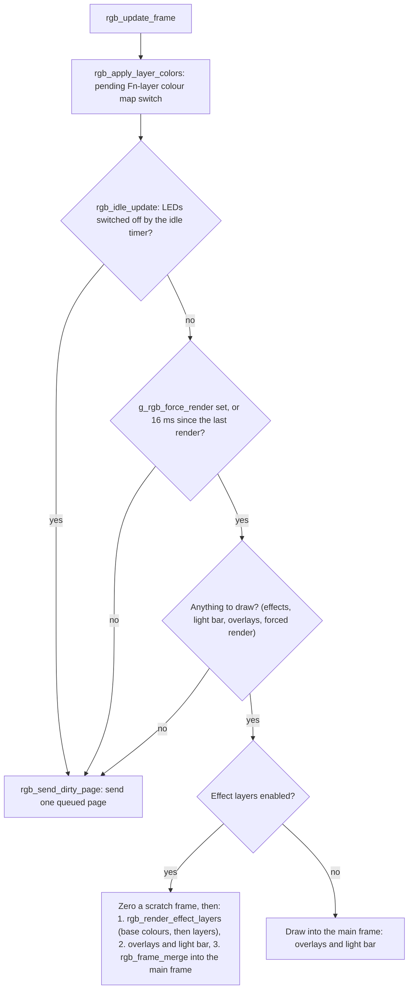

# Extending the lighting: your own RGB effects

This guide explains how the lighting code of openwoot, the open firmware for Wooting hall-effect keyboards, works and how to add an animation effect of your own. It covers the LED model, the frame buffer, the order in which a frame is painted, the effect layer mechanism, a complete worked example and the constraints an effect has to respect. The lighting code is the same for every board; where the boards differ (LED numbers, frame layout, channel gains, light bar), the guide gives the values of the Wooting 80HE (`boards/wooting_80he/`) and of the Wooting 60HE+ (`boards/wooting_60he_plus/`).

Related documents: [architecture](architecture.md) (layers, features, registration lists, main loop, concurrency), [hardware](hardware.md) (LED driver, register pages, LED wiring of each board), [layout](layout.md) (physical positions of keys and LEDs), [protocol](protocol.md) (host commands), [storage](storage.md) (profile files, protobuf schema), [extending-keys](extending-keys.md) (the key pipeline that feeds reactive effects), [building](building.md) (toolchain, boards, build options), [porting](porting.md) (what a board and a feature provide), [flashing](flashing.md) (writing the image to the keyboard).

## Status

- The lighting of the unmodified firmware (effects, colours, brightness, light bar) ran on a Wooting 80HE with ANSI layout in an earlier form of this tree, built without link-time optimisation. The tree described here, with its board, driver and family layers, is not yet tested on hardware, and neither is the link-time-optimised build.
- The lighting data of the Wooting 60HE+ (LED numbers, frame pages, channel gains, key-to-LED tables) is taken from that board's stock firmware, not confirmed on hardware. openwoot has never run on that board.
- The example in section 3, applied to this repository as written with option A of step 8 as the way to select the effect, builds for both boards in both build configurations (`LTO=0` and `LTO=1`) without adding a compiler warning, and `make check` passes with it. A firmware that contains the example is not yet tested on hardware.
- Times are calculated from bus speeds and constants.
- The names of effects, parameters, messages and fields are names chosen by this project. "Rainbow wave", "key ripple", "light bar" and so on describe behaviour and may differ from the names in Wootility.

All code of this area is in [`src/rgb/`](../src/rgb/). Types and constants are in [`rgb_types.h`](../src/rgb/rgb_types.h), global variables in [`rgb_data.h`](../src/rgb/rgb_data.h). All of it runs in the main loop; no interrupt handler touches the lighting code.

File names in this guide are given as the build addresses them: relative to `src/`, or to the board directory for the board tables (`tables/rgb_tables.h` is `boards/<board>/tables/rgb_tables.h`). A name without a directory is a file of the module `rgb` in `src/rgb/`. The lighting is spread over the layers of the tree:

| Part | Where | Boards |
| --- | --- | --- |
| Frame, effect layers, overlays, brightness, output stage | [`src/rgb/`](../src/rgb/) | all |
| Light bar: feature `lightbar` | [`src/rgb/lightbar/`](../src/rgb/lightbar/) | 80HE (`FEATURES` of its `board.mk`) |
| Named live values that the light bar shows: feature `signals` | [`src/rgb/signals/`](../src/rgb/signals/) | 80HE |
| Gamma curve, effect palette, noise permutation | [`tables/rgb_color_tables.c`](../src/tables/rgb_color_tables.c) | all |
| Driver of the LED driver chip IS31FL3741 (driver class `led_matrix`) | [`drivers/is31fl3741/`](../drivers/is31fl3741/), interface [`drivers/led_matrix.h`](../drivers/include/drivers/led_matrix.h) | all (`DRIVERS` of `board.mk`) |
| Bus to the LED driver chip | `hal_led_bus.c` of the family ([`gd32f4xx`](../hal/gd32f4xx/hal_led_bus.c), [`gd32f30x`](../hal/gd32f30x/hal_led_bus.c)), interface [`hal/hal_led_bus.h`](../hal/include/hal/hal_led_bus.h) | all |
| LED numbers, frame size, channel gains, level meter size, light-bar LEDs | `board.h` of the board | per board |
| Key-to-LED tables, LED channel table, frame page table | `tables/rgb_tables.c` of the board | per board |
| Effect layers of the factory profiles | `defaults/profile_defaults.c` of the board | per board |

A new effect is code shared by all boards: it goes into `src/rgb/` and must compile and work for every board. It sizes its loops and arrays with `RGB_MATRIX_ROWS` and `RGB_MATRIX_COLS`, reaches LEDs only through the key-to-LED table and names no constant that only some boards define (the light-bar block of `board.h`, section 1.3). Code that belongs to a feature goes into the feature's directory, which only the boards that list the feature compile; the rest of the firmware reaches it through the feature's public header, which has empty stand-ins for boards without the feature (`lightbar/lightbar.h`, `signals/signals.h`). How features and boards are put together is described in [architecture](architecture.md#features) and [porting](porting.md#a-feature).

The values that differ between the boards:

| | Wooting 80HE | Wooting 60HE+ |
| --- | --- | --- |
| Key matrix `RGB_MATRIX_ROWS` x `RGB_MATRIX_COLS` (`BOARD_KEY_ROWS`, `BOARD_KEY_COLS`) | 6 x 17 = 102 positions | 6 x 14 = 84 positions, row 0 without keys |
| LED numbers that carry an LED | 1..104 | 0..49, 90..107 |
| `RGB_LED_LIMIT` (`BOARD_LED_LIMIT`): every LED number is below it | 105 | 108 |
| `RGB_LED_NONE` (`BOARD_LED_NONE`): "no LED" in the key-to-LED tables | 105 (`0x69`) | 108 (`0x6C`) |
| LEDs in the key-to-LED tables | 88 (ANSI), 89 (ISO), 90 (JIS) | 65 (ANSI), 66 (ISO) |
| Light bar | 10 LEDs, feature `lightbar` | none |
| Frame pages `RGB_FRAME_PAGE_COUNT` (`BOARD_RGB_FRAME_PAGE_COUNT`) | 10 | 7 |
| Size of a frame (`rgb_frame_t`) | 400 bytes | 238 bytes |
| Channel gains red, green, blue (`BOARD_LED_GAIN_RED`, `BOARD_LED_GAIN_GREEN`, `BOARD_LED_GAIN_BLUE`) | 255, 255, 255 | 232, 255, 255 |
| Keys of the level meter (`BOARD_RGB_LEVEL_METER_SEGMENTS`) | 10 | 12 |
| Animation state of one effect layer (`RGB_EFFECT_STATE_SIZE`) | 108 bytes | 92 bytes |

## 1. The lighting model

### 1.1 LEDs and their numbers

Both boards drive their RGB LEDs with one IS31FL3741 matrix driver. The firmware names an LED by its LED number (`led_id` in the code). The entry `RGB_LED_NONE` of a key-to-LED table means "no LED here"; `rgb_frame_set_led` ignores it, like every other number that carries no LED.

An LED number encodes where the LED is wired to the driver, not where it sits on the keyboard. Where the three channels of an LED are kept in the frame (section 1.4) is the board table `k_rgb_led_channels`, one entry per LED number, declared with the other board tables in `tables/rgb_tables.h` ([80HE](../boards/wooting_80he/tables/rgb_tables.h), [60HE+](../boards/wooting_60he_plus/tables/rgb_tables.h)). Its element type is defined in [`rgb_frame_layout.h`](../src/rgb/rgb_frame_layout.h), the header that the board tables and the frame code share:

```c
typedef struct {
    uint8_t page;   /* frame page 0..RGB_FRAME_PAGE_COUNT - 1, RGB_LED_PAGE_NONE = no LED */
    uint8_t offset; /* pwm[] offset of the red channel */
} rgb_led_channel_t;
```

Green and blue are the two bytes after red. The numbering follows the wiring of each board:

| Board | LED numbers | Frame page of an LED |
| --- | --- | --- |
| 80HE | 1..104: 13 LEDs on each of the switch lines SW1..SW8; LED n is on switch line (n - 1) / 13 (0 = SW1). Number 0 carries no LED. | The ten LEDs of a switch line on the current-sink lines CS1..CS30 are in the page of their switch line (pages 0..7), the other three (CS31..CS39) in page 8 (SW1..SW4) or 9 (SW5..SW8). |
| 60HE+ | 0..49: ten LEDs on each of SW1..SW5, on CS1..CS30. 90..107: three LEDs on each of SW1..SW6, on CS31..CS39. 50..89 carry no LED. | LED n below 50 is in page n / 10 at offset 3 x (n % 10); 90..98 are in page 5, 99..107 in page 6. |

An effect does not need this mapping. It addresses keys by matrix row and column and lets the helpers translate. The mapping is implemented once, in `rgb_frame_locate_led` ([`rgb_frame.c`](../src/rgb/rgb_frame.c)); the wiring of the driver and its registers are described in [hardware](hardware.md#is31fl3741-led-driver).

### 1.2 Key positions and the key-to-LED tables

The firmware names a key by its position in a matrix of `RGB_MATRIX_ROWS` rows and `RGB_MATRIX_COLS` columns: 6 x 17 on the 80HE, 6 x 14 on the 60HE+. Row 5 is the bottom row. On the 80HE row 0 is the function-key row; on the 60HE+ row 0 carries no key (`BOARD_KEY_FIRST_ROW` is 1) and row 1 is the number row. This is the same matrix the key code uses (`key id = row << 5 | column`, see [extending-keys](extending-keys.md)).

The translation from matrix position to LED number is one table per physical layout, declared in the board's `tables/rgb_tables.h`: `k_rgb_key_to_led_ansi`, `k_rgb_key_to_led_iso` and, on the 80HE, `k_rgb_key_to_led_jis`, each `uint8_t [BOARD_KEY_ROWS][BOARD_KEY_COLS]`. The board's list of layouts `k_layout_variants` (`tables/layout_tables.c`) names the table of each layout. At start-up `layout_select_variant` ([`layout/layout_variant.c`](../src/layout/layout_variant.c), start-up step `STARTUP_LAYOUT_VARIANT`) stores a pointer to the table of the layout in `g_rgb_key_to_led`, according to `g_layout_physical_variant` (0 ANSI, 1 ISO, 2 JIS; read from the factory device information on the 80HE and from an option byte of the microcontroller on the 60HE+). A layout number at or above `BOARD_LAYOUT_VARIANT_COUNT` gets the ANSI table. All lighting code reads the table through that pointer:

```c
uint8_t led_id = g_rgb_key_to_led[row * RGB_MATRIX_COLS + col];   /* or rgb_effect_key_led(row, col) */
```

Content of `k_rgb_key_to_led_ansi` of the 80HE (`-` = `RGB_LED_NONE`):

| Row | Col 0 | 1 | 2 | 3 | 4 | 5 | 6 | 7 | 8 | 9 | 10 | 11 | 12 | 13 | 14 | 15 | 16 |
| --- | --- | --- | --- | --- | --- | --- | --- | --- | --- | --- | --- | --- | --- | --- | --- | --- | --- |
| 0 | 1 | 14 | 27 | 40 | 53 | 66 | 79 | 92 | 7 | - | 20 | 33 | 46 | 59 | 72 | 85 | 98 |
| 1 | 2 | 15 | 28 | 41 | 54 | 67 | 80 | 93 | 8 | 21 | 34 | 47 | 60 | - | 73 | 86 | 99 |
| 2 | 3 | 16 | 29 | 42 | 55 | 68 | 81 | 94 | 9 | 22 | 35 | 48 | 61 | - | 62 | 87 | 100 |
| 3 | 4 | 17 | 30 | 43 | 56 | 69 | 82 | 95 | 10 | 23 | 36 | 49 | - | - | 75 | - | - |
| 4 | 5 | - | 31 | 44 | 57 | 70 | 83 | 96 | 11 | 24 | 37 | 50 | - | - | 63 | 76 | - |
| 5 | 6 | 19 | 32 | - | 45 | 58 | 71 | 84 | 97 | - | 12 | 25 | 38 | - | 13 | 26 | 39 |

Differences of the other two tables of the 80HE against its ANSI table:

| Layout | Row, column | LED number | ANSI value |
| --- | --- | --- | --- |
| ISO | 2, 14 | - | 62 |
| ISO | 3, 12 | 62 | - |
| ISO | 4, 1 | 18 | - |
| JIS | 1, 13 | 73 | - |
| JIS | 1, 14 | 74 | 73 |
| JIS | 2, 14 | - | 62 |
| JIS | 3, 12 | 62 | - |
| JIS | 4, 12 | 63 | - |
| JIS | 4, 14 | 89 | 63 |
| JIS | 5, 1 | 18 | 19 |
| JIS | 5, 2 | 19 | 32 |
| JIS | 5, 3 | 32 | - |
| JIS | 5, 4 | - | 45 |
| JIS | 5, 8 | - | 97 |
| JIS | 5, 9 | 97 | - |

Content of `k_rgb_key_to_led_ansi` of the 60HE+, taken from that board's stock firmware, not confirmed on hardware:

| Row | Col 0 | 1 | 2 | 3 | 4 | 5 | 6 | 7 | 8 | 9 | 10 | 11 | 12 | 13 |
| --- | --- | --- | --- | --- | --- | --- | --- | --- | --- | --- | --- | --- | --- | --- |
| 0 | - | - | - | - | - | - | - | - | - | - | - | - | - | - |
| 1 | 0 | 1 | 2 | 3 | 4 | 5 | 6 | 7 | 8 | 9 | 90 | 91 | 92 | 107 |
| 2 | 10 | 11 | 12 | 13 | 14 | 15 | 16 | 17 | 18 | 19 | 93 | 94 | 95 | 98 |
| 3 | 20 | 21 | 22 | 23 | 24 | 25 | 26 | 27 | 28 | 29 | 96 | 97 | - | 104 |
| 4 | 30 | - | 32 | 33 | 34 | 35 | 36 | 37 | 38 | 39 | 99 | 100 | - | 101 |
| 5 | 40 | 41 | 42 | - | 43 | 44 | 45 | 46 | 47 | - | 48 | 49 | 102 | 103 |

Differences of the ISO table of the 60HE+ against its ANSI table:

| Row, column | LED number | ANSI value |
| --- | --- | --- |
| 2, 13 | - | 98 |
| 3, 12 | 98 | - |
| 4, 1 | 31 | - |

Two consequences for an effect:

- Not every matrix position has an LED; on the 60HE+ no position of row 0 has one. Loop over all `RGB_MATRIX_ROWS` x `RGB_MATRIX_COLS` positions and let `rgb_frame_set_led` drop the `RGB_LED_NONE` entries; do not test for it yourself.
- Some positions have an LED but no key. The space bar is the key at row 5, column 6 on both boards (`RGB_SPACEBAR_ROW`, `RGB_SPACEBAR_COL` in [`rgb_effects_input.c`](../src/rgb/rgb_effects_input.c)), but LEDs also sit at the neighbouring columns of row 5: columns 4, 5, 7, 8 on the ANSI and ISO layouts of both boards, columns 5 and 7 on the JIS layout of the 80HE (lists `k_layout_spacebar_fill_cols_*` in the board's `tables/layout_tables.c`, reached through `g_layout_spacebar_fill_cols`). An effect that stores one value per key copies the space bar's value to these columns with `rgb_effect_copy_spacebar_cell`, so that the whole space bar lights up.

The tables are constant data in the board's `tables/rgb_tables.c` ([80HE](../boards/wooting_80he/tables/rgb_tables.c), [60HE+](../boards/wooting_60he_plus/tables/rgb_tables.c)).

**Physical positions.** The matrix is a naming scheme, not a ruler: columns are skipped, and on the 80HE the same column sits up to 21 mm apart in x in different rows and the function row is further from the number row than the other rows are from each other. An effect that computes with row and column, as all built-in effects do, is therefore sheared on the real keyboard. Every board directory has positions in millimetres as reference data (not compiled): one file `layout/key_positions_<variant>.csv` per layout with one line per key switch (columns `row`, `col`, `cell`, `x_mm`, `y_mm`, `width_u`, `height_u`, `led_id`, `default_keycode_layer0`, `position_source`), and `layout/leds.csv` with one line per LED and layout (columns `kind`, `led_id`, `variant`, `row`, `col`, `x_mm`, `y_mm`, `position_source`), which also lists the cells under the space bar that carry an LED but no key and, on the 80HE, the light bar. The files of the 80HE are [`key_positions_ansi.csv`](../boards/wooting_80he/layout/key_positions_ansi.csv), [`key_positions_iso.csv`](../boards/wooting_80he/layout/key_positions_iso.csv), [`key_positions_jis.csv`](../boards/wooting_80he/layout/key_positions_jis.csv) and [`leds.csv`](../boards/wooting_80he/layout/leds.csv), those of the 60HE+ [`key_positions_ansi.csv`](../boards/wooting_60he_plus/layout/key_positions_ansi.csv), [`key_positions_iso.csv`](../boards/wooting_60he_plus/layout/key_positions_iso.csv) and [`leds.csv`](../boards/wooting_60he_plus/layout/leds.csv).

A position is the centre of the switch, with the origin at the centre of the top-left key, x to the right and y towards the front. For the LED of a key, `leds.csv` gives the switch centre of the key; on the 80HE the LED sits 4.94 mm behind it (`y_mm - 4.94`), on the two-row Enter key of the ISO and JIS layouts 4.94 mm to the left instead (`x_mm - 4.94`). The column `position_source` says how exact a position is; the `README.md` of the board directory lists its values. The positions of the 60HE+ are nominal positions of a 60 % key grid, not measurements, and its four LEDs under the space bar have none. For an effect that should be geometrically exact (a true circle, a wave with a constant speed in millimetres), generate a constant table of LED positions from the CSV file of your layout and index it by row and column. [layout](layout.md) describes the files and has a sketch of such a table generator.

### 1.3 The light bar (80HE)

The Wooting 80HE has ten LEDs that do not belong to keys; the Wooting 60HE+ has none. "Light bar" is this project's name for them. They are feature `lightbar`, which the 80HE lists in [`board.mk`](../boards/wooting_80he/board.mk) together with feature `signals`, which the light bar needs. A board without the features compiles nothing of `src/rgb/lightbar/` and `src/rgb/signals/`; there the functions of their public headers [`lightbar.h`](../src/rgb/lightbar/lightbar.h) and [`signals.h`](../src/rgb/signals/signals.h) do nothing.

The LED numbers of the light bar are `BOARD_LIGHTBAR_LEDS` in the light-bar block of the 80HE's [`board.h`](../boards/wooting_80he/board.h), in this order: 51, 64, 77, 90, 103, 52, 65, 78, 91, 104 (`BOARD_LIGHTBAR_LED_COUNT` = 10). The feature keeps them in `k_lightbar_led_ids` ([`lightbar/lightbar_leds.c`](../src/rgb/lightbar/lightbar_leds.c)); the index into this list (0..9) is the "light-bar position", `LIGHTBAR_LED_COUNT` (`lightbar/lightbar.h`) the number of positions, 0 on a board without the feature. The ten LEDs stand in one line to the right of the Enter key, 3.4 mm apart, where the matrix cells (3, 15) and (3, 16) would be (the lines of kind `lightbar` in `leds.csv`, see [layout](layout.md)). Which end of the bar is position 0 is not yet confirmed on hardware; position 0 at the left end is the likely assignment.

The light bar is not driven by effect layers. It has its own configuration (profile file `lb` in `g_rgb_lightbar_config`, keyboard-wide file `glb` in `g_rgb_global_lightbar_config`): up to four entries each (`RGB_LIGHTBAR_ENTRY_MAX`), every entry being an optional condition on "signals" plus one light-bar effect (meter, profile indicator, mirror of a key area, blink, static colour, custom colours). The code is in [`src/rgb/lightbar/`](../src/rgb/lightbar/): [`lightbar.c`](../src/rgb/lightbar/lightbar.c) (configuration, binding, drawing), [`lightbar_effects.c`](../src/rgb/lightbar/lightbar_effects.c) and [`lightbar_condition.c`](../src/rgb/lightbar/lightbar_condition.c). Three facts matter for an effect author:

- The light bar is rendered after the effect layers and paints over them when the profile has it enabled (`g_rgb_lightbar_config.enabled`). An effect layer could paint the ten LEDs with `rgb_frame_set_led`, but their numbers are wiring of the 80HE: `BOARD_LIGHTBAR_LEDS` exists only in the 80HE's `board.h` and `k_lightbar_led_ids` only in the feature, so shared code in `src/rgb/` that names either does not build for the 60HE+, and the plain numbers would hit keys there (90, 91, 103 and 104 are key LEDs of the 60HE+). Code for the light bar belongs into `src/rgb/lightbar/`.
- The light bar has its own brightness (`g_rgb_lightbar_brightness`). The ten LEDs are scaled with it, not with the key brightness, when a page is sent (section 1.7).
- Some light-bar effects can also paint a rectangle of keys (`lightbar_fill_key_rect`). They then paint over the effect layers there.

### 1.4 The frame

A frame (`rgb_frame_t`) holds one 8-bit value per driver channel, organised the way the values are sent to the driver:

```c
typedef struct {
    uint8_t index;        /* page number 0..RGB_FRAME_PAGE_COUNT - 1 */
    uint8_t driver_page;  /* register bank of the LED driver */
    uint8_t first_reg;    /* first PWM register of the run */
    uint8_t length;       /* number of PWM bytes sent */
    uint8_t pwm[RGB_FRAME_PAGE_PWM_MAX];   /* linear channel values */
} rgb_frame_page_t;

typedef struct {
    rgb_frame_page_t pages[RGB_FRAME_PAGE_COUNT];
} rgb_frame_t;
```

A page is one contiguous run of PWM registers of the driver, so that one bus write transfers it. Which run each page covers is the board table `k_rgb_frame_pages` (`tables/rgb_tables.c`):

| | 80HE | 60HE+ |
| --- | --- | --- |
| Pages (`RGB_FRAME_PAGE_COUNT`) | 10 | 7 |
| Pages in register bank 0, in bank 1 | 0..5, 6..9 | 0..4, 5..6 |
| PWM bytes of a page | 30 (pages 0..7), 36 (pages 8, 9) | 30 (pages 0..4), 27 (pages 5, 6) |
| Longest page (`RGB_FRAME_PAGE_PWM_MAX`) | 36 | 30 |
| Size of a page, of a frame | 40, 400 bytes | 34, 238 bytes |

The driver and its register pages are described in [hardware](hardware.md#is31fl3741-led-driver).

There are two kinds of frame:

- **The main frame** `g_rgb_frame_main`. It mirrors what the driver shows or is about to show. Its page headers are filled once from `k_rgb_frame_pages` by `rgb_frame_pages_init`, the start-up step `STARTUP_FRAME_PAGES` of [`rgb_frame.c`](../src/rgb/rgb_frame.c).
- **Scratch frames.** `rgb_update_frame` keeps one on its stack, zeroes it and lets the effects paint into it. Its page headers are zero; only the `pwm` bytes are used.

**Dirty marking.** Sending a page costs about 1 ms (section 1.8), so the firmware only sends pages that changed. The queue `g_rgb_dirty_pages` (`int8_t[RGB_FRAME_PAGE_COUNT]`, free entries negative) holds the numbers of the pages to send. `rgb_mark_page_dirty(page)` appends a page number unless it is already queued. Two paths fill the queue:

- A write through `rgb_frame_set_led` or `rgb_frame_scale_led` into the **main** frame compares each of the three channel bytes with the stored value and queues the page when a byte changes. Writes into any other frame never queue anything.
- After the effects have painted a scratch frame, `rgb_frame_merge` (static, [`rgb_frame_update.c`](../src/rgb/rgb_frame_update.c)) copies it byte by byte into the main frame and queues every page in which at least one byte differs.

An effect therefore never deals with pages or dirty marks. It paints all its LEDs on every call; unchanged values cost no bus time.

### 1.5 Colour formats along the pipeline

| Stage | Format | Where |
| --- | --- | --- |
| Stored per-key colours | RGB565 (`uint16_t`: red in bits 15:11, green in 10:5, blue in 4:0) | Base colours `g_rgb_base_colors[RGB_MATRIX_ROWS][RGB_BASE_COLOR_COLS]` (profile file `clr`; 21 columns per row on both boards, of which the first `RGB_MATRIX_COLS` are used); Fn-layer colour maps `g_rgb_layer_colors[3][RGB_MATRIX_ROWS][RGB_MATRIX_COLS]` (files `r1`..`r3`) |
| Colour parameters of effects and settings | "Packed colour", `uint32_t`: bit 31 clear = RGB565 in bits 15:0; bit 31 set (`RGB_PACKED_COLOR_RGB888`) = red in bits 23:16, green in 15:8, blue in 7:0, and a 7-bit alpha in bits 30:24 | Protobuf fields such as `RgbEffectSimplexNoise.color_a`, `RgbBaseSettings.caps_lock_color` |
| Working colour | `0xAARRGGBB` in a `uint32_t` (blue in the low byte). `rgb_argb_t` is the same layout as a struct. | Result of `rgb_unpack_color` and `rgb_convert_rgb565_to_argb`, arguments of `rgb_blend_argb` |
| Frame | Three 8-bit values per LED (red, green, blue), linear, scaled by the channel gains of the board; one byte per driver channel | `rgb_frame_page_t.pwm[]` |
| Driver | 8-bit PWM value after gamma correction and brightness scaling | Computed when a page is sent (section 1.7) |

Conversion details:

- `rgb_convert_rgb565_to_argb` expands a 5-bit or 6-bit channel by shifting it to the top of the byte and, if the channel is not zero, filling the low bits with ones. Full scale becomes 255, zero stays 0. Alpha is `0xFF`.
- `rgb_unpack_color` decodes a packed colour. For the RGB888 form the alpha byte is the 7-bit value doubled. No renderer of the key LEDs uses the alpha value.
- `rgb_frame_set_led` stores `(gain * (v + 1)) >> 8` for each channel value `v`, with the channel gain of the board (`RGB_LED_GAIN_RED`, `RGB_LED_GAIN_GREEN`, `RGB_LED_GAIN_BLUE`, taken from `board.h`). With the gain 255, which the 80HE uses for all three channels, 255 stays 255, 0 stays 0, and every other value becomes one step smaller at most. On the 60HE+ red has the gain 232: a red value of 255 is stored as 232, green and blue behave as on the 80HE. `rgb_frame_scale_led` scales the stored value and applies no gain.
- `rgb_blend_argb(from, to, t)` mixes two working colours: `t` = 0 returns `from`, `t` = 255 returns `to`, values between give `(to * t + from * (255 - t)) >> 8` per channel. The result has alpha `0xFF`.
- A "level" or "scale" in this code is always 0..255 and is applied as `(scale + value * scale) >> 8`: 255 leaves a value unchanged, 0 gives black.

Hue: the built-in effects use an 8-bit hue circle (0 red, 43 yellow, 86 green, 129 cyan, 172 blue, 215 magenta) with full saturation and value. The conversion to RGB exists twice, as the static function `rainbow_hue_to_rgb` in [`rgb_effect_kind_rainbow_wave.c`](../src/rgb/rgb_effect_kind_rainbow_wave.c) and inlined in `rgb_effect_render_hue_cycle` ([`rgb_effects_render.c`](../src/rgb/rgb_effects_render.c)). There is no shared hue function; an effect that needs one brings its own (the example in section 3 does).

### 1.6 `rgb_update_frame`: when a frame is drawn, and in which order

`rgb_update_frame` ([`rgb_frame_update.c`](../src/rgb/rgb_frame_update.c)) is the lighting step of the main loop. `startup_run_active_task` ([`app/tasks.c`](../src/app/tasks.c)) calls it once per main-loop pass while the LED driver is enabled (`g_rgb_driver_enabled`: USB configured and not suspended). One call does exactly one of two things: it renders a frame, or it sends one queued page to the driver.



**Frame period.** A render happens at most every 16 ms (`RGB_FRAME_PERIOD_MS`): the test is `g_clock_uptime_ms - g_rgb_effect_stamp_ms > 15`. `g_rgb_force_render` skips this test once.

**Is there anything to draw?** Three polls decide:

- `rgb_effects_need_render` (static, `rgb_frame_update.c`) for the effect layers, described in section 2.6.
- `lightbar_needs_render` (`lightbar/lightbar.c`) asks every light-bar entry (`rgb_lightbar_entry_needs_redraw`) unless `g_rgb_lightbar_redraw` already requests it. On a board without the light bar it always answers no.
- `rgb_overlays_need_render` (static, `rgb_frame_update.c`): an overlay was started (`g_rgb_overlay_dirty_mask`), a slot ended, a blink is about to toggle or a fade is running.

If none of them reports work and no render is forced, the call sends one queued page instead. A static picture therefore costs no rendering at all.

**Are effect layers enabled?** They are rendered only if all of the following hold: the scan mode level is 0 (`g_run_state_flags >> RUN_STATE_SCAN_MODE_SHIFT`, [`core/run_state.h`](../src/core/run_state.h); the parallel scan mode, which converts all multiplexer inputs per trigger, switches effects off), at least one layer exists (`g_rgb_effect_layer_count`), no Fn-layer colour map is shown (`g_rgb_shown_color_layer` is 0) and the host does not drive the LEDs directly (`g_rgb_sdk_mode_active` is 0).

**Paint order with effect layers** (later steps paint over earlier ones):

1. `rgb_render_effect_layers(&scratch, elapsed_ms)`: first the base colour of every key (`rgb_effect_layers_paint_base_colors`), then every effect layer in list order.
2. `rgb_render_overlays(..., class_mask, ...)` for every overlay class except the one the light bar draws on top of itself (`lightbar_overlay_class()`). On the 80HE these are the overlays on single keys (`RGB_OVERLAY_CLASS_KEYS`): lock indicators (Caps Lock, Scroll Lock, Num Lock, layer lock), the profile-switch blink, latched toggle keys, disabled keys. On the 60HE+, which has no light bar, the same pass also draws the overlays of `RGB_OVERLAY_CLASS_GLOBAL`, the brightness fade (it only changes `g_rgb_fade_level`). Skipped in SDK mode.
3. `lightbar_render_pass(&scratch, ...)`, 80HE only: the light bar (`rgb_render_lightbar`) if `g_rgb_lightbar_config.enabled`, then `rgb_render_overlays(..., RGB_OVERLAY_CLASS_GLOBAL, ...)`: the brightness fade and light-bar colours set by the host (these overlays are skipped in SDK mode). On a board without the light bar this step does nothing.
4. `rgb_frame_merge(&scratch)`.

Steps 2 and 3 are the static function `rgb_render_overlays_and_lightbar` of `rgb_frame_update.c`.

**Paint order without effect layers.** Nothing repaints the keys per frame. The base colours were painted into the main frame when the settings changed (`rgb_paint_base_colors`), a layer colour map by `rgb_apply_layer_colors`. The call then only draws steps 2 and 3 straight into the main frame; an overlay that ends restores the colour of its key from the base colours or the shown layer map.

`elapsed_ms` is the time since the previous render pass of any kind, truncated to 16 bits. It is not a constant 16 ms: after a period in which nothing had to be drawn it can be seconds. Section 4 comes back to this.

### 1.7 Brightness, fade level and gamma

The frame holds linear values. Nothing in an effect applies brightness or gamma. Both are applied when a page is sent, in `rgb_send_dirty_page` (static, `rgb_frame_update.c`), with `rgb_output_value` ([`rgb_frame.h`](../src/rgb/rgb_frame.h)) for every byte:

```c
key_scale = k_rgb_gamma_table[g_rgb_applied_brightness  * g_rgb_fade_level / 255];  /* rgb_send_dirty_page */
scale     = k_rgb_gamma_table[g_rgb_lightbar_brightness * g_rgb_fade_level / 255];  /* lightbar_apply_page_brightness (80HE) */

output = (scale + k_rgb_gamma_table[linear] * scale) >> 8;     /* per channel: rgb_output_value(linear, scale) */
```

- `k_rgb_gamma_table` (256 bytes, [`tables/rgb_color_tables.h`](../src/tables/rgb_color_tables.h), the same for every board) is applied twice: to the channel value and to the brightness factor.
- `g_rgb_applied_brightness` is a copy of the profile setting `g_rgb_settings.base.brightness` (0..255). `rgb_apply_brightness_change` takes a new value over and queues all pages. The brightness keys step it by 5 (`RGB_BRIGHTNESS_STEP`); in the parallel scan mode the maximum is 179 (`RGB_BRIGHTNESS_MAX_FAST_MODE`).
- `g_rgb_fade_level` (0..255, normally 255) is driven by fade overlays: fade-in after the driver wakes (250 ms), idle dimming to 127 and to 0, fade back on key activity (500 ms).
- On the 80HE, `lightbar_apply_page_brightness` ([`lightbar/lightbar_leds.c`](../src/rgb/lightbar/lightbar_leds.c)) computes the channels of the ten light-bar LEDs again with the light-bar brightness. Which `pwm[]` offsets of a page these are is recorded per page in `g_lightbar_page_channels`, filled at start-up by `lightbar_leds_init` from `k_rgb_led_channels`.

Consequence: an effect should use the full 0..255 range and treat the values as linear light levels. A value of 128 is not "half as bright to the eye"; the gamma table maps it to 50 of 255.

### 1.8 From the frame to the driver, and how long that blocks

`rgb_send_dirty_page` takes the oldest entry of `g_rgb_dirty_pages` (`rgb_dirty_page_pop`), computes the output bytes of that page into a local buffer and hands them to `led_matrix_write(bank, first, values, count)`, the interface of the LED driver class ([`drivers/led_matrix.h`](../drivers/include/drivers/led_matrix.h)). The IS31FL3741 driver ([`is31fl3741.c`](../drivers/is31fl3741/is31fl3741.c)) selects the register page of the bank if it differs from the cached one (`is31fl3741_select_page`) and writes the run with `is31fl3741_i2c_write`, which puts the register number and the data into `g_rgb_i2c_tx_buf` and calls `hal_led_bus_write` of the microcontroller family.

`hal_led_bus_write` is blocking, in both families. It sends start condition and address with interrupts masked, lets DMA transfer the bytes and waits for the end. While it waits for the bus to become free, for the DMA transfer and for the stop condition, it calls `tud_task()` in a loop. It has no timeout: if the driver does not answer, the firmware stays in this function.

Calculated bus times at 400 kHz (9 bit times of 2.5 µs per byte), on both boards:

| Transfer | Bytes on the bus | Time |
| --- | --- | --- |
| One page of 30 values | address + register + 30 = 32 | about 0.72 ms |
| One page of 36 values (80HE, pages 8 and 9) | 38 | about 0.86 ms |
| One page of 27 values (60HE+, pages 5 and 6) | 29 | about 0.65 ms |
| Register page select (two one-byte writes) | 2 x 3 | about 0.14 ms |
| All ten pages of the 80HE | 8 x 32 + 2 x 38 = 332, plus two page selects | about 7.7 ms |
| All seven pages of the 60HE+ | 5 x 32 + 2 x 29 = 218, plus two page selects | about 5.2 ms |

Because one call sends one page, a frame in which every page changed needs `RGB_FRAME_PAGE_COUNT` main-loop passes (10 on the 80HE, 7 on the 60HE+) to reach the driver, and each of these passes is longer by the page time. A frame is never sent as a whole, and there is no synchronisation between pages: the LEDs of different pages change up to several milliseconds apart. A render call sends nothing; the first page of a new frame leaves on the following pass.

The main loop does nothing else during a page write except `tud_task()`. The key scan of the next cycle starts only after `rgb_update_frame` returns, so lighting traffic adds directly to the time between two key passes. This is the reason for the design "one page or one render per pass".

## 2. Effect layers

### 2.1 The layer record

A profile's lighting settings (`RgbSettings`, RAM copy `g_rgb_settings`, profile file `rgb`) contain a list of up to six effect layers (`RGB_EFFECT_LAYER_MAX`). Layers are rendered in list order on top of the base colours, each on top of the previous ones. A layer either replaces the colour of LEDs or dims what is already there, so layers combine: a colour animation below, a reactive mask above.

The run-time form of a layer is `rgb_effect_layer_t` (124 bytes on the 80HE, 108 on the 60HE+); the array is `g_rgb_effect_layers[RGB_EFFECT_LAYER_MAX]`, the number of used entries `g_rgb_effect_layer_count`:

```c
typedef struct {
    RgbEffectLayer     cfg;    /* +0x00, 16 bytes: copy of the protobuf layer entry */
    rgb_effect_state_t state;  /* +0x10, RGB_EFFECT_STATE_SIZE bytes: animation state, a union with one member per kind */
} rgb_effect_layer_t;
```

- `cfg` is the nanopb struct generated from message `RgbEffectLayer` ([`src/proto/settings.proto`](../src/proto/settings.proto), C type in [`proto/settings.pb.h`](../src/proto/settings.pb.h)). It is a oneof: `cfg.which_effect` (a `uint16_t` at offset 0) is the **effect kind**, and `cfg.effect` (at offset 4, at most 12 bytes) is the parameter message of that kind, for example `cfg.effect.rainbow_wave`. The kind constants are the generated tag macros `RgbEffectLayer_<member>_tag`.
- `state` is `rgb_effect_state_t`, a union of one small struct per kind. Its size is that of the largest member, the ripple state of kind 5: one cell byte per matrix position and 6 bytes behind the cells, rounded up to a multiple of 4. `RGB_EFFECT_STATE_SIZE` is this size as a formula over `RGB_KEY_COUNT`: 108 bytes on the 80HE, 92 on the 60HE+. A `_Static_assert` keeps the union at this size and the record at 16 bytes more.

**Life cycle.** `rgb_effects_apply_layer_settings` ([`rgb_effects_state.c`](../src/rgb/rgb_effects_state.c)) copies the layer list of `g_rgb_settings` into the run-time layers. It runs when a profile is activated (`profile_init_rgb_effects`, the profile section in slot `PROFILE_SECTION_EFFECT_START` of [`profile/profile_sections.c`](../src/profile/profile_sections.c)) and when the host sends new settings (`protocol_cmd_set_rgb_settings` in [`protocol/protocol_rgb_settings.c`](../src/protocol/protocol_rgb_settings.c)). For every list entry:

- If the slot is new or its kind changed: copy the entry, zero the state (`memset`) and call `rgb_effect_reset_slot_state(slot)`, which sets the start state of the kind.
- If the kind is unchanged: call the static `rgb_effect_update_slot_params(slot, entry)`, which resets only the state that depends on changed parameters so that a running animation continues, then copy the entry.

Settings in the older single-effect form (`RgbSettings.effect.legacy_effect`, oneof tag 3) are first rewritten into a one-entry layer list by `rgb_settings_convert_legacy_effect` ([`rgb_effects_settings.c`](../src/rgb/rgb_effects_settings.c)).

### 2.2 The effect kinds that exist

The names in this table are this project's descriptions of what the code does.

| Kind | Member of `cfg.effect` (message) | Parameters | State member | What it draws |
| --- | --- | --- | --- | --- |
| 1 | `rainbow_wave` (`RgbEffectRainbowWave`) | `hue_preset` (`RgbHuePreset`: full circle or one of five hue ranges), `period_250ms` (one cycle takes 250 ms x value), `direction` | `hue` | Hue gradient moving over the matrix columns. Replaces all key colours. |
| 2 | `scanner` (`RgbEffectScanner`) | `width`, `steps_per_second` (clamped to 1..60), `outside_level`, `start_direction` (`RgbScannerDirection`) | `scanner` | A window of columns or rows at full level sweeping back and forth; everything outside is dimmed to `outside_level`. Rows count from the first row with keys (`RGB_FIRST_KEY_ROW`). |
| 3 | `breathing` (`RgbEffectBreathing`) | `step_ms` (clamped to 1..40), `min_level` | `breathing` | Dims all keys up and down between `min_level` and full. |
| 4 | `hue_cycle` (`RgbEffectHueCycle`) | `hue_preset`, `period_250ms` | `hue` | All keys in one colour that runs through the hue range. Replaces all key colours. |
| 5 | `key_ripple` (`RgbEffectKeyRipple`) | `flags` (bit 0 palette colours, bit 2 inverted levels), `steps_per_second` (clamped to 1..50), `decay_step_ms`, `base_level` | `ripple` | A diamond-shaped wave spreading from every pressed key, with a fading tail (cellular automaton). |
| 6 | `reactive_fade` (`RgbEffectReactiveFade`) | `base_level`, `step_ms`, `flags` (bit 0 random palette colour, bit 1 fixed colour, bit 2 inverted), `color` (packed colour) | `reactive` | Pressed keys light up and fade out. |
| 7 | `level_meter` (`RgbEffectLevelMeter`) | `base_level`, `use_gamepad_curve`; `f3`..`f5` are not read by any code | `level_meter` | Bar graph of the deepest pressed key on the `RGB_LEVEL_METER_SEGMENTS` keys of row 1 from column 1: columns 1..10 on the 80HE, 1..12 on the 60HE+. |
| 8 | `analog_spotlight` (`RgbEffectAnalogSpotlight`) | `base_level`, `use_gamepad_curve` | `key_map` | A lit square around every pressed key that grows with the key depth; the rest is dimmed. |
| 9 | `analog_glow` (`RgbEffectAnalogGlow`) | `base_level`, `use_gamepad_curve` | `key_map` | Every pressed key and its eight neighbours are lit in proportion to the key depth. |
| 10 | `analog_rgb_fill` (`RgbEffectAnalogRgbFill`) | `use_gamepad_curve` | `fill` | All keys in one colour; the depths of the last three keys of row 5 (columns 14, 15, 16 on the 80HE, 11, 12, 13 on the 60HE+) give red, green and blue. |
| 11 | `key_test` (`RgbEffectKeyTest`) | `base_level` | `key_map` | Marks keys: green while the key is pressed, red while it is past the actuation point of rapid trigger but not pressed; other keys are dimmed. |
| 12 | `f12` | `f1`..`f7` | none | Nothing. The member exists in the schema, but no code reads it. |
| 13 | `f13` | none (empty message) | `key_map` | Nothing. `rgb_effects_feed_key_travel` stores per-key analog levels for it, but no renderer exists. |
| 14 | `simplex_noise` (`RgbEffectSimplexNoise`) | `color_a`, `color_b` (packed colours), `speed`, `scale` | `noise` | Two-colour 3D simplex noise field drifting in time. Replaces all key colours. |
| 15 | `polar_gradient` (`RgbEffectPolarGradient`) | `color_a`, `color_b`, `speed` (signed), `twist` (signed) | `polar` | Two-colour angular gradient rotating around the centre of the matrix (row `RGB_MATRIX_ROWS` / 2, column `RGB_MATRIX_COLS` / 2: row 3.0, column 8.5 on the 80HE, row 3.0, column 7.0 on the 60HE+), optionally twisted into a spiral. Replaces all key colours. The point is not the physical middle of the keyboard (on the 80HE it lies near x = 176 mm, y = 62 mm; the middle of the key field is at x = 155 mm, y = 50 mm), and distances are counted in matrix steps, see section 1.2. |

The parameter fields are documented field by field in the comments of the `.proto` file and of the generated header. The state structs (`rgb_effect_hue_state_t`, `rgb_effect_scanner_state_t`, `rgb_effect_breathing_state_t`, `rgb_effect_ripple_state_t`, `rgb_effect_reactive_state_t`, `rgb_effect_level_meter_state_t`, `rgb_effect_key_map_state_t`, `rgb_effect_fill_state_t`, `rgb_effect_noise_state_t`, `rgb_effect_polar_state_t`) are in `rgb_types.h`.

Where each kind is implemented:

| Kinds | File |
| --- | --- |
| 1 | [`rgb_effect_kind_rainbow_wave.c`](../src/rgb/rgb_effect_kind_rainbow_wave.c) |
| 2, 3, 4, 7 | [`rgb_effects_render.c`](../src/rgb/rgb_effects_render.c): `rgb_effect_render_scanner`, `rgb_effect_render_breathing`, `rgb_effect_render_hue_cycle`, `rgb_effect_render_level_meter` |
| 5 | [`rgb_effect_kind_key_ripple.c`](../src/rgb/rgb_effect_kind_key_ripple.c) |
| 6 | [`rgb_effect_kind_reactive_fade.c`](../src/rgb/rgb_effect_kind_reactive_fade.c): `rgb_render_reactive_fade_effect` |
| 8, 9 | [`rgb_effect_kind_analog.c`](../src/rgb/rgb_effect_kind_analog.c) |
| 10 | `rgb_frame_fill_keys` in [`rgb_frame.c`](../src/rgb/rgb_frame.c) |
| 11 | [`rgb_effect_kind_key_test.c`](../src/rgb/rgb_effect_kind_key_test.c) |
| 14 | [`rgb_effect_kind_simplex_noise.c`](../src/rgb/rgb_effect_kind_simplex_noise.c) |
| 15 | [`rgb_effect_kind_polar_gradient.c`](../src/rgb/rgb_effect_kind_polar_gradient.c) |

The functions of kinds 2, 3, 4, 6, 7 and 10 have parameter lists of their own; static wrappers in `rgb_effect_layers.c` give them the signature of section 2.3.

### 2.3 The dispatcher and the effect function signature

Rendering is split into a dispatcher and one function per kind. The dispatcher is `rgb_render_effect_layers` in [`rgb_effect_layers.c`](../src/rgb/rgb_effect_layers.c):

```c
void rgb_render_effect_layers(rgb_frame_t *frame, uint32_t elapsed_ms)
{
    g_rgb_effect_redraw_request = 0;
    /* ... optional reset of all layer states (g_rgb_effect_reset_request; nothing sets it) ... */

    rgb_effect_layers_paint_base_colors(frame);

    for (uint8_t i = 0; i < g_rgb_effect_layer_count; i++) {
        rgb_effect_layer_t *layer = &g_rgb_effect_layers[i];

        switch (layer->cfg.which_effect) {
        case RgbEffectLayer_rainbow_wave_tag:
            rgb_effect_kind_rainbow_wave(frame, layer, elapsed_ms);
            break;
        /* ... one case per kind ... */
        default:   /* kinds 12, 13 and unknown kinds: not drawn */
            break;
        }
    }
}
```

Every kind is one function with the same signature, declared in [`rgb_effect_layers_internal.h`](../src/rgb/rgb_effect_layers_internal.h):

```c
typedef void rgb_effect_render_fn(rgb_frame_t *frame, rgb_effect_layer_t *layer, uint32_t elapsed_ms);
```

| Argument | Meaning |
| --- | --- |
| `frame` | The frame to paint into. It already holds the base colours and the output of all earlier layers. Today it is always the scratch frame of `rgb_update_frame`; do not assume that, and never write to `g_rgb_frame_main` directly. |
| `layer` | The layer record: parameters in `layer->cfg.effect.<member>`, state in `layer->state.<member>`. |
| `elapsed_ms` | Milliseconds since the previous render pass (0..65535). 0 on the frame after a state reset through `g_rgb_effect_reset_request`. |

The function is called once per rendered frame and layer. It must leave every key LED it is responsible for in a defined state on every call, because the scratch frame starts from zero and from the base colours each time. Nothing persists in the frame between calls; everything an effect remembers lives in `layer->state`.

### 2.4 Helper functions an effect can call

Declared in [`rgb_frame.h`](../src/rgb/rgb_frame.h) unless noted:

| Function or object | Use |
| --- | --- |
| `rgb_effect_key_led(row, col)` (static inline, `rgb_effect_layers_internal.h`) | LED number of a matrix position, `RGB_LED_NONE` if there is none. |
| `rgb_frame_set_led(frame, led_id, r, g, b)` | Set the colour of one LED, scaled by the channel gains of the board (section 1.5). Ignores `RGB_LED_NONE` and every other number without an LED. |
| `rgb_frame_scale_led(frame, led_id, scale)` | Dim the colour that is already in the frame: each channel becomes `(scale + c * scale) >> 8`. This is how a layer acts as a mask over lower layers. |
| `rgb_frame_set_key_scaled(frame, row, col, r, g, b, scale)` | Set the colour of the key at a matrix position, dimmed by `scale` (255 = unchanged). |
| `rgb_frame_fill_keys(frame, r, g, b)` | Set all `RGB_MATRIX_ROWS` x `RGB_MATRIX_COLS` key positions to one colour. |
| `rgb_frame_locate_led(frame, led_id, &page_r, &page_g, &page_b, &ch_r, &ch_g, &ch_b)` | Pointers to the three channel bytes of an LED, to read the current colour. Returns 0 and leaves the outputs untouched for a number without an LED (every number from `RGB_LED_LIMIT` on, `RGB_LED_NONE` included, and every number whose entry in `k_rgb_led_channels` names no page). It does not check `frame`; always pass a valid frame. `rgb_render_reactive_fade_effect` uses the function for a cross-fade towards the colour below. |
| `rgb_blend_argb(from, to, t)` | Mix two `0xAARRGGBB` colours, `t` = 0..255. |
| `rgb_unpack_color(packed)` | Packed colour parameter to `0xAARRGGBB`. |
| `rgb_convert_rgb565_to_argb(rgb565)` | RGB565 to `0xAARRGGBB`. |
| `k_rgb_palette_red`, `k_rgb_palette_green`, `k_rgb_palette_blue` ([`tables/rgb_color_tables.h`](../src/tables/rgb_color_tables.h)) | Seven fixed colours (red, green, blue, yellow, magenta, cyan, orange), index 0..6, used by kinds 5 and 6. |
| `g_rgb_key_distance_table`, `g_rgb_key_angle_table` ([`rgb_data.h`](../src/rgb/rgb_data.h)) | Per key: 16 x distance from the centre of the matrix (section 2.2, kind 15), and the angle around it scaled to 0..255, both in matrix steps, not millimetres. Valid only after `rgb_init_polar_tables()` ([`rgb_effects.h`](../src/rgb/rgb_effects.h)) has run; call it from the state reset of your kind, as kind 15 does. For true distances build your own table from the positions in the layout CSV files (section 1.2). |
| `k_rgb_simplex_perm` (`tables/rgb_color_tables.h`) | Permutation table of the noise effect, usable as a cheap hash. |
| `g_rgb_base_colors[row][col]` | The profile's base colour of a key (RGB565), if the effect wants to refer to it. |
| `rgb_effect_copy_spacebar_cell(&cells[0][0], row, col)` ([`rgb_effects.h`](../src/rgb/rgb_effects.h)) | For per-key state arrays of `RGB_MATRIX_ROWS` x `RGB_MATRIX_COLS` bytes: if (row, col) is the space bar, copy its cell to the other LED positions of the space bar. |
| `g_clock_uptime_ms` ([`core/clock.h`](../src/core/clock.h)) | Millisecond uptime, if an effect needs absolute time. |

Hue to RGB conversion is not among the helpers; see section 1.5.

The values that the light bar shows ("signals", `enum rgb_signal_id` in [`signals.h`](../src/rgb/signals/signals.h): deepest key of the last pass, key pressed, key presses in the last 990 ms, active layer, lock states and others) are not a helper for effects. They exist only on a board with feature `signals` (the 80HE), in `g_rgb_signal_table`, which the feature's internal header `signals/signals_internal.h` declares; shared code that reads it does not link for the 60HE+. An effect for every board takes key activity from the input functions of section 2.5.

### 2.5 Input for reactive effects: key events and key travel

Two functions in [`rgb_effects_input.c`](../src/rgb/rgb_effects_input.c) carry key activity into the layer states. Both are called from the key processing pass (main-loop context, see [extending-keys](extending-keys.md)); both walk all layers and switch on the kind. A reactive effect adds a `case` to one of them and writes its own state there. The renderer only reads that state on the next frame.

**Key events: `rgb_effects_handle_key_event(row, col, event)`.**

| Event (`enum rgb_key_event`) | Sent when | Caller |
| --- | --- | --- |
| `RGB_KEY_EVENT_PRESSED` | The key's digital state changed to pressed | `keys_handle_key_edge` ([`keys/keys_scan_pass.c`](../src/keys/keys_scan_pass.c)) |
| `RGB_KEY_EVENT_RELEASED` | The digital state changed to released | `keys_handle_key_edge` |
| `RGB_KEY_EVENT_ACTUATED` | With rapid trigger: the key passed the actuation point and entered the rapid-trigger zone | `keys_update_press_state_rapid_trigger` ([`keys/keys_actuation.c`](../src/keys/keys_actuation.c)) |
| `RGB_KEY_EVENT_RESET` | The key is back in the released zone: without rapid trigger together with the release, with rapid trigger when the key leaves the rapid-trigger zone | `keys_handle_key_edge`, `keys_update_press_state_rapid_trigger` |

Key events are not delivered while `g_rgb_sdk_mode_active` is set.

**Analog travel: `rgb_effects_feed_key_travel(row, col, travel)`.** `keys_update_key_common` calls it for every scan event of a key with the travel 0..4095. A key at rest produces no scan events, so the feed stops after one last call with travel 0 when the key comes back to rest. The existing analog kinds convert the travel to a level 0..255 (or 0..4095 for the level meter), optionally through the gamepad response curve (`use_gamepad_curve`), and store it in their state. `rgb_effects_reset_key_state` clears this analog state when the scan mode changes (called from [`adc_scan/adc_scan_control.c`](../src/adc_scan/adc_scan_control.c)); add your kind there if it keeps analog state.

### 2.6 The redraw poll

`rgb_effects_need_render` (static, `rgb_frame_update.c`) decides every 16 ms whether the effect layers need a new frame. It returns "yes" if `g_rgb_effect_redraw_request` is set (the base colours or settings changed) or if any layer wants one:

| Kinds | Wants a frame when |
| --- | --- |
| 5, 6 | `state.ripple.active` / `state.reactive.active` is set (same offset; the renderer clears it when no key is animating) |
| 7 | `state.level_meter.dirty` |
| 8, 9, 11 | `state.key_map.dirty` |
| 10 | `state.fill.dirty` (set at reset and never cleared, so this kind renders every frame) |
| every other kind, including unknown ones | always |

A kind that is not listed renders every 16 ms. That is correct for a continuous animation. An event-driven kind should add its own flag to the `switch`, set it in the input function and clear it in the renderer once nothing moves; otherwise it keeps the frame loop busy for nothing.

## 3. Walkthrough: adding an effect kind

The example adds effect kind 16, a "key heat map": every key press adds heat to the key, heat decays over time, and a warm key is shown in a colour from blue (barely warm) to red (hot). Cold keys keep the colour of the layers below, dimmed to a base level. It is reactive on purpose, so that the walkthrough touches every hook. A continuous animation skips steps 6 and 7. Nothing in the example depends on the board: the same steps give the effect on the 80HE and on the 60HE+, and it does not touch the light bar.

Effect kinds have no registration list: the dispatcher and the other functions of section 2 switch on the kind, so a new kind adds one `case` to each switch that concerns it (steps 4 to 7). Where the tree has a registration list ([architecture](architecture.md#registration)), the example uses it: step 8 registers a profile section next to its function instead of editing the profile module.

Files touched:

| Step | File | Change |
| --- | --- | --- |
| 1 | `src/proto/settings.proto`, `settings.options`; regenerated `settings.pb.h`, `settings.pb.c` | Parameter message and oneof member (the kind number) |
| 2 | [`rgb_types.h`](../src/rgb/rgb_types.h) | State struct and union member |
| 3 | new `rgb_effect_kind_heat.c` | The effect function |
| 4 | [`rgb_effect_layers_internal.h`](../src/rgb/rgb_effect_layers_internal.h) | Prototype |
| 4 | [`rgb_effect_layers.c`](../src/rgb/rgb_effect_layers.c) | Dispatcher `case` |
| 5 | [`rgb_effects_state.c`](../src/rgb/rgb_effects_state.c) | State reset and parameter take-over |
| 6 | [`rgb_effects_input.c`](../src/rgb/rgb_effects_input.c) | Key event feed |
| 7 | [`rgb_frame_update.c`](../src/rgb/rgb_frame_update.c) | Redraw poll |
| 8 | new `rgb_effects_force_heat.c`, [`rgb_effects.h`](../src/rgb/rgb_effects.h), [`protocol/protocol_rgb_settings.c`](../src/protocol/protocol_rgb_settings.c) | Making the effect selectable (option A) |

### Step 1: kind number and parameters (protobuf schema)

The kind is the tag of a new member in the oneof of message `RgbEffectLayer`. Tags 1..15 are taken; use 16. The parameter message must fit into the 12 bytes of the union (`_Static_assert(sizeof(RgbEffectLayer) == 16, ...)` in `rgb_types.h` fails otherwise).

Add the parameter message to [`src/proto/settings.proto`](../src/proto/settings.proto), in front of the two comment lines that introduce `message RgbEffectLayer`, with an empty line after it:

```proto
// Custom. Parameters of effect kind 16 (RgbEffectLayer tag 16): key heat map.
message RgbEffectHeat {
  required uint32 gain = 1;           // heat added by one key press, 1..255
  required uint32 decay_step_ms = 2;  // every this many ms each key loses 4 units of heat; 0 is treated as 1
  required uint32 base_level = 3;     // scale 0..255 applied to cold keys
}
```

and this line to the oneof of `RgbEffectLayer`, after the line of `polar_gradient = 15`:

```proto
    RgbEffectHeat heat = 16;                        // custom: kind 16, rgb_effect_kind_heat
```

Add these lines to [`src/proto/settings.options`](../src/proto/settings.options), after the line of `RgbEffectPolarGradient.twist`, so that the three fields become `uint8_t` like those of the built-in effects:

```
RgbEffectHeat.gain                       int_size:IS_8
RgbEffectHeat.decay_step_ms              int_size:IS_8
RgbEffectHeat.base_level                 int_size:IS_8
```

Regenerate the C files with the nanopb generator 0.4.9.1, from the repository root. [Storage](storage.md#regenerating-the-c-code) describes how to install the generator, the schema files and the rules for changing them.

```sh
nanopb_generator -I src/proto -f src/proto/settings.options -D src/proto src/proto/settings.proto
```

This gives the type `RgbEffectHeat`, the union member `cfg.effect.heat` and the kind constant of the new member (the tag macro `RgbEffectLayer_<member>_tag` of section 2.1, value 16) that the code of the following steps uses. The generated bounds stay as they are: `RgbEffectLayer_size` is 26 and `RgbSettings_size` 200 before and after the change.

Two things to know about the schema files:

- `settings.proto` and `settings.options` are the source; [`proto/settings.pb.h`](../src/proto/settings.pb.h) and `proto/settings.pb.c` are generated from them and are not edited by hand. The `.options` file fixes the C layout of the messages (integer widths, array sizes), which the firmware code relies on. The schema describes the stored settings and the messages of the host protocol, and both are shared with stock firmware 2.14.1 and with the vendor's configuration program. Adding a oneof member or a field with a new number is a compatible change in the protobuf sense: a program that does not know the number skips it. Never change the number or the type of an existing field.
- The encode buffers for file `rgb` are fixed at 182 bytes in three places (`RGB_SETTINGS_FILE_BUF_SIZE` in [`rgb_brightness.c`](../src/rgb/rgb_brightness.c), `PROTOCOL_RGB_FILE_BUFFER_SIZE` in [`protocol/protocol_rgb_settings.c`](../src/protocol/protocol_rgb_settings.c), `PROFILE_RGB_ENCODED_MAX` in [`profile/profile_default_files.c`](../src/profile/profile_default_files.c)). The generated maximum `RgbSettings_size` of the schema is 200 already. `storage_write_profile_pb_file` does not check the encode result; a message that does not fit is stored truncated. The heat message encodes shorter than the largest existing layer, so it does not make this worse, but if you add a kind with larger parameters, replace the three constants by `RgbSettings_size`.

### Step 2: state

Add the state struct to [`rgb_types.h`](../src/rgb/rgb_types.h), behind the state struct of kind 15 (`rgb_effect_polar_state_t`), with an empty line in front of it:

```c
/* Kind 16 (custom): key heat map. */
typedef struct {
    uint8_t  cells[RGB_MATRIX_ROWS][RGB_MATRIX_COLS]; /* heat 0..255 per matrix position */
    uint8_t  active;   /* 1 while a key is warm or a redraw is wanted; polled by rgb_effects_need_render */
    uint8_t  resume;   /* 1 = the next frame follows an idle period: its elapsed time is ignored */
    uint16_t timer_ms; /* elapsed time not yet turned into decay steps */
} rgb_effect_heat_state_t;
```

and this member to the union `rgb_effect_state_t`, after the member `polar`:

```c
    rgb_effect_heat_state_t        heat;        /* kind 16 (custom) */
```

The struct has one cell per matrix position, like the ripple state that sets the size of the union, and two bytes less behind the cells: 106 bytes on the 80HE and 88 on the 60HE+, below the 108 and 92 bytes of the union. The existing `_Static_assert(sizeof(rgb_effect_state_t) == RGB_EFFECT_STATE_SIZE, ...)` catches a state that is too large on any board. If you really need more, change the formula of `RGB_EFFECT_STATE_SIZE`; the assert of `rgb_effect_layer_t` follows it, and the record size is not visible outside the firmware.

### Step 3: the effect function

New file `rgb_effect_kind_heat.c` in `src/rgb/`. The build compiles every `src/*/*.c` for every board, so no build file changes ([building](building.md#how-the-source-list-follows-from-boardmk)).

```c
/*
 * rgb_effect_kind_heat.c - effect kind 16 (custom): key heat map. Every key press adds heat to
 * the key (rgb_effects_handle_key_event), heat decays with time. Warm keys are painted from
 * blue to red, cold keys keep the colour of the lower layers, dimmed to the base level.
 */
#include "rgb/rgb_effect_layers_internal.h"
#include "rgb/rgb_frame.h"

#define HEAT_DECAY_PER_STEP 4u    /* heat units a key loses per decay step */
#define HEAT_HUE_COLD       172u  /* blue on the 8-bit hue circle (0 = red) */
#define HEAT_HUE_SECTOR     43u   /* 256 / 6 */

/* Hue 0..255 at full saturation and value to RGB, with linear ramps. */
static void heat_hue_to_rgb(uint8_t hue, uint8_t *r, uint8_t *g, uint8_t *b)
{
    uint32_t sector  = hue / HEAT_HUE_SECTOR;
    uint8_t  rising  = (uint8_t)((hue % HEAT_HUE_SECTOR) * 6u); /* 0..252 */
    uint8_t  falling = (uint8_t)(255u - rising);

    switch (sector) {
    case 0:  *r = 255;     *g = rising;  *b = 0;       break; /* red to yellow */
    case 1:  *r = falling; *g = 255;     *b = 0;       break; /* yellow to green */
    case 2:  *r = 0;       *g = 255;     *b = rising;  break; /* green to cyan */
    case 3:  *r = 0;       *g = falling; *b = 255;     break; /* cyan to blue */
    case 4:  *r = rising;  *g = 0;       *b = 255;     break; /* blue to magenta */
    default: *r = 255;     *g = 0;       *b = falling; break; /* magenta to red */
    }
}

void rgb_effect_kind_heat(rgb_frame_t *frame, rgb_effect_layer_t *layer, uint32_t elapsed_ms)
{
    const RgbEffectHeat     *params = &layer->cfg.effect.heat;
    rgb_effect_heat_state_t *state  = &layer->state.heat;
    uint32_t step_ms = (params->decay_step_ms != 0) ? params->decay_step_ms : 1u;
    uint32_t total_ms;
    uint32_t decay;
    uint8_t  active = 0;

    /* The first frame after an idle period carries the whole idle time; do not decay by it. */
    if (state->resume != 0) {
        state->resume = 0;
        elapsed_ms = 0;
    }

    /* Elapsed time to decay steps; the remainder stays in the timer. */
    total_ms = state->timer_ms + elapsed_ms;
    decay = (total_ms / step_ms) * HEAT_DECAY_PER_STEP;
    state->timer_ms = (uint16_t)(total_ms % step_ms);

    for (uint32_t row = 0; row < RGB_MATRIX_ROWS; row++) {
        for (uint32_t col = 0; col < RGB_MATRIX_COLS; col++) {
            uint32_t heat = state->cells[row][col];

            heat = (heat > decay) ? heat - decay : 0u;
            state->cells[row][col] = (uint8_t)heat;

            if (heat == 0u) {
                /* Cold: keep what the lower layers painted, dimmed. */
                rgb_frame_scale_led(frame, rgb_effect_key_led(row, col), params->base_level);
            } else {
                uint8_t r;
                uint8_t g;
                uint8_t b;

                /* Heat 1 is blue (hue 172), heat 255 is red (hue 0). */
                heat_hue_to_rgb((uint8_t)(HEAT_HUE_COLD - HEAT_HUE_COLD * heat / 255u), &r, &g, &b);
                rgb_frame_set_led(frame, rgb_effect_key_led(row, col), r, g, b);
                active = 1;
            }
        }
    }

    /* No warm key left: no further frames until the next key press. */
    state->active = active;
}
```

Points to take from this function:

- It handles all matrix positions (102 on the 80HE, 84 on the 60HE+) on every call and never tests for `RGB_LED_NONE`.
- It uses only integer arithmetic. Float arithmetic is available (the microcontrollers of both boards have a single-precision FPU, and kind 15 uses it), but keep `double` out: it is computed in software.
- Time enters only through `elapsed_ms` and a remainder kept in the state. Do not assume 16 ms per call.

### Step 4: prototype and dispatcher case

In [`rgb_effect_layers_internal.h`](../src/rgb/rgb_effect_layers_internal.h), add this line to the list of prototypes, after the line of `rgb_effect_kind_polar_gradient`:

```c
rgb_effect_render_fn rgb_effect_kind_heat;             /* kind 16, rgb_effect_kind_heat.c (custom) */
```

In `rgb_render_effect_layers` ([`rgb_effect_layers.c`](../src/rgb/rgb_effect_layers.c)), add before the `default`:

```c
        case RgbEffectLayer_heat_tag:
            rgb_effect_kind_heat(frame, layer, elapsed_ms);
            break;
```

### Step 5: state reset and parameter take-over

Both functions are in [`rgb_effects_state.c`](../src/rgb/rgb_effects_state.c). `RGB_EFFECT_CELL_MAP_SIZE` is a macro of that file (`RGB_MATRIX_ROWS * RGB_MATRIX_COLS`). In both switches the cases are separated by empty lines; add each new `case` before the `default`, followed by an empty line.

In `rgb_effect_reset_slot_state`, which runs for a new layer after its state was zeroed:

```c
    case RgbEffectLayer_heat_tag:
        memset(slot->state.heat.cells, 0, RGB_EFFECT_CELL_MAP_SIZE);
        slot->state.heat.timer_ms = 0;
        slot->state.heat.resume = 0;
        slot->state.heat.active = 1; /* one frame, so that the cold keys get the base level */
        break;
```

In the static `rgb_effect_update_slot_params`, which runs when the host changes the parameters of an existing layer of the same kind:

```c
    case RgbEffectLayer_heat_tag:
        slot->state.heat.active = 1; /* redraw with the new base level; the heat is kept */
        break;
```

Without the second `case` a changed `base_level` would only become visible with the next key press, because nothing else requests a frame.

### Step 6: the key event feed

In `rgb_effects_handle_key_event` ([`rgb_effects_input.c`](../src/rgb/rgb_effects_input.c)), add a `case` to the `switch (layer->cfg.which_effect)`, before the `default` and followed by an empty line:

```c
        case RgbEffectLayer_heat_tag:
            if (event == RGB_KEY_EVENT_PRESSED) {
                rgb_effect_heat_state_t *heat = &layer->state.heat;
                uint32_t level = heat->cells[row][col] + layer->cfg.effect.heat.gain;

                heat->cells[row][col] = (uint8_t)((level > 255u) ? 255u : level);
                rgb_effect_copy_spacebar_cell(&heat->cells[0][0], row, col);
                if (heat->active == 0) {
                    heat->resume = 1; /* the layer was idle: see the renderer */
                }
                heat->active = 1;
            }
            break;
```

For an analog effect the same kind of `case` goes into `rgb_effects_feed_key_travel`, and, if the state should be cleared on a scan mode change, into `rgb_effects_reset_key_state` ([`rgb_effects_state.c`](../src/rgb/rgb_effects_state.c)).

### Step 7: the redraw poll

In the static `rgb_effects_need_render` ([`rgb_frame_update.c`](../src/rgb/rgb_frame_update.c)), add a `case` to the `switch` inside the loop, before the `default`:

```c
        case RgbEffectLayer_heat_tag:
            dirty = layer->state.heat.active;
            break;
```

If you leave this out the effect still works; the `default` branch then renders a frame every 16 ms for as long as the layer exists.

### Step 8: making the effect selectable

The firmware draws a kind only if a layer with that kind is in `g_rgb_settings`. There are three ways to get it there.

**Option A: hard-wire it (for experiments).** Force the layer into the live settings wherever they are applied. That happens in two places: in the profile sections when a profile is activated (at start-up and on every profile switch), and in `protocol_cmd_set_rgb_settings` when the host sends new settings. The profile sections are a registration list (`PROFILE_SECTION` in [`profile/profile.h`](../src/profile/profile.h)): `profile_activate` runs them in ascending slot number, so a section in the slot just before `PROFILE_SECTION_EFFECT_START` runs after file `rgb` was read and before `profile_init_rgb_effects` takes the layers over. The host command needs one line in its handler.

New file `rgb_effects_force_heat.c` in `src/rgb/`:

```c
/*
 * rgb_effects_force_heat.c - experiment (custom): the last effect layer of the live settings is
 * a heat map (effect kind 16) after every profile activation and every new RGB settings message
 * of the host.
 */
#include <string.h>

#include "profile/profile.h"
#include "rgb/rgb_effects.h"

enum {
    PROFILE_SECTION_FORCE_HEAT_LAYER = PROFILE_SECTION_EFFECT_START - 1, /* after file "rgb", before the effect layers start */
};

/* Makes sure that the last effect layer of the live settings is a heat map. */
void rgb_settings_force_heat_layer(void)
{
    RgbEffectLayerList *list = &g_rgb_settings.effect.layers;
    RgbEffectLayer *layer;

    if (g_rgb_settings.which_effect == RgbSettings_legacy_effect_tag) {
        rgb_settings_convert_legacy_effect();   /* leaves a layer list (tag 4) */
    } else if (g_rgb_settings.which_effect != RgbSettings_layers_tag) {
        g_rgb_settings.which_effect = RgbSettings_layers_tag;
        list->layers_count = 0;
    }

    if (list->layers_count != 0
        && list->layers[list->layers_count - 1].which_effect == RgbEffectLayer_heat_tag) {
        return;                                 /* already there, e.g. read back from file `rgb` */
    }
    if (list->layers_count >= RGB_EFFECT_LAYER_MAX) {
        list->layers_count = RGB_EFFECT_LAYER_MAX - 1;   /* replace the last layer */
    }

    layer = &list->layers[list->layers_count++];
    memset(layer, 0, sizeof(*layer));
    layer->which_effect = RgbEffectLayer_heat_tag;
    layer->effect.heat.gain = 96;
    layer->effect.heat.decay_step_ms = 20;      /* 4 units per 20 ms: a single press cools down in about 0.5 s */
    layer->effect.heat.base_level = 40;
}

/* Profile section: every profile activation, the one at start-up included. */
static void rgb_settings_force_heat_section(uint16_t profile_id, uint32_t default_index)
{
    rgb_settings_force_heat_layer();
}
PROFILE_SECTION(PROFILE_SECTION_FORCE_HEAT_LAYER, rgb_settings_force_heat_section);
```

Add its prototype to [`rgb_effects.h`](../src/rgb/rgb_effects.h), after the line of `rgb_settings_convert_legacy_effect`:

```c
void rgb_settings_force_heat_layer(void); /* custom, rgb_effects_force_heat.c */
```

In `protocol_cmd_set_rgb_settings` ([`protocol/protocol_rgb_settings.c`](../src/protocol/protocol_rgb_settings.c), which already includes `rgb/rgb_effects.h`), insert this line directly after `rgb_reset_idle_timer();`, that is in front of the existing `if (g_rgb_settings.which_effect == RgbSettings_legacy_effect_tag) {`:

```c
    rgb_settings_force_heat_layer();
```

After the call `which_effect` is always `RgbSettings_layers_tag`, so the existing code continues with `rgb_effects_apply_layer_settings()`, in the command handler as in `profile_init_rgb_effects`. `make check` prints the registration list `profile_sections` of each board with the new section in slot 49, before `profile_init_rgb_effects` in slot 50, and fails if two sections have the same slot. Side effects to be aware of: the forced layer is part of `g_rgb_settings`, so the host reads it back (feature command 50) and it is written to file `rgb` whenever the settings are saved, for example two seconds after a brightness key was used (`rgb_save_settings_timer_cb`).

Compatibility note: a stored `rgb` file then contains a layer with oneof member 16, which only this modified firmware knows. Stock firmware 2.14.1, should you return to it, skips the unknown member when it decodes the file and gets a layer of kind 0, which it does not draw. How the vendor's configuration program reacts to such a layer is not known.

Remember the conditions of section 1.6: no effect layer is drawn in the parallel scan mode, while an Fn-layer colour map is shown, or in SDK mode.

**Option B: schema and host protocol (the complete route).** After step 1 the firmware already accepts the new kind from the host and stores it: `protocol_cmd_set_rgb_settings` (OUT-report command 22, `PROTOCOL_REPORT_CMD_SET_RGB_SETTINGS`) decodes an `RgbSettings` message straight into `g_rgb_settings`, and `protocol_cmd_get_rgb_settings` (feature command 50) returns it. No firmware change beyond steps 1 to 7 is needed. What is missing is a host program that sends the message: the vendor's configuration program does not know kind 16. The report is: bytes `D1 DA` (magic `0xDAD1`), command byte 22, a flags byte (bit 0 = also write file `rgb` of the active profile), a 16-bit little-endian payload length, then the protobuf encoding of `RgbSettings` (struct `protocol_report_profile_t` in [`protocol/protocol_types.h`](../src/protocol/protocol_types.h)). The transport (HID interface, report sizes) is described in [protocol](protocol.md). The edited `.proto` file can be compiled for the host language with the normal protobuf tools. Compatibility note: expect the vendor's configuration program to replace your layer list whenever the lighting is edited there.

**Option C: use a kind that the schema already has.** Kinds 12 and 13 exist in the schema and are not drawn (section 2.2). Implementing one of them needs no schema change (skip step 1; use `RgbEffectLayer_f12_tag` or `RgbEffectLayer_f13_tag` and the members `cfg.effect.f12` / `cfg.effect.f13`). Kind 13 is attractive for an analog effect: `rgb_effects_feed_key_travel` already keeps a per-key level 0..255 in `state.key_map.cells` and sets `state.key_map.dirty` for it, so only a renderer, a dispatcher `case`, a reset `case` and a redraw-poll `case` are missing. Kind 12 offers seven parameter fields (`f1`..`f6` as `uint8_t`, `f7` as `uint32_t`). Compatibility note: whether the vendor's configuration program can select these kinds on these keyboards, and what it would send in the fields, is not known.

Factory defaults: the layer lists of the built-in profiles are board data. Each board's `defaults/profile_defaults.c` ([80HE](../boards/wooting_80he/defaults/profile_defaults.c), [60HE+](../boards/wooting_60he_plus/defaults/profile_defaults.c)) has the functions that fill them (for example `profile_effects_typing`), named by the member `fill_effects` of its factory profile entries. `profile_default_fill_rgb` ([`profile/profile_default_files.c`](../src/profile/profile_default_files.c)) calls the function of a profile when the profile has no `rgb` file (`profile_fill_default_rgb_settings`) and when the first boot writes the default files. That is the place to make a custom effect part of a default profile, on every board that should have it.

## 4. Timing and safety constraints

**Frame rate.** At most one render per 16 ms (62.5 frames per second), and only when something requests it. The effective rate is lower when the main loop is busy: every page write takes a pass of about 1 ms, and a host command that writes a file can block the loop for tens of milliseconds (see [architecture](architecture.md#main-loop)).

**`elapsed_ms` is not constant.** It is the time since the last render pass of any kind, truncated to 16 bits. If the only layers are event-driven and nothing else is drawn, it grows to the length of the idle period. The built-in reactive effects handle this with special "just pressed" cell values that the first frame does not count down. The example uses the `resume` flag. An effect that integrates `elapsed_ms` blindly jumps or loses its animation after idle periods. Also clamp very large values if your arithmetic can overflow.

**Render time is key latency.** `rgb_update_frame` runs between the key pass and the start of the next sensor scan. Whatever an effect computes delays the next scan cycle by the same amount, once per frame. The most expensive built-in effect is the simplex noise (four gradient contributions per matrix position, 102 on the 80HE, 84 on the 60HE+). Keep an effect to simple per-key arithmetic, avoid `double`, avoid divisions inside inner loops where a multiplication does, and do not loop over time steps without a bound (kind 5 does this with a `while` over `elapsed_ms`; with a 16-bit time and a period of at least 1 ms it is bounded, but only just).

**What an effect function must not do.**

- Do not call `led_matrix_write`, `is31fl3741_i2c_write`, `is31fl3741_select_page`, `hal_led_bus_write` or anything that reaches them. Sending is the job of `rgb_send_dirty_page`.
- Do not write to `g_rgb_frame_main` or to `g_rgb_dirty_pages`. Paint into the `frame` argument only.
- Do not touch storage (littlefs, `storage_*`) or send USB reports.
- Do not block or wait for time to pass. There is no delay facility that is safe here.
- Do not write outside the matrix. `rgb_effect_key_led` and `g_rgb_key_to_led` are not range checked; an index at or past `RGB_KEY_COUNT` (102 on the 80HE, 84 on the 60HE+) reads beyond the table.
- Do not name constants or objects that only some boards have (section 1.3): the effect has to build for every board.
- Keep the stack use small. `rgb_update_frame` already holds a scratch frame (400 bytes on the 80HE, 238 on the 60HE+), and a nested `tud_task` can add large frames on top during a page write. A scratch grid of one byte per matrix position, as kinds 5, 8 and 9 use, is fine.
- Do not mask interrupts. Nothing in the layer state is shared with an interrupt handler.

**Re-entry through `tud_task`.** No interrupt handler calls lighting code, but the lighting code is re-entered indirectly. `hal_led_bus_write` calls `tud_task()` while it waits, and so do the key pass and the flash code. `tud_task` runs USB callbacks; these do not execute host commands directly (commands are queued and run from the main loop), but they change link state such as `g_rgb_driver_enabled` and `g_usb_link_flags`. What this means in practice:

- The effect functions and the two input functions are never interrupted by each other: all of them run from the main loop, the renderer from `rgb_update_frame`, the input functions from `keys_process_scan_pass`. A layer's state needs no protection.
- Host commands (`protocol_cmd_set_rgb_settings` and others) run from `protocol_queue_service`, between passes. They can replace `g_rgb_effect_layers` between two frames, never during a render.
- The dirty page queue and the overlay slots are accessed with interrupts masked (`rgb_mark_page_dirty`, `rgb_dirty_page_pop`, `rgb_overlay_start`, `rgb_overlay_stop`, `rgb_render_overlays`), although no interrupt handler uses them. If you add code that edits these structures, follow the same pattern (`hal_irq_save()`, then `hal_irq_restore()`, from [`hal/hal_irq.h`](../hal/include/hal/hal_irq.h)).
- If you add a new caller of lighting functions from a TinyUSB callback, you break the assumption above. Do not do that; set a request flag and let the main loop act on it, as `g_rgb_force_render` and `g_rgb_layer_switch_pending` do.

**Brightness and power.** An effect cannot exceed the profile brightness, because scaling happens at send time. The driver's global current is set to maximum (`0xFF`) at start-up and all scaling registers to `0xFF` (`led_matrix_init`). The firmware has no other limit on the total LED current than the channel gains of the board (red at 232 of 255 on the 60HE+); an effect that drives all LEDs white at full brightness draws what a static white at full brightness draws.

## 5. Known issues in this area

Some settings that a correct host program never sends make the lighting code misbehave. This firmware keeps that behaviour where it matches stock firmware 2.14.1, and marks every such place with a `KNOWN ISSUE:` comment. These are all such comments under `src/rgb/`; the ones in `src/rgb/lightbar/` concern the 80HE only:

| File | Function | Issue |
| --- | --- | --- |
| [`rgb_effect_kind_rainbow_wave.c`](../src/rgb/rgb_effect_kind_rainbow_wave.c) | `rgb_effect_kind_rainbow_wave` | `period_250ms` = 0 divides by zero. The Cortex-M4 division returns 0 (the divide-by-zero trap is off), so the animation freezes. |
| [`rgb_effects_render.c`](../src/rgb/rgb_effects_render.c) | `rgb_effect_render_hue_cycle` | The same unguarded division for kind 4: a period of 0 stops the phase. |
| [`rgb_effects_input.c`](../src/rgb/rgb_effects_input.c) | `rgb_effect_pick_press_color` | The random palette colour of a key press (kinds 5 and 6) is computed from a second read of the millisecond counter. If the counter advances between the two reads the colour index can become 8, which is stored as "no colour": for kind 5 the cell is cleared and no ripple starts. |
| [`rgb_effect_kind_polar_gradient.c`](../src/rgb/rgb_effect_kind_polar_gradient.c) | `rgb_effect_kind_polar_gradient` | With a negative `speed` the phase wraps at 65536 instead of 65535. One phase count; not visible. |
| [`rgb_effect_kind_key_ripple.c`](../src/rgb/rgb_effect_kind_key_ripple.c) | `rgb_effect_kind_key_ripple` | The scratch grid is cleared once per frame, not once per move step. With more than one move step in a frame, expired tails survive until the next frame. Needs a late frame to show. |
| [`rgb_overlay.c`](../src/rgb/rgb_overlay.c) | `rgb_overlay_draw` (blink overlay) | A blink period of 0 never leaves a subtraction loop that runs with interrupts masked: the keyboard hangs. |
| [`rgb_overlay.c`](../src/rgb/rgb_overlay.c) | `rgb_overlay_draw` (fade overlay) | `fade_ms` = 0 with no elapsed time divides by zero (result 0 on the target). |
| [`lightbar/lightbar.c`](../src/rgb/lightbar/lightbar.c) | `rgb_lightbar_init_item_state` | A condition with a single group is bound twice, so every signal it uses holds the subscriber id twice. |
| [`lightbar/lightbar_effects.c`](../src/rgb/lightbar/lightbar_effects.c) | `lightbar_fill_range` | A range with `last` = 255 never ends (8-bit loop counter). |
| [`lightbar/lightbar_effects.c`](../src/rgb/lightbar/lightbar_effects.c) | `lightbar_fill_key_rect` | Rows and columns are not range checked: 255 never ends, values outside the matrix read beyond the key-to-LED table. |
| [`lightbar/lightbar_effects.c`](../src/rgb/lightbar/lightbar_effects.c) | `lightbar_paint_profile_indicator` | Positions are not checked against 9 (reads beyond `k_lightbar_led_ids`); `segment_count` = 0 divides by zero. |
| [`lightbar/lightbar_effects.c`](../src/rgb/lightbar/lightbar_effects.c) | `lightbar_paint_blink` | `period_ms` = 0 is not guarded (division by zero; the phase keeps counting). |
| [`lightbar/lightbar_effects.c`](../src/rgb/lightbar/lightbar_effects.c) | `lightbar_paint_custom` | A range ending at 255 never ends. |
| [`lightbar/lightbar_protocol.c`](../src/rgb/lightbar/lightbar_protocol.c) | `protocol_cmd_get_global_lightbar_config` | The "live" variant of feature command 67 encodes the profile configuration `g_rgb_lightbar_config` with the message descriptor of the keyboard-wide configuration, so the entry count it sends is the `enabled` byte. |

Related behaviour that the source comments describe without the `KNOWN ISSUE:` mark, or that lies outside `src/rgb/`:

- `protocol_cmd_set_rgb_settings` decodes into the live `g_rgb_settings`. A message that fails to decode leaves the settings partly overwritten and nothing is re-applied.
- `g_rgb_effect_reset_request` is read by `rgb_render_effect_layers` and `rgb_effects_need_render`, but nothing sets it. The "reset all layer states" path is never taken.
- Overlay ids and key positions share one number space. On the 80HE the key at row 0, column 10 has the position byte `0x0A`, which is also `RGB_OVERLAY_ID_PROFILE_SWITCH`; on the 60HE+ row 0 has no keys.
- The idle timer of `rgb_idle_update` drops the milliseconds above a full second and counts 61 seconds per minute.
- Kind 13 reads a parameter byte (`use_gamepad_curve` of kind 9, at the same offset) that its empty message never sets.
- `lightbar_paint_mirror` clears its sample array before use, so a key without an LED is sampled as black. Stock firmware 2.14.1 leaves these samples undefined.
- `led_matrix_init` ([`is31fl3741.c`](../drivers/is31fl3741/is31fl3741.c), marked `KNOWN ISSUE:` in the driver): after the software reset of the chip the cached register page still names the function page, so the page select that follows sends nothing; if the reset also returns the page register of the chip to its default, the write of the configuration register lands in register 0 of that page. Harmless either way: the configuration register is 0 (shutdown) after a reset, and the next page select addresses the chip again.

Most of these are reachable only through settings that the vendor's configuration program presumably never sends (zero periods, ranges ending at 255). A host tool of your own can send them. If you write one, validate on the host side or add checks to the firmware; a hang inside `rgb_render_overlays` runs with interrupts masked and stops the whole keyboard.

## 6. Checklist for a new effect kind

1. Parameter message of at most 12 bytes and a oneof member in `RgbEffectLayer`; `int_size` options; regenerate with `nanopb_generator`. (Not needed when reusing kind 12 or 13.)
2. State struct in `rgb_types.h`, sized with `RGB_MATRIX_ROWS` and `RGB_MATRIX_COLS` and not larger than `RGB_EFFECT_STATE_SIZE` on any board (108 bytes on the 80HE, 92 on the 60HE+); member in `rgb_effect_state_t`.
3. Effect function with the `rgb_effect_render_fn` signature in its own file `rgb_effect_kind_<name>.c`, without anything that only some boards define.
4. Prototype in `rgb_effect_layers_internal.h`, `case` in `rgb_render_effect_layers`.
5. `case` in `rgb_effect_reset_slot_state` and in `rgb_effect_update_slot_params`.
6. Reactive effects: `case` in `rgb_effects_handle_key_event` or `rgb_effects_feed_key_travel` (and `rgb_effects_reset_key_state` for analog state).
7. Event-driven effects: `case` in `rgb_effects_need_render`, flag set by the input function and cleared by the renderer.
8. A way to select it: forced layer (a profile section and one line in `protocol_cmd_set_rgb_settings`), own host tool, or the factory profiles of a board.
9. Check the buffer constants for file `rgb` against `RgbSettings_size` if the parameters are large.
10. Build every board and run the checks of the tree at the repository root (see [building](building.md)); `make check` builds every board that links in both configurations and checks the registration lists:

    ```sh
    make BOARD=wooting_80he         # build/wooting_80he/openwoot-wooting_80he.hex
    make BOARD=wooting_60he_plus    # build/wooting_60he_plus/openwoot-wooting_60he_plus.hex
    make check
    ```

    Read [flashing](flashing.md) before you write an image to a keyboard; it also describes how to return to the stock firmware. Only the update procedure of the 80HE is known; `tools/openwoot.py` refuses `enter` and `flash` for the 60HE+. For the 80HE the commands are:

    ```sh
    python3 tools/openwoot.py enter
    python3 tools/openwoot.py flash build/wooting_80he/openwoot-wooting_80he.hex
    ```

    `make BOARD=<board> flash` runs both and skips the confirmation question. A firmware with your effect, the current tree and the link-time-optimised build (`make LTO=1`) are not yet tested on hardware.
