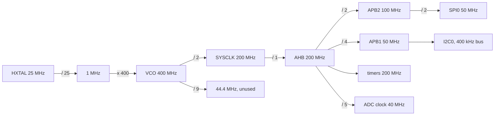
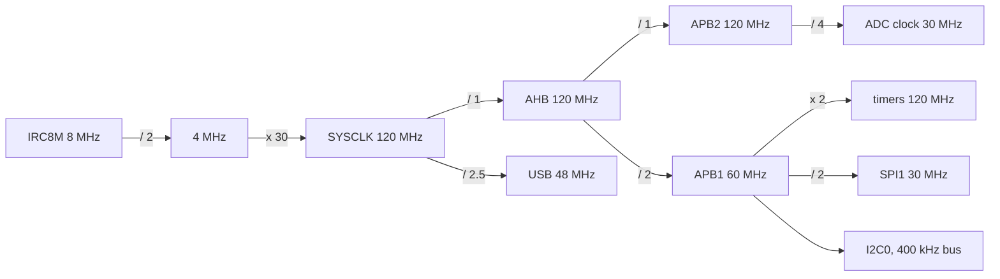

# Hardware as seen from the firmware

This document describes the main board of each supported keyboard the way the firmware uses it: the microcontroller, its clocks and memory, every peripheral and pin the firmware touches, the interrupts, and the external parts. The companion document [architecture](architecture.md) describes the software that runs on it; [layout](layout.md) gives the physical positions of keys and LEDs.

| Board | Section | State of the facts |
| --- | --- | --- |
| Wooting 80HE | [Wooting 80HE](#wooting-80he) | The configuration described here matches stock firmware 2.14.1 of this board; an earlier build of openwoot ran on a Wooting 80HE (ANSI). The restructured build of this tree has not yet been run on hardware. |
| Wooting 60HE+ | [Wooting 60HE+](#wooting-60he) | Taken from that board's stock firmware 2.14.1. openwoot has never run on a 60HE+; no pin, clock or address of this section is confirmed on hardware. |

Everything here describes what the firmware configures and drives. Timing figures are computed from the register settings; none was measured. Points that the firmware alone does not settle are collected at the end of each board section.

## Where the facts live

A board is described by numbers, pins and tables in its directory; the code that turns them into register writes is the hardware abstraction layer of its microcontroller family. Nothing in `src/` or `drivers/` touches a register.

| What | Where |
| --- | --- |
| Numbers: matrix size, scan geometry, LED count, image and storage addresses, USB identity | `boards/<board>/board.h` |
| Pins and converter channels, in the vocabulary of the family library | `boards/<board>/wiring.h` (list of constants: `hal/<family>/wiring_template.h`) |
| Order of the multiplexers in parallel scanning, scan-position and LED tables | `boards/<board>/tables/` |
| Family, chip drivers, features and strategies of the board | `boards/<board>/board.mk` |
| Clocks, vector table, start-up code, every peripheral set-up | `hal/<family>/` ([`gd32f4xx`](../hal/gd32f4xx/), [`gd32f30x`](../hal/gd32f30x/)); the interface is [`hal/include/hal/`](../hal/include/hal/) |
| LED driver chip and settings flash chip | [`drivers/is31fl3741/`](../drivers/is31fl3741/), [`drivers/spi_nor/`](../drivers/spi_nor/) |

## Parts shared by both boards

### Naming of peripherals

The source tree uses the names of the GigaDevice libraries (`third_party/gd32f4xx/`, `third_party/gd32f30x/`), which number peripheral instances from 0. The GD32F4 register blocks are laid out like those of the STM32F4, the GD32F30x blocks like those of the STM32F1, whose names count from 1. This document uses the GigaDevice names; the tables give the STM32 name for readers who know those families.

GD32F4xx (Wooting 80HE):

| Base address | GigaDevice name | STM32F4 name |
| --- | --- | --- |
| `0x40000000` | `TIMER1` | TIM2 |
| `0x40000C00` | `TIMER4` | TIM5 |
| `0x40002800` | RTC (`RTC_BKP0`..) | RTC (RTC_BKP0R..) |
| `0x40005400` | `I2C0` | I2C1 |
| `0x40007000` | PMU | PWR |
| `0x40012000` | `ADC0` | ADC1 |
| `0x40013000` | `SPI0` | SPI1 |
| `0x40020000`..`0x40020C00` | `GPIOA`..`GPIOD` | GPIOA..GPIOD |
| `0x40023800` | RCU | RCC |
| `0x40023C00` | FMC | FLASH |
| `0x40026000` | `DMA0` (channel n) | DMA1 (stream n) |
| `0x40026400` | `DMA1` (channel n) | DMA2 (stream n) |
| `0x40040000` | USBHS | OTG_HS |

GD32F30x (Wooting 60HE+):

| Base address | GigaDevice name | STM32F1 name |
| --- | --- | --- |
| `0x40000000` | `TIMER1` | TIM2 |
| `0x40000C00` | `TIMER4` | TIM5 |
| `0x40003800` | `SPI1` | SPI2 |
| `0x40005400` | `I2C0` | I2C1 |
| `0x40005C00` | USBD | USB |
| `0x40006C00` | BKP (`BKP_DATA0`..) | BKP (BKP_DR1..) |
| `0x40007000` | PMU | PWR |
| `0x40010000` | AFIO | AFIO |
| `0x40010800`..`0x40011000` | `GPIOA`..`GPIOC` | GPIOA..GPIOC |
| `0x40012400` | `ADC0` | ADC1 |
| `0x40012800` | `ADC1` | ADC2 |
| `0x40020000` | `DMA0` (channel n) | DMA1 (channel n + 1) |
| `0x40021000` | RCU | RCC |
| `0x40022000` | FMC | FLASH |

Two GigaDevice-specific features appear in the code of both families: the GPIO bit-clear register `GPIO_BC` (offset `0x28` on GD32F4xx, `0x14` on GD32F30x), and the names of the flash controller registers.

### Sensor scan

Each key has one hall-effect sensor. The sensors are wired to 16:1 analog multiplexers. All multiplexers share four address lines; each has its own enable line (low = on) and its own converter input. The number of multiplexers and the addresses in use are board numbers (`BOARD_MUX_COUNT`, `BOARD_MUX_ADDRESSES_USED`).

**Scan position.** A sensor is addressed by its scan position:

```
scan position = multiplexer address (0..15) + 16 x multiplexer index
```

The scan position is the index of the per-key record array `g_analog_key_states`. The scan uses the addresses below `BOARD_MUX_ADDRESSES_USED` (`ADC_SCAN_MUX_CHANNELS` in `src/adc_scan/adc_scan_types.h`).

**Key id.** The rest of the firmware names a key by its position in a matrix of `BOARD_KEY_ROWS` rows and `BOARD_KEY_COLS` columns: `key id = row << 5 | column` (`KEYS_KEY_ID` in `src/keys/keys_types.h`). The matrix is a naming scheme; electrically there is no matrix. Columns follow the keys from left to right, but they are not a ruler ([layout](layout.md)).

The two numbering schemes are connected by one pair of tables per physical layout in `boards/<board>/tables/layout_tables.c`, collected in the board table `k_layout_variants`. At start-up `layout_select_variant` (`src/layout/layout_variant.c`) takes the entry of the variant in `g_layout_physical_variant` and sets the pointers `g_layout_scanpos_to_keyid`, `g_layout_keyid_to_scanpos` and `g_rgb_key_to_led`. Where the variant number comes from is a strategy of the board (`STRATEGY_layout_variant` in `board.mk`).

**Scan hardware.** The address lines are driven with one store of a precomputed set/reset value into the bit operate register of their port (`hal_scan_select_address` in `hal/<family>/inline/hal_scan_inline.h`). `hal_scan_select_input` (`hal/<family>/hal_scan.c`) drives the enable line of the previous multiplexer high, the enable line of the next one low and selects its converter channel. Channel 1 of `TIMER1`, counting in microseconds in single-pulse mode, triggers every conversion; a DMA channel moves each 32-bit result word into `g_adc_scan_dma_samples`; the end-of-conversion interrupt calls `hal_scan_conversion_isr` (`src/adc_scan/adc_scan_irq.c`).

The firmware switches the converter between two set-ups (`adc_scan_set_mode` in `src/adc_scan/adc_scan_control.c`, through `hal_scan_enter_single` and `hal_scan_enter_parallel`):

| Mode | Converter sequence | Multiplexer enables | Interrupt handler path |
| --- | --- | --- | --- |
| Single input (`ADC_SCAN_MODE_SINGLE`) | Length 1: the channel of the selected multiplexer | Only the selected multiplexer is enabled | `adc_scan_process_single_sample` |
| All inputs (`ADC_SCAN_MODE_PARALLEL`) | Length `BOARD_MUX_COUNT`, discontinuous mode with all conversions per trigger, in the order of `k_adc_scan_parallel_mux_order` (`boards/<board>/tables/adc_scan_tables.c`) | All enabled | `adc_scan_process_parallel_samples` |

The parallel mode is selected by the profile setting that the firmware stores as "scan mode level" in bits 7:5 of `g_run_state_flags` (`RUN_STATE_SCAN_MODE_MASK` in `src/core/run_state.h`).

Trigger delays written to the `TIMER1` compare register (constants in `src/adc_scan/adc_scan_types.h`; the same on both boards):

| Delay | Constant | Used when |
| --- | --- | --- |
| 254 µs | `ADC_SCAN_DELAY_FIRST_US` | First conversion of the start-up sweep |
| 149 µs | `ADC_SCAN_DELAY_ADDRESS_US` | Start-up sweep, after a change of the multiplexer address |
| 54 µs | `ADC_SCAN_DELAY_MUX_US` | After switching to another multiplexer |
| 2 µs | `ADC_SCAN_DELAY_SAME_MUX_US` | Next address on the same multiplexer, repeated conversion (feature `recheck`) |
| 1 µs | `ADC_SCAN_DELAY_SWEEP_REPEAT_US` | Start-up sweep, next of the 100 conversions of one position |
| 900 µs | `ADC_SCAN_CYCLE_TIMER_US` | End of a scan cycle: the converter trigger is switched off and the timer only measures the time since the cycle ended (`hal_scan_end_cycle`) |

The scan code relies on two properties of the scan-position tables. Position (multiplexer 0, address 0) must carry a key, and every multiplexer must carry at least one key; otherwise `adc_scan_next_position` in `src/adc_scan/adc_scan_sample.c` can loop forever inside the interrupt. Keep both properties when you edit a layout table.

**Sensor signal.** The firmware takes the absolute difference between each 12-bit sample and the zero-field level ("magnitude"); values within ±79 of the level count as 0 (`ANALOG_ADC_DEADBAND` in `src/analog/analog_types.h`; the computation is in `src/adc_scan/adc_scan_magnitude.h`). A larger magnitude means a deeper key press; because the absolute value is used, the polarity of the magnet does not matter. A board without the feature `reference` takes the fixed level `BOARD_ADC_ZERO_LEVEL`; a board with it measures the level with every sample on a second converter (`src/adc_scan/reference/reference.h`). How the magnitude becomes a travel distance is described in [extending-keys](extending-keys.md).

### IS31FL3741 LED driver

Both boards drive their LEDs with one ISSI IS31FL3741, a matrix driver with 9 switch lines (SW1..SW9) and 39 current-sink lines (CS1..CS39), which is 351 channels. The driver code is [`drivers/is31fl3741/is31fl3741.c`](../drivers/is31fl3741/is31fl3741.c); the bus is `hal_led_bus_write` of the family.

**Bus access.** The firmware only writes. Each write is: start condition, address byte `0x60` (`BOARD_LED_DRIVER_ADDRESS`, 7-bit address `0x30`), register number, data bytes, stop condition. The bytes are assembled in `g_rgb_i2c_tx_buf` and sent by DMA while the main loop waits and runs the USB device task (`is31fl3741_i2c_write`, `hal_led_bus_write`). There is no timeout and no handling of a missing acknowledge: if the driver does not answer, the firmware hangs in this function.

**Register pages.** The driver has five register pages. A page is selected by writing `0xC5` to register `0xFE` (unlock) and the page number to register `0xFD`. `is31fl3741_select_page` does this and remembers the page in `g_rgb_is31fl3741_page`, so that the two writes are skipped when the page is already selected.

| Page | Constant | Registers | Content | Written by |
| --- | --- | --- | --- | --- |
| 0 | `IS31FL3741_PAGE_PWM0` | 0..179 | Brightness (PWM) of SW1..SW6, CS1..CS30: register = 30 x (SW - 1) + (CS - 1) | `led_matrix_write`, bank 0 |
| 1 | `IS31FL3741_PAGE_PWM1` | 0..170 | Registers 0..89: SW7..SW9, CS1..CS30. Registers 90..170: CS31..CS39 of SW1..SW9, 9 per switch line | `led_matrix_write`, bank 1 |
| 2 | `IS31FL3741_PAGE_SCALE0` | 0..179 | Current scaling, same layout as page 0 | `led_matrix_init`: all `0xFF` |
| 3 | `IS31FL3741_PAGE_SCALE1` | 0..170 | Current scaling, same layout as page 1 | `led_matrix_init`: all `0xFF` |
| 4 | `IS31FL3741_PAGE_FUNCTION` | `0x00`, `0x01`, `0x02`, `0x3F` | Function registers, see below | `led_matrix_init`, `led_matrix_set_running` |

Function registers:

| Register | Constant | Values written | Meaning |
| --- | --- | --- | --- |
| `0x00` | `IS31FL3741_FN_CONFIG` | `0x00` (`IS31FL3741_CONFIG_SHUTDOWN`), `BOARD_LED_DRIVER_CONFIG_RUN` | Software shutdown or normal operation. According to the register description in the ISSI datasheet, bit 0 switches the outputs on and bits 7:4 limit scanning: 1 = SW1..SW8 (80HE, `0x11`), 3 = SW1..SW6 (60HE+, `0x31`). |
| `0x01` | `IS31FL3741_FN_GLOBAL_CURRENT` | `0xFF` | Global current, maximum |
| `0x02` | `IS31FL3741_FN_PULL_UP_DOWN` | `0x35` | Pull-up and pull-down resistor selection of the matrix lines (codes 3 and 5; see the ISSI datasheet for the resistor values) |
| `0x3F` | `IS31FL3741_FN_RESET` | `0xAE` | Software reset of all registers |

Start-up sequence (`led_matrix_init`, start-up step `STARTUP_LED_MATRIX` registered in `src/rgb/rgb_init.c`): software reset, configuration register = shutdown, enable line high (`hal_led_bus_set_enable`), all 351 scaling registers to `0xFF`, global current `0xFF`, resistor register `0x35`. The driver stays in shutdown until the USB port is configured; `rgb_wake_led_driver` (`src/rgb/rgb_frame_update.c`) then writes `BOARD_LED_DRIVER_CONFIG_RUN` through `led_matrix_set_running` and fades the LEDs in.

**Frame and LED numbers.** The firmware keeps the brightness values in a frame of `BOARD_RGB_FRAME_PAGE_COUNT` pages (`rgb_frame_t`, `src/rgb/rgb_types.h`). Each frame page is one contiguous register run of the driver, so that it can be sent with one bus write; the runs are the board table `k_rgb_frame_pages`. An LED is named by its LED number; the board table `k_rgb_led_channels` (`boards/<board>/tables/rgb_tables.c`) gives for every LED number the frame page and the offset of its red channel, or no LED. `rgb_frame_locate_led` in `src/rgb/rgb_frame.c` looks the number up; the value is stored red first, then green, then blue, each scaled by the board's gain: stored value = (`BOARD_LED_GAIN_<channel>` x (value + 1)) >> 8. `rgb_frame_pages_init` (`src/rgb/rgb_frame.c`) sets up the page headers from `k_rgb_frame_pages`.

**Which LED is where.** The key LEDs are assigned by one table per physical layout, indexed by matrix row and column (`k_rgb_key_to_led_<variant>`, `boards/<board>/tables/rgb_tables.c`), reached through the pointer `g_rgb_key_to_led`. Every key has one LED. In addition, row 5 has cells with an LED but without a sensor: the LEDs under the space bar on both sides of its switch. These cells have their own entries in the colour maps. For the key-driven effects, `rgb_effect_copy_spacebar_cell` copies the per-key effect state of the space bar cell (5, 6) to them (column list `g_layout_spacebar_fill_cols`), so that the whole space bar reacts to its one switch.

### SPI NOR flash memory

Both boards keep all settings in an 8 MiB serial flash memory. The driver is [`drivers/spi_nor/spi_nor.c`](../drivers/spi_nor/spi_nor.c); every command is one transfer of `hal_nor_bus_transfer_in` or `hal_nor_bus_transfer_out` (`hal/<family>/hal_nor_bus.c`), which runs with interrupts masked and polls byte by byte.

| Command byte | Constant (`drivers/spi_nor/spi_nor.h`) | Use |
| --- | --- | --- |
| `0x02` | `SPI_NOR_CMD_PAGE_PROGRAM` | Program up to 256 bytes (24-bit address) |
| `0x05` | `SPI_NOR_CMD_READ_STATUS` | Read the status register; bit 0 = busy |
| `0x06` | `SPI_NOR_CMD_WRITE_ENABLE` | Before each program and erase command |
| `0x0B` | `SPI_NOR_CMD_FAST_READ` | Read (24-bit address, 8 dummy bits) |
| `0x20` | `SPI_NOR_CMD_SECTOR_ERASE` | Erase one 4 KiB sector |
| `0x4B` | `SPI_NOR_CMD_UNIQUE_ID` | Read the chip's unique id (reported to the host) |
| `0x90` | `SPI_NOR_CMD_READ_ID` | Read manufacturer and device code. The self-test command of the host protocol accepts manufacturer `0xEF` or `0xC8` with device code `0x16` (`drivers/include/drivers/nor_flash.h`). |

`nor_flash_wait_ready` polls the busy bit without a timeout and runs the USB device task between polls. The file system starts at offset 0 of the chip and has `BOARD_STORAGE_LFS_BLOCK_COUNT` blocks of 4 KiB (`STORAGE_LFS_BLOCK_SIZE`); the board sections give the layout of the chip. Files, formats and the device information record are described in [storage](storage.md).

### Backup registers

The backup registers keep their content across a reset. The firmware and the factory bootloader use three of them as a mailbox; `hal/<family>/hal_system.c` implements the firmware side. The values are the same on both families:

| Register | Written by | Read by | Value |
| --- | --- | --- | --- |
| 0 | `hal_system_enter_update_mode` | The bootloader | `0x504`: the bootloader stays in update mode for this one start |
| 1 | The bootloader, on its "settings reset" command. The firmware never writes a non-zero value. | `hal_system_take_format_request`, called by `storage_init` (`src/storage/storage_init.c`) | `0x420`: the firmware clears the register and formats the file system before mounting it |
| 2 | `hal_system_restart`, `hal_system_enter_update_mode` | The bootloader | An option byte for the bootloader: the low byte of the 32-bit argument word of the host's reset command (`src/protocol/protocol_device.c`). `hal_system_restart` writes the register only when that byte is not 0. |

What the bootloader does with them is described for the 80HE in [bootloader](bootloader.md); for the 60HE+ it is not known.

### Interrupts and faults

`hal/<family>/vectors.c` holds the vector table `g_vector_table` (section `.isr_vector`). Every vector that the firmware does not claim, including every fault vector, points at `Default_Handler` (`hal/<family>/startup.c`), an endless loop: a fault stops the keyboard until power is removed, and no watchdog restarts it. Critical sections mask all interrupts through `PRIMASK` (`hal_irq_save`, `hal_irq_restore` in `hal/<family>/inline/hal_irq_inline.h`), for example around every transaction with the flash memory. The priority grouping is left at its reset value. The SysTick interrupt (`hal_time_tick_isr` in `src/app/tasks.c`) has the lowest priority (`0xF0`); every other interrupt keeps priority 0, the highest, so they cannot interrupt each other but all interrupt the tick.

## Wooting 80HE

Board directory [`boards/wooting_80he/`](../boards/wooting_80he/), family [`hal/gd32f4xx/`](../hal/gd32f4xx/). Features: `signals`, `lightbar`, `edition`, `recheck`.

### Microcontroller

| Property | Value |
| --- | --- |
| Family | GigaDevice GD32F425 (`DEVICE_DEFS := -DGD32F425`): ARM Cortex-M4F, Thumb-2, single-precision floating-point unit, used with the hard-float calling convention. The firmware relies on features of this family: 4 KiB flash page erase, 200 MHz operation without flash wait states, and the 98-entry vector table of the GD32F405/F425. |
| Package and flash density | Every pin in use exists on a 64-pin package, and the firmware writes to flash address `0x080FE000`, so the flash has at least 1024 KiB. A GD32F425RG (64 pins, 1024 KiB) fits; the exact type is not determined. |
| Crystal | 25 MHz high-speed crystal oscillator ("HXTAL") |
| RAM | 192 KiB at `0x20000000` (initial stack pointer `0x20030000`, `BOARD_RAM_END`) |
| Peripheral library | GigaDevice GD32F4xx Firmware Library V3.0.0, unmodified, in `third_party/gd32f4xx/`; `hal/gd32f4xx/system_clock.c` replaces its `system_gd32f4xx.c` |

The firmware reads two factory areas of the chip: the 96-bit unique identifier at `0x1FFF7A10` and the read-protection option byte at `0x1FFFC001` (`HAL_MCU_UNIQUE_ID_ADDR`, `HAL_MCU_PROTECTION_ADDR` in `hal/gd32f4xx/hal_mcu.c`). Both are only reported to the host.

### Clock tree

`SystemInit` in `hal/gd32f4xx/system_clock.c` configures the clocks before `main` runs. It is the library function `system_clock_200m_25m_hxtal` with two extra statements at the end.



| Item | Value | Where |
| --- | --- | --- |
| PLL register `RCU_PLL` | `0x09406419`: source HXTAL, input divider 25, multiplier 400, system divider 2, USB divider 9 | `system_clock_200m_25m_hxtal` in `hal/gd32f4xx/system_clock.c` |
| System clock | 200 MHz (`SYSTEM_CLOCK_HZ`); the high-drive mode of the power unit is enabled (`PMU_CTL` bits 16 and 17) and the regulator is set to its highest output level | same |
| AHB clock | 200 MHz | same |
| APB2 clock | 100 MHz | same |
| APB1 clock | 50 MHz | same |
| Timer clock | 200 MHz for all timers: `rcu_timer_clock_prescaler_config(RCU_TIMER_PSC_MUL4)` sets bit 24 of `RCU_CFG1` | `scan_trigger_init` in `hal/gd32f4xx/hal_scan.c` |
| ADC clock | AHB / 5 = 40 MHz (`adc_clock_config(ADC_ADCCK_HCLK_DIV5)`) | `scan_converter_init`, same file |
| USB clock | 60 MHz from the external USB transceiver; the 44.4 MHz PLL output is not used | |
| Flash wait states | none; the register is never written | |
| Vector table | `SCB->VTOR` = `0x08008000` (`BOARD_APP_BASE`), written at the end of `SystemInit` | `hal/gd32f4xx/system_clock.c` |

If the crystal never becomes stable, `SystemInit` stays in an endless loop. There is no fallback to the internal oscillator.

Peripheral clocks that the firmware enables: `GPIOA`, `GPIOB`, `GPIOC`, `GPIOD`, `DMA0`, `DMA1`, USBHS and its ULPI clock (AHB1); `TIMER1`, `TIMER4`, `I2C0`, PMU (APB1); `ADC0`, `SPI0`, SYSCFG (APB2). SYSCFG is clocked but none of its registers is accessed.

### Memory map

#### Internal flash

The linker script [`boards/wooting_80he/linker.ld`](../boards/wooting_80he/linker.ld) defines the regions; the section layout is `hal/gd32f4xx/sections.ld`. Its `FLASH` region is `0x08008000`-`0x080FDFFF`.

| Range | Size | Content |
| --- | --- | --- |
| `0x08000000`-`0x08007FFF` | 32 KiB | Factory bootloader (version 2.3). It is not part of this project and is never linked or written by it. See [bootloader](bootloader.md). |
| `0x08008000`-`0x080FDFFF` | 984 KiB | Application. It starts with the vector table of 98 entries (392 bytes): initial stack pointer `0x20030000`, 15 system vectors, 82 interrupt vectors (`g_vector_table` in `hal/gd32f4xx/vectors.c`, section `.isr_vector`). `.text` follows, aligned to 64 bytes, then `.rodata` and the initial values of `.data`, which `Reset_Handler` copies to RAM. |
| `0x080FE000`-`0x080FEFFF` | 4 KiB | Serial page (`BOARD_MCU_SERIAL_PAGE_ADDR`): a copy of the serial number text, written by the firmware itself (see [flash controller](#internal-flash-controller-fmc)) |
| `0x080FF000`-`0x080FFFFF` | 4 KiB | Completion marker page of the bootloader. The marker is the last word, at `0x080FFFFC`: 0 means that the last update was completed. The bootloader erases the page when an update starts and programs the marker when the update is finished; it starts the application only when the marker is 0. The firmware never touches this page. |

Section sizes of the default build (`LTO=0`, GCC 10.3.1) of this tree, as printed by `make BOARD=wooting_80he size` and `arm-none-eabi-size -A`. They change with every change of the code; run the command for the current numbers.

| Section | Bytes | Content |
| --- | --- | --- |
| `.isr_vector` | 392 | Vector table |
| `.text` | 147,528 | Code |
| `.rodata` | 344,220 | Constants. 327,680 bytes of it (320 KiB) are one table, `k_analog_travel_curves` (40 curves of 4096 `uint16_t`). |
| `.ARM.extab`, `.ARM.exidx`, `.init_array`, `.fini_array` | 800 | Tables of the C library |
| `.data` (initial values) | 2,752 | Copied to RAM by `Reset_Handler` |

The image is 495,748 bytes long (484.1 KiB), 49 % of the application region. [Building](building.md) describes the build variants.

#### RAM

| Range | Content |
| --- | --- |
| from `0x20000000` | `.data` (initialised variables, 2,752 bytes), then `.bss` (zeroed by `Reset_Handler`, 60,636 bytes). Together they use 63,388 bytes (61.9 KiB) of the 196,608 bytes (192 KiB). |
| above `.bss` | Heap. The C library's `_sbrk` starts at the linker symbol `end` and has no upper limit. Only the C library allocates (inside the `sprintf` family); littlefs is built with `LFS_NO_MALLOC`. |
| downward from `0x20030000` | Stack (`_estack`). Heap and stack share the remaining 133,220 bytes (130.1 KiB); nothing checks for a collision. |

The three largest statically allocated objects are the six HID interface buffers of TinyUSB (6 x 4172 bytes = 25,032 bytes), the per-key records `g_analog_key_states` (96 x 172 bytes = 16,512 bytes) and the response ring of the host protocol `g_protocol_tx_ring` (3 x 2050 bytes).

### Peripherals in use

| Peripheral | Purpose | Configuration | Source |
| --- | --- | --- | --- |
| SysTick | 1 ms time base | Reload 199,999 at 200 MHz, core clock, interrupt enabled (`SysTick_Config(200000)`) | `hal_time_start_tick` in `hal/gd32f4xx/hal_time.c`; handler `hal_time_tick_isr` in `src/app/tasks.c` |
| `TIMER1` | Delay generator that triggers each ADC conversion | Prescaler 199 (1 tick = 1 µs), auto-reload `0xFFFF`, up-counting, single-pulse mode. Channel 1 runs as an output compare (mode "PWM1", active high, no preload, no pin); its rising edge is the ADC trigger. A conversion is scheduled by writing the counter, writing the delay in microseconds to the compare register and starting the counter. No timer interrupt. | `scan_trigger_init`, `hal_scan_trigger_at`, `hal_scan_end_cycle` in `hal/gd32f4xx/hal_scan.c`; `hal_scan_trigger_after` in `hal/gd32f4xx/inline/hal_scan_inline.h` |
| `TIMER4` | Free-running microsecond clock | Prescaler 199 (1 MHz), 32-bit counter with auto-reload `0xFFFFFFFE` (wraps after about 71.6 minutes), read through `TIMER_CNT(TIMER4)`. Most readers keep only the low 16 bits. | `hal_time_start_micros` in `hal/gd32f4xx/hal_time.c`; `hal_time_micros` in `hal/gd32f4xx/inline/hal_time_inline.h` |
| `ADC0` | Samples the hall sensors | 12 bit, right aligned, independent mode, 40 MHz ADC clock, sample time 3 cycles on every channel (`BOARD_SCAN_SAMPLE_HALF_CYCLES` = 6; one conversion takes 15 clock cycles = 0.375 µs), no averaging (`BOARD_SCAN_OVERSAMPLE` = 1), external trigger `TIMER1` channel 1 on the rising edge, end-of-conversion interrupt, DMA request after every conversion, calibrated once at start-up | `scan_converter_init`, `hal_scan_enter_single`, `hal_scan_enter_parallel` in `hal/gd32f4xx/hal_scan.c`; `adc_scan_set_mode` in `src/adc_scan/adc_scan_control.c` |
| `DMA1` channel 0 | Moves ADC results into `g_adc_scan_dma_samples` | Sub-peripheral 0 (`ADC0`), source `ADC_RDATA(ADC0)`, 32-bit transfers, memory increment, circular, priority high, 1 or 6 items, no DMA interrupt | `scan_transport_start` in `hal/gd32f4xx/hal_scan.c` |
| `I2C0` | Writes to the LED driver (never reads) | Master, 400 kHz fast mode with 16/9 duty cycle; the timing is computed at run time from the clock registers | `hal_led_bus_init` in `hal/gd32f4xx/hal_led_bus.c` |
| `DMA0` channel 6 | Sends the bytes of one I2C write | Sub-peripheral 1 (`I2C0` transmit), memory `g_rgb_i2c_tx_buf` to `I2C_DATA(I2C0)`, 8 bit, normal mode, priority ultra high. The channel is re-initialised for every write; completion is polled (flag bit 21 of `DMA_INTF1`). | `hal_led_bus_write` in `hal/gd32f4xx/hal_led_bus.c` |
| `SPI0` | External flash memory | Master, mode 0 (clock idle low, data sampled on the first edge), 8 bit, most significant bit first, software chip select, clock = APB2 / 2 = 50 MHz, polled byte by byte | `hal_nor_bus_init`, `nor_bus_transfer_byte` in `hal/gd32f4xx/hal_nor_bus.c` |
| USBHS | USB device port | See [USB core](#usb-high-speed-core-and-transceiver) | `hal_usb_prepare` in `hal/gd32f4xx/hal_usb.c`; `usb_stack_init` in `src/usb/usb_init.c`; `third_party/tinyusb/src/portable/synopsys/dwc2/dcd_dwc2.c` |
| FMC | Writes the serial number copy into internal flash | See [flash controller](#internal-flash-controller-fmc) | `hal_mcu_flash_write_page` in `hal/gd32f4xx/hal_mcu.c`; `storage_mirror_serial_to_mcu_flash` in `src/storage/storage_serial.c` |
| PMU | High-drive mode at start-up; opens the backup domain for writing around each backup register write | | `hal/gd32f4xx/system_clock.c`, `hal/gd32f4xx/hal_system.c` |
| RTC backup registers | Values that survive a reset | `RTC_BKP0`, `RTC_BKP1`, `RTC_BKP2` at `0x40002850`, `0x40002854`, `0x40002858`; see [backup registers](#backup-registers). The real-time clock itself is never started. | `hal/gd32f4xx/hal_system.c` |

Not used at all: every UART, external interrupts (EXTI), watchdogs, DAC, CAN, SDIO, the random number generator, the CRC unit, the debug cycle counter (DWT), all timers other than `TIMER1` and `TIMER4`. There is no debug output channel.

### USB high-speed core and transceiver

The USB device port is the high-speed core of the microcontroller (Synopsys DWC2 design, base `0x40040000`, TinyUSB root port 1) with an external transceiver ("PHY") connected through the 12-signal ULPI bus. The stack is TinyUSB; `usb_stack_init` starts it, which runs `dcd_init`.

- Transceiver interface: ULPI selected, 8-bit data. The transceiver supplies the 60 MHz clock on PA5.
- PC10 is driven low while the ULPI pins are set up and high afterwards (`hal_usb_prepare`). The sequence fits a reset or enable line of the transceiver; its exact function is not determined.
- Speed: high speed, or full speed when the device setting "force full speed" is stored (`RUN_STATE_OPTION_USB_FULL_SPEED`; `usb_speed_option_init` calls `hal_usb_limit_to_full_speed`, which clears `g_usb_high_speed_enabled`).
- VBUS sensing is not used (the "B-session valid" override is set).
- The core is forced into device mode; it soft-disconnects first in `hal_usb_prepare` and connects at the end of `dcd_init`.
- Receive FIFO: 283 words (sized for 512-byte packets); control endpoint 64 bytes; 6 endpoints and 4096 bytes of FIFO RAM (`third_party/tinyusb/src/portable/synopsys/dwc2/dwc2_stm32.h`).
- Interrupt sources enabled: bus reset, enumeration done, suspend, wake-up, receive FIFO level, OTG, mode mismatch; endpoint interrupts are enabled per endpoint by TinyUSB.

Interfaces, endpoints and descriptors are described in [protocol](protocol.md). The build configuration of TinyUSB is `src/usb/tusb_config.h`.

### Internal flash controller (FMC)

The application writes to its own flash in one place only. `storage_mirror_serial_to_mcu_flash` (`src/storage/storage_serial.c`) builds a record of the form `[length byte][serial number text]`; `hal_mcu_flash_write_page` (`hal/gd32f4xx/hal_mcu.c`) erases the 4 KiB page at `0x080FE000` (`BOARD_MCU_SERIAL_PAGE_ADDR`) with the GigaDevice page-erase command and programs the record in 16-bit steps. `device_serial_mirror_init` does this at start-up when the first byte of the page reads `0xFF`; a host command that stores a new serial number does it again. The application never reads the page otherwise. The factory bootloader reads it at its start and uses the text as its USB serial number ([bootloader](bootloader.md)).

### Pin map

The pins are constants of [`boards/wooting_80he/wiring.h`](../boards/wooting_80he/wiring.h). All pins are configured without pull-up or pull-down resistor. "Speed" is the library's output speed setting: `GPIO_OSPEED_50MHZ` or `GPIO_OSPEED_MAX`.

| Pin | Mode | Alternate function | Output type, speed | Role |
| --- | --- | --- | --- | --- |
| PA0 | Analog | | | ADC channel 0: output of sensor multiplexer 0 |
| PA1 | Analog | | | ADC channel 1: multiplexer 1 |
| PA2 | Analog | | | ADC channel 2: multiplexer 2 |
| PC1 | Analog | | | ADC channel 11: multiplexer 3 |
| PC5 | Analog | | | ADC channel 15: multiplexer 4 |
| PC4 | Analog | | | ADC channel 14: multiplexer 5 |
| PA8 | Output | | Push-pull, 50 MHz | Multiplexer address bit 0 (shared by all six multiplexers) |
| PA9 | Output | | Push-pull, 50 MHz | Multiplexer address bit 1 |
| PA10 | Output | | Push-pull, 50 MHz | Multiplexer address bit 2 |
| PA11 | Output | | Push-pull, 50 MHz | Multiplexer address bit 3 |
| PB14 | Output | | Push-pull, 50 MHz | Enable of multiplexer 0, active low |
| PB15 | Output | | Push-pull, 50 MHz | Enable of multiplexer 1, active low |
| PC6 | Output | | Push-pull, 50 MHz | Enable of multiplexer 2, active low |
| PC7 | Output | | Push-pull, 50 MHz | Enable of multiplexer 3, active low |
| PC8 | Output | | Push-pull, 50 MHz | Enable of multiplexer 4, active low |
| PC9 | Output | | Push-pull, 50 MHz | Enable of multiplexer 5, active low |
| PA3 | Alternate | AF10 | Push-pull, maximum | ULPI data 0 |
| PB0 | Alternate | AF10 | Push-pull, maximum | ULPI data 1 |
| PB1 | Alternate | AF10 | Push-pull, maximum | ULPI data 2 |
| PB10 | Alternate | AF10 | Push-pull, maximum | ULPI data 3 |
| PB11 | Alternate | AF10 | Push-pull, maximum | ULPI data 4 |
| PB12 | Alternate | AF10 | Push-pull, maximum | ULPI data 5 |
| PB13 | Alternate | AF10 | Push-pull, maximum | ULPI data 6 |
| PB5 | Alternate | AF10 | Push-pull, maximum | ULPI data 7 |
| PA5 | Alternate | AF10 | Push-pull, maximum | ULPI clock (60 MHz from the transceiver) |
| PC0 | Alternate | AF10 | Push-pull, maximum | ULPI STP |
| PC2 | Alternate | AF10 | Push-pull, maximum | ULPI DIR |
| PC3 | Alternate | AF10 | Push-pull, maximum | ULPI NXT |
| PC10 | Output | | Push-pull, 50 MHz | Control line of the USB transceiver (`BOARD_USB_PHY_RESET_PIN`): low first, high after the USB clocks are on, never touched again. Exact function not determined. |
| PA7 | Alternate | AF5 | Push-pull, 50 MHz | `SPI0` data out to the flash memory |
| PB4 | Alternate | AF5 | Push-pull, 50 MHz | `SPI0` data in from the flash memory |
| PB3 | Alternate | AF5 | Push-pull, 50 MHz | `SPI0` clock |
| PD2 | Output | | Push-pull, 50 MHz | Chip select of the flash memory, active low, idle high |
| PB6 | Alternate | AF4 | Open drain, 50 MHz | `I2C0` clock to the LED driver (needs an external pull-up) |
| PB7 | Alternate | AF4 | Open drain, 50 MHz | `I2C0` data |
| PB8 | Output | | Push-pull, 50 MHz | LED driver enable line (`BOARD_LED_ENABLE_PIN`): set high once after the software reset of the LED driver. The timing fits the hardware shutdown input of the LED driver; its exact function is not determined. |

The debug port pins PA13 and PA14 (SWD) are left in their reset state. Every other pin is left unconfigured (input after reset).

### Interrupts

The vector table has 98 entries. Three of them point at handlers of the firmware besides `Reset_Handler`; the other non-zero entries point at `Default_Handler`.

| Vector index | Interrupt number | Handler | Source file | Enabled by | Priority |
| --- | --- | --- | --- | --- | --- |
| 1 | | `Reset_Handler` | `hal/gd32f4xx/startup.c` | | |
| 15 | | `hal_time_tick_isr` | `src/app/tasks.c` | `hal_time_start_tick` | `0xF0` = level 15 of 16, the lowest |
| 34 | 18 | `hal_scan_conversion_isr` | `src/adc_scan/adc_scan_irq.c` | `scan_converter_init` (`NVIC_EnableIRQ(ADC_IRQn)`) | Never written, so 0 = the highest |
| 93 | 77 | `USBHS_IRQHandler` | `hal/gd32f4xx/hal_usb.c` | TinyUSB's `dcd_int_enable`; TinyUSB switches it off and on around its event queue accesses | Never written, so 0 = the highest |

The ADC interrupt and the USB interrupt have the same priority and cannot interrupt each other; both interrupt the SysTick handler. A new interrupt handler is added as an entry of `g_vector_table` in `hal/gd32f4xx/vectors.c`.

### Sensor multiplexers

Six 16:1 multiplexers (`BOARD_MUX_COUNT` = 6) share the address lines PA8..PA11.

| Multiplexer | Enable pin (low = on) | ADC input pin | ADC channel |
| --- | --- | --- | --- |
| 0 | PB14 | PA0 | 0 |
| 1 | PB15 | PA1 | 1 |
| 2 | PC6 | PA2 | 2 |
| 3 | PC7 | PC1 | 11 |
| 4 | PC8 | PC5 | 15 |
| 5 | PC9 | PC4 | 14 |

Wiring constants: `BOARD_MUX_ADDR_PINS`, `BOARD_MUX_ENABLE_PORTS`, `BOARD_MUX_ENABLE_PINS`, `BOARD_MUX_INPUT_PORTS`, `BOARD_MUX_INPUT_PINS`, `BOARD_MUX_INPUT_CHANNELS` in `boards/wooting_80he/wiring.h`. Parallel scanning converts the inputs in the order 0..5 (`k_adc_scan_parallel_mux_order`).

The scan uses addresses 0..14 (`BOARD_MUX_ADDRESSES_USED` = 15), which gives 90 of the 96 scan positions; address 15 never carries a key. The matrix has 6 rows and 17 columns (`BOARD_KEY_ROWS`, `BOARD_KEY_COLS`); row 0 is the function-key row, row 5 the bottom row.

The feature `recheck` treats multiplexers 3, 4 and 5 differently from 0, 1 and 2: a reading on them that would change the filtered value is converted a second time 2 µs later and only the second result is used (`BOARD_SCAN_RECHECK_FIRST_INPUT` = 3; `src/adc_scan/recheck/recheck.h`). The zero-field level is the fixed `BOARD_ADC_ZERO_LEVEL` = 2048, the middle of the converter range; the board does not list the feature `reference`.

Physical layouts and their tables (`boards/wooting_80he/tables/layout_tables.c`); the variant number comes from the factory device information (strategy `layout_variant` = `device_info`):

| Layout (`g_layout_physical_variant`) | Scan position to key id | Key id to scan position | Keys |
| --- | --- | --- | --- |
| 0 ANSI | `k_layout_scanpos_to_keyid_ansi` | `k_layout_keyid_to_scanpos_ansi` | 84 |
| 1 ISO | `k_layout_scanpos_to_keyid_iso` | `k_layout_keyid_to_scanpos_iso` | 85 |
| 2 JIS | `k_layout_scanpos_to_keyid_jis` | `k_layout_keyid_to_scanpos_jis` | 88 |

Content of `k_layout_scanpos_to_keyid_ansi`, written as `row.column`; `-` means no sensor:

| Multiplexer | Address 0 | 1 | 2 | 3 | 4 | 5 | 6 | 7 | 8 | 9 | 10 | 11 | 12 | 13 | 14 | 15 |
| --- | --- | --- | --- | --- | --- | --- | --- | --- | --- | --- | --- | --- | --- | --- | --- | --- |
| 0 | 2.4 | 0.4 | 1.4 | 2.3 | 0.3 | 1.3 | 2.2 | 1.2 | 0.2 | 2.1 | 0.1 | 1.1 | 0.0 | 1.0 | - | - |
| 1 | 4.2 | 5.2 | 4.3 | 4.4 | 4.5 | 3.4 | 3.3 | 3.2 | 3.1 | 2.0 | 3.0 | 4.0 | 5.0 | - | 5.1 | - |
| 2 | 0.10 | 0.8 | 1.9 | 2.8 | 1.8 | 2.7 | 1.7 | 2.6 | 1.6 | 0.7 | 0.6 | 0.5 | 1.5 | 2.5 | - | - |
| 3 | 4.8 | 4.9 | 4.10 | 5.10 | 5.11 | 3.9 | 2.9 | 3.8 | 3.7 | 3.6 | 3.5 | 4.6 | 5.6 | 4.7 | - | - |
| 4 | 1.14 | 1.15 | 2.15 | 2.16 | 1.16 | 0.16 | 0.15 | 0.14 | 0.13 | 0.12 | 0.11 | 1.10 | 1.11 | 1.12 | - | - |
| 5 | 5.12 | 4.14 | 5.14 | 5.15 | 5.16 | 4.15 | 3.14 | 2.14 | 3.11 | 2.12 | 2.11 | 2.10 | 3.10 | 4.11 | - | - |

Differences of the other layouts against this table:

| Layout | Multiplexer, address | Key |
| --- | --- | --- |
| ISO | 1, 13 | 4.1 (added) |
| ISO | 5, 7 | 3.12 (instead of 2.14) |
| JIS | 1, 1 | 5.3 (instead of 5.2) |
| JIS | 1, 13 | 5.1 (added) |
| JIS | 1, 14 | 5.2 (instead of 5.1) |
| JIS | 3, 14 | 5.9 (added) |
| JIS | 4, 0 | 1.13 (instead of 1.14) |
| JIS | 4, 14 | 1.14 (added) |
| JIS | 5, 1 | 4.12 (instead of 4.14) |
| JIS | 5, 7 | 3.12 (instead of 2.14) |
| JIS | 5, 14 | 4.14 (added) |

Unused channels per variant:

| Layout | Unused channels | Per multiplexer 0..5 |
| --- | --- | --- |
| ANSI | 12 | 2, 2, 2, 2, 2, 2 |
| ISO | 11 | 2, 1, 2, 2, 2, 2 |
| JIS | 8 | 2, 1, 2, 1, 1, 1 |

The keys of each multiplexer form one compact block of the keyboard: multiplexers 0, 2 and 4 serve the left, middle and right part of rows 0 to 2, multiplexers 1, 3 and 5 the left, middle and right part of rows 2 to 5. The same channel serves different keys on different variants (nine scan positions differ), so each variant needs its own tables.

### LEDs

The driver scans SW1..SW8 (`BOARD_LED_DRIVER_CONFIG_RUN` = `0x11`): 8 x 39 = 312 channels = 104 RGB LEDs, LED numbers 1..104 (`BOARD_LED_LIMIT` = 105; number 0 carries no LED). 105 (`BOARD_LED_NONE`) means "no LED" in the key tables. Of the 104 LEDs, 88 (ANSI), 89 (ISO) or 90 (JIS) are key LEDs and 10 are the light bar; the remaining 6, 5 or 4 numbers appear in no table. All three colour channels use the full range (`BOARD_LED_GAIN_RED`, `BOARD_LED_GAIN_GREEN` and `BOARD_LED_GAIN_BLUE` are 255).

An LED occupies three neighbouring current-sink lines on one switch line. `k_rgb_led_channels` encodes this pattern:

```
switch line index (0 = SW1) = (LED number - 1) / 13
position p                  = (LED number - 1) % 13
first CS line (red)         = {16, 13, 10, 7, 4, 1, 19, 37, 34, 22, 31, 28, 25}[p]
green, blue                 = the next two CS lines
```

The frame has ten pages (`BOARD_RGB_FRAME_PAGE_COUNT` = 10, `k_rgb_frame_pages`):

| Frame page | Driver page | First register | Length | Channels |
| --- | --- | --- | --- | --- |
| 0 | 0 | 0 | 30 | SW1, CS1..CS30 |
| 1 | 0 | 30 | 30 | SW2, CS1..CS30 |
| 2 | 0 | 60 | 30 | SW3, CS1..CS30 |
| 3 | 0 | 90 | 30 | SW4, CS1..CS30 |
| 4 | 0 | 120 | 30 | SW5, CS1..CS30 |
| 5 | 0 | 150 | 30 | SW6, CS1..CS30 |
| 6 | 1 | 0 | 30 | SW7, CS1..CS30 |
| 7 | 1 | 30 | 30 | SW8, CS1..CS30 |
| 8 | 1 | 90 | 36 | CS31..CS39 of SW1..SW4 |
| 9 | 1 | 126 | 36 | CS31..CS39 of SW5..SW8 |

The registers of SW9 (page 1, registers 60..89 and 162..170) are never written.

Key LED tables: `k_rgb_key_to_led_ansi`, `k_rgb_key_to_led_iso`, `k_rgb_key_to_led_jis`. The LED-only cells under the space bar are row 5, columns 4, 5, 7, 8 on ANSI and ISO, columns 5 and 7 on JIS.

**Light bar** (feature `lightbar`, `src/rgb/lightbar/`). Ten LEDs do not belong to keys: the LED numbers 51, 64, 77, 90, 103, 52, 65, 78, 91, 104 (`BOARD_LIGHTBAR_LEDS` in `board.h`, in this order positions 0..9; the firmware table is `k_lightbar_led_ids` in `src/rgb/lightbar/lightbar_leds.c`). They are positions 11 and 12 of the switch lines SW4..SW8. The ten LEDs stand in one line, 3.40 mm apart, at the height of key row 3 to the right of the Enter key, under a light guide. This is where the matrix cells (3, 15) and (3, 16) would be; both are empty in every layout table. Positions are in [layout](layout.md#light-bar); the lighting model is described in [extending-rgb](extending-rgb.md).

### SPI flash layout

The chip select is PD2.

| Range | Content |
| --- | --- |
| `0x000000`-`0x7FEFFF` | littlefs file system: 2047 blocks of 4 KiB (`BOARD_STORAGE_LFS_BLOCK_COUNT`, `STORAGE_LFS_BLOCK_SIZE`) |
| `0x7FF000`-`0x7FFFFF` | Factory device information outside the file system (strategy `device_info` = `nor_flash_sector`): protobuf record at `0x7FF000` (`BOARD_DEVICE_INFO_ADDR`), marker word at `0x7FFFFC` (`STORAGE_DEVICE_INFO_MAGIC_OFFSET` behind the start) |

### Computed timing figures

| Figure | Value | Computed from |
| --- | --- | --- |
| System tick | 1 ms | SysTick reload 199,999 at 200 MHz |
| ADC conversion | 0.375 µs | 15 cycles (3 sample + 12 conversion) of the 40 MHz ADC clock |
| Trigger timer resolution | 1 µs | `TIMER1` prescaler 199 at 200 MHz |
| Delay before a conversion | 2 µs on the same multiplexer, 54 µs after a multiplexer change | `ADC_SCAN_DELAY_SAME_MUX_US`, `ADC_SCAN_DELAY_MUX_US` |
| Microsecond clock wrap | about 71.6 minutes | `TIMER4`, 32 bit at 1 MHz |
| SPI clock | 50 MHz | APB2 / 2 |
| LED frame page write | about 1 ms | Up to 37 bytes plus address at 400 kHz |

### Not determined

- The exact microcontroller type (GD32F425 or the pin-compatible GD32F427, package, flash density). The code runs on either.
- The type of the USB transceiver, and the function and polarity of PC10.
- Whether PB8 is the hardware shutdown input of the LED driver.
- Whether the multiplexer enable lines are enable inputs of the multiplexers or switch the supply of a sensor group, and why inputs 3 to 5 get a second conversion.
- The type of the hall sensors, of the multiplexers and of the SPI flash memory. A teardown published by TechPowerUp in October 2024 reports a GigaDevice 32-bit microcontroller, an SMSC USB33xx transceiver and a Winbond W25Q64JV flash memory on this board; this project has not verified it.
- Whether the backup registers keep their value while the keyboard is unplugged. This depends on how the backup supply of the microcontroller is wired.
- The order of the ten light-bar LEDs along the bar (which end is position 0 of `BOARD_LIGHTBAR_LEDS`), and the left-to-right order of the LED-only cells under the space bar. See [layout](layout.md).
- The scan rate, the I2C transfer time and the interrupt latency. They were not measured.

## Wooting 60HE+

Board directory [`boards/wooting_60he_plus/`](../boards/wooting_60he_plus/), family [`hal/gd32f30x/`](../hal/gd32f30x/). Feature: `reference`.

**Every fact of this section is taken from that board's stock firmware 2.14.1 and has not been confirmed on hardware. openwoot has never run on a Wooting 60HE+.** The [board README](../boards/wooting_60he_plus/README.md) states what is missing before the build may be flashed.

### Microcontroller

| Property | Value |
| --- | --- |
| Family | GigaDevice GD32F303, extra-density device (`DEVICE_DEFS := -DGD32F30X_XD`): ARM Cortex-M4F, single-precision floating-point unit, hard-float calling convention. 120 MHz operation without flash wait states, 76-entry vector table of the high- and extra-density devices. |
| Flash density | The firmware reads flash up to `0x080FFFFF`, so the flash has at least 1024 KiB. The package is not determined. |
| Oscillator | The internal 8 MHz oscillator ("IRC8M"); the crystal oscillator is never switched on |
| RAM | 96 KiB at `0x20000000` (initial stack pointer `0x20018000`, `BOARD_RAM_END`) |
| Peripheral library | GigaDevice GD32F30x Firmware Library V2.1.3 in `third_party/gd32f30x/`; `hal/gd32f30x/system_clock.c` replaces its `system_gd32f30x.c`; the flash controller driver of the library is not compiled (`hal/gd32f30x/hal.mk`) |

The firmware reads the 96-bit unique identifier at `0x1FFFF7E8`, the read-protection option word at `0x1FFFF800`, and the first user data option byte from `FMC_OBSTAT` (`HAL_MCU_UNIQUE_ID_ADDR`, `HAL_MCU_PROTECTION_ADDR`, `hal_mcu_read_user_option` in `hal/gd32f30x/hal_mcu.c`). Bit 0 of the user option byte selects the physical layout (strategy `layout_variant` = `mcu_option`).

### Clock tree

`SystemInit` in `hal/gd32f30x/system_clock.c` is the library function `system_clock_120m_irc8m` with one extra statement at the end.



| Item | Value | Where |
| --- | --- | --- |
| PLL | Source IRC8M / 2, multiplier 30 (`RCU_PLL_MUL30`) | `system_clock_120m_irc8m` in `hal/gd32f30x/system_clock.c` |
| System clock | 120 MHz (`SYSTEM_CLOCK_HZ`); the regulator is set to its high output level and the high-drive mode of the power unit is enabled | same |
| AHB, APB2, APB1 | 120 MHz, 120 MHz, 60 MHz | same |
| Timer clock | 120 MHz (the timers of a divided APB1 run at twice its clock) | |
| ADC clock | APB2 / 4 = 30 MHz (`rcu_adc_clock_config(RCU_CKADC_CKAPB2_DIV4)`) | `scan_converter_init` in `hal/gd32f30x/hal_scan.c` |
| USB clock | PLL / 2.5 = 48 MHz (`RCU_CKUSB_CKPLL_DIV2_5`) | `hal_usb_prepare` in `hal/gd32f30x/hal_usb.c` |
| Flash wait states | none; the register is never written | |
| Vector table | `SCB->VTOR` = `0x08007000` (`BOARD_APP_BASE`), written at the end of `SystemInit` | `hal/gd32f30x/system_clock.c` |

If the internal oscillator never becomes stable, `SystemInit` stays in an endless loop.

Peripheral clocks that the firmware enables: `GPIOA`, `GPIOB`, `GPIOC`, AFIO, `DMA0` (`hal_system_init`); `TIMER1`, `TIMER4`, `I2C0`, `SPI1`, USBD, PMU, the backup interface (APB1); `ADC0`, `ADC1` (APB2).

### Memory map

#### Internal flash

The linker script [`boards/wooting_60he_plus/linker.ld`](../boards/wooting_60he_plus/linker.ld) defines the regions; the section layout is `hal/gd32f30x/sections.ld`. Its `FLASH` region is `0x08007000`-`0x080FCFFF`.

| Range | Size | Content |
| --- | --- | --- |
| `0x08000000`-`0x08006FFF` | 28 KiB | Factory bootloader. It is not part of this project and is never linked or written by it. Its behaviour is not known. |
| `0x08007000`-`0x080FCFFF` | 984 KiB | Application. It starts with the vector table of 76 entries (304 bytes): initial stack pointer `0x20018000`, 15 system vectors, 60 interrupt vectors (`g_vector_table` in `hal/gd32f30x/vectors.c`). `.text`, `.rodata` and the initial values of `.data` follow. |
| `0x080FD000`-`0x080FDFFF` | 4 KiB | Serial number page (`BOARD_MCU_SERIAL_PAGE_ADDR`). openwoot reads its first byte and never writes it: `hal_mcu_flash_write_page` of this family changes nothing. |
| `0x080FE000`-`0x080FEFFF` | 4 KiB | Not used by the firmware |
| `0x080FF000`-`0x080FFFFF` | 4 KiB | Factory device information (`BOARD_DEVICE_INFO_ADDR`, strategy `device_info` = `mcu_flash_page_readonly`): record from `0x080FF000`, marker word at `0x080FFFFC`. Read in place; never written. |

Section sizes of the default build (`LTO=0`, GCC 10.3.1) of this tree, from `make BOARD=wooting_60he_plus size` and `arm-none-eabi-size -A`:

| Section | Bytes | Content |
| --- | --- | --- |
| `.isr_vector` | 304 | Vector table |
| `.text` | 134,808 | Code |
| `.rodata` | 341,876 | Constants, of which 327,680 bytes are `k_analog_travel_curves` |
| `.ARM.extab`, `.ARM.exidx`, `.init_array`, `.fini_array` | 800 | Tables of the C library |
| `.data` (initial values) | 2,736 | Copied to RAM by `Reset_Handler` |

The image is 480,540 bytes long (469.3 KiB), 49 % of the application region.

#### RAM

| Range | Content |
| --- | --- |
| from `0x20000000` | `.data` (2,736 bytes), then `.bss` (50,172 bytes). Together they use 52,908 bytes (51.7 KiB) of the 98,304 bytes (96 KiB). |
| above `.bss` | Heap, as on the 80HE (`_sbrk` from `end`, no upper limit) |
| downward from `0x20018000` | Stack. Heap and stack share the remaining 45,396 bytes (44.3 KiB); nothing checks for a collision. |

The largest statically allocated objects are the HID interface buffers of TinyUSB (25,032 bytes), the per-key records `g_analog_key_states` (64 x 172 bytes = 11,008 bytes) and `g_protocol_tx_ring` (3 x 2050 bytes).

### Peripherals in use

| Peripheral | Purpose | Configuration | Source |
| --- | --- | --- | --- |
| SysTick | 1 ms time base | Reload 119,999 at 120 MHz, interrupt enabled (`SysTick_Config(120000)`) | `hal_time_start_tick` in `hal/gd32f30x/hal_time.c`; handler `hal_time_tick_isr` in `src/app/tasks.c` |
| `TIMER1` | Delay generator that triggers each ADC conversion | Prescaler 119 (1 tick = 1 µs), auto-reload `0xFFFF`, single-pulse mode, channel 1 output compare "PWM1" as on the 80HE. No timer interrupt. | `scan_trigger_init`, `hal_scan_trigger_at`, `hal_scan_end_cycle` in `hal/gd32f30x/hal_scan.c`; `hal_scan_trigger_after` in `hal/gd32f30x/inline/hal_scan_inline.h` |
| `TIMER4` | Microsecond clock | Prescaler 119 (1 MHz), 16-bit counter with auto-reload `0xFFFE`; its update interrupt counts the overflows in `g_hal_time_micros_high`, which gives the upper 16 bits | `hal_time_start_micros`, `TIMER4_IRQHandler` in `hal/gd32f30x/hal_time.c`; `hal_time_micros` in `hal/gd32f30x/inline/hal_time_inline.h` |
| `ADC0` | Samples the hall sensors | 12 bit, right aligned, regular parallel mode with `ADC1`, 30 MHz ADC clock, sample time 1.5 cycles (`BOARD_SCAN_SAMPLE_HALF_CYCLES` = 3), hardware averaging of 8 conversions per result (`BOARD_SCAN_OVERSAMPLE` = 8), external trigger `TIMER1` channel 1, end-of-conversion interrupt, DMA after every conversion, calibrated once at start-up | `scan_converter_init`, `hal_scan_enter_single`, `hal_scan_enter_parallel` in `hal/gd32f30x/hal_scan.c` |
| `ADC1` | Converts the zero-field reference input (PA4, channel 4) at the same instant as every sensor conversion | Same sample time and averaging; every rank of its sequence converts the reference; its result is the upper half of each result word (`hal_scan_sample_reference`) | same |
| `DMA0` channel 0 | Moves the result words into `g_adc_scan_dma_samples` | Source `ADC_RDATA(ADC0)`, 32-bit transfers, memory increment, circular, priority high, 1 or 4 items, no DMA interrupt | `scan_transport_start` in `hal/gd32f30x/hal_scan.c` |
| `I2C0` | Writes to the LED driver | Master, 400 kHz fast mode with 16/9 duty cycle, timing from the 60 MHz APB1 clock | `hal_led_bus_init` in `hal/gd32f30x/hal_led_bus.c` |
| `DMA0` channel 5 | Sends the bytes of one I2C write | Memory `g_rgb_i2c_tx_buf` to `I2C_DATA(I2C0)`, 8 bit, priority ultra high; re-initialised for every write; completion polled (flag bit 21 of `DMA_INTF`) | `hal_led_bus_write` in `hal/gd32f30x/hal_led_bus.c` |
| `SPI1` | External flash memory | Master, mode 0, 8 bit, most significant bit first, software chip select, clock = APB1 / 2 = 30 MHz, polled byte by byte | `hal_nor_bus_init`, `nor_bus_transfer_byte` in `hal/gd32f30x/hal_nor_bus.c` |
| USBD | USB device port | Full-speed device controller with 512 bytes of packet memory; see [USB](#usb-full-speed-controller) | `hal_usb_prepare`, `dcd_connect`, `dcd_disconnect` in `hal/gd32f30x/hal_usb.c`; `third_party/tinyusb/src/portable/st/stm32_fsdev/dcd_stm32_fsdev.c` |
| AFIO | Releases the JTAG pins: serial-wire debug stays, PA15, PB3 and PB4 become general pins | `gpio_pin_remap_config(GPIO_SWJ_SWDPENABLE_REMAP, ENABLE)` | `hal_usb_prepare` |
| PMU, backup registers | High-drive mode at start-up; `BKP_DATA0`, `BKP_DATA1`, `BKP_DATA2` at `0x40006C04`, `0x40006C08`, `0x40006C0C` as the [mailbox](#backup-registers). Every access first switches on the backup interface clock and sets the tamper event reset bit. | | `hal/gd32f30x/system_clock.c`, `hal/gd32f30x/hal_system.c` |
| FMC | Read only: the user option byte (`FMC_OBSTAT`). The firmware never erases or programs the flash of this microcontroller. | | `hal/gd32f30x/hal_mcu.c` |

### USB full-speed controller

The USB device port is the full-speed device controller of the microcontroller (TinyUSB root port 0, port driver `stm32_fsdev`). The controller has no internal D+ pull-up: the firmware switches the pull-up resistor with PA15 (`BOARD_USB_PULLUP_PIN`): low in `hal_usb_prepare` (host sees no device), high in `dcd_connect`. The data lines are the fixed pins PA11 and PA12 of the controller, which the firmware does not configure. `hal_usb_limit_to_full_speed` does nothing on this family; the "force full speed" setting has no effect.

### Pin map

The pins are constants of [`boards/wooting_60he_plus/wiring.h`](../boards/wooting_60he_plus/wiring.h).

| Pin | Mode | Output type, speed | Role |
| --- | --- | --- | --- |
| PA0 | Analog | | `ADC0` channel 0: output of sensor multiplexer 0 |
| PA1 | Analog | | `ADC0` channel 1: multiplexer 1 |
| PA2 | Analog | | `ADC0` channel 2: multiplexer 2 |
| PA3 | Analog | | `ADC0` channel 3: multiplexer 3 |
| PA4 | Analog | | `ADC1` channel 4: zero-field reference of the sensors |
| PB0 | Output | Push-pull, 50 MHz | Multiplexer address bit 0 (shared by all four multiplexers) |
| PB1 | Output | Push-pull, 50 MHz | Multiplexer address bit 1 |
| PB10 | Output | Push-pull, 50 MHz | Multiplexer address bit 2 |
| PB11 | Output | Push-pull, 50 MHz | Multiplexer address bit 3 |
| PB8 | Output | Push-pull, 50 MHz | Enable of multiplexer 0, active low |
| PB9 | Output | Push-pull, 50 MHz | Enable of multiplexer 1, active low |
| PC13 | Output | Push-pull, 50 MHz | Enable of multiplexer 2, active low |
| PC14 | Output | Push-pull, 50 MHz | Enable of multiplexer 3, active low |
| PB15 | Alternate function | Push-pull, 50 MHz | `SPI1` data out to the flash memory |
| PB14 | Input | Floating | `SPI1` data in from the flash memory |
| PB13 | Alternate function | Push-pull, 50 MHz | `SPI1` clock |
| PB12 | Output | Push-pull, 50 MHz | Chip select of the flash memory, active low, idle high |
| PB6 | Alternate function | Open drain, 50 MHz | `I2C0` clock to the LED driver |
| PB7 | Alternate function | Open drain, 50 MHz | `I2C0` data |
| PB5 | Output | Push-pull, 50 MHz | LED driver enable line: set high once after the software reset of the LED driver |
| PA15 | Output | Push-pull, 50 MHz | Switch of the USB D+ pull-up: low = disconnected, high = connected |

PA13 and PA14 remain the serial-wire debug port; PA11 and PA12 are the USB data lines. Every other pin is left in its reset state.

### Interrupts

The vector table has 76 entries; five lead into the firmware besides `Reset_Handler`. Entry 53 (interrupt 37, USART0) is zero, as in the stock firmware.

| Vector index | Interrupt number | Handler | Source file | Enabled by | Priority |
| --- | --- | --- | --- | --- | --- |
| 1 | | `Reset_Handler` | `hal/gd32f30x/startup.c` | | |
| 15 | | `hal_time_tick_isr` | `src/app/tasks.c` | `hal_time_start_tick` | `0xF0`, the lowest |
| 34 | 18 | `hal_scan_conversion_isr` | `src/adc_scan/adc_scan_irq.c` | `scan_converter_init` (`ADC0_1_IRQn`) | 0 |
| 35 | 19 | `USBD_HP_CAN0_TX_IRQHandler` | `hal/gd32f30x/hal_usb.c` | TinyUSB's `dcd_int_enable` | 0 |
| 36 | 20 | `USBD_LP_CAN0_RX0_IRQHandler` | `hal/gd32f30x/hal_usb.c` | TinyUSB's `dcd_int_enable` | 0 |
| 66 | 50 | `TIMER4_IRQHandler` | `hal/gd32f30x/hal_time.c` | `hal_time_start_micros` | 0 |

Because the overflow interrupt of `TIMER4` has the same priority as the scan interrupt, an overflow that happens during the scan interrupt is counted only after it; the low 16 bits of the microsecond count, the only part the scan path uses, are exact in every context (`hal/gd32f30x/inline/hal_time_inline.h`).

### Sensor multiplexers

Four 16:1 multiplexers (`BOARD_MUX_COUNT` = 4) share the address lines PB0, PB1, PB10, PB11.

| Multiplexer | Enable pin (low = on) | ADC input pin | ADC channel |
| --- | --- | --- | --- |
| 0 | PB8 | PA0 | 0 |
| 1 | PB9 | PA1 | 1 |
| 2 | PC13 | PA2 | 2 |
| 3 | PC14 | PA3 | 3 |

Parallel scanning converts the inputs in the order 0..3 (`k_adc_scan_parallel_mux_order`). The scan uses all addresses 0..15 (`BOARD_MUX_ADDRESSES_USED` = 16): 64 scan positions. The matrix has 6 rows and 14 columns; row 0 carries no key (`BOARD_KEY_FIRST_ROW` = 1), row 1 is the number row and row 5 the bottom row.

With the feature `reference`, every reading is measured against the reference converted with it by `ADC1`; while the reference reads 0 the firmware takes `BOARD_ADC_ZERO_LEVEL` = 2482. The board does not list the feature `recheck`: every reading is used as converted. Noise statistics use the strategy `noise_recal` = `stddev`.

Physical layouts and their tables (`boards/wooting_60he_plus/tables/layout_tables.c`); the variant number is bit 0 of the user option byte (strategy `layout_variant` = `mcu_option`):

| Layout (`g_layout_physical_variant`) | Scan position to key id | Key id to scan position | Keys |
| --- | --- | --- | --- |
| 0 ANSI | `k_layout_scanpos_to_keyid_ansi` | `k_layout_keyid_to_scanpos_ansi` | 61 |
| 1 ISO | `k_layout_scanpos_to_keyid_iso` | `k_layout_keyid_to_scanpos_iso` | 62 |

Content of `k_layout_scanpos_to_keyid_ansi`, written as `row.column`; `-` means no sensor:

| Multiplexer | Address 0 | 1 | 2 | 3 | 4 | 5 | 6 | 7 | 8 | 9 | 10 | 11 | 12 | 13 | 14 | 15 |
| --- | --- | --- | --- | --- | --- | --- | --- | --- | --- | --- | --- | --- | --- | --- | --- | --- |
| 0 | 4.2 | 5.2 | 1.3 | 1.2 | 1.1 | 2.2 | 2.1 | 3.2 | 3.1 | - | 4.0 | 3.0 | 2.0 | 1.0 | 5.0 | 5.1 |
| 1 | 4.5 | 5.6 | 4.6 | 3.5 | 2.6 | 2.5 | 1.7 | 1.6 | 3.4 | 2.4 | 1.5 | 1.4 | 2.3 | 3.3 | 4.3 | 4.4 |
| 2 | 4.9 | 5.10 | 4.10 | 2.10 | 1.10 | 1.9 | 2.9 | 3.9 | 3.8 | 2.8 | 1.8 | 2.7 | 3.7 | 3.6 | 4.7 | 4.8 |
| 3 | 5.13 | 5.12 | 4.13 | 3.13 | 2.13 | 1.13 | 1.12 | 2.12 | 1.11 | 2.11 | 3.10 | 5.11 | 4.11 | 3.11 | - | - |

Differences of the ISO layout against this table:

| Layout | Multiplexer, address | Key |
| --- | --- | --- |
| ISO | 0, 9 | 4.1 (added) |
| ISO | 3, 4 | 3.12 (instead of 2.13) |

Unused channels per variant:

| Layout | Unused channels | Per multiplexer 0..3 |
| --- | --- | --- |
| ANSI | 3 | 1, 0, 0, 2 |
| ISO | 2 | 0, 0, 0, 2 |

The multiplexers serve four vertical strips of the keyboard: multiplexer 0 columns 0 to 3, multiplexer 1 columns 3 to 7, multiplexer 2 columns 7 to 10, multiplexer 3 columns 10 to 13.

### LEDs

The driver scans SW1..SW6 (`BOARD_LED_DRIVER_CONFIG_RUN` = `0x31`). LED numbers are 0..107 (`BOARD_LED_LIMIT` = 108; 108 = `BOARD_LED_NONE` means "no LED"), of which 68 exist in `k_rgb_led_channels`:

| LED numbers | Channels | Frame page, offset of red |
| --- | --- | --- |
| 0..49 | Ten LEDs per switch line SW1..SW5, CS1..CS30: LED n on SW(n / 10 + 1), red on CS(3 x (n % 10) + 1) | page n / 10, offset 3 x (n % 10) |
| 50..89 | none | |
| 90..107 | Nine LEDs per switch line SW1..SW6 on CS31..CS39 | page 5 (90..98) or 6 (99..107), offset 3 x ((n - 90) % 9) |

The frame has seven pages (`BOARD_RGB_FRAME_PAGE_COUNT` = 7, `k_rgb_frame_pages`):

| Frame page | Driver page | First register | Length | Channels |
| --- | --- | --- | --- | --- |
| 0 | 0 | 0 | 30 | SW1, CS1..CS30 |
| 1 | 0 | 30 | 30 | SW2, CS1..CS30 |
| 2 | 0 | 60 | 30 | SW3, CS1..CS30 |
| 3 | 0 | 90 | 30 | SW4, CS1..CS30 |
| 4 | 0 | 120 | 30 | SW5, CS1..CS30 |
| 5 | 1 | 90 | 27 | CS31..CS39 of SW1..SW3 |
| 6 | 1 | 117 | 27 | CS31..CS39 of SW4..SW6 |

Red is limited: `BOARD_LED_GAIN_RED` = 232, green and blue 255, so a red value of 255 is stored as 232.

Key LED tables: `k_rgb_key_to_led_ansi`, `k_rgb_key_to_led_iso`. 65 (ANSI) or 66 (ISO) LED numbers carry an RGB LED: one per key and four LED-only cells under the space bar (row 5, columns 4, 5, 7, 8). LED numbers 105 and 106, and 31 on ANSI, appear in no table. The board has no light bar.

### SPI flash layout

The chip select is PB12.

| Range | Content |
| --- | --- |
| `0x000000`-`0x7FFFFF` | littlefs file system: 2048 blocks of 4 KiB, the whole chip (`BOARD_STORAGE_LFS_BLOCK_COUNT`). The device information is not on this chip. |

### Computed timing figures

| Figure | Value | Computed from |
| --- | --- | --- |
| System tick | 1 ms | SysTick reload 119,999 at 120 MHz |
| ADC result | about 3.7 µs | 8 conversions of 14 cycles (1.5 sample + 12.5 conversion) of the 30 MHz ADC clock |
| Trigger timer resolution | 1 µs | `TIMER1` prescaler 119 at 120 MHz |
| Microsecond clock | low 16 bits wrap every 65.535 ms; with the overflow count about 71.6 minutes | `TIMER4`, 16 bit at 1 MHz, auto-reload `0xFFFE` |
| SPI clock | 30 MHz | APB1 / 2 |
| LED frame page write | about 0.7 ms | Up to 28 bytes plus address at 400 kHz |

### Not determined

Everything in this section, because nothing of it has been confirmed on a device. In particular:

- The exact microcontroller type and package, and whether the board has a crystal that the firmware does not use.
- The function of PB5 (presumably the shutdown input of the LED driver) and the wiring of the USB pull-up on PA15.
- The type of the hall sensors, the multiplexers, the reference source on PA4 and the SPI flash memory.
- The behaviour of the factory bootloader: what it checks before it starts an application, how its update mode is entered and left, and what it does with the backup registers.
- The physical position of every key and LED ([layout](layout.md) gives nominal positions only).
- The scan rate, the I2C transfer time and the interrupt latency.
