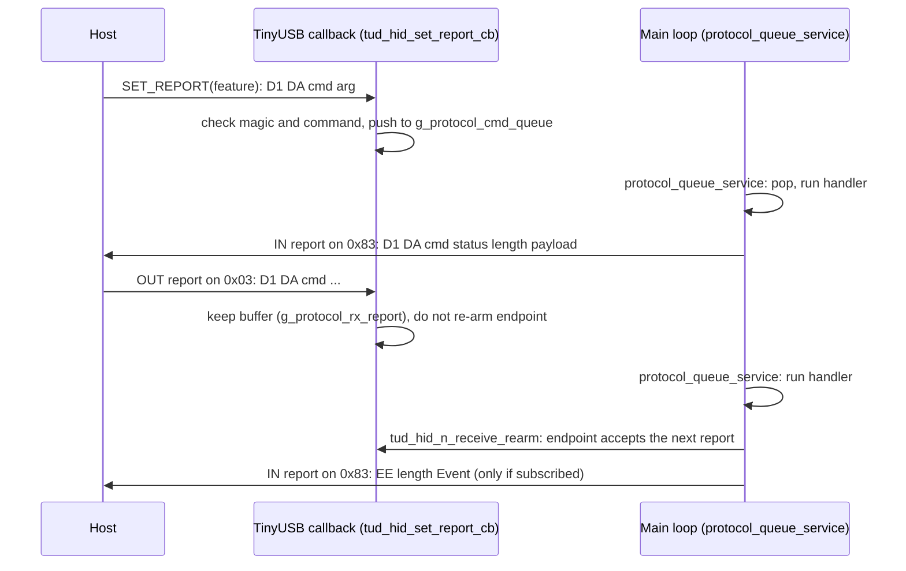

# Host protocol

This document describes how a program on the host computer talks to the keyboard: what the keyboard looks like on USB, how the configuration channel frames requests and responses, every command the firmware accepts, the events it sends, and worked examples as byte sequences.

Related documents: [storage](storage.md) (the files the commands read and write, and the protobuf schema), [architecture](architecture.md) (where the protocol task sits in the main loop), [hardware](hardware.md) (USB controller and PHY), [flashing](flashing.md) (installing firmware), [bootloader](bootloader.md) (what the reset commands hand to the factory bootloader).

## Scope

The document describes openwoot on the boards of this repository, the Wooting 80HE and the Wooting 60HE+. The USB descriptors and the host protocol match stock firmware 2.14.1, so that programs written for the stock firmware, including the vendor's configuration program, find the same device. The protocol is the same on both boards; [Differences between the boards](#differences-between-the-boards) lists what depends on the board.

- The sections state what the firmware accepts and answers. They do not describe which commands the vendor's configuration program sends, or in which order.
- Command, handler, message and field names are names of this project. Only numbers travel over USB: command numbers, status bytes, protobuf tags.
- Tested state: USB enumeration and the feature commands that only read state were confirmed on a Wooting 80HE with an earlier build of openwoot; the current build is not yet tested on hardware. The commands that store settings, the OUT-report commands, and the gamepad and XInput modes are not yet tested on hardware. openwoot has never run on a Wooting 60HE+: what this document states for that board is taken from its stock firmware, not confirmed on hardware.

Notation: numbers with `0x` are hexadecimal, all others decimal. Multi-byte integers are little endian. "Profile id" is defined in [Profile ids](#profile-ids).

## USB identity and modes

### Device descriptor

The device descriptor is the RAM object `g_usb_device_descriptor` ([`usb_data.c`](../src/usb/usb_data.c)); `usb_descriptors_init` ([`usb_init.c`](../src/usb/usb_init.c)) patches two fields at boot before the USB stack starts. The identity values are constants of the board's `board.h` ([80HE](../boards/wooting_80he/board.h), [60HE+](../boards/wooting_60he_plus/board.h)).

| Field | Value | Source |
| --- | --- | --- |
| `bcdUSB` | `0x0200` | constant |
| Class / subclass / protocol | 0 / 0 / 0 (defined per interface) | constant |
| `bMaxPacketSize0` | 64 | constant |
| `idVendor` | `0x31E3` (`BOARD_USB_VID`) | constant |
| `idProduct` | `BOARD_USB_PID_BASE` + USB mode: `0x1400`, `0x1401` or `0x1402` on the 80HE, `0x1320`, `0x1321` or `0x1322` on the 60HE+ | `usb_descriptors_init` |
| `bcdDevice` | `0x0250` with the NKRO keyboard report, `0x0251` with the 6KRO report | `usb_descriptors_init` |
| Manufacturer string (index 1) | `Wooting` | `g_usb_string_table` |
| Product string (index 2) | `BOARD_USB_PRODUCT`: `Wooting 80HE` or `Wooting 60HE+`; on a unit of the 80HE's TenZ edition `Wooting 80HE TenZ` (`BOARD_EDITION_USB_PRODUCT`, see [storage](storage.md#edition)) | `g_usb_string_table`, `usb_descriptors_init` |
| Serial string (index 3) | text formatted from the factory serial number by `storage_format_serial_string` ([`storage_serial.c`](../src/storage/storage_serial.c)), at most 31 characters in the descriptor | `usb_serial_string_init` |
| Configurations | 1 | constant |

String index 0 returns language id `0x0409`. Indices above 3 stall, except index `0xEE` in USB mode 0 (see [Microsoft OS descriptors](#microsoft-os-descriptors)). The device answers no BOS, device-qualifier or other-speed-configuration request (they stall), although the 80HE can run at high speed.

### USB mode, keyboard report format and bus speed

Three stored settings decide what the keyboard enumerates as. They live in the file `ds` (message `DeviceSettings`, see [storage](storage.md)), are read once at boot by `settings_load_and_apply` and `settings_apply_usb_mode` ([`settings.c`](../src/app/settings.c)), and therefore take effect only after a reset.

| Setting | Values | Effect |
| --- | --- | --- |
| USB mode (`g_usb_link_flags` bits 1:0, `enum usb_mode` in [`usb_types.h`](../src/usb/usb_types.h)) | 0 `USB_MODE_XINPUT`, 1 `USB_MODE_GAMEPAD`, 2 `USB_MODE_NO_GAMEPAD` (a stored 3 is rewritten to 2 at boot) | Selects what interface 0 is and is added to the product id. Default when `ds` cannot be read: 2. |
| Keyboard report format (`g_run_state_flags` bit `RUN_STATE_FLAG_6KRO`) | NKRO (default) or 6KRO | Selects the keyboard report descriptor, the endpoint of interface 1 and `bcdDevice`. NKRO means "N-key rollover" (a bitmap report with one bit per key), 6KRO the boot-compatible report with six key slots. |
| Force full speed (`g_run_state_options` bit `RUN_STATE_OPTION_USB_FULL_SPEED`; `usb_speed_option_init` calls `hal_usb_limit_to_full_speed`) | off (default) or on | The 80HE's controller is a high-speed core with an external PHY. With the option set it connects at full speed (12 Mbit/s) only (`g_usb_high_speed_enabled` is cleared). The 60HE+ has a full-speed controller only, so the option changes nothing there. |
| Gamepad polling rate (`g_usb_gamepad_poll_rate`) | 0 = 4 ms, 1 = 1 ms (default), 2 = 125 us | `bInterval` of the interface-0 endpoints in modes 0 and 1. |

### The 14 configuration descriptors

The firmware holds 14 complete configuration descriptors (`k_usb_config_desc_*` in [`usb_tables.c`](../src/tables/usb_tables.c)). `tud_descriptor_configuration_cb` ([`usb_descriptors.c`](../src/usb/usb_descriptors.c)) returns one of them, chosen by USB mode, keyboard report format and, for modes 0 and 1, the polling interval of interface 0. All 14 have 5 interfaces, `bConfigurationValue` 1, `bmAttributes` `0xA0` (bus powered, remote wakeup) and `bMaxPower` 200 (400 mA). Interfaces 2, 3 and 4 are byte-identical in all of them.

| Table | Length | Interface 0 | `bInterval` of interface 0 | Keyboard |
| --- | --- | --- | --- | --- |
| `k_usb_config_desc_nkro_xinput_int1` | 156 | XInput | 1 | NKRO |
| `k_usb_config_desc_nkro_xinput_int4` | 156 | XInput | 4 | NKRO |
| `k_usb_config_desc_nkro_xinput_int6` | 156 | XInput | 6 | NKRO |
| `k_usb_config_desc_6kro_xinput_int1` | 156 | XInput | 1 | 6KRO |
| `k_usb_config_desc_6kro_xinput_int4` | 156 | XInput | 4 | 6KRO |
| `k_usb_config_desc_6kro_xinput_int6` | 156 | XInput | 6 | 6KRO |
| `k_usb_config_desc_nkro_gamepad_int1` | 141 | HID gamepad | 1 | NKRO |
| `k_usb_config_desc_nkro_gamepad_int4` | 141 | HID gamepad | 4 | NKRO |
| `k_usb_config_desc_nkro_gamepad_int6` | 141 | HID gamepad | 6 | NKRO |
| `k_usb_config_desc_6kro_gamepad_int1` | 141 | HID gamepad | 1 | 6KRO |
| `k_usb_config_desc_6kro_gamepad_int4` | 141 | HID gamepad | 4 | 6KRO |
| `k_usb_config_desc_6kro_gamepad_int6` | 141 | HID gamepad | 6 | 6KRO |
| `k_usb_config_desc_nkro_placeholder` | 141 | placeholder HID | 10 | NKRO |
| `k_usb_config_desc_6kro_placeholder` | 141 | placeholder HID | 10 | 6KRO |

Selection of the interval variant (`usb_select_gamepad_interval`). `bInterval` counts 1 ms frames at full speed; at high speed (80HE only) the period is 2^(`bInterval` - 1) microframes of 125 us, so the same polling rate needs a different descriptor per bus speed.

| Polling rate setting | Full-speed link | High-speed link |
| --- | --- | --- |
| 0 (4 ms) | `*_int4`: 4 ms | `*_int6`: 32 microframes = 4 ms |
| 1 (1 ms) | `*_int1`: 1 ms | `*_int4`: 8 microframes = 1 ms |
| 2 (125 us) | `*_int1`: 1 ms | `*_int1`: 1 microframe = 125 us |

### Interfaces and endpoints

All endpoints are interrupt endpoints. The interface numbers are fixed (`enum usb_itf_num`).

| Itf | Purpose | Class / subclass / protocol | Endpoints (address, direction, `wMaxPacketSize`, `bInterval`) | HID report descriptor |
| --- | --- | --- | --- | --- |
| 0, mode 0 | XInput gamepad | `0xFF` / `0x5D` / `0x01` (vendor class) | `0x81` IN 32, `0x01` OUT 32; interval 1, 4 or 6 | none (not HID) |
| 0, mode 1 | HID gamepad | 3 / 0 / 0 | `0x81` IN 32; interval 1, 4 or 6 | `k_usb_hid_report_desc_gamepad` (122 bytes) |
| 0, mode 2 | placeholder | 3 / 0 / 0 | `0x81` IN 8; interval 10 | `k_usb_hid_report_desc_itf0_placeholder` (21 bytes) |
| 1 | keyboard | 3 / 1 / 1 (boot keyboard) | `0x82` IN; NKRO: 28 bytes, interval 1; 6KRO: 8 bytes, interval 10 | `k_usb_hid_report_desc_kbd_nkro` (103 bytes) or `k_usb_hid_report_desc_kbd_6kro` (59 bytes) |
| 2 | configuration channel | 3 / 0 / 0 | `0x03` OUT 64, `0x83` IN 64; interval 1 | `k_usb_hid_report_desc_protocol` (99 bytes) |
| 3 | system control, consumer control, mouse | 3 / 0 / 0 | `0x84` IN 8; interval 4 | `k_usb_hid_report_desc_system_consumer_mouse` (98 bytes) |
| 4 | key states (vendor defined) | 3 / 0 / 0 | `0x85` IN 64; interval 1 | `k_usb_hid_report_desc_vendor64` (21 bytes) |

Every HID interface has a HID descriptor with `bcdHID` 1.11, country code 0 and one report descriptor.

Polling periods that follow from these `bInterval` values:

| Endpoint | Full speed | High speed (80HE only) |
| --- | --- | --- |
| `0x82` keyboard, NKRO (interval 1) | 1 ms | 125 us |
| `0x82` keyboard, 6KRO (interval 10) | 10 ms | 512 microframes = 64 ms |
| `0x03` / `0x83` configuration channel (interval 1) | 1 ms | 125 us |
| `0x84` interface 3 (interval 4) | 4 ms | 1 ms |
| `0x85` interface 4 (interval 1) | 1 ms | 125 us |
| `0x81` placeholder (interval 10) | 10 ms | 64 ms |

The polling period is what the descriptor offers to the host. How often the firmware actually produces a new report is a property of the scan task and is described in [architecture](architecture.md).

### HID report descriptors

`tud_hid_descriptor_report_cb` ([`usb_descriptors.c`](../src/usb/usb_descriptors.c)) returns the descriptor by interface number.

| Descriptor | Report ids | Content |
| --- | --- | --- |
| `k_usb_hid_report_desc_kbd_6kro` | none | Input, 8 bytes: 8 modifier bits (usages `0xE0`..`0xE7`), 1 constant byte, 6 key codes. Output, 1 byte: 5 LED bits, 3 padding bits. |
| `k_usb_hid_report_desc_kbd_nkro` | none | Output, 1 byte: 5 LED bits, 3 padding bits. Input, 28 bytes: 8 modifier bits, then key bitmaps for usages `0x04`..`0x31` (46 bits), `0x33`..`0x9B` (105 bits), `0x9D`..`0xA4` (8 bits), `0xB0`..`0xDD` (46 bits), with padding bits between the groups. |
| `k_usb_hid_report_desc_protocol` | 1..6 | Usage page `0xFF55`, usage 1. Each id has an input and an output report of the same size: id 1: 32 bytes, id 2: 62, id 3: 254, id 4: 510, id 5: 1022, id 6: 2046. Id 1 also has a feature report of 7 bytes. Sizes do not include the report-id byte. |
| `k_usb_hid_report_desc_system_consumer_mouse` | 1..3 | Id 1: system control, one usage (`0x81`..`0x83`: power down, sleep, wake up). Id 2: consumer control, three 16-bit usages (1..`0x2A2`). Id 3: mouse with 5 buttons and 8-bit relative X and Y. |
| `k_usb_hid_report_desc_vendor64` | none | Usage page `0xFF53`: one 64-byte input report (key states, built by `hid_keystate_report_add_key` in [`hid_reports.c`](../src/hid/hid_reports.c)). |
| `k_usb_hid_report_desc_gamepad` | none | 25-byte input report: 12 buttons, six 16-bit axes (X, Y, Z, Rz, Rx, Ry), five 16-bit simulation-control axes, one hat switch. Sent by `hid_send_gamepad_report`. |
| `k_usb_hid_report_desc_itf0_placeholder` | none | Usage page `0xFF00`, 8-byte input report. Nothing is sent on it. |

The keyboard interface accepts the standard LED output report (bit 0 Num Lock, bit 1 Caps Lock, bit 2 Scroll Lock). `tud_hid_set_report_cb` ([`protocol_core.c`](../src/protocol/protocol_core.c)) stores the lock states, updates the indicator keys and publishes them as RGB signals.

KNOWN ISSUE: if the USB mode were 3, interface 0 would answer the report-descriptor request with the keyboard descriptor. Mode 3 is rewritten to 2 at boot, so this is not reachable through stored settings. Matches stock firmware 2.14.1.

### XInput interface

In USB mode 0, interface 0 is a vendor class interface that imitates an Xbox 360 controller. It is served by the firmware's own class driver ([`usb_xinput.c`](../src/usb/usb_xinput.c), table `k_usb_app_class_driver`), not by the HID driver.

- Interface descriptor: class `0xFF`, subclass `0x5D`, protocol `0x01`, followed by a 17-byte class-specific descriptor (type `0x21`), endpoint `0x81` IN and endpoint `0x01` OUT, both 32 bytes.
- Input report, sent by `hid_send_xinput_report` ([`hid_reports.c`](../src/hid/hid_reports.c)): 20 bytes, `00 14`, then the 12-byte pad state (buttons `uint16`, left trigger `uint8`, right trigger `uint8`, left stick X, Y and right stick X, Y as `int16`), then 6 zero bytes. A report is sent only when it differs from the last one.
- Output: `usb_xinput_xfer_cb` understands the LED command `01 03 <pattern>`. Patterns 2..5 and 6..9 give player index 0..3, which the firmware stores in `g_hid_xinput_player_index`.

### Microsoft OS descriptors

These make Windows load its XInput driver without an INF file. They are served only in USB mode 0.

- String descriptor `0xEE` (`tud_descriptor_string_cb`): `12 03`, `MSFT100` in UTF-16, request code `0xB0`, padding `00`.
- Vendor request with `bRequest` `0xB0` and `wIndex` 4 (`tud_vendor_control_xfer_cb` in [`usb_xinput.c`](../src/usb/usb_xinput.c)): returns the 40-byte Extended Compat ID descriptor `k_usb_msos_compat_id_desc`, which assigns the compatible id `XUSB10` to interface 0. Every other vendor request stalls.

## The configuration channel

### Transport

The configuration channel is HID interface 2. Three kinds of transfers are used.

| Direction | Transfer | Used for | Handled by |
| --- | --- | --- | --- |
| host to device | `SET_REPORT` control request, report type 3 (feature), report id 1, 7 data bytes | feature commands: short requests with a 4-byte argument; each gets a response | `protocol_receive_feature_report`, then `protocol_handle_feature_command` |
| host to device | output report on interrupt endpoint `0x03` (or `SET_REPORT` with report type 2) | OUT-report commands: requests that carry data, mostly a protobuf message; no response | `protocol_receive_out_report`, then the handler from the main loop |
| device to host | input report on interrupt endpoint `0x83`, report ids 1..6 | responses to feature commands and unsolicited events | `protocol_queue_report` |

All functions named in this section are in [`protocol_core.c`](../src/protocol/protocol_core.c) unless stated otherwise; the frame layouts are the structs of [`protocol_types.h`](../src/protocol/protocol_types.h).

`GET_REPORT` is not usable: `tud_hid_get_report_cb` returns 0 bytes. Responses always arrive as input reports.



Requests are only received in the TinyUSB callback `tud_hid_set_report_cb`. TinyUSB calls it from its device task `tud_task`, which the main loop runs once per pass and which the settings-flash driver also runs while it waits for the flash chip (`nor_flash_wait_ready` in [`spi_nor.c`](../drivers/spi_nor/spi_nor.c), and the byte transfers of the family's `hal_nor_bus.c`: [gd32f4xx](../hal/gd32f4xx/hal_nor_bus.c), [gd32f30x](../hal/gd32f30x/hal_nor_bus.c)); so a request can arrive while a command handler is in the middle of a flash write. The callback only validates and queues the request. Commands are executed later by `protocol_queue_service` ([`tasks.c`](../src/app/tasks.c)), which runs once per pass of the main loop and executes at most one queued command per pass.

### The magic

Every request starts with the 16-bit value `0xDAD1` (`PROTOCOL_MAGIC`), which appears on the wire as the bytes `D1 DA`. Every response to a feature command starts with the same two bytes. Events start with the byte `0xEE` instead.

### Feature commands: request

A feature command is the 7-byte feature report of report id 1 (`protocol_feature_request_t`):

| Offset | Size | Field | Content |
| --- | --- | --- | --- |
| 0 | 2 | `magic` | `D1 DA` |
| 2 | 1 | `cmd` | command number 0..88, looked up in the registration list `protocol_feature_commands` (see [Feature command table](#feature-command-table)) |
| 3 | 4 | `arg` | argument, little endian; meaning depends on the command. This document calls the four bytes `a0`..`a3` (`a0` = report byte 3 = bits 7:0 of `arg`). |

On the wire the HID report-id byte `01` precedes these 7 bytes (8 data bytes in the `SET_REPORT` request with `wValue` = `0x0301`, `wIndex` = 2). The firmware's HID driver removes the id byte when it equals the report id in `wValue`; data without the id byte is accepted as well, because the handler only looks for `D1 DA` at the start of what it receives. Feature data longer than 64 bytes stalls.

What `protocol_receive_feature_report` does with a request:

1. Wrong magic: an immediate header-only response with status `0xFF`.
2. `cmd` above 88, or below 38 (`PROTOCOL_FEATURE_CMD_FIRST_CURRENT`) without a registered handler: an immediate header-only response with status `0x66`. A number from 38 to 88 without a handler is queued like any other command and answered with status `0xAA` by `protocol_handle_feature_command`.
3. Three feature commands already waiting: an immediate header-only response with status `0x77`. The queue `g_protocol_cmd_queue` has 4 entries, of which at most 3 may be feature commands.
4. Otherwise the command and its argument are queued.

`protocol_queue_service` leaves a feature command in the queue while the transmit ring (see below) is full, so a host that does not read input reports stalls its own commands.

### Feature commands: response

`protocol_handle_feature_command` gives the handler a zeroed 2046-byte buffer (`protocol_response_t`), lets it fill status, length and payload, then adds the magic and the command number and queues `length` + 6 bytes.

| Offset | Size | Field | Content |
| --- | --- | --- | --- |
| 0 | 2 | `magic` | `D1 DA` |
| 2 | 1 | `cmd` | echo of the command number |
| 3 | 1 | `status` | see the table below |
| 4 | 2 | `length` | number of payload bytes, 0..2040 |
| 6 | `length` | `payload` | raw bytes or one encoded protobuf message |

Status bytes (`enum protocol_status`):

| Value | Name | Meaning |
| --- | --- | --- |
| `0x88` | `PROTOCOL_STATUS_OK` | Success. With `length` 0 on a "get" command it often means "nothing stored" (file missing). |
| `0xFF` | `PROTOCOL_STATUS_ERROR` | Handler error (bad argument, storage not mounted, read or encode failure) or wrong magic. Some handlers add an error code as payload, noted in the command table. |
| `0x66` | `PROTOCOL_STATUS_UNKNOWN_CMD` | Command number above 88, or below 38 without a registered handler. |
| `0x77` | `PROTOCOL_STATUS_QUEUE_FULL` | Three feature commands are already waiting. Retry later. |
| `0xAA` | `PROTOCOL_STATUS_UNSUPPORTED` | Command number 38..88 without a registered handler: 60, 77..80 and 88 on every board, and the commands of a feature the board does not have (see [Differences between the boards](#differences-between-the-boards)). Also returned by command 87 for profile id `0xFFFF`. The rule matches stock firmware 2.14.1. |
| `0x99` | `PROTOCOL_STATUS_TOO_LONG` | Set when a handler reports more than 2040 payload bytes. Such a frame would exceed 2046 bytes and `protocol_handle_feature_command` then does not send it, so a host should not expect to see this value. |

A response is sent only while the device is configured (`g_usb_mounted`). Commands 2, 25 and 43 reset the keyboard inside their handler, so they never produce a response.

### Input report sizes and the transmit ring

`protocol_queue_report` sends each frame (response or event) in the smallest input report that holds it and pads the rest with zero bytes:

| Frame length | Report id | Report size (without the id byte) |
| --- | --- | --- |
| up to 32 | 1 | 32 |
| up to 62 | 2 | 62 |
| up to 254 | 3 | 254 |
| up to 510 | 4 | 510 |
| up to 1022 | 5 | 1022 |
| up to 2046 | 6 | 2046 |

A host must therefore read the `length` field to find the end of the payload; the transfer length only tells the report size. A report longer than 64 bytes spans several USB packets of endpoint `0x83`.

If the endpoint is busy the frame is copied into `g_protocol_tx_ring`, which holds 3 frames. A fourth frame is dropped silently. `protocol_flush_tx_ring` sends waiting frames from the main loop and from the transfer-complete callback.

### OUT-report commands

An OUT-report command is an output report of interface 2. The firmware does not look at the report id: for data from endpoint `0x03` it skips the first byte whatever its value, and then expects (`protocol_receive_out_report`):

| Offset | Size | Field | Content |
| --- | --- | --- | --- |
| 0 | 2 | `magic` | `D1 DA` |
| 2 | 1 | `cmd` | command number, looked up in the registration list `protocol_report_commands` (numbers 0..44 are in use) |
| 3 | ... | | depends on the command, see the four layouts below |

A host should use the smallest report id whose size holds the frame and pad with zeros, as the device does for input reports; this is what the report descriptor describes. The payload length is taken from the length field inside the frame, never from the transfer length. A transfer on endpoint `0x03` ends with a short packet; all six report sizes plus the id byte are not multiples of 64, so no zero-length packet is needed.

Reports with a wrong magic, a command number without a registered handler or fewer than 3 bytes are ignored silently (`protocol_receive_out_report`, `protocol_handle_report_command`). There is no response and no error report for OUT-report commands; handlers also ignore protobuf decode errors silently. To confirm a change, read it back with the matching feature command.

Flow control: the report stays in the USB driver's buffer (`g_protocol_rx_report` points into it) and the OUT endpoint is not armed again until the main loop has run the handler. The host's next OUT transfer is therefore held off (NAK) until the previous command is done. If the command queue is full (4 entries) the report is dropped. `SET_REPORT` with report type 2 on the control endpoint is accepted too, but it writes into the same buffer without this flow control; prefer the interrupt endpoint.

Four layouts are in use after the 3-byte header.

**Layout A** (`protocol_report_profile_t`), used by most "set" commands:

| Offset | Size | Field | Content |
| --- | --- | --- | --- |
| 3 | 1 | `flags` | bit 0: persist (write to flash); bits 5:1: profile index; bits 7:6: profile namespace |
| 4 | 2 | `length` | payload length; for several commands 0 means "clear" or "delete the file" |
| 6 | `length` | `payload` | one encoded protobuf message |

The common behaviour of layout A commands, unless the command table says otherwise:

- Persist bit clear: the message is applied to the running state in RAM only (a live preview). The profile bits are ignored.
- Persist bit set: the message is written to the file of the profile named by the flags. It is applied to RAM only if that profile is the active one.

**Layout B** (`protocol_report_plain_t`), commands without a flags byte:

| Offset | Size | Field | Content |
| --- | --- | --- | --- |
| 3 | 2 | `length` | payload length (unaligned) |
| 5 | `length` | `payload` | protobuf message or raw bytes |

**Layout C** (`protocol_report_indexed_t`), commands that address a numbered file:

| Offset | Size | Field | Content |
| --- | --- | --- | --- |
| 3 | 1 | `flags` | as in layout A |
| 4 | 1 | `index` | keymap layer (command 20) or file slot (command 44) |
| 5 | 2 | | not read |
| 7 | 2 | `length` | payload length (unaligned) |
| 9 | `length` | `payload` | one encoded protobuf message |

**Raw layouts**: commands 7, 11 and 27 carry fixed-size binary data directly after the header; they are described in the command table.

### Profile ids

A profile is addressed by a 16-bit profile id (`profile_id_t` in [`profile_types.h`](../src/profile/profile_types.h)): the low byte is the index, the high byte the namespace.

| Namespace | Index | Directory | Meaning |
| --- | --- | --- | --- |
| 0 | 0..3 | `<index>/` | the built-in profile slots |
| 1 | 0..9 | `lp/<index>/` | a second set of profiles managed by the host. |

In feature commands the profile id is `arg` bits 15:0, so `a0` is the index and `a1` the namespace. The id `0xFFFF` (`PROFILE_ID_NONE`) means "the running state in RAM" for the "get" commands that support it and is an error elsewhere. In OUT reports the profile is packed into the flags byte as shown above.

### Key ids, colours and distances

Several messages and arguments use these encodings.

- Key id: `row << 5 | column` (`KEYS_KEY_ID` in [`keys_types.h`](../src/keys/keys_types.h)). Row and column index the key matrix of the board, `BOARD_KEY_ROWS` x `BOARD_KEY_COLS`: 6 x 17 on the 80HE (row 0..5, column 0..16), 6 x 14 on the 60HE+ (row 0..5, column 0..13; row 0 carries no keys). Which physical key sits at which position depends on the layout tables.
- Matrices on the wire have 6 rows of 21 columns (`BOARD_KEYMAP_COLS`) on every board. Only the columns below `BOARD_KEY_COLS` belong to keys (0..16 on the 80HE, 0..13 on the 60HE+); the other columns are unused.
- RGB565: a 16-bit colour, red in bits 15:11, green in bits 10:5, blue in bits 4:0.
- Distances (actuation points, rapid-trigger sensitivities) are 16-bit values: 0 = not set, 1..255 = legacy 8-bit fraction of the full switch travel, `0x4000`..`0x7FFF` = 14-bit fraction in bits 13:0. See the constants `KEYS_DISTANCE_*` in [`keys_types.h`](../src/keys/keys_types.h).

### Protobuf payloads

Structured payloads are Protocol Buffers messages in the proto2 wire format, encoded and decoded with nanopb (a C implementation for microcontrollers). The schema is [`src/proto/settings.proto`](../src/proto/settings.proto); [storage](storage.md#the-protobuf-schema) describes its messages.

- A payload is exactly one message, without any length prefix or type marker of its own. The frame's `length` field gives the number of encoded bytes; which message it is follows from the command number.
- Responses are encoded into the 2040-byte payload area by `pb_encode`; requests are decoded with `pb_decode`, which first sets every field to its schema default.
- Fields marked `required` in the schema must be present in a request or decoding fails (and the command is silently ignored). nanopb skips fields with unknown tags.
- Tags, wire types, field sizes, array limits and defaults are fixed by compatibility with stock firmware 2.14.1. Message and field names are not transmitted, so they can be renamed without affecting compatibility.

## Feature command table

There is no central command table. Each handler is registered next to its definition with the macro `PROTOCOL_FEATURE_COMMAND` (OUT-report commands: `PROTOCOL_REPORT_COMMAND`) of [`protocol.h`](../src/protocol/protocol.h). The macro places one entry {number, handler} in the registration list `protocol_feature_commands` (or `protocol_report_commands`); the linker collects the entries of a list into one array ([`registry.h`](../src/core/registry.h)), and `protocol_handle_feature_command` and `protocol_handle_report_command` look the command number up in it. From [`protocol_device.c`](../src/protocol/protocol_device.c):

```c
/* Feature command 0. Reply: one byte, the inverted low argument byte. */
static void protocol_cmd_ping(uint32_t arg, protocol_response_t *response)
{
    response->length = 1u;
    response->payload[0] = (uint8_t)~arg;
    response->status = PROTOCOL_STATUS_OK;
}
PROTOCOL_FEATURE_COMMAND(PROTOCOL_FEATURE_CMD_PING, protocol_cmd_ping);
```

A command that belongs to a feature is registered in the feature's directory (the light-bar commands in [`src/rgb/lightbar/lightbar_protocol.c`](../src/rgb/lightbar/lightbar_protocol.c), the host-signal commands in [`src/rgb/signals/signals_protocol.c`](../src/rgb/signals/signals_protocol.c)), so it exists only in the build of a board whose `board.mk` lists the feature. The command numbers have named constants in `enum protocol_feature_cmd_id` ([`protocol_types.h`](../src/protocol/protocol_types.h)).

Feature command numbers 0..88; 65 numbers have a handler on the 80HE, 59 on the 60HE+.

Conventions in this table:

- "id" in the argument column means a profile id in `a1:a0`; "(live)" marks commands where id `0xFFFF` returns the running RAM state.
- Unless stated otherwise the response has status `0x88` and no payload on success, and status `0xFF` on error.
- "empty OK" means status `0x88` with `length` 0, returned when the file does not exist.
- The handler name links to its source file. Messages are defined in [`settings.proto`](../src/proto/settings.proto). File names such as `cfg` refer to the [file table in storage](storage.md#file-table).

| No. | Handler | Argument | Response payload | Message | Effect |
| --- | --- | --- | --- | --- | --- |
| 0 (`0x00`) | [`protocol_cmd_ping`][device] | `a0`: any byte | 1 byte: `a0` inverted | | Connectivity check. |
| 1 (`0x01`) | [`protocol_cmd_get_version`][device] | none | 3 bytes: major, minor, patch = `02 0E 01` | | Firmware version 2.14.1. |
| 2 (`0x02`) | [`protocol_cmd_enter_update_mode`][device] | `a0`: option bits for the bootloader: bit 0 = run update mode at USB high speed (clear: full speed), bit 1 = ignore the key combination, bit 2 = no lighting | no response | | Reset to update mode. `hal_system_enter_update_mode` ([`hal_system.h`](../hal/include/hal/hal_system.h), implemented per family in `hal_system.c`) writes `0x504` to the backup register `RTC_BKP0` and `a0` to `RTC_BKP2` (on the 60HE+: `BKP_DATA0` and `BKP_DATA2`), then resets the MCU. The registers survive the reset. The 80HE's factory bootloader (version 2.3) reads both at its start, clears them, and stays in update mode because of the value `0x504`; the request therefore holds for one start. See [bootloader](bootloader.md). How the 60HE+ bootloader treats the request is not known. |
| 3 (`0x03`) | [`protocol_cmd_get_serial`][devinfo] | `arg` = selector 0..3 | 0: 11 bytes (packed serial fields, zero if unreadable). 1: 12 bytes, the MCU unique id. 2: protobuf. 3: 10 bytes: SPI flash manufacturer id, device id, 8-byte unique id | `SerialNumber` (selector 2) | Identification data. Selector 2 error: status `0xFF` with a 2-byte `int16` error code. Other selectors: status `0xFF`. |
| 4..6 | no handler | | status `0x66` | | |
| 7 (`0x07`) | [`protocol_cmd_reload_profile_legacy`][profile] | none | none | | Requests a reload of the active profile from flash; the main loop runs `profile_activate`. Same body as command 38. |
| 8 (`0x08`) | [`protocol_cmd_save_live_rgb`][rgbset] | id | none | | Writes the running RGB settings to file `rgb` and the running base colours to file `clr` of that profile. Error if the id does not name a profile slot. |
| 9, 10 | no handler | | status `0x66` | | |
| 11 (`0x0B`) | [`protocol_cmd_get_active_profile`][profile] | none | 2 bytes: index, namespace | | Active profile. |
| 12..18 | no handler | | status `0x66` | | |
| 19 (`0x13`) | [`protocol_cmd_get_device_config`][device] | none | 7 bytes: device settings block, see [Device settings block](#device-settings-block) | | Reads file `ds` and the stored physical layout; byte 4 is replaced by the MCU read-protection state. |
| 20 (`0x14`) | [`protocol_cmd_get_key_sensor_values`][keysact] | `a0`: kind 0..5 (other values act as 0); `a1`: format, 1 = raw | format 1: one `uint16` per scan position (`BOARD_SCAN_POSITIONS`): 192 bytes on the 80HE, 128 bytes on the 60HE+. Other formats: protobuf | `KeyMatrixU8` | Per-key sensor data. Kind 0: current value (travel scaled to 0..255, or the raw ADC word while raw scanning is on); 1: rest level, single-input scan; 2: a state flag as 0 / `0xFF`; 3: scan order (matrix format only); 4: rest level, six-input scan; 5: bottom-out level. |
| 21 (`0x15`) | [`protocol_cmd_keys_off`][keysact] | none | none | | Clears the "key reports" bit of `g_usb_link_flags`: the keyboard stops sending key reports. |
| 22 (`0x16`) | [`protocol_cmd_keys_on`][keysact] | none | none | | Sets that bit again. It is also set whenever the device is configured. |
| 23 (`0x17`) | [`protocol_cmd_activate_profile`][profile] | id | none | | Requests a switch to that profile; the main loop runs `profile_activate`, which sends event 1 to subscribers. Error if the namespace is above 1 or the index is not below the profile count of the namespace. |
| 24 (`0x18`) | [`protocol_cmd_ack_empty`][device] | none | none | | Does nothing but answer OK. The firmware attaches no function to it. |
| 25 (`0x19`) | [`protocol_cmd_restart`][device] | `a0`: option bits for the bootloader, as for command 2 | no response | | Resets the MCU (`hal_system_restart`); the bootloader starts the firmware again. A non-zero `a0` is written to `RTC_BKP2` (60HE+: `BKP_DATA2`) first and applies to that one start of the bootloader. |
| 26..29 | no handler | | status `0x66` | | |
| 30 (`0x1E`) | [`protocol_cmd_sdk_set_key_color`][rgbsdk] | `a3`: key id; `a2`: red; `a1`: green; `a0`: blue | none | | Enters SDK mode (see [RGB SDK mode](#rgb-sdk-mode)) and sets the LED of one key. Error if row is above 5 or the column is not below `BOARD_KEY_COLS` (above 16 on the 80HE, above 13 on the 60HE+); SDK mode is entered even then. |
| 31 (`0x1F`) | [`protocol_cmd_sdk_reset_key_color`][rgbsdk] | `a0`: key id | none | | Gives one key LED its profile colour back. Does not change the mode. |
| 32 (`0x20`) | [`protocol_cmd_sdk_reset_colors`][rgbsdk] | none | none | | Leaves SDK mode and repaints the profile colours. |
| 33 (`0x21`) | [`protocol_cmd_sdk_init_colors`][rgbsdk] | none | none | | Enters SDK mode. |
| 34 | no handler | | status `0x66` | | |
| 35 (`0x23`) | [`protocol_cmd_get_base_colors_rows_0_2`][rgbcol] | id (live) | protobuf | `ColorRows` | Rows 0..2 of the base colour map (file `clr`). Known issue (matches stock firmware 2.14.1): an unreadable file, an unmounted file system or an invalid id answers with an all-zero map and status OK. |
| 36 (`0x24`) | [`protocol_cmd_get_base_colors_rows_3_5`][rgbcol] | id (live) | protobuf | `ColorRows` | Rows 3..5 of the base colour map. Same quirk. |
| 37 | no handler | | status `0x66` | | |
| 38 (`0x26`) | [`protocol_cmd_reload_profile`][profile] | none | none | | Same as command 7. |
| 39 (`0x27`) | [`protocol_cmd_get_profile_cfg`][profile] | id (live) | protobuf, or empty OK | `ProfileConfigFile` | General profile settings (file `cfg`): actuation point, rapid trigger, scan mode, tap duration. Distances are sanitised before they are returned. |
| 40 (`0x28`) | [`protocol_cmd_get_gamepad_mapping`][keysgp] | id (live) | protobuf, or empty OK | `GamepadMapping` | Gamepad control bound to each key (file `gm`). Live: empty OK when no mapping is loaded. |
| 41 (`0x29`) | [`protocol_cmd_get_gamepad_settings`][keysgp] | id (live) | protobuf, or empty OK | `GamepadSettings` | Stick response settings (file `gp`). |
| 42 (`0x2A`) | [`protocol_cmd_save_live_cfg`][profile] | id | none | | Writes the running general settings to file `cfg` of that profile. |
| 43 (`0x2B`) | [`protocol_cmd_factory_reset`][device] | none | no response | | Formats the file system (all profiles and settings), waits 100 ms, resets the MCU. See [storage](storage.md#factory-reset). |
| 44 (`0x2C`) | [`protocol_cmd_set_raw_scanning`][keysact] | `arg`: non-zero = on | none | | Sets the raw-scanning flag: the scan paths and command 20 then work with raw ADC values. Not stored. |
| 45 (`0x2D`) | [`protocol_cmd_start_xinput_detection`][keysact] | none | none | | Sets `g_hid_gamepad_detection_active`: the gamepad report of interface 0 carries a fixed pattern instead of the key state, by which a host program can find which game controller the keyboard is. |
| 46 (`0x2E`) | [`protocol_cmd_stop_xinput_detection`][keysact] | none | none | | Clears that flag. |
| 47 (`0x2F`) | [`protocol_cmd_ack`][device] | none | none | | Does nothing but answer OK. The firmware attaches no function to it. |
| 48 (`0x30`) | [`protocol_cmd_get_keymap_layer`][keyslay] | id (`0xFFFF` = active profile); `a2`: layer 0..3 | protobuf, or empty OK | `KeymapLayer` | Key codes of one layer from file `ml<layer>`. Always read from flash. |
| 49 (`0x31`) | [`protocol_cmd_get_actuation_points`][keysact] | id (live) | protobuf, or empty OK | `ActuationPoints` | Per-key actuation points (file `act`). Known issue in the live variant (matches stock firmware 2.14.1): unset cells of the message are not cleared and can carry stack garbage. |
| 50 (`0x32`) | [`protocol_cmd_get_rgb_settings`][rgbset] | id (live) | protobuf | `RgbSettings` | Brightness, indicator colours and effect layers (file `rgb`). Known issue (matches stock firmware 2.14.1): a missing or damaged file answers with the message defaults and status OK. |
| 51 (`0x33`) | [`protocol_cmd_get_global_settings`][device] | none | protobuf, or empty OK | `GlobalSettings` | Keyboard-wide settings, read from file `global` (not from RAM). |
| 52 (`0x34`) | [`protocol_cmd_get_advanced_keys`][keysadv] | id (live); `a2`: index of the first entry | protobuf, or empty OK | `AdvancedKeysPage` | One page of up to 10 entries of the advanced-key list (file `ak2`, up to 40 entries) plus the total count. Known issue (matches stock firmware 2.14.1): a read error other than "missing" puts the low byte of the error code into the status byte. |
| 53 (`0x35`) | [`protocol_cmd_save_advanced_keys`][keysadv] | id | none | | Writes the running advanced-key list to file `ak2` of that profile and removes the legacy file `dks`. |
| 54 (`0x36`) | [`protocol_cmd_get_legacy_rapid_trigger_keys`][keysrt] | id (live) | protobuf, or empty OK | `KeyByteMap` | Legacy per-key rapid-trigger modes (file `prt`). Live: empty OK when the group format is in use. |
| 55 (`0x37`) | [`protocol_cmd_get_profile_info`][profile] | id (not `0xFFFF`) | protobuf, or empty OK | `ProfileInfo` | Profile name, colour and one uninterpreted string (file `i`). |
| 56 (`0x38`) | [`protocol_cmd_flash_selftest`][device] | none | 1 byte: 1 = passed, 0 = failed | | Checks the SPI flash id (manufacturer `0xEF` or `0xC8`, device `0x16`) and increments the counter file `boot_count`. Writes to flash on every call. |
| 57 (`0x39`) | [`protocol_cmd_get_layer_colors`][rgbcol] | `a0`: profile index; `a1`: layer; `a2`: 0 = rows 0..2, else rows 3..5; `a3`: namespace | protobuf, or empty OK | `ColorRows` | Half of the colour map of one Fn layer (file `r<layer>`). Note the argument layout differs from the other commands. |
| 58 (`0x3A`) | [`protocol_cmd_get_storage_usage`][device] | none | protobuf | `StorageUsage` | Number of file-system blocks in use (of `BOARD_STORAGE_LFS_BLOCK_COUNT`: 2047 on the 80HE, 2048 on the 60HE+), or a negative littlefs error. |
| 59 (`0x3B`) | [`protocol_cmd_get_device_info_aux_record`][devinfo] | none | protobuf, or empty OK | `DeviceInfoAux` | Returns field 2 of the device-info record; the firmware never interprets it. Read error: status `0xFF` with a 2-byte error code. |
| 60 (`0x3C`) | no handler | | status `0xAA` | | |
| 61 (`0x3D`) | [`protocol_cmd_get_rapid_trigger_groups`][keysrt] | id (live) | protobuf, or empty OK | `RapidTriggerGroups` | Rapid-trigger settings as groups of keys (file `prt2`). |
| 62 (`0x3E`) | [`protocol_cmd_get_profile_count`][profile] | `a0`: namespace | 1 byte: number of profile directories | | Counts consecutive existing directories. Error: status `0xFF` with 1 payload byte, a positive error number (22 for a bad namespace, 1 if storage is not mounted, otherwise the negated littlefs error). |
| 63 (`0x3F`) | [`protocol_cmd_delete_profile`][profile] | id | none | | Deletes the directory of a profile with all files. Only the last profile of a namespace can be deleted and never built-in profile 0 (error payload 22). Moves the active profile if needed and sends event 4. Body: `protocol_delete_last_profile`. |
| 64 (`0x40`) | [`protocol_cmd_create_profile`][profile] | id | none | | Creates the directory of a profile slot (and `lp` itself if needed). No files are written; the profile uses defaults until the host stores settings. Error payload as for command 62. |
| 65 (`0x41`) | [`protocol_cmd_get_host_signals`][sig] | none | protobuf | `HostSignalList` | Feature `signals`. Lists the host-defined signals the light-bar entries refer to, as {index, id} pairs, and enables host-signal effects. Empty list while the device is locked. See [Host signals](#host-signals). |
| 66 (`0x42`) | [`protocol_cmd_get_lightbar_config`][lb] | id (live) | protobuf, or empty OK | `LightbarConfig` | Feature `lightbar`. Light-bar entries of a profile (file `lb`). |
| 67 (`0x43`) | [`protocol_cmd_get_global_lightbar_config`][lb] | `arg`: 0 = file | protobuf, or empty OK | `GlobalLightbarConfig` | Feature `lightbar`. Light-bar entries shared by all profiles (file `glb`). Known issue (matches stock firmware 2.14.1): a non-zero `arg` encodes the profile's `LightbarConfig` struct with the wrong descriptor; use 0. |
| 68 (`0x44`) | [`protocol_cmd_get_lightbar_colors`][lb] | none | protobuf | `LightbarColors` | Feature `lightbar`. Current colours of the 10 light-bar LEDs in the frame buffer (before brightness and gamma). |
| 69 (`0x45`) | [`protocol_cmd_get_usb_speed`][device] | none | 1 byte: 1 low, 2 full, 3 high speed, 0 unknown | | Negotiated bus speed. The 60HE+ controller runs at full speed only. |
| 70 (`0x46`) | [`protocol_cmd_get_lbm_file`][lb] | id (not `0xFFFF`) | protobuf, or empty OK | `LbmFile` | Feature `lightbar`. Returns file `lbm`, which the firmware only stores (up to four 30-character strings). |
| 71 (`0x47`) | [`protocol_cmd_get_glbm`][lb] | none | protobuf, or empty OK | `GlbmFile` | Feature `lightbar`. Returns file `glbm`, the keyboard-wide counterpart of `lbm`. |
| 72 (`0x48`) | [`protocol_cmd_get_profile_revision`][profile] | id | 4 bytes: `uint32` revision, or empty OK | | Revision counter of a profile directory (file `pst`), see [storage](storage.md#revision-counter). Read error: status `0xFF` with a 2-byte error code. |
| 73 (`0x49`) | [`protocol_cmd_get_active_profile_state`][profile] | none | protobuf | `ActiveProfileState` | Active profile index and namespace, whether SDK mode is active, whether the LEDs are off because of the idle timer. |
| 74 (`0x4A`) | [`protocol_cmd_get_led_frame`][rgbsdk] | none | RGB565 words: 224 bytes (112 words) on the 80HE, 168 bytes (84 words) on the 60HE+ | | The frame buffer: the `BOARD_KEY_POSITIONS` key LEDs row by row (6 x 17 on the 80HE, 6 x 14 on the 60HE+), then the LEDs of the light bar (feature `lightbar`: 10 on the 80HE). All zero while the LEDs are off because of the idle timer. |
| 75 (`0x4B`) | [`protocol_cmd_unsubscribe_all_events`][device] | none | none | | Clears all event subscriptions. |
| 76 (`0x4C`) | [`protocol_cmd_subscribe_event`][device] | `a0`: event number 0, 1, 2 or 4; `a1` bit 0: 1 = subscribe, 0 = unsubscribe | 1 byte: the new state | | See [Events](#events). Other event numbers: status `0xFF`. |
| 77..80 | no handler | | status `0xAA` | | |
| 81 (`0x51`) | [`protocol_cmd_get_lock_mode`][devinfo] | none | 1 byte: lock mode, 0 if not set | | Reads the lock mode from the device-info record and refreshes the RAM copy `g_profile_lock_mode`. |
| 82 (`0x52`) | [`protocol_cmd_get_switch_profiles`][keyssw] | `a0`: source, `0x00` = file `sw`, `0x01` = factory default, `0xFF` = running state | protobuf, or empty OK (file missing) | `SwitchProfiles` | Which hall switch type sits under which keys. A locked device answers with the default switch type (`profile_edition_default_switch_type`) whatever the argument. |
| 83 (`0x53`) | [`protocol_cmd_get_switch_types`][keyssw] | `a0`: first type id | protobuf | `SwitchTypeList` | Lists the switch types the firmware knows (ids `a0`..48) with their travel in 0.05 mm units. A locked device lists only its default type. |
| 84 (`0x54`) | [`protocol_cmd_select_lp_profile`][profile] | id in namespace 1, or `0xFFFF` to clear; `a2`: non-zero = switch now | none | | Selects which `lp` profile the keyboard may enter. Clearing the selection while an `lp` profile is active returns to the last built-in profile. |
| 85 (`0x55`) | [`protocol_cmd_get_lp_profile_selection`][profile] | none | 2 bytes: index, namespace; or `length` 0 if nothing is selected | | Current selection of command 84. |
| 86 (`0x56`) | [`protocol_cmd_get_al_file_count`][keyslay] | id in namespace 1 | 1 byte: number of `al<k>` files | | Counts the consecutive files `al0`..`al15` of an `lp` profile. |
| 87 (`0x57`) | [`protocol_cmd_get_profile_al_file`][keyslay] | id in namespace 1; `a2`: slot 0..15 | protobuf, or empty OK | `AlFile` | Returns file `al<slot>`, which the firmware only stores. Id `0xFFFF`: status `0xAA`. |
| 88 (`0x58`) | no handler | | status `0xAA` | | |

## OUT-report command table

OUT-report command numbers 0..44; 28 numbers have a handler on the 80HE, 22 on the 60HE+, each registered with `PROTOCOL_REPORT_COMMAND` next to its definition as described under [Feature command table](#feature-command-table). Constants: `enum protocol_report_cmd_id`. No command sends a response. "Layout" refers to the layouts defined in [OUT-report commands](#out-report-commands); "standard" means the persist and profile rules of layout A apply as described there.

| No. | Handler | Layout | Message | Effect |
| --- | --- | --- | --- | --- |
| 0..6 | no handler | | | ignored |
| 7 (`0x07`) | [`protocol_report_cmd_set_device_config`][device] | raw: 7 bytes at offset 3 | | Stores the [device settings block](#device-settings-block): writes file `ds`, then the physical layout through the strategy `layout_variant` (`storage_layout_variant_store`). On the 80HE the layout goes into the device-info record, which erases and reprograms the last sector of the SPI flash; on the 60HE+ the layout is not stored. Takes effect at the next boot. |
| 8 (`0x08`) | [`protocol_report_cmd_noop`][device] | any | | Accepted and ignored. |
| 9, 10 | no handler | | | ignored |
| 11 (`0x0B`) | [`protocol_cmd_sdk_set_all_colors`][rgbsdk] | raw: `uint16[6][21]` RGB565 at offset 3 | | Enters SDK mode and paints all key LEDs from the columns below `BOARD_KEY_COLS` (0..16 on the 80HE, 0..13 on the 60HE+); the other columns are ignored. The complete map makes a 255-byte frame. |
| 12 (`0x0C`) | [`protocol_cmd_set_serial_number`][devinfo] | B: payload = 4-byte key, then the message | `SerialNumber` | Programs the factory serial number into the device-info record and mirrors it into MCU flash (`storage_mirror_serial_to_mcu_flash`). Without the key `5B 13 04 05` the write is refused once a serial number exists. On the 60HE+ neither the record nor the mirror is written, so the command changes nothing. Factory command; do not use it on a working keyboard. |
| 13 | no handler | | | ignored |
| 14 (`0x0E`) | [`protocol_cmd_set_base_colors_rows0_2`][rgbcol] | A | `ColorRows` | Sets rows 0..2 of the running base colour map and repaints. Persist: writes the whole map to file `clr` of the active profile (the profile bits are ignored). |
| 15 (`0x0F`) | [`protocol_cmd_set_base_colors_rows3_5`][rgbcol] | A | `ColorRows` | Same for rows 3..5. |
| 16 | no handler | | | ignored |
| 17 (`0x11`) | [`protocol_cmd_set_profile_cfg`][profile] | A, standard | `ProfileConfigFile` | General profile settings (file `cfg`). Distances are sanitised first. |
| 18 (`0x12`) | [`protocol_cmd_set_gamepad_mapping`][keysgp] | A, standard | `GamepadMapping` | Gamepad bindings (file `gm`). `length` 0: remove all bindings and, with persist, delete the file. |
| 19 (`0x13`) | [`protocol_cmd_set_gamepad_settings`][keysgp] | A, standard | `GamepadSettings` | Stick response settings (file `gp`). `length` 0 resets them. Known issue (matches stock firmware 2.14.1): with persist the reset deletes file `gm` (the mapping) instead of `gp`. |
| 20 (`0x14`) | [`protocol_cmd_set_keymap_layer`][keyslay] | C, `index` = layer 0..3, standard | `KeymapLayer` | Key codes of one layer (file `ml<layer>`). `length` 0: put the stored or factory keymap back and, with persist, delete the file. |
| 21 (`0x15`) | [`protocol_cmd_set_actuation_points`][keysact] | A, standard | `ActuationPoints` | Per-key actuation points (file `act`). `length` 0: clear all per-key values and, with persist, delete the file. |
| 22 (`0x16`) | [`protocol_cmd_set_rgb_settings`][rgbset] | A | `RgbSettings` | Replaces the running RGB settings and restarts the effect layers. Persist: writes file `rgb` of the active profile (the profile bits are ignored). The message is decoded straight into the running struct, so a decode error leaves it partly overwritten. |
| 23 (`0x17`) | [`protocol_cmd_set_global_settings`][device] | A (only the persist bit is used) | `GlobalSettings` | Keyboard-wide settings; always applied, with persist also written to file `global`. |
| 24 (`0x18`) | [`protocol_cmd_set_advanced_keys`][keysadv] | A | `AdvancedKeysPage` | Writes one page of the running advanced-key list; the list then ends after this page, so pages must be sent in ascending order. `length` 0 clears the list. Persist: writes the whole list to file `ak2` of the active profile. |
| 25 (`0x19`) | [`protocol_cmd_set_legacy_rapid_trigger_keys`][keysrt] | A, standard | `KeyByteMap` | Legacy per-key rapid-trigger modes (file `prt`). `length` 0 clears them and, with persist, deletes the file. |
| 26 (`0x1A`) | [`protocol_cmd_set_profile_info`][profile] | A | `ProfileInfo` | Profile name, colour and string (file `i`), written only with persist. Known issue (matches stock firmware 2.14.1): the profile-colour signal is updated from the message for any addressed profile. |
| 27 (`0x1B`) | [`protocol_cmd_set_layer_colors`][rgbcol] | raw, see below | | Stores or deletes the colour map of one Fn layer (file `r<layer>`). |
| 28 (`0x1C`) | [`protocol_cmd_set_device_info_aux_record`][devinfo] | B | `DeviceInfoAux` | Stores field 2 of the device-info record (on the 80HE it reprograms the last flash sector; on the 60HE+ nothing is stored). The firmware never interprets the content. |
| 29 (`0x1D`) | [`protocol_cmd_set_rapid_trigger_groups`][keysrt] | A, standard | `RapidTriggerGroups` | Rapid-trigger groups (file `prt2`). With persist the legacy file `prt` is deleted. `length` 0 clears the groups and, with persist, deletes both files. |
| 30 (`0x1E`) | [`protocol_report_set_lightbar_colors`][lb] | B | `LightbarColors` | Feature `lightbar`. The host drives the 10 light-bar LEDs directly until a report with `length` 0 stops it. Ignored in SDK mode. Not stored. |
| 31 (`0x1F`) | [`protocol_cmd_set_host_signals`][sig] | B | `HostSignalValues` | Feature `signals`. Pushes values of host-defined signals, addressed by the index from command 65. Ignored while the device is locked. Not stored. |
| 32 (`0x20`) | [`protocol_cmd_set_lightbar_config`][lb] | A, standard | `LightbarConfig` | Feature `lightbar`. Light-bar entries of a profile (file `lb`). |
| 33 (`0x21`) | [`protocol_cmd_set_global_lightbar_config`][lb] | A (only the persist bit is used) | `GlobalLightbarConfig` | Feature `lightbar`. Light-bar entries shared by all profiles; always applied, with persist also written to file `glb`. |
| 34 (`0x22`) | [`protocol_report_save_lbm`][lb] | A, persist required | `LbmFile` | Feature `lightbar`. Writes file `lbm` of the addressed profile. Without persist nothing happens. |
| 35 (`0x23`) | [`protocol_cmd_save_glbm`][lb] | A, persist required | `GlbmFile` | Feature `lightbar`. Writes file `glbm`. Without persist nothing happens. |
| 36..38 | no handler | | | ignored |
| 39 (`0x27`) | [`protocol_cmd_set_lock_mode`][devinfo] | B: payload = mode byte, then `5E 46 45 7A` | | Sets the lock mode in RAM and in the device-info record (on the 60HE+ in RAM only). Only the values 1 and 3 are accepted, and both lock. **Caution: the lock cannot be undone**, see [Lock mode](#lock-mode). |
| 40 (`0x28`) | [`protocol_cmd_set_switch_profiles`][keyssw] | A (only the persist bit is used) | `SwitchProfiles` | Switch types per key; always applied, with persist also written to file `sw`. Ignored while the device is locked. Body: `protocol_cmd_set_switch_profiles_body`. |
| 41..43 | no handler | | | ignored |
| 44 (`0x2C`) | [`protocol_cmd_set_al_file`][keyslay] | C, `index` = slot 0..15, persist required, namespace must be 1 | `AlFile` | Writes file `al<slot>` of an `lp` profile; the slot must be an existing one or the next free one. `length` 0 deletes the file, which is allowed for the last slot only. Sends event 4. |

Frame of command 27 (`protocol_report_layer_colors_t` in [`protocol_rgb_colors.c`](../src/protocol/protocol_rgb_colors.c)), 256 bytes:

| Offset | Size | Content |
| --- | --- | --- |
| 0 | 3 | `D1 DA 1B` |
| 3 | 1 | flags: bit 0: 1 = store the map, 0 = delete the file; bits 4:1: profile index; bits 7:5: layer (1..3 expected; the handler does not check the range, and other values corrupt memory) |
| 4 | 252 | `uint16[6][21]` RGB565; the columns below `BOARD_KEY_COLS` of each row are stored (0..16 on the 80HE, 0..13 on the 60HE+) |
| 254 | 2 | the last word of the map doubles as namespace marker: high byte `0xAE` means the low byte is the profile namespace; any other high byte means namespace 0 |

### Device settings block

The 7-byte block of feature command 19 and OUT-report command 7 (`storage_device_settings_t` in [`storage_types.h`](../src/storage/storage_types.h)):

| Byte | Content |
| --- | --- |
| 0 | flags: bit 3 = force USB full speed; bit 4 = 6KRO keyboard report. Bit 7 is tested by the boot code as a legacy flag, but the loader never sets it and the save function does not store it. The other bits are not used. |
| 1..3 | not used by the firmware |
| 4 | in the response of command 19: the MCU's read-protection state (`hal_mcu_is_read_protected`): `0x11` while the flash can be read out, otherwise the protection code of the chip. Ignored on write. |
| 5 | physical layout, an index of the board's `k_layout_variants`: 0 ANSI, 1 ISO, 2 JIS on the 80HE; 0 ANSI, 1 ISO on the 60HE+. Kept by the strategy `layout_variant`, not in `ds`: on the 80HE in the device-info record (written by OUT-report command 7), on the 60HE+ in bit 0 of the MCU's user option byte, which the firmware only reads (the byte is ignored on write). |
| 6 | bits 2:1 = USB mode (0 XInput, 1 HID gamepad, 2 no gamepad); bits 4:3 = gamepad polling rate (0 = 4 ms, 1 = 1 ms, 2 = 125 us; 3 is stored as 1) |

### RGB SDK mode

Commands 30, 33 and OUT-report command 11 put the firmware into a mode in which the host owns the key LEDs (`g_rgb_sdk_mode_active`, set by `protocol_sdk_enter_direct_mode` in [`protocol_rgb_sdk.c`](../src/protocol/protocol_rgb_sdk.c)). While it is set, the lock indicators, the Fn-layer colour maps and the effect layers leave the key LEDs alone. Command 32 ends the mode. The mode is not stored and ends with a reset. Command 73 reports whether it is active.

### Host signals

Light-bar entries (messages `LightbarConfig`, `GlobalLightbarConfig`) can refer to values that only the host knows, identified by a 32-bit id chosen by the host software. This needs the features `lightbar` and `signals` (the 80HE). The flow, from [`lightbar.c`](../src/rgb/lightbar/lightbar.c) and [`signals_protocol.c`](../src/rgb/signals/signals_protocol.c):

1. Whenever the light-bar entries are bound (`rgb_lightbar_rebind_signals`: profile switch, configuration change), the firmware rebuilds its table of referenced host signals and sends event 2.
2. The host reads the table with feature command 65: a list of {index, id}.
3. The host pushes values with OUT-report command 31: a list of {index, `float` value}.

### Lock mode

The device-info record holds a lock mode (field `lock_mode` of `DeviceInfo`, RAM copy `g_profile_lock_mode`; see [storage](storage.md#the-device-info-record)). The values 1 and 3 mean "locked" (`PROFILE_LOCK_MODE_IS_LOCKED` in [`profile_types.h`](../src/profile/profile_types.h)); the firmware treats both the same. A locked keyboard

- ignores OUT-report command 40, so the switch types per key cannot be changed, and answers feature commands 82 and 83 with its default switch type only (that of the edition on a TenZ unit of the 80HE);
- ignores host signals: feature command 65 returns an empty list and OUT-report command 31 has no effect.

Feature command 81 reads the lock mode. OUT-report command 39 (`protocol_cmd_set_lock_mode`) writes it. Its frame in layout B, for mode 1:

```
01 D1 DA 27 05 00 01 5E 46 45 7A 00 ...      padded to 33 bytes
|  |     |  |     |  '-- key 5E 46 45 7A
|  |     |  |     '----- mode: 1 or 3
|  |     |  '----------- length 5
|  |     '-------------- cmd 39
|  '-------------------- magic
'----------------------- report id 1
```

> **Caution: this lock is permanent.** Command 39 accepts only the locking values 1 and 3. No command of the protocol writes 0 or any other unlocked value, and the record is outside the file system, so a factory reset (feature command 43) does not clear it. The lock survives firmware updates in both directions, because the stock firmware and openwoot read the same record.
>
> On the 60HE+ openwoot never writes the record (it is read only, see [storage](storage.md#the-device-info-record)): there command 39 locks the running firmware until the next reset, and command 81 keeps reporting the stored value. The stock firmware 2.14.1 of that board does rewrite the record, so a lock set while it runs is permanent.
>
> The vendor's configuration program can send this command on its own: when it connects to a keyboard it may write a value it calls a "handshake" with command 39. Whoever connects that program to the keyboard accepts that the lock mode may be set. A host program of your own should never send command 39.

## Events

Events are unsolicited input reports on endpoint `0x83`, built by `protocol_send_event` ([`protocol_core.c`](../src/protocol/protocol_core.c)). The frame (`protocol_event_frame_t`):

| Offset | Size | Content |
| --- | --- | --- |
| 0 | 1 | `0xEE` |
| 1 | 2 | length of the encoded message |
| 3 | length | one encoded `Event` message |

The frame is padded to a report size exactly like a response. `Event` is a message with a single `oneof`; the tag of the member that is present is the event number.

| No. | `Event` member | Content | Sent when | Sender |
| --- | --- | --- | --- | --- |
| 0 | (none) | | never; can be subscribed without effect | |
| 1 | `profile_activated` (`ProfileActivatedEvent`) | `profile_index`, `profile_namespace` | a profile was activated: after command 7, 23, 38 or 84, after a profile-switch key action, or after a deletion that moved the active profile | `profile_send_activated_event`, the last profile section that `profile_activate` runs ([`profile_sections.c`](../src/profile/profile_sections.c)) |
| 2 | `lightbar_changed` (`LightbarChangedEvent`) | empty | the light-bar signal bindings were rebuilt; the host should re-read the host-signal list (command 65). Only on a board with feature `lightbar` | `protocol_send_lightbar_changed_event` ([`lightbar_protocol.c`](../src/rgb/lightbar/lightbar_protocol.c)) |
| 3 | `f3` | up to 32 records of 20 bytes | never: no code builds it and it cannot be subscribed | |
| 4 | `profiles_changed` (`ProfilesChangedEvent`) | empty | stored profile data changed: a profile was deleted (command 63) or an `al<k>` file was written or deleted (OUT-report command 44) | `protocol_send_profiles_changed_event`, `protocol_cmd_set_al_file` |

Subscribing:

- No event is sent until the host subscribes to its number with feature command 76 (`a0` = event number, `a1` = 1). `a1` = 0 unsubscribes one event, command 75 unsubscribes all.
- Subscriptions are bytes in RAM (`g_protocol_event_subscriptions`). They are cleared by a reset, not by a USB disconnect, so a host program should set the subscriptions it wants each time it starts and should tolerate events it did not ask for.
- Events are sent only while the device is configured. An event is lost if the transmit ring is full, except event 4 after a profile deletion, which the main loop holds back until the ring has room (`protocol_notify_service` in [`tasks.c`](../src/app/tasks.c)).
- There is no event for a key press, for a changed setting or for a completed OUT-report command.

## Worked examples

The byte sequences show the HID report including the report-id byte, which is what a HID library such as hidapi expects as the first byte of the buffer (its functions `hid_send_feature_report`, `hid_write` and `hid_read` on the device that represents interface 2). Input reports are shown without the zero padding; report id 1 always carries 32 bytes after the id. Example 1 was confirmed on a Wooting 80HE with an earlier build of openwoot; the others are not yet tested on hardware. Example 4 needs feature `lightbar` (the 80HE).

### 1. Read the firmware version

Feature command 1, no argument.

```
host -> device, feature report:   01 D1 DA 01 00 00 00 00
                                  |  |     |  '---------- arg = 0
                                  |  |     '------------- cmd 1
                                  |  '------------------- magic 0xDAD1
                                  '---------------------- report id 1

device -> host, input report:     01 D1 DA 01 88 03 00 02 0E 01 00 ...
                                  |  |     |  |  |     '------ payload: 2, 14, 1
                                  |  |     |  |  '------------ length 3
                                  |  |     |  '--------------- status 0x88 (OK)
                                  |  |     '------------------ cmd echo
                                  |  '------------------------ magic
                                  '--------------------------- report id 1 (32-byte report)
```

### 2. Activate a profile and receive the event

First subscribe to event 1 (feature command 76 = `0x4C`, `a0` = 1, `a1` = 1):

```
host -> device, feature report:   01 D1 DA 4C 01 01 00 00
device -> host, input report:     01 D1 DA 4C 88 01 00 01 00 ...     payload: 1 = subscribed
```

Then activate built-in profile 1 (feature command 23 = `0x17`, profile id `0x0001`: index 1, namespace 0):

```
host -> device, feature report:   01 D1 DA 17 01 00 00 00
device -> host, input report:     01 D1 DA 17 88 00 00 00 ...        status OK, no payload
device -> host, input report:     01 EE 06 00 0A 04 08 01 10 00 00 ...
                                  |  |  |     '---------------- Event, 6 bytes
                                  |  |  '---------------------- length 6
                                  |  '------------------------- event marker 0xEE
                                  '---------------------------- report id 1
```

The 6 protobuf bytes decode as: `0A 04` = field 1 (`profile_activated`), length 4; `08 01` = `profile_index` 1; `10 00` = `profile_namespace` 0.

The response only confirms that the switch was requested. The profile is loaded by the main loop afterwards, and the event is sent at the end of that. Status `0xFF` instead means the profile does not exist; command 62 returns how many profiles a namespace has.

### 3. Set one key colour through the RGB SDK commands

Feature command 30 = `0x1E`. Set the key at row 2, column 3 to red 255, green 128, blue 0. The key id is `2 << 5 | 3` = `0x43`, so `arg` = `0x43FF8000`, which is `00 80 FF 43` in little-endian byte order (`a0` = blue, `a1` = green, `a2` = red, `a3` = key id).

```
host -> device, feature report:   01 D1 DA 1E 00 80 FF 43
device -> host, input report:     01 D1 DA 1E 88 00 00 00 ...        status OK
```

The first such command switches the keyboard into SDK mode. To give the LEDs back to the profile (feature command 32 = `0x20`):

```
host -> device, feature report:   01 D1 DA 20 00 00 00 00
device -> host, input report:     01 D1 DA 20 88 00 00 00 ...
```

### 4. An OUT report with a protobuf payload: drive the light bar

OUT-report command 30 = `0x1E`, layout B. The payload is a `LightbarColors` message that sets light-bar position 0 to red and position 1 to blue:

```
0A 07 08 FF 01 10 00 18 00      colors[0]: r = 255, g = 0, b = 0
0A 07 08 00 10 00 18 FF 01      colors[1]: r = 0, g = 0, b = 255
```

That is 18 bytes (`0x12`). The frame is 5 + 18 = 23 bytes, which fits output report 1 (32 bytes):

```
host -> device, output report on endpoint 0x03 (33 bytes):
01 D1 DA 1E 12 00 0A 07 08 FF 01 10 00 18 00 0A 07 08 00 10 00 18 FF 01 00 00 00 00 00 00 00 00 00
|  |     |  |     '-- payload (18 bytes), then zero padding
|  |     |  '-------- length 0x0012
|  |     '----------- cmd 30
|  '----------------- magic
'-------------------- report id 1
```

There is no response. Feature command 68 reads the light-bar colours back. To stop the overlay send the same command with length 0: `01 D1 DA 1E 00 00`, padded to 33 bytes.

## Differences between the boards

Everything above holds on every board: transport, frames, status bytes, command numbers, protobuf messages. What a board's build contains is set by its `board.mk` ([80HE](../boards/wooting_80he/board.mk), [60HE+](../boards/wooting_60he_plus/board.mk)): a command whose handler is registered in a feature directory exists only where `FEATURES` lists that feature. On a board without it, the feature command (all of them have numbers from 38 on) is answered with status `0xAA`, and the OUT-report command is ignored. The board numbers are in `board.h` ([80HE](../boards/wooting_80he/board.h), [60HE+](../boards/wooting_60he_plus/board.h)). The values of the 60HE+ are taken from that board's stock firmware, not confirmed on hardware.

| | Wooting 80HE | Wooting 60HE+ |
| --- | --- | --- |
| `FEATURES` in `board.mk` | `signals lightbar edition recheck` | `reference` |
| Command numbers with a handler | 65 feature, 28 OUT-report | 59 feature, 22 OUT-report |
| Feature commands 66, 67, 68, 70, 71 (feature `lightbar`, [`lightbar_protocol.c`][lb]) | registered | no handler: status `0xAA` |
| Feature command 65 (feature `signals`, [`signals_protocol.c`][sig]) | registered | no handler: status `0xAA` |
| OUT-report commands 30, 32, 33, 34, 35 (feature `lightbar`) and 31 (feature `signals`) | registered | no handler: ignored |
| Event 2 | sent when the light-bar bindings are rebuilt | never sent (it can still be subscribed) |
| USB ids (`BOARD_USB_VID`, `BOARD_USB_PID_BASE`, repeated in `board.json`) | `0x31E3`; `0x1400`..`0x1402` | `0x31E3`; `0x1320`..`0x1322` |
| Product string | `Wooting 80HE`; `Wooting 80HE TenZ` on a unit of the TenZ edition (feature `edition`) | `Wooting 60HE+` |
| Bus speed | high speed; full speed with the "force full speed" setting | full speed only; the setting has no effect |
| Key matrix (`BOARD_KEY_ROWS` x `BOARD_KEY_COLS`), key id columns | 6 x 17, columns 0..16 | 6 x 14, columns 0..13, row 0 without keys |
| Matrices on the wire (`BOARD_KEYMAP_COLS`) | 6 x 21 | 6 x 21 |
| Feature command 20, format 1 (one word per `BOARD_SCAN_POSITIONS`) | 192 bytes (96 positions) | 128 bytes (64 positions) |
| Feature command 74 (key LEDs, then light-bar LEDs) | 224 bytes (102 + 10 words) | 168 bytes (84 words) |
| Feature command 30 and OUT-report commands 11 and 27: key columns | 0..16 | 0..13 |
| Feature command 58: blocks of the file system (`BOARD_STORAGE_LFS_BLOCK_COUNT`) | 2047 | 2048 |
| Physical layout, byte 5 of the device settings block (strategy `layout_variant`, `k_layout_variants`) | 0 ANSI, 1 ISO, 2 JIS; kept in the device-info record, stored by OUT-report command 7 | 0 ANSI, 1 ISO; bit 0 of the MCU's user option byte, never written |
| Device-info record (strategy `device_info`) | last sector of the SPI flash; OUT-report commands 7, 12, 28 and 39 rewrite it | MCU flash page, read only: OUT-report commands 12 and 28 change nothing, 39 locks until the next reset |
| Serial number page in MCU flash (OUT-report command 12) | written | never written |
| Backup registers of feature commands 2 and 25 | `RTC_BKP0`, `RTC_BKP2` | `BKP_DATA0`, `BKP_DATA2` |
| Factory bootloader | version 2.3, see [bootloader](bootloader.md) | not known; see the [board README](../boards/wooting_60he_plus/README.md) |
| Default switch type (feature commands 82 and 83) | 0; `BOARD_EDITION_DEFAULT_SWITCH_TYPE` (1) on a TenZ unit | 0 |

[Storage](storage.md#differences-between-the-boards) lists the differences of the stored data.

## Practical notes for a host program

- Open the HID interface with usage page `0xFF55` (interface number 2). The product id depends on the USB mode, so match `BOARD_USB_PID_BASE` + 0..2: `0x1400`..`0x1402` on the 80HE, `0x1320`..`0x1322` on the 60HE+.
- Send one feature command, then read input reports until one arrives whose bytes 0..2 are `D1 DA <cmd>`; frames starting with `EE` in between are events. Up to three feature commands may be outstanding, but responses carry only the command number, so two outstanding commands with the same number cannot be told apart.
- Commands that write files block the main loop while the SPI flash erases and programs (see [storage](storage.md#write-strategy-and-its-consequences)). Responses to commands queued behind them are delayed accordingly.
- "Set" commands with the persist bit write to flash on every call. A host that sends them at a high rate (for example while a slider is dragged) wears the flash; send without the persist bit for previews and persist once at the end.
- Commands 2, 12, 28, 39 and 43 change or destroy data that a profile reload cannot bring back (bootloader entry, factory serial number, device-info record, lock mode, the whole file system). OUT-report command 39 in particular sets a lock that cannot be undone; see [Lock mode](#lock-mode).

[device]: ../src/protocol/protocol_device.c
[devinfo]: ../src/protocol/protocol_device_info.c
[profile]: ../src/protocol/protocol_profile.c
[keysact]: ../src/protocol/protocol_keys_actuation.c
[keysrt]: ../src/protocol/protocol_keys_rapid_trigger.c
[keysgp]: ../src/protocol/protocol_keys_gamepad.c
[keysadv]: ../src/protocol/protocol_keys_advanced.c
[keyssw]: ../src/protocol/protocol_keys_switch.c
[keyslay]: ../src/protocol/protocol_keys_layout.c
[rgbset]: ../src/protocol/protocol_rgb_settings.c
[rgbcol]: ../src/protocol/protocol_rgb_colors.c
[rgbsdk]: ../src/protocol/protocol_rgb_sdk.c
[lb]: ../src/rgb/lightbar/lightbar_protocol.c
[sig]: ../src/rgb/signals/signals_protocol.c
